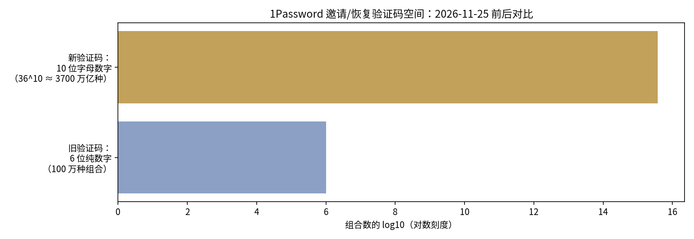

> [English version 英文版](/life/1password-backend-breach-vaults-safe/)

*图片：9to5Mac 的 1Password 应用资料图。1Password 于 2026 年 11 月 25 日在其官方博客发布披露。*

## 一段话说清这次披露

2026 年 **11 月 25 日**（周三），1Password 发布了一篇题为《Update on a security incident involving 1Password's backend systems》的博文。用公司自己的框架概括：攻击者进入了其部分后端系统，复制了**一部分**用户的有限账户信息，包括姓名和邮箱地址。密码库——用户存放密码、通行密钥、信用卡和笔记的加密容器——未被访问，保护它们的密钥也未被访问。公司表示用户**无需采取任何操作**，其应用与服务运行正常。

报道的速度和广度本身就说明这个品类聚集了多少信任：The Hacker News、MacRumors、Digital Trends、SecurityAffairs、Cointelegraph 都在一天之内跟进。密码管理器被攻破从来不只是一次数据泄露事件；它是对整个品类赖以销售的那个核心主张的压力测试——把你所有的秘密集中放在一处，是否比分散存放更安全。11 月 25 日，这个主张在公开场合被检验了一次，而这次检验值得冷静地做，而不是情绪化地做。

## 攻击者是怎么进来的：一个 GitHub 账号

入口不是密码库，不是客户端应用，也不是密码学。是一扇"人形"的门：一名员工的**企业 GitHub 账号**。

1Password 表示，它在 **2026 年 11 月 19 日**开始调查，此前发现有迹象表明攻击者取得了该账号的访问权。至于这个账号本身是如何被攻破的，公司没有说明——截至披露时这一细节未知或未公开，本文不做猜测。攻击者拿到访问权之后做了什么，公司说得很清楚：用该账号**访问源码**，并向 1Password 的**后端服务植入恶意代码**；这段恶意代码随后**下载了客户的管理类数据**，也就是下文逐项列出的账户记录。

请慢慢读这条链，因为它是当代入侵模式的微缩版。攻击者没有破解加密，没有利用客户端漏洞，也不需要。一个权限足够大的开发者平台账号，变成了一条通往生产相邻系统的路：先读代码，再写代码，然后让公司自己的后端替他把数据搬出去。失守的那道防线，是围绕单个员工账号的身份与代码审查控制——这正是近年一长串供应链事件背后的同一类失败，从被攻破的 CI 流水线到被投毒的构建系统。1Password 是这份名单上的最新名字，不是例外。

攻击者还**复制了私有仓库的源码**，并**取得了 1Password 的 CI/CD 系统的访问权**——那套持续集成与交付、负责构建和发布产品的机器。1Password 正确地指出，其源码不是客户数据，也不含用户秘密。它同样坦率地指出，CI/CD 系统"为了让产品运转，内含与基础设施相关的秘密"。这句话是整篇披露里分量最重的一句，我们后面还会回到它。

## 被拿走的东西，逐项列清

在这里精确非常重要，因为"客户数据被泄露"式的标题会把后果天差地别的类别压成一团。根据 1Password 的披露，攻击者下载了**一部分**用户的账户记录——公司未公布人数，你在别处看到的任何数字都不是 1Password 给的。这些记录包括：

- 登录 1Password 所用的**姓名与邮箱地址**；
- **账户与用户标识符**，以及**账户创建与最近登录时间**；
- **公钥**——1Password 指出公钥在设计上就是公开的，单独看没有安全影响；
- **安全远程密码（SRP）协议参数**——身份验证握手数据的一部分，1Password 明确表示这些参数无法用于登录账户；
- 部分用户收到的邀请、开通与账户恢复**邮件链接中内嵌的令牌**；
- 其他与内部架构有关的**非秘密账户元数据**，如版本号与文件编号类标识。

此外如上文所述：**私有源码**，以及 **CI/CD 系统的访问权**连同其中的基础设施秘密。

清单里有两项值得展开。第一项是令牌，因为"账户恢复令牌被拿走"最容易被误读成"账户可以被接管"。1Password 的解释很具体：邀请或恢复链接中的令牌**单独不能取得账户访问权**，使用它仍需单点登录（SSO）认证，或发送到账户邮箱的验证码。公司表示**没有证据**表明任何被暴露的令牌被成功用于接管账户。作为预防措施，它把这类邮件验证码从**6 位纯数字扩大到 10 位字母数字字符**——这个变化的规模值得画出来，因为那正是"原则上可以暴力破解"与"实际上不可能"之间的差别。

*作者自制图。6 位数字共 1,000,000 种组合；10 位、每位 36 种符号共约 3.7 千万亿种——空间大约扩大到原来的 37 亿倍。数字按 1Password 2026 年 11 月 25 日披露计算。*

第二项是元数据本身。姓名、邮箱、登录时间和账户标识符在密码学意义上不是秘密，把它们等同于密码是错误的。但它们恰恰是高可信钓鱼的原材料：一封用你的真名打招呼、引用你真实 1Password 账户、在事件公开后你正预期收到安全邮件的那几天抵达、要求你去"验证"点什么的邮件，远比普通垃圾邮件危险。1Password 自己也是这么说的——它给用户的指引把钓鱼警示放在最前面，并重复了那条最重要的规则：**1Password 永远不会联系你索要你的账户密码或 Secret Key（秘密密钥）。** 如果你只从这篇文章带走一句操作建议，就带走这一句。

## 没被拿走的东西——以及那为什么是架构，不是运气

攻击者**没有**拿到的东西清单，正是这个产品的立身之本，在近似宣誓的条件下被陈述了一遍：

- **密码库及其中一切**——密码、通行密钥、卡片、笔记；
- **保护密码库的密钥**。1Password 不存储你的账户密码和 Secret Key；由它们派生出的加密密钥存在你的设备上，不在它的服务器上；
- **账户恢复密钥**；
- **应用与浏览器扩展本身**——未报告有恶意客户端更新，公司称产品安全与可用性未受影响。

这就是零知识设计在做它被卖给你的那件正事。在这套架构里，密码管理器的服务器只是一个装满密文和账户账本的仓库。攻破仓库，你拿到的是账本——谁有账户、何时登录过、其认证握手如何参数化——拿不到任何能解密的东西。业界心里一直放着的对照组是 2022 年的 LastPass 事件：那次连密码库备份本身都被拖走，客户面对的是长尾的离线破解风险。按 1Password 已披露的事实，这次事件在类别上完全不同：密文根本没有离开大楼。读者应当同时握住这句话的两半——差别是真实的，而它建立在公司对自身事件的陈述之上；1Password 表示已请外部网络安全专家验证其遏制与修复工作。

还有一个更安静的点：披露质量本身。这篇博文点名了入口向量，给出了调查启动日期（11 月 19 日，披露前六天），逐项列举数据类别而不是躲在"某些信息"后面，把"未受影响"的项目列成清单，并描述了具体的修复动作。公司并没有义务这么快、这么具体，许多公司也确实不会。无论你对"攻击者为何能进来"作何评判，这份披露本身已经接近业界声称想要的标准。

## 修复动作，以及那扇还没完全合上的门

1Password 列出的响应包括：涉事 GitHub 账号已被**禁用**，被盗令牌已被**吊销**，攻击者建立的访问已被**移除**；所有可能暴露的内部凭据已被**轮换或吊销**；受影响服务已恢复为干净版本；GitHub、CI/CD 与终端控制已被**收紧**，并新增了针对这类攻击模式的检测；上文的验证码加长已生效；公司还验证称，**没有内部证据**显示有人利用被暴露的开通令牌接管账户。

其中大部分是原则上可核查的卫生动作。真正难的部分是 CI/CD 访问权，它值得一段怀疑主义的审视。源码加一段构建发布流水线内部的窗口期，正是供应链攻击的原材料：噩梦场景不是攻击者在 11 月下载了什么，而是他有没有**留下**什么——一个被改动的构建步骤、一个潜伏的凭据、一处日后会随可信更新一起发出的细微改动。1Password 针对这个场景陈述的防线是：轮换凭据、恢复干净服务、收紧控制、外部验证。这些都是正确的动作，同时从外部看也都是**断言**。证明将是阴性的、缓慢的：数月干净的发版，以及最好有一篇后续博文说明独立审查发现了什么。在那之前，准确的表述只能是窄的——没有报告显示有被投毒的版本发布，无论来自 1Password 还是任何其他人——而用户在决定给"没有证据"赋多大权重时应当注意到，这家公司值得肯定的一点是，它大体上把自己限制在了这种窄表述之内。

还有一个悬而未决的问题：**那名员工的 GitHub 账号最初到底是怎么被攻破的。** 钓鱼、令牌窃取、会话劫持、终端恶意软件，指向的结论完全不同——关于同一扇门能否被再次打开，无论是在 1Password，还是在读者自己的雇主那里。披露没有说，后续值得盯的就是能回答这一点的更新。

## 用户实际上该做什么

1Password 的官方口径是**无需采取任何操作**，在密码库这个问题上这与架构自洽：没有需要轮换的密码，因为公司从未持有它，你的 Secret Key 也从未在它的服务器上。出于谨慎改一下 1Password 账户密码无害，但按已披露的事实并非必要。

真正的行动清单关乎收件箱，而不是密码库：

1. **未来几周，把每一封"1Password"邮件先当作敌意邮件，直到证明清白。** 攻击者握有部分用户的真实姓名和真实邮箱。邀请与恢复邮件正是最值得仿冒的格式。
2. **永远不要从邮件链接里输入你的账户密码或 Secret Key。** 自己打开应用，或自己输入网址。1Password 不会通过邮件、电话或短信索要这两样东西。
3. **把可疑邮件转发到 support@1password.com**，这是公司提出的要求——用户举报是这类事件后真实的检测通道。
4. **留意官方通知。** 1Password 表示正在通知受影响客户；少数有未完成开通或恢复邀请的用户已被单独联系。如果你收到通知，令牌加固已经保护了链接格式，但请删除并重新发出你所管理的任何未完成邀请，尤其是你担任管理员的家庭或团队账户。
5. **如果你管理团队或企业账户**，检查成员列表与待处理邀请。被拿走的是管理类数据；最容易被一封可信的社会工程邮件打中的，正是那些能添加成员的管理员账户。

## 我们的判断

有两件事可以同时为真，而在这次事件里两件都为真。第一件：1Password 的核心架构通过了它被设计来通过的测试——一次包含源码与 CI/CD 访问的后端入侵，产出的是**零密码库暴露**；这个结果在多年前"永不持有客户密钥"的决定做出时就已经被决定了，而不是靠事件当周任何人的临场发挥。如果你正是冲着这个场景选择了零知识密码管理器，11 月 25 日是你的推理成立的证据。

第二件：这次入侵走的是现代软件最古老的那扇门——代码所在平台上一个员工的账号，被变成了后端里的代码执行。零知识密码学保护密码库不受服务器拖累；但能保护服务器不受开发流水线拖累的，只有身份控制、审查纪律与检测能力——而失守的正是这些，在一家以安全为全部品牌的公司。品类的承诺守住了，公司的运营没有守住，这两句话之间的距离，就是下一次事件正在被准备的地方，无论是在 1Password 还是在别处。

接下来盯三件事：1Password 是否会公布那个 GitHub 账号的攻破方式；独立验证是否会产出公开的后续说明；以及未来几周是否会出现利用被盗姓名与邮箱的钓鱼浪潮。前两件衡量这家公司的认真程度，第三件是唯一还能抵达你收件箱的东西。

*来源：1Password 官方博客《Update on a security incident involving 1Password's backend systems》，2026 年 11 月 25 日（入口向量、数据类别、未受影响项、修复动作、验证码加长、用户指引）；The Hacker News，2026 年 11 月 26 日；MacRumors，2026 年 11 月 25 日；Digital Trends，2026 年 11 月 25–26 日；SecurityAffairs，2026 年 11 月 26 日。1Password 未公布受影响子集的用户数量，也未公布涉事员工 GitHub 账号最初的被攻破方式；本文均已标注为未披露。*
