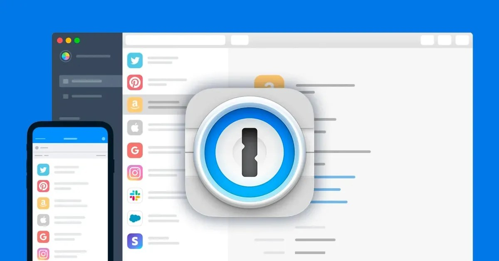
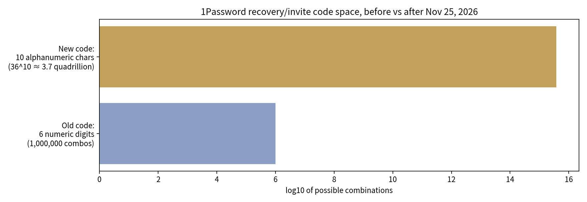

> [中文版 Chinese version](/life/1password-backend-breach-vaults-safe-zh/)

*Image: 9to5Mac file photo of the 1Password app. 1Password published its disclosure on its official blog on November 25, 2026.*

## The disclosure, in one paragraph

On Wednesday, **November 25, 2026**, 1Password published a post titled "Update on a security incident involving 1Password's backend systems." The short version, in the company's own framing: an attacker gained access to some of its backend systems and copied a limited amount of customer account information from a subset of customers, including names and email addresses. Customer vaults — the encrypted containers where users store passwords, passkeys, credit cards and notes — were not accessed, and neither were the keys that protect them. The company says no action is required from customers, and that its apps and services are operating normally.

The coverage was immediate and broad, which is itself a measure of how much trust the category concentrates. The Hacker News, MacRumors, Digital Trends, SecurityAffairs and Cointelegraph all carried the story within a day. A breach at a password manager is never just a breach; it is a stress test of the single claim on which the entire product category is sold — that concentrating all of your secrets in one place is safer than scattering them. November 25 was the day that claim got examined in public, again, and the examination is worth doing carefully rather than emotionally.

## How the attacker got in: one GitHub account

The entry point was not the vault, the apps, or the cryptography. It was a person-shaped door: an employee's corporate **GitHub** account.

1Password says it began investigating on **November 19, 2026**, after detecting indications that an attacker had gained access to that account. The company has not said how the account itself was compromised — that detail is, as of the disclosure, unknown or undisclosed, and this post will not speculate. What the attacker did with the access is described plainly. They used the account to **access source code** and to **push malicious code into 1Password's backend services**. That malicious code then **downloaded administrative data** about customers — the account records described below.

Read that chain slowly, because it is the modern breach pattern in miniature. The attacker did not break encryption, did not exploit the client apps, and did not need to. A developer-platform account with sufficient reach became a path to production-adjacent systems: read the code, then write code, then let the company's own backend do the exfiltration. The perimeter that failed was identity and code-review control around a single employee account — the same class of failure behind a long line of supply-chain incidents across the industry, from compromised CI pipelines to poisoned build systems. 1Password is the latest name on that list, not an exception to it.

The attacker also **copied source code from private repositories** and **gained access to 1Password's CI/CD system** — the continuous-integration and delivery machinery that builds and ships the product. 1Password notes, correctly, that its source code is not customer data and contains no user secrets. It also notes, with equal candour, that a CI/CD system "contains infrastructure related secrets in order for our product to work." That sentence is the most consequential one in the disclosure, and we will return to it.

## What was taken, item by item

Precision matters here, because "customer data was breached" headlines flatten categories that have wildly different consequences. According to 1Password's disclosure, the attacker downloaded account records for a **subset** of users — the company has not published a count, and any number you see elsewhere is not from 1Password. The records include:

- **Names and email addresses** used to sign in to 1Password.
- **Account and user identifiers**, plus **account creation and last sign-in times**.
- **Public keys** — which 1Password notes are public by design and have no security impact on their own.
- **Secure Remote Password (SRP) protocol parameters** — part of the authentication handshake data. 1Password states these cannot be used to sign in to an account.
- **Tokens embedded in emailed links** for invitations, provisioning and account recovery, for some users.
- **Other non-secret account metadata** related to internal architecture, such as version and file numeric identifiers.

And separately, as above: **private source code**, and **access to the CI/CD system** with its infrastructure secrets.

Two items on that list deserve unpacking. The first is the token category, because "account recovery tokens were taken" is the phrase most likely to be misread as "accounts can be taken over." 1Password's explanation is specific: a token from an invitation or recovery link **cannot by itself gain access to an account**. Using one still requires either single sign-on authentication or a verification code sent to the account's email address. The company says it found **no evidence** that any exposed token was successfully used to take over an account. As a precaution, it has **expanded those email codes from six numeric digits to ten alphanumeric characters** — a change whose size is worth visualising, because it is the difference between a code space an attacker can brute-force in principle and one they cannot in practice.

*Author's chart. Six digits give 1,000,000 combinations; ten characters drawn from 36 symbols give roughly 3.7 quadrillion — a space about 3.7 billion times larger. Figures computed from 1Password's November 25, 2026 disclosure.*

The second item is the metadata itself. Names, emails, sign-in times and account identifiers are not secrets in the cryptographic sense, and treating them as equivalent to passwords would be wrong. But they are exactly the raw material of convincing phishing: a message that addresses you by name, references your real 1Password account, arrives days after a publicised breach when you are primed to expect security mail, and asks you to "verify" something is far more dangerous than generic spam. 1Password says so itself — its guidance to customers leads with phishing caution, and repeats the rule that matters most: **1Password will never contact you to ask for your account password or Secret Key.** If you take one operational sentence from this post, take that one.

## What was not taken — and why that is architecture, not luck

The list of what the attacker did **not** get is the product's founding argument, stated under oath-like conditions:

- **Vaults and everything in them** — passwords, passkeys, cards, notes.
- **The keys that protect the vaults.** 1Password does not store your account password or your Secret Key; the encryption keys derived from them exist on your devices, not on its servers.
- **Account recovery keys.**
- **The apps and browser extensions** themselves — no malicious client update is reported, and the company says product security and availability were not impacted.

This is the zero-knowledge design doing precisely the job it was sold to do. A password manager's server, in this architecture, is a warehouse of ciphertext and account bookkeeping. Breaching the warehouse yields the bookkeeping — who has an account, when they last signed in, how their authentication handshake is parameterised — and yields nothing that decrypts. The contrast the industry keeps in mind is the 2022 LastPass incident, where vault backups themselves were exfiltrated and customers faced a long tail of cracking risk against weakly protected vaults. On the facts 1Password has disclosed, this incident is categorically different: the ciphertext never left the building. Readers should hold both halves of that sentence — the difference is real, and it rests on the company's account of its own incident, which independent experts are now validating; 1Password says it has brought in outside cybersecurity specialists to check its containment and remediation.

There is also a quieter point about disclosure quality. The post names the entry vector, dates the investigation's start (November 19 — six days before disclosure), enumerates the data categories instead of hiding behind "some information," states what was not affected as a checklist, and describes concrete remediation. Companies are not obliged to be this specific this fast, and many are not. Whatever judgement one reaches about the failure that let an attacker in, the disclosure itself is close to the standard the industry claims to want.

## The remediation, and the one open door

1Password lists its response: the affected GitHub account was **disabled**, the stolen token **revoked**, and the access the attacker created **removed**. All internal credentials that may have been exposed were **rotated or revoked**. Clean versions of affected services were restored. GitHub, CI/CD and endpoint controls were **tightened**, with new detections added for this attack pattern. The email-code lengthening described above was applied. And the company states it validated that there is **no internal evidence of account takeovers** using exposed provisioning tokens.

Most of that is verifiable-in-principle hygiene. The genuinely hard part is the CI/CD access, and it deserves a sceptical paragraph. Source code plus a window inside the build-and-deploy pipeline is the raw material of a supply-chain attack: the nightmare scenario is not what the attacker downloaded in November, but whether they left anything behind — a modified build step, a lingering credential, a subtle change that ships later inside a trusted update. 1Password's stated defences against that scenario are credential rotation, restored clean services, tightened controls and outside validation. Those are the right moves, and they are also, from outside, assertions. The proof will be negative and slow: months of clean releases, and ideally a follow-up post describing what the independent review found. Until then, the accurate statement is narrow — no evidence of a poisoned release has been reported, by 1Password or anyone else — and users deciding how much weight to put on "no evidence" should notice that the company, to its credit, has mostly confined itself to exactly that kind of narrow statement.

One more unknown belongs in the open: **how the employee's GitHub account was compromised in the first place.** Phishing, token theft, session hijacking and endpoint malware imply very different things about whether the same door can be opened again, at 1Password or at the reader's own employer. The disclosure does not say, and the follow-ups worth watching are the ones that answer it.

## What users should actually do

1Password's official line is that **no action is required**, and on the vault question that is consistent with the architecture: there is no password to rotate because the company never had it, and your Secret Key was never on its servers. Changing your 1Password account password out of caution is harmless but, on the disclosed facts, not necessary.

The real action list is about the inbox, not the vault:

1. **Treat every "1Password" email in the coming weeks as hostile until proven otherwise.** The attacker holds real names and real email addresses for a subset of users. Invitations and recovery messages are the exact formats worth imitating.
2. **Never enter your account password or Secret Key from an email link.** Open the app yourself, or type the address yourself. 1Password will never ask for either by email, phone or text.
3. **Forward suspicious messages to support@1password.com**, as the company requests — user reports are a real detection channel after breaches like this.
4. **Check for the notification.** 1Password says it is notifying affected customers; a small number of users with outstanding provisioning or recovery invitations were specifically contacted. If you are notified, the token-hardening change already protects the link format, but delete and re-issue any outstanding invitations you control, especially for family or team accounts you administer.
5. **If you administer a team or business account**, review member lists and pending invitations. The data taken is administrative; the accounts most exposed to a convincing social-engineering attempt are the ones with administrators who can add members.

## Our judgment

Two things can be true at once, and in this incident both are. The first is that 1Password's core architecture passed the test it was designed for: a backend breach, including source code and CI/CD access, produced **zero vault exposure**, and that outcome was determined years ago by the decision to never hold customer keys — not by anything anyone did during the incident week. If you chose a zero-knowledge password manager for exactly this scenario, November 25 is evidence your reasoning was sound.

The second is that the breach happened through the oldest door in modern software: one employee's account on the platform where the code lives, turned into code execution in the backend. Zero-knowledge cryptography protects the vault from the server. Nothing protects the server from the development pipeline except identity controls, review discipline and detection — and those are the controls that failed, at a company whose entire brand is security. The category's promise held. The company's operations did not, and the distance between those two sentences is where the next incident is already being prepared, at 1Password or somewhere else.

Watch three things from here: whether 1Password publishes the GitHub account's compromise vector; whether the independent validation produces a public follow-up; and whether any phishing wave using the stolen names and emails is reported in the coming weeks. The first two measure the company's seriousness. The third is the one that can still reach your inbox.

*Sources: 1Password official blog, "Update on a security incident involving 1Password's backend systems," November 25, 2026 (entry vector, data categories, unaffected items, remediation, code-length change, customer guidance); The Hacker News, November 26, 2026; MacRumors, November 25, 2026; Digital Trends, November 25–26, 2026; SecurityAffairs, November 26, 2026. 1Password has not published how many users are in the affected subset, or how the employee's GitHub account was initially compromised; both are noted as undisclosed in this post.*
