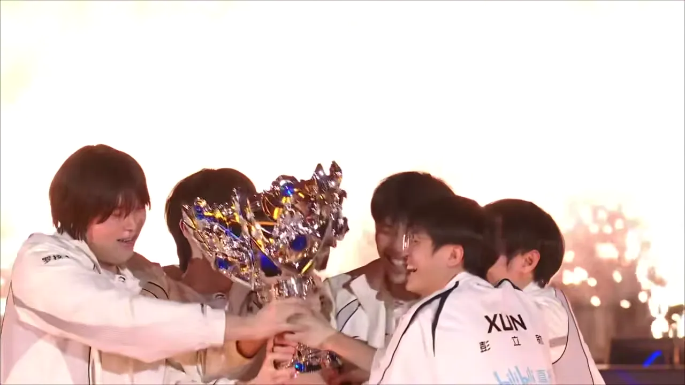
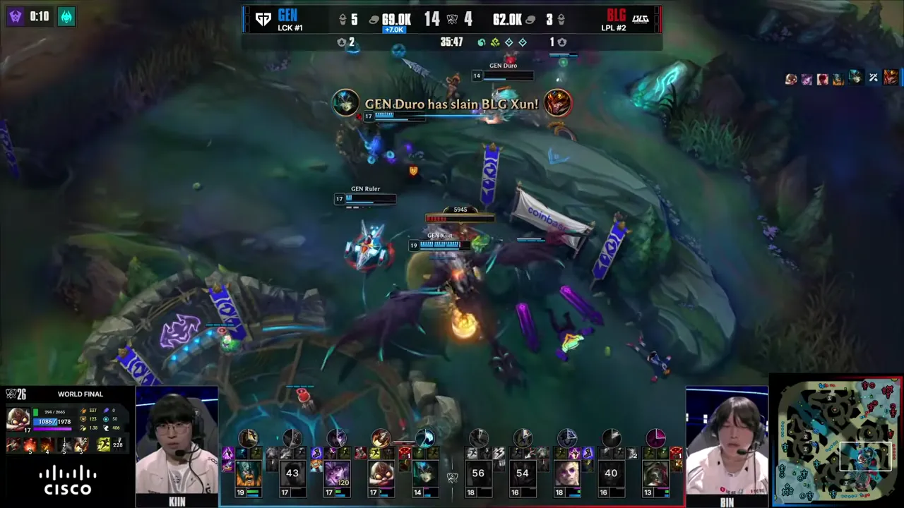
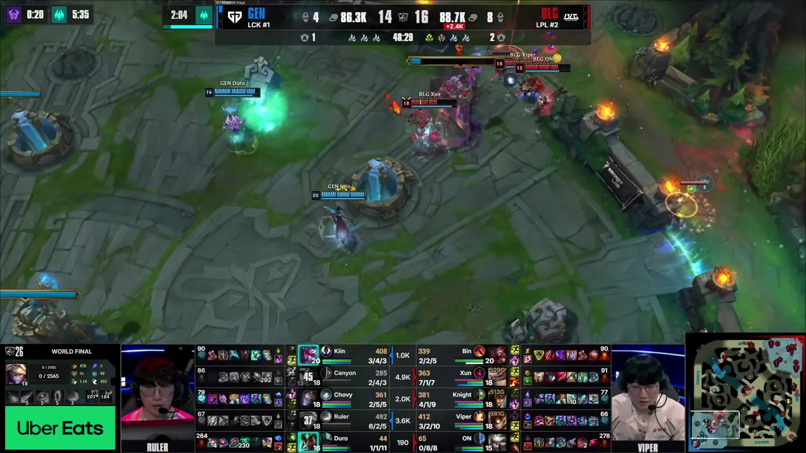
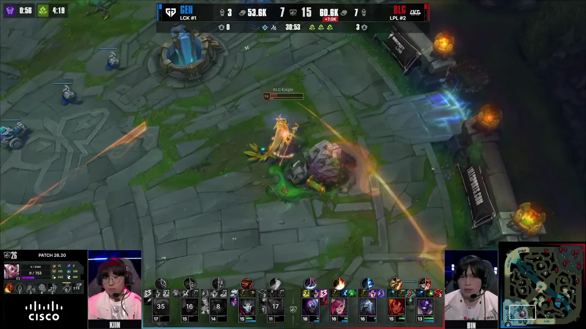
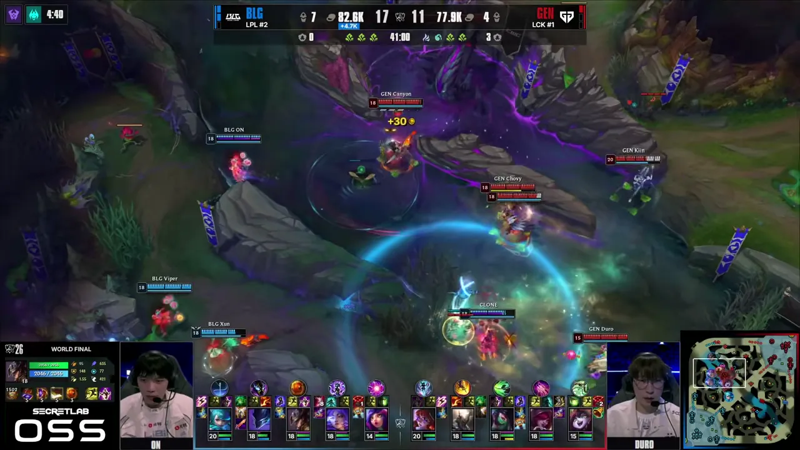
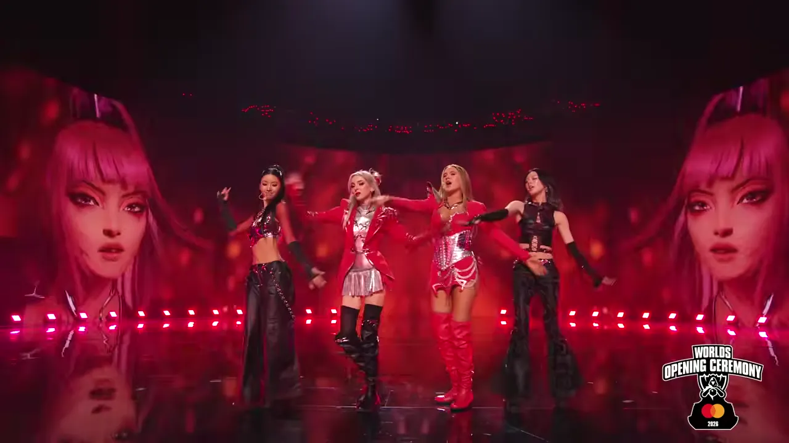
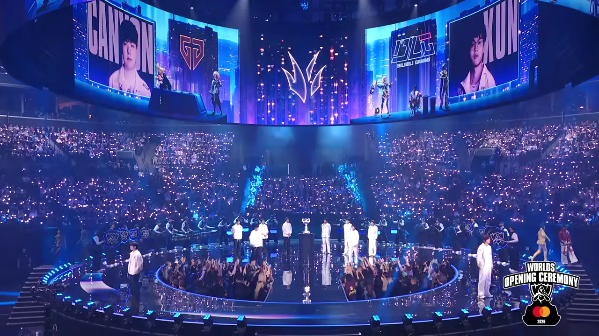

> [English version](/life/blg-worlds-2026-champions/)

Bilibili Gaming 是世界冠军。2026 年 11 月 14 日星期六，BLG 在纽约布鲁克林巴克莱中心举行的英雄联盟全球总决赛中 3-1 击败 Gen.G，夺得队史首个世界赛冠军——也是 LPL 自 2021 年 EDward Gaming 夺冠以来的首个世界赛冠军。

这不是一场加冕礼，而是一轮四局的系列赛：开局 Gen.G 一边倒地拿下第一局，接着是一场 53 分钟的消耗战，然后 BLG 找到节奏，再也没有交出来。而这条夺冠之路，是 LPL 历史上从未有过的：BLG 连续击败了本届赛事中的全部四支韩国队伍。

*BLG 在布鲁克林捧起召唤师奖杯——队史首个世界赛冠军，LPL 自 2021 年以来的首冠。截图来自官方 LoL Esports 决赛转播（YouTube @lolesports）。*

## 决赛逐局复盘

**第一局：Gen.G 19-4，38 分 59 秒。** 系列赛的开局，朝着很多人最担心的方向发展。LCK 一号种子 Gen.G 从前期就掌控了比赛，38 分 59 秒结束战斗，人头 19 比 4。这是整个系列赛中最一边倒的一局，完全属于韩国队。对一支在本届赛事中已经在淘汰边缘走过一遭的 BLG 来说，这是最糟糕的开局——而事后看，这也是 Gen.G 最后一次在系列赛里显得游刃有余。

*第一局 32 分钟左右：Gen.G 人头 14 比 4 领先，正在拉开比分。截图来自官方 LoL Esports 决赛转播（YouTube @lolesports）。*

**第二局：BLG 19-14，53 分钟。** 本届赛事耗时最长的一局。53 分钟，双方谁都不肯把系列赛拱手相让，BLG 以 19 比 14 赢下，把大比分扳成 1 比 1。这种局不会体现在比分上，它体现在下一局里——体现在哪支队伍还相信自己的指挥。BLG 走出这场马拉松的时候，看起来像是一支相信自己能赢下系列赛的队伍。

*第二局 48 分钟：BLG 打进 Gen.G 高地，人头 16 比 14 领先，这是本届赛事耗时最长的一局。截图来自官方 LoL Esports 决赛转播（YouTube @lolesports）。*

**第三局：BLG 20-8。** 势头彻底倒向了 BLG。BLG 20 比 8 拿下第三局，决定性时刻属于上单 Bin 的武器大师：他在收官团战中的眩晕控住了 Gen.G，终结了比赛。一度由 Gen.G 完全掌控的系列赛，现在变成了 BLG 2 比 1 领先，LCK 冠军再输一局就要回家了。

*第三局收官阶段：BLG 推进 Gen.G 高地，人头 15 比 7，Bin 的武器大师带队终结比赛。截图来自官方 LoL Esports 决赛转播（YouTube @lolesports）。*

**第四局：BLG 21-11，43 分 03 秒。** 收官之战，也是决赛最著名的镜头。比赛进行到 41 分钟左右、胜负未分之时，BLG 打野 Xun 用梦魇抢下了大龙——这种操作能决定冠军归属，是从 Gen.G 手里硬生生抢来的。BLG 带着大龙 buff 推进，43 分 03 秒结束比赛，人头 21 比 11。BP 方面，Gen.G 的 Kiin 选了极光，Bin 则用格温回应。系列赛使用的是 26.20 版本。

*第四局 41 分钟：Xun 的梦魇在大龙坑——这记抢龙打碎了决赛的平衡。截图来自官方 LoL Esports 决赛转播（YouTube @lolesports）。*

## Knight，FMVP

FMVP 属于 BLG 中单 knight（卓定），数据本身就能说明问题：系列赛 KDA 9.0，13 杀 6 死 41 助攻，参团率 84.4%——BLG 全队 64 个人头里，他参与了 54 个。

第四局是他的代表作。卡牌大师 2/1/17，BLG 21 个人头里他参与了 19 个，参团率 90.5%，在 Gen.G 追赶比赛的过程中牢牢掌控着地图。

数据之外的历史意义更重。Knight 是首位夺得世界冠军的中国大陆中单。他的冠军终结了韩国中单连续 13 届夺冠的纪录，这波连胜从 2013 年开始。而对他个人而言，这是救赎：两年前，他随 BLG 在 2024 年决赛中 2 比 3 输给 T1。这一次，第五局根本没有打的必要。

## 夺冠之路：一穿四

这条夺冠之路与众不同之处在于对手。BLG 击败了本届赛事中的每一支韩国队伍——一穿四：

- **瑞士轮：** 击败 Hanwha Life Esports（HLE）。
- **四分之一决赛：** 3 比 0 横扫 Dplus KIA（DK）。
- **半决赛：** 3 比 1 击败 T1——LPL 队伍首次在世界赛 BO5 中击败 T1，终结了 T1 对阵 LPL 队伍的世界赛 BO5 十三连胜。
- **决赛：** 3 比 1 击败 Gen.G。

Gen.G 打进决赛之前，在淘汰赛阶段一局未丢，3 比 0 横扫 LYON 和 Invictus Gaming。他们的阵容——Kiin、Canyon、Chovy、Ruler、Duro——看起来是本届赛事最完整的队伍。BLG 还是赢了，而且是在已经击败另外三支韩国队伍之后赢的。

BLG 自己的五人——上单 Bin、打野 Xun、中单 knight、下路 Viper、辅助 On，主教练 Daeny——今年早些时候已经拿过一个冠军：BLG 赢得了 2026 年 First Stand 锦标赛，在圣保罗的决赛中 3 比 1 击败 G2。但 First Stand 是新赛事，世界赛才是定义传奇的舞台，而这套阵容之前在这里栽过跟头。

对 Viper（朴到贤）来说，这是他的第二个世界赛冠军——第一个是 2021 年随 EDward Gaming 拿到的，也就是 LPL 上一次夺冠。五年时间，两支不同的队伍，两次登顶。

## 这一路并不平坦

这一切在第一周看起来都不可能。BLG 瑞士轮首日输给 MKOI，接着又输给 Top Esports（TES），战绩来到 2 胜 2 负，再输一场就回家。LPL 整个赛区在瑞士轮首日 0 胜 4 负。那个统治了 2020 年代初的赛区，看起来已经完了——然后 BLG 活了下来，然后 BLG 开始赢所有人。

这就是这个故事的形状：一支第一周差点回家的队伍，一个两年前输掉决赛的中单，一个五年无冠的赛区——而回答这三个问题的夺冠之路，要穿过对阵表里的每一支韩国队伍。

## 对 LPL 意味着什么

五年在英雄联盟里是很长的时间。自 EDG 2021 年夺冠以来，LCK 赢下了每一届世界赛，围绕 LPL 的讨论也从“能不能赢”变成了“这种打法在最高水平还行不行”。BLG 的冠军不会凭一届比赛就终结这场争论——一届比赛就是一届比赛——但它终结了冠军荒，而且是用最难的方式终结的：不是绕开韩国队伍，而是把四支全赢了。

对 LPL 来说，更持久的问题是接下来会发生什么。Knight 的冠军打破了中单位置上 13 年的格局。Viper 的第二个冠军——五年之后、换了一支队伍——让他成为极少数在两支不同队伍都夺过冠的选手。而 BLG，一家从未赢过世界赛的俱乐部，现在拥有了 2026 赛季最具代表性的夺冠征程。

## 奖金

据报道，S16 世界赛的基础奖金池为 500 万美元。冠军 BLG 拿到据报道的 100 万美元（20%），亚军 Gen.G 拿到据报道的 80 万美元（16%）。这些是赛事奖金分配的报道数字，并非 Riot 官方公布的最终发放金额。

## 比赛之外的舞台

决赛在第一个小兵出生之前就已经是一场盛典。开幕式上 K/DA 回归——虚拟流行组合表演了《POP/STARS》，并首演新单曲《FIRESTARTER》；True Damage 表演了 S16 主题曲《Know My Name》。这就是世界赛决赛如今的样子：先是一场演唱会，然后才是一场 BO5。

*K/DA 在 S16 开幕式舞台上表演——《POP/STARS》与新单曲《FIRESTARTER》首演。截图来自官方 LoL Esports 决赛转播（YouTube @lolesports）。*

*第一局开始前，两支队伍入场，召唤师奖杯在舞台中央等着他们。截图来自官方 LoL Esports 决赛转播（YouTube @lolesports）。*

## 回看录像

完整决赛在 LoL Esports 官方 YouTube 频道（@lolesports）上可以回看，包括逐局的 VOD。如果只看一局，就看第四局——41 分钟的抢龙，以及 knight 那场会被重播很多年的卡牌大师。如果有一整个晚上，把四局都看了：这轮系列赛讲了一个完整的故事，从第一局 Gen.G 的全面掌控，到 BLG 把系列赛、把冠军，从他们手里拿走的那一刻。

*本文截图均为官方 LoL Esports 决赛转播画面（YouTube @lolesports）。*
