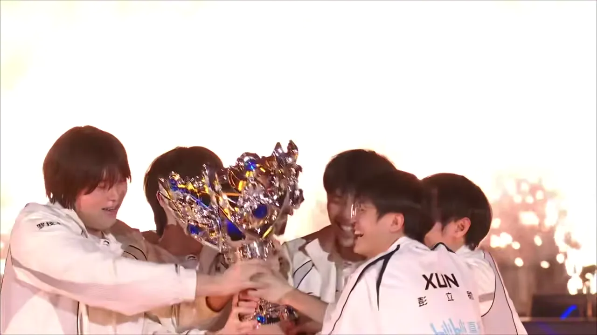
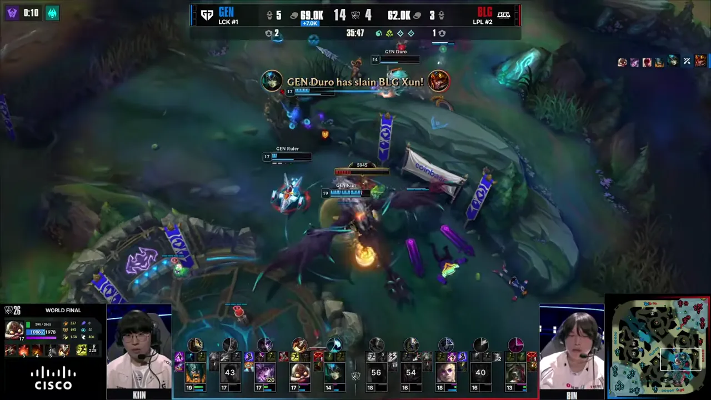
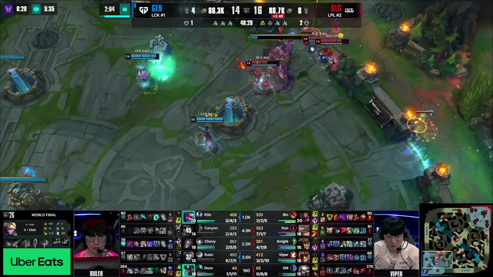
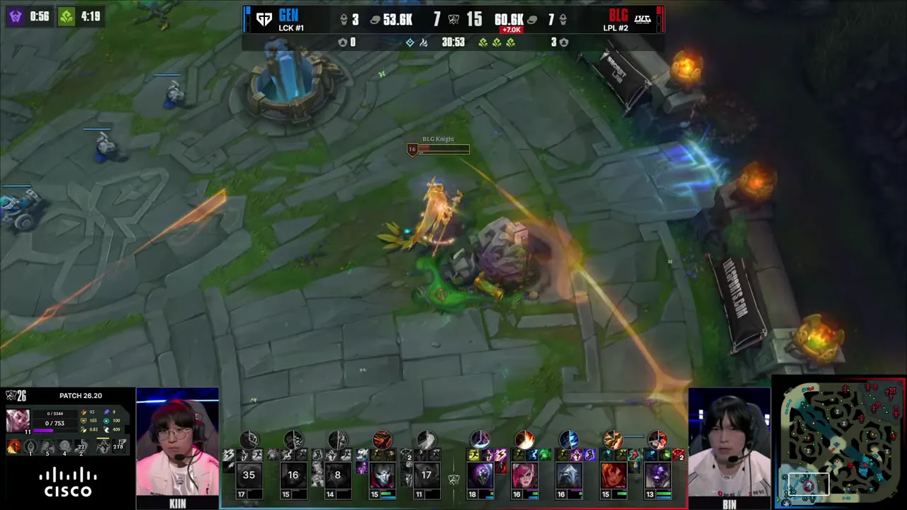
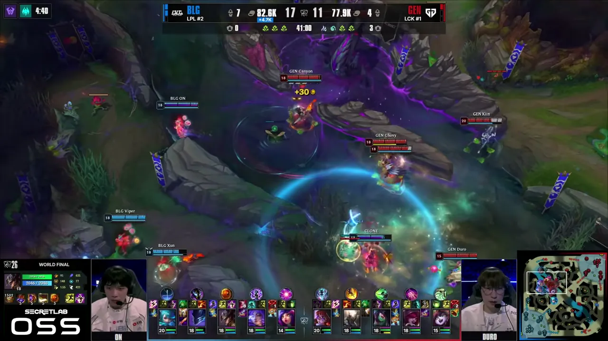
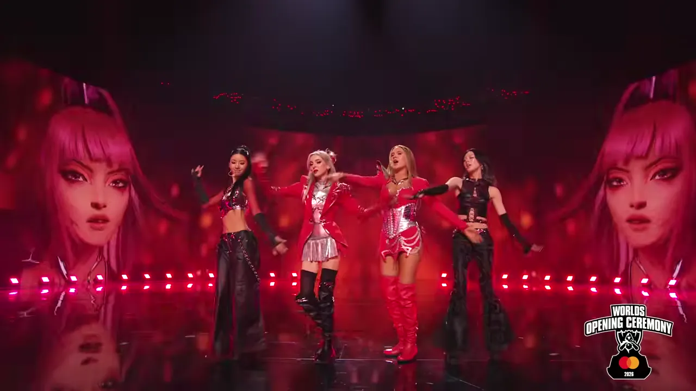
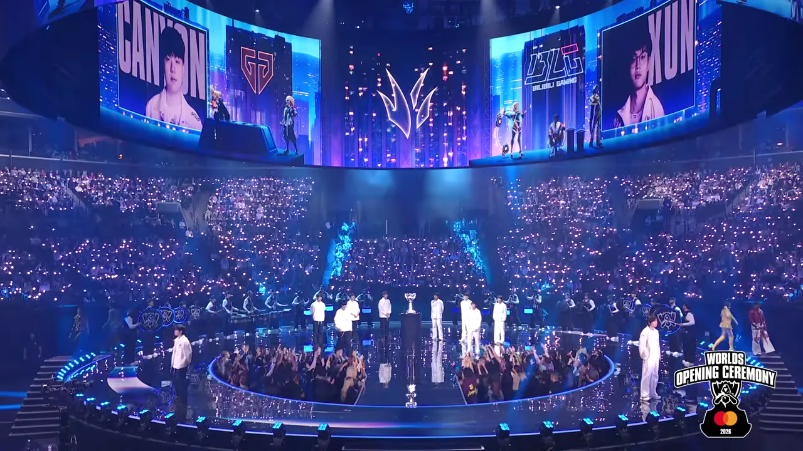

> [中文版 Chinese version](/life/blg-worlds-2026-champions-zh/)

Bilibili Gaming are world champions. On Saturday, November 14, 2026, BLG beat Gen.G 3-1 in the League of Legends World Championship final at Barclays Center in Brooklyn, New York, to win the organization's first Worlds title — and the LPL's first since EDward Gaming lifted the Summoner's Cup in 2021.

It was not a coronation. It was a four-game series that swung from a one-sided Gen.G opener to a 53-minute war of attrition, then to a BLG team that found its footing and never gave it back. And it was the end of a tournament run that no LPL team had ever put together: BLG beat all four Korean teams in the field, one after another, to take the title.

*BLG lift the Summoner's Cup in Brooklyn — the organization's first Worlds title, and the LPL's first since 2021. Screenshot from the official LoL Esports broadcast (YouTube @lolesports).*

## The final, game by game

**Game 1: Gen.G 19-4, 38:59.** The series opened the way a lot of people feared it would for BLG. Gen.G, the LCK's first seed, controlled the game from early on and closed it out in just under 39 minutes with a 19-4 kill lead. It was the cleanest game of the series, and it belonged entirely to the Korean side. For a BLG team that had already survived the edge of elimination once in this tournament, it was the worst possible start — and, as it turned out, the last time Gen.G looked comfortable.

*Game 1, around 32 minutes: Gen.G lead 14-4 on kills and are running away with the opener. Screenshot from the official LoL Esports broadcast (YouTube @lolesports).*

**Game 2: BLG 19-14, 53 minutes.** The longest game of the entire tournament. Fifty-three minutes of neither team willing to give the series away, and BLG won it 19-14 to level the score at 1-1. Games like this one do not show up in a scoreline; they show up in the next game, in which team still trusts its calls. BLG came out of the marathon looking like the team that believed it could win the series.

*Game 2, 48 minutes in: BLG are inside Gen.G's base, up 16-14 in the longest game of the tournament. Screenshot from the official LoL Esports broadcast (YouTube @lolesports).*

**Game 3: BLG 20-8.** The momentum flipped for good. BLG took the game 20-8, and the defining moment belonged to top laner Bin on Jax: his stuns in the closing fight locked Gen.G down and ended the game. A series that had started with Gen.G in total control was now 2-1 to BLG, and the LCK champions were one loss from going home.

*Game 3, closing minutes: BLG push into Gen.G's base, up 15-7, with Bin's Jax leading the end. Screenshot from the official LoL Esports broadcast (YouTube @lolesports).*

**Game 4: BLG 21-11, 43:03.** The closer, and the most famous play of the final. With the game still in the balance at around 41 minutes, BLG jungler Xun stole the Baron on Nocturne — the kind of play that decides a championship, taken right out of Gen.G's hands. BLG pushed with the buff and ended the game at 43:03, 21-11 on kills. In the draft, Gen.G's Kiin played Aurora while Bin answered on Gwen. The series was played on patch 26.20.

*Game 4, 41 minutes: Xun's Nocturne in the Baron pit — the steal that broke the final open. Screenshot from the official LoL Esports broadcast (YouTube @lolesports).*

## Knight, Finals MVP

The Finals MVP was BLG mid laner knight (Zhuo Ding), and the numbers make the case on their own: a 9.0 KDA across the series, 13 kills, 6 deaths and 41 assists, with 84.4% kill participation — he was involved in 54 of BLG's 64 kills.

His Game 4 was the signature performance. On Twisted Fate, knight went 2/1/17 — involved in 19 of BLG's 21 kills, 90.5% kill participation — dictating the map while Gen.G chased a game that kept slipping away from them.

The history around it matters as much as the stat line. Knight is the first mainland Chinese mid laner ever to win a World Championship. His title ends a streak of 13 consecutive Worlds titles won by South Korean mid laners, a run stretching back to 2013. And it is personal redemption: knight was in this exact spot two years ago, losing the 2024 final 3-2 to T1 with BLG. This time, the fifth game was never needed.

## The run: 一穿四

What makes this title different from a normal championship run is the path. BLG beat every Korean team in the tournament — 一穿四, one team sweeping through all four:

- **Swiss round:** beat Hanwha Life Esports (HLE).
- **Quarterfinals:** swept Dplus KIA (DK) 3-0.
- **Semifinals:** beat T1 3-1 — the first time an LPL team had ever beaten T1 in a best-of-five at Worlds, ending T1's 13 straight BO5 wins against LPL teams at the tournament.
- **Final:** beat Gen.G 3-1.

Gen.G arrived in the final without having dropped a single game in the knockout stage, sweeping both LYON and Invictus Gaming 3-0. Their roster — Kiin, Canyon, Chovy, Ruler and Duro — had looked like the most complete team in the tournament. BLG beat them anyway, and did it after already beating the other three Korean teams.

BLG's own five — Bin on top, Xun in the jungle, knight in mid, Viper on bot lane and On on support, coached by Daeny — had already won silverware this year: BLG won the 2026 First Stand tournament, beating G2 3-1 in the final in São Paulo. But First Stand was a new event. Worlds is the one that defines a legacy, and this roster had come up short there before.

For Viper (Park Do-hyeon), the title is his second Worlds championship — his first came with EDward Gaming in 2021, the last time the LPL won it all. He has now won the tournament with two different organizations, five years apart.

## The road was rough

None of this looked likely in the first week. BLG opened the Swiss round by losing to MKOI on day one, then lost to Top Esports (TES) and sat at 2-2, one loss from elimination. The LPL as a whole went 0-4 on day one of the Swiss stage. The region that had dominated the early 2020s looked finished — and then BLG survived, and then BLG started beating everyone.

That is the shape of the story. A team that nearly went home in week one, a mid laner who had lost a final two years earlier, and a region on a five-year title drought — and the run that answered all three at once went through every Korean team in the bracket.

## What it means for the LPL

Five years is a long time in League of Legends. Since EDG's win in 2021, the LCK had won every Worlds, and the conversation around the LPL had shifted from whether it could win to whether its style still worked at the highest level. BLG's title does not settle that argument on its own — one tournament is one tournament — but it ends the drought, and it ends it in the hardest way available: not by avoiding the Korean teams, but by beating all four of them.

For the LPL, the more durable question is what comes next. Knight's title breaks a 13-year pattern at mid lane. Viper's second title, five years after his first, makes him one of the few players to win Worlds with two different teams. And BLG, an organization that had never won Worlds, now owns the defining run of the 2026 season.

## The money

The reported prize pool for Worlds 2026 was $5,000,000 as a base figure. BLG took home a reported $1,000,000 (20%) for the title; Gen.G took a reported $800,000 (16%) as runners-up. Those are reported figures from the tournament's prize breakdown, not official Riot announcements of the final payouts.

## The show around the games

The final was a spectacle before the first minion spawned. The opening ceremony brought back K/DA — the virtual pop group performed "POP/STARS" and debuted a new single, "FIRESTARTER" — and True Damage performed "Know My Name," the Worlds 2026 theme. It was the kind of opening that the Worlds final has made its own: a concert first, a best-of-five second.

*K/DA on stage at the Worlds 2026 opening ceremony — "POP/STARS" and the debut of new single "FIRESTARTER." Screenshot from the official LoL Esports broadcast (YouTube @lolesports).*

*The two teams walk out before Game 1, with the Summoner's Cup waiting on the stage. Screenshot from the official LoL Esports broadcast (YouTube @lolesports).*

## How to watch it back

The full final is on the official LoL Esports YouTube channel (@lolesports), including the per-game VODs. If you only watch one game, make it Game 4 — the Baron steal at 41 minutes, and a Twisted Fate performance from knight that will be replayed for years. If you have an evening, watch all four: the series tells a complete story, from Gen.G's total control in Game 1 to the moment BLG took the series, and the title, away from them.

*Screenshots in this post are frames taken from the official LoL Esports broadcast of the final (YouTube @lolesports).*
