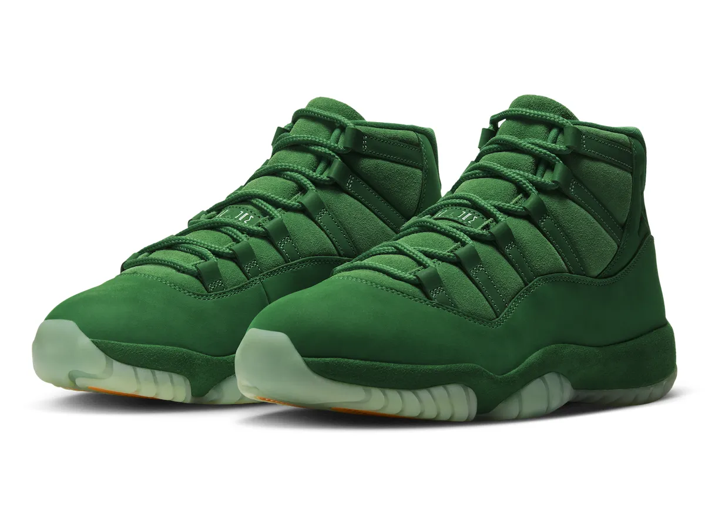
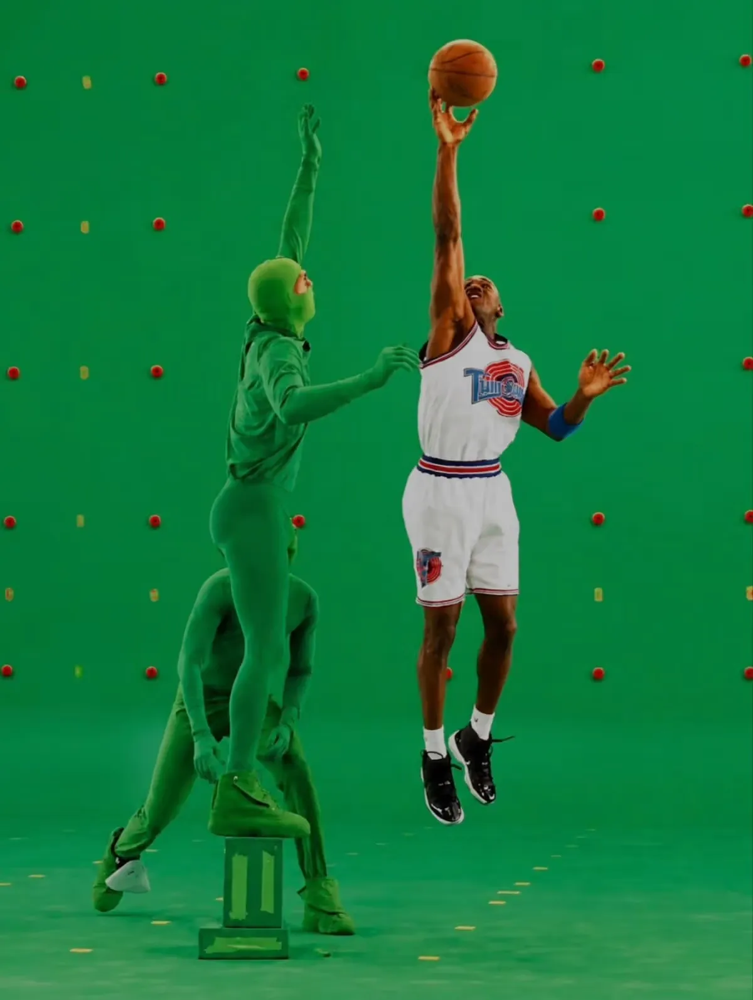
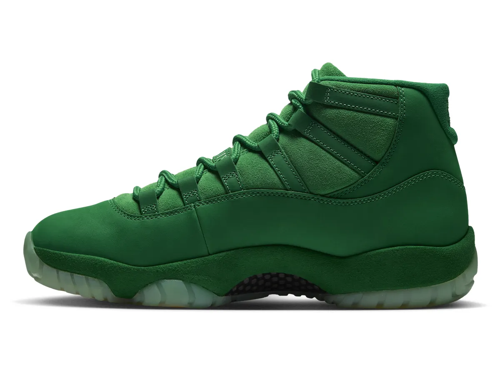
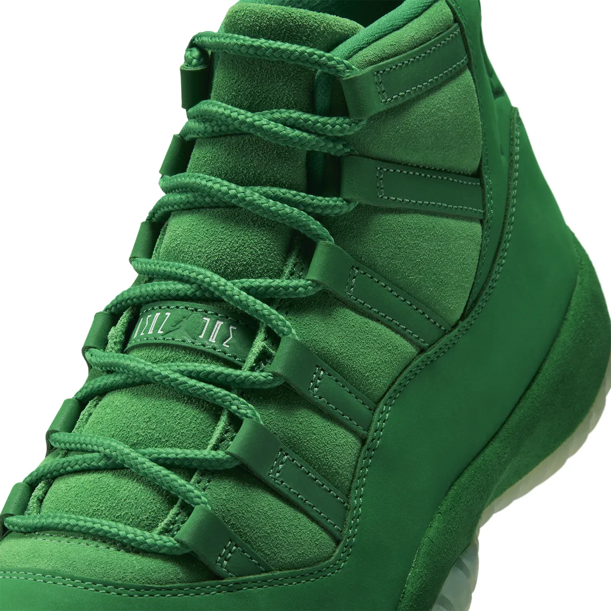
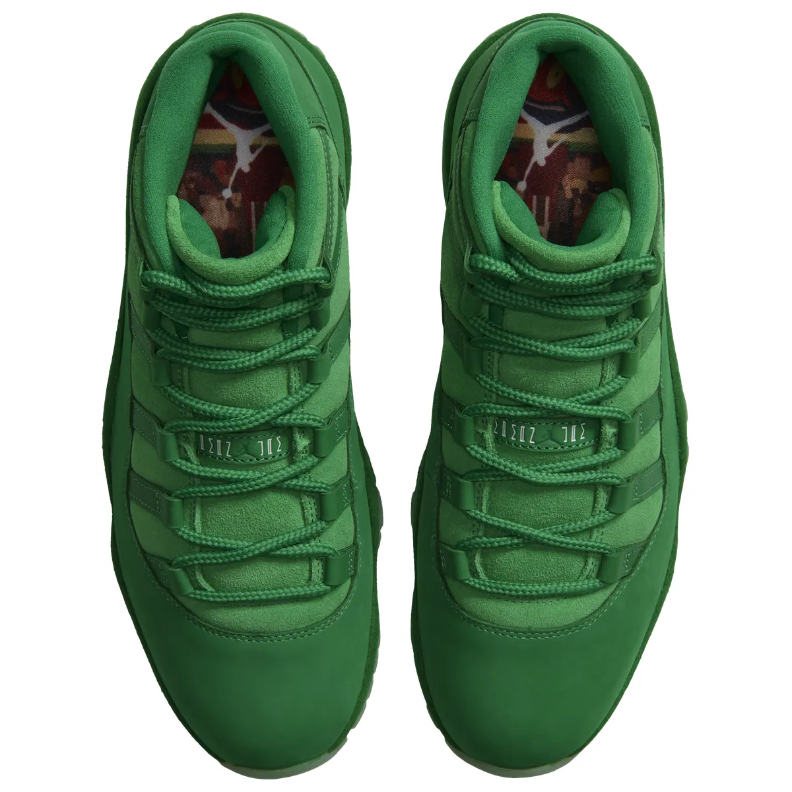
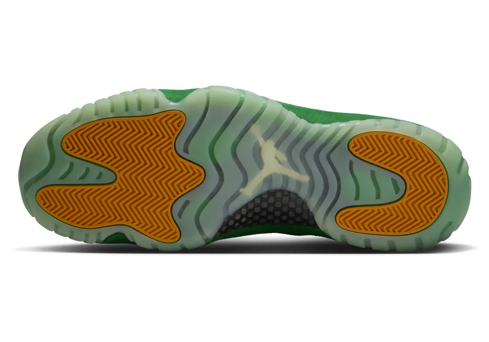
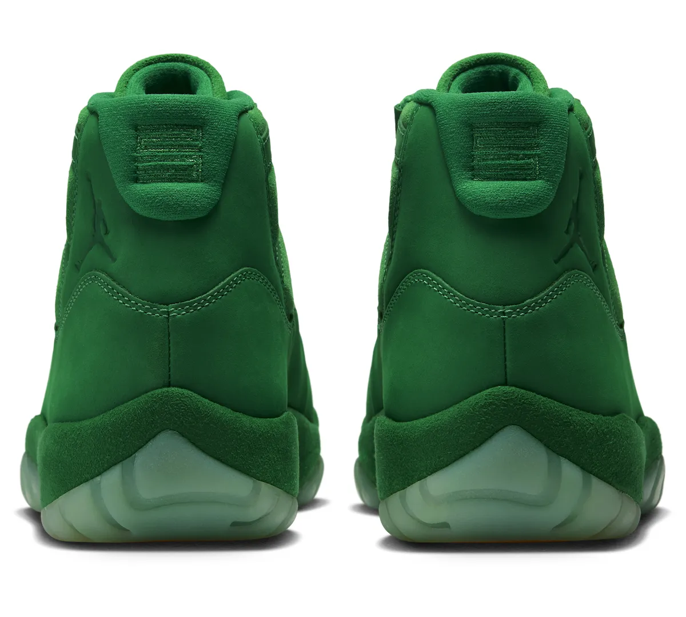
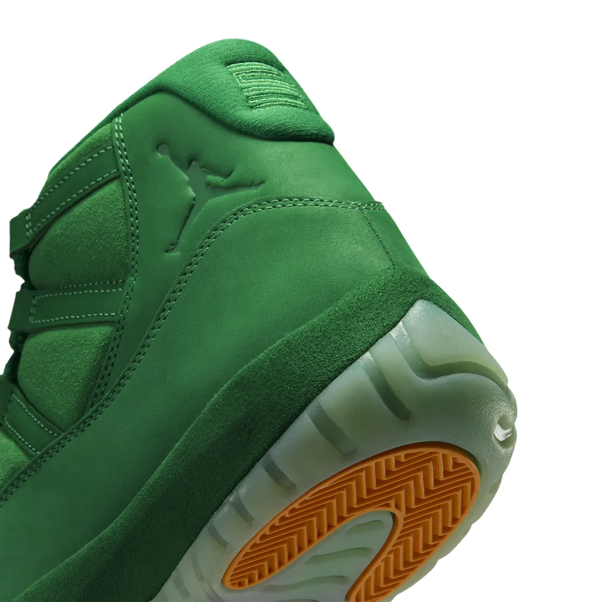
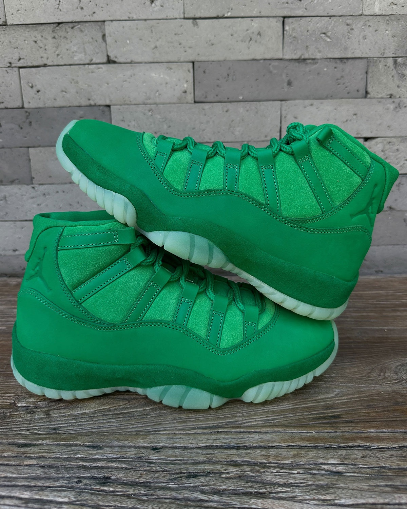

> [English version 英文版](/life/air-jordan-11-green-screen/)

今天发售的最有意思的一双鞋，取材自这部电影里你本不该看到的部分。Michael Jordan 在 1990 年代中期拍摄《Space Jam》的时候，他身边的卡通世界还不存在——他对着绿幕演戏，穿绿衣的替身演员站在兔巴哥和怪物们的位置上，动画是后来一帧一帧加上去的。Air Jordan 11 “Green Screen”（IQ5700-900）把制作过程中那个看不见的一半做成了一个配色：一双鞋，装下了整个拍摄把戏。它于 2026 年 11 月 14 日星期六发售，成人码 255 美元，通过 Nike SNKRS 与 Jordan Brand 指定 NBHD 零售商发售，大童码 200 美元起。

先说一句实在话：这不是 “Green Screen” 这个配色本身的上脚评测。这双鞋今天才发售，Nike 之外没有人穿着这个配色打过有意义的场次。下面是一篇长篇首次深度解析——事实、让一双绿色 Jordan 11 值得被记住的三十年电影史、Jordan Brand 实际做出来的设计与技术、这双鞋在周年三部曲里的位置，以及 255 美元到底买到了什么——能核实的说法和不能核实的说法会分开讲。

*Air Jordan 11 “Green Screen” 的 Nike 官方图：从鞋头到鞋领全是绿色麂皮与翻毛皮，绿色绳状鞋带，半透明冰底。图片：Nike，经 Sneaker Bar Detroit。*

## 事实一览

| | |
|---|---|
| **型号** | Air Jordan 11 Retro “Green Screen” |
| **货号** | IQ5700-900 |
| **配色** | Multi-Color / Gym Green – Lucky Green – Orange Peel（多色／健身绿－幸运绿－橙皮） |
| **发售日** | 2026 年 11 月 14 日星期六，美东时间上午 10 点／美西时间上午 7 点 |
| **发售价** | 成人码 255 美元（大童码 200 美元起）——2026 年 11 月 14 日的价格快照，依据 Nike、Nice Kicks、Sneaker Bar Detroit 与 Sole Retriever 的报道；可能变动 |
| **发售渠道** | Nike SNKRS、Jordan Brand 指定 NBHD 零售商 |
| **这双鞋是什么** | Jordan Brand《Space Jam》三十周年三部曲中的第二双 Air Jordan 11——一个取材自电影绿幕拍摄的概念配色，漆皮挡泥板换成了绿色麂皮与翻毛皮 |

## 为什么这双鞋是本周的头条

热度很容易举证，因为整个球鞋媒体在同一周都站到了这双鞋身后。Complex 把 Green Screen 放在本周发售指南的榜首，排在十一月拥挤日历上的所有其他鞋前面。每周发售指南称它是 11 月 13 日至 19 日当周的头条——本周最贵的一双，要早做决定。Sneaker News 把它放进每周发售指南，还专门为 Foot Locker 的 Space Jam 系列写了文章。Nice Kicks、Sneaker Bar Detroit、HotNewHipHop、Sole Retriever、Sneaker News 都发了带完整官方图的专门发售报道，主流媒体也跟进了：Parade 在发售当天早上报道了这双鞋，引用的是 Variety 的消息，文章与发售同一天上线。

三部曲的中间一章能拿到这么多关注，值得问一句为什么。答案是，Green Screen 是三双里唯一一个真正有想法、而不是单纯复刻的一双。另外两章讲的是电影本身：11 月 11 日先发的 “Magic Ball” 和 12 月 12 日回归的黑白 “Space Jam”。这一双讲的是片场。而球鞋圈看了三十年周年配色，分得清这个差别。

## 故事：《Space Jam》到底是怎么拍出来的

《Space Jam》在 2026 年 11 月 15 日满三十岁——电影于 1996 年 11 月 15 日上映，这次发售正好落在周年日前一天。人人都知道银幕上的故事：Michael Jordan、兔巴哥、怪物们、决定 Tune Squad 命运的那场比赛。这双鞋讲的是摄影机后面的故事。

Jordan 是在一整面绿幕围起来的片场里拍他的戏份的。动画角色根本不在现场。穿全身绿衣的替身演员站在兔巴哥和怪物们的位置上，摆姿势、给眼神，让 Jordan 有东西可以对着演，卡通世界是后期合成上去的。那些拍摄现场的剧照——Jordan 穿着 Tune Squad 球衣腾空投篮，身边一个绿衣替身伸手防守，背景是一整面带追踪标记点的绿墙——是体育电影史上最奇怪的画面之一：一个处在巅峰的真实运动员，对着一片虚空打篮球。

*这双鞋的灵感来源：Michael Jordan 在绿幕前拍摄《Space Jam》，穿绿衣的替身演员代替动画角色。绿墙上的橙色追踪标记点，和大底上的橙色抓地块是同一个意思。图片：华纳兄弟拍摄剧照，经 Sneaker Bar Detroit。*

这就是这个概念，而且它很具体。大多数电影联名鞋画的是海报。这一双画的是制作流程——一个真实的人在一片空白绿幕前打篮球的那个瞬间，之后才有人把他要拯救的世界画出来。Nike 自己的发售文案说得很直白：“Inspired by the green screens that brought the real world into the cartoon universe of Space Jam, the AJ11 ‘Green Screen’ brings that otherworldly energy to an icon. Lucky Green takes over the familiar silhouette.”（灵感来自把真实世界带进《Space Jam》卡通宇宙的绿幕，AJ11 “Green Screen” 把那种超现实能量带到了一双经典鞋上。幸运绿接管了这个熟悉的轮廓。）

球鞋圈几乎立刻给这双鞋起了个外号——“Monstars”（怪物队），取自电影里的反派，因为鞋子真正引用的视觉就是那些绿衣替身。Jordan Brand 确认的官方名字是 “Green Screen”，但外号已经叫开了，而且它说明了这双鞋第一眼的感觉：这不是一双碰巧是绿色的 Jordan 11，而是一只碰巧是 Jordan 11 的怪物。

还有一段发售史值得知道。Green Screen 顶替的是原本传闻中的 “Space Jam Galaxy” 配色留下的位置——据 Nice Kicks 报道，那个配色在公开亮相之前就被取消了。正是这个转向，给了一个更奇怪的想法留出了空间，结果成了近年来概念上最独特的 Air Jordan 11 配色之一。

## 设计：漆皮没了

这双鞋最大胆的决定是一次减法。Air Jordan 11 的标志性面板——Tinker Hatfield 在 1995 年设计时让这个鞋型出名的亮面漆皮挡泥板——在这个配色上没了，换成了哑光绿色麂皮。Men’s Journal 直接点出了这个替换：“vibrant green suede replacing patent leather”（亮绿色麂皮取代漆皮）。一双没有漆皮光泽的 11，有点像一部没有卡通的电影：轮廓一眼就能认出来，表面却完全是另一回事。

绿色的接管是彻底的。短绒翻毛皮覆盖下半部分和挡泥板，毛茸茸的绿色麂皮接管鞋舌和鞋面，鞋带是绿色绳状鞋带，内衬是绿色的，连中底都包了一层绿色麂皮。整双鞋唯一的暖色在脚底下，只有球场看得见。

*外侧轮廓：漆皮没了，换成哑光绿色麂皮与翻毛皮——足弓处的碳纤维板透了出来。图片：Nike，经 Sneaker Bar Detroit。*

细节经得起近看。后跟的 Jumpman 是压印的同色浮雕，而不是撞色刺绣，上面是后跟提环上绣着的 “23”。鞋带扣上是同色绿的 Jumpman 与 “JORDAN” 字样。鞋舌是毛茸茸的麂皮，鞋眼条是光滑的翻毛皮，两种质感在整个鞋面上互相映衬——这种材质对比只有拿在手里才看得出来，这也是这双鞋的实物照片比官方渲染图更重要的原因。

*鞋带特写：绿色绳状鞋带、毛茸茸的麂皮鞋舌、同色 Jumpman 鞋带扣。光滑翻毛皮对毛茸麂皮——两种绿色质感就是整双鞋的材质故事。图片：Nike，经 Sneaker Bar Detroit。*

还有鞋里没人穿着时看不见的部分。鞋垫上印着电影里最著名的一帧——Jordan 伸展身体完成制胜扣篮，兔巴哥画在画面下方——这是 Sneaker Bar Detroit 与 Sneaker History 的报道，在 Nike 自己的俯视官方图里也能从鞋口看到这幅图案。Nike 的发售页面没有提到鞋垫，所以这条按媒体报道加官方图佐证来写，不算 Nike 的官方说法。如果实物如报道所说，这就是这个概念应有的那种彩蛋：完成的卡通瞬间，藏在一双由它之前所有工序构成的鞋子里。

*俯视：整双鞋，鞋垫上的《Space Jam》图案从鞋口看得见——Jordan 的制胜扣篮，画面里有兔巴哥。图片：Nike，经 Sneaker Bar Detroit。*

## 技术：脚下到底是什么

去掉配色，脚下的 Air Jordan 11 还是 1995 年以来的那个平台：全掌 Air 气垫、中足碳纤维弹簧板提供抗扭转支撑、人字纹抓地纹路。那在当年是一套真正的实战配置——Jordan 穿着它打完了 1995–96 赛季、72 胜赛季和这部电影——复刻版保留了同样的结构。官方外侧照片里能看到足弓处的碳板，半透明大底里也能看到它。

新的是大底本身。半透明橡胶会夜光——灯一关，大底会发出绿光，正好扣住绿幕主题——前掌和后跟的人字纹抓地块是 Orange Peel（橙皮色）。橙色一举两得：既是兔巴哥的胡萝卜，也是片场绿墙上星星点点的橙色追踪标记。一个暖色，藏在脚底下，只有球场看得见。

*大底：半透明夜光橡胶，前掌与后跟的橙色人字纹抓地块，中间一个 Jumpman，碳纤维板透了出来。图片：Nike，经 Sneaker Bar Detroit。*

实话实说这在 2026 年的球场上意味着什么。Air Jordan 11 复刻版是一套三十年前的实战设计，没人会花 255 美元买一双麂皮复刻去打野球——麂皮和翻毛皮鞋面沾水、蹭灰、留痕的速度，是当年的漆皮永远不会有的。全掌 Air 和碳板是真实的技术，室内打球完全没问题，但诚实的说法是，这是一双收藏品和生活方式鞋，不是实战采购。这里的技术之所以重要，是因为它是传承，不是因为它是购买理由。

## 鞋盒，和让概念成立的细节

Jordan Brand 给这次发售做了专属包装，而且包装确实在为概念出力。亮绿色鞋盒上印着 Jumpman，配的是怪物主题的 artwork——一个怪物把一个圆环套在 Jumpman 外面——盒身正面有 Tune Squad 和 Monstars 的标志。盒盖内侧是一张场记板图案，写着 “SJ 30th”，提到 Michael Jordan 和兔巴哥；定制的包装纸上印满了草图、角色、篮球图案和电影里的其他元素。

*后跟正面：提环上绣着的 “23”、压印的同色 Jumpman、包着麂皮的中底。图片：Nike，经 Sneaker Bar Detroit。*

包装通常是收藏者最先扔掉、评测者最后才提的东西。在这里它是论证的一部分：鞋盒就是场记板，包装纸就是分镜稿，鞋子就是片场。对一双 255 美元的周年发售来说，这种完整度很重要——它决定了这是一件作品，还是仅仅一个配色。

*后跟特写：压在麂皮里的 Jumpman 浮雕、挡泥板周围的缝线、下面露出的橙色后跟抓地块。图片：Nike，经 Sneaker Bar Detroit。*

## 三部曲：三个章节，三种不同的赌法

这是《Space Jam》三十周年系列三双 Air Jordan 11 里的第二双，三个章节是三种对“周年纪念应该是什么”的不同下注。

“Magic Ball” 在 11 月 11 日打头阵——一双女性先行发售，玩的是电影里的意象，是三双里第一双开卖的。Green Screen 是概念之作：讲的是片场，不是电影。而电影本色那双——黑白配色的 “Space Jam”，就是 Jordan 在电影最后一场比赛里脚上那双——还要等到 12 月 12 日，售价 235 美元。周年系列里还有一双 Air Jordan 9 “Space Jam”，给要集齐全套的人准备的。

定价讲清了这个系列的故事。Green Screen 的 255 美元是三双 11 里最贵的——比 Magic Ball 和十二月的 “Space Jam” 都贵 20 美元，也是它发售当周最贵的一双。Jordan Brand 是在为概念、材质和包装收费，市场会来判断：最奇怪的那双，值不值得比最忠实的那双更贵。

有一条传闻要小心处理，因为它说的是十二月那双，不是这双：球鞋圈里在传一个说法，源头是 @zsnakerheadz，称十二月那双黑色 “Space Jam” 11 的产量可能超过一百万双。Nike 没有确认过任何产量数字，这个数字只能当作未经证实的传闻，不能当事实。在这里提一句是因为，如果属实，它会改变十二月的算法——一双产量百万的 “Space Jam”，是等原价慢慢买的鞋，不是发售日要抢的鞋——但它对 Green Screen 什么都说明不了，那是另一双鞋、另一个供应故事。

*实物上手，离开摄影棚灯光之后：绿色比官方渲染图里更亮，麂皮比渲染图里更柔——这正是这双鞋的实物照片重要的原因。图片经 Sneaker Bar Detroit。*

## 同场：本周还有什么

没有一双鞋是在真空里发售的，这一周很拥挤。11 月 13 日星期五发了 Nike KD 19 “Aunt Pearl”——Durant 每年纪念系列的第十五个篇章——还有 Nike Air Diamond Turf II “Patent Black”，Deion Sanders 的复刻，每周指南把它排在 KD 19 前面一位。11 月 17 日星期二有 Nike LeBron 24 “Stars”，号称史上最轻的 LeBron 签名鞋，同一天还有 NOCTA x Nike Air Modmax “Pink Spell”。11 月 19 日星期四的日程上写着 Travis Scott x Rockstar Games x Nike Air Force 1 Low，配合《Grand Theft Auto VI》发售——但 Nike 和 Rockstar 都没有正式宣布这次联名，有报道说 Travis 本人称之为亲友限定，所以 11 月 19 日只能当作预期日期，不能当锁定日期，别围绕它安排购买。

Green Screen 真正的对照不是其中任何一双，而是 12 月 12 日那双 “Space Jam” 11。两双都是周年 11，都在 235 美元以上，都会同时被当作物件和投资来评判。Green Screen 的优势是新意——概念、麂皮、包装——劣势是更难穿：全绿麂皮能搭的衣服很少。十二月那双的优势是它就是电影里那双，是稳妥的选择，人人都知道怎么搭。如果想要奇怪的那双，今天就是日子。如果想要稳妥的那双，等四个星期。

## 购买建议

几条实用建议，按发售日早上最要紧的顺序来。

**尺码。** Air Jordan 11 复刻版一般按正常尺码买，鞋头空间宽裕——标准建议就是你平常的 Nike 尺码，Green Screen 的结构没有什么能改变这一点。麂皮鞋面不会像网面那样撑开，但这也不是一双窄鞋。如果你在两个尺码之间，宁可去店里试穿也别猜。

**发售。** 11 月 14 日星期六，美东时间上午 10 点／美西时间上午 7 点，SNKRS 上架，外加 Jordan Brand 指定 NBHD 零售商。这是限量发售，不是市售款——SNKRS 上要抽签，零售商要抽奖，别指望直接走进去买到。如果 SNKRS 没中，先去 NBHD 零售商和 FootLocker 的 FLX 抽奖看看，再考虑二级市场。发售头几个小时别付太高的溢价：周年 11 的发售日转卖价波动最大，在市场摸清实际库存深度之前，价格最不稳定。

**麂皮养护，实话实说。** 这是唯一一条真正重要的实用警告。一双全麂皮加翻毛皮的幸运绿鞋子，沾水渍、蹭灰、粘脏的速度比它取代的漆皮快得多。如果买这双鞋是为了穿，第一次上脚之前先喷一层麂皮保护喷雾，别淋雨，接受鞋头不可能永远保持崭新。如果这听起来维护成本太高，那你就是个陈列买家——这完全没问题，这双鞋放在架子上的样子，比大多数 11 穿在脚上都好看。

**适合谁。** 如果你收藏 Jordan 11，这双是必收——它是这个鞋型多年来概念上最独特的一个配色，也是三十周年系列里会被记住的那一双。如果你喜欢《Space Jam》，手里已经有一双黑白 11，这就是第二章，不是重复。如果你想要一双日常穿的绿鞋，诚实一点：这是一双响亮的、全绿的、麂皮的鞋，能搭的衣服很少。买它应该是因为这个概念让你开心，不是因为它填补了你鞋柜里的空缺。

**唯一的提醒。** 255 美元的价格是三双周年 11 里最高的，溢价付的是故事、材质和鞋盒——不是更好的技术。鞋子底下还是和 235 美元那双十二月款一样的 AJ11 平台。如果这个概念没能打动你，十二月的 “Space Jam” 是同一个鞋型、电影本来的配色、便宜 20 美元，还有四个星期就到了。

## 结论

Green Screen 是《Space Jam》三十周年系列里最奇怪的一双，而这正是它领跑本周的原因。作为一个概念，它是 Jordan Brand 多年来给 Air Jordan 11 附加的最犀利的想法——画的不是海报，而是制作流程；画的不是卡通，而是卡通被画上去之前的那片绿色虚空。作为一件物品，它是三双里最完整的一次周年发售：麂皮接管、夜光大底配橙色追踪标记抓地块、图案鞋垫、场记板鞋盒。而作为一次购买，它是星期六早上 255 美元的一次限量发售，规则照旧：先试 SNKRS 和零售商，别付发售日的转卖价，买它是因为这个想法让你笑了。

三十年后，Jordan Brand 完全可以只靠怀旧卖掉这次周年——电影的配色、电影的海报、稳妥的致敬。但系列里最奇怪的一双卖的却是制作机器：一个真实的人在一片空白绿幕前打篮球，之后才有人把他要拯救的世界画出来。星期六的发售会证明，三双里最奇怪的那双是不是人们真正追逐的那双。明智的判断是：绿幕从来不是背景。它就是重点。

*价格与发售情况为截至 2026 年 11 月 14 日的快照，依据 Nike、Nice Kicks、Sneaker Bar Detroit 与 Sole Retriever 的报道；两者都可能变动。这是对 “Green Screen” 配色的首次深度解析，不是上脚评测——这双鞋今天才发售，这个配色尚无任何独立上脚评测。十二月的产量数字是未经证实的传闻，不是 Nike 的说法。无 affiliate 链接。*

**来源：** Nike——Air Jordan 11 “Green Screen”（IQ5700-900）官方发售页；Nice Kicks——“Air Jordan 11 ‘Green Screen’”发售记录（2026 年 11 月 14 日，255 美元，SNKRS 与指定零售商）；Sneaker Bar Detroit——“Air Jordan 11 ‘Green Screen’ 2026 Release Date”（官方图、鞋垫与包装细节）；Sneaker News——每周发售指南与 “Space Jam Jordans” Foot Locker 专题（2026 年 11 月 5 日，11 月 13 日更新）；Complex——本周发售指南（2026 年 11 月 10 日）；HotNewHipHop——“Official Photos Of The Air Jordan 11 ‘Green Screen’ Are Here”（2026 年 10 月 7 日）与 “Unboxing Experience Surfaces Of The Air Jordan 11 ‘Green Screen’”（2026 年 10 月 30 日）；Men’s Journal——“Air Jordan 11 ‘Green Screen’ Release Date & Price”（哑光绿麂皮取代漆皮）；Parade / Variety——“Nike Releases Air Jordan 11 ‘Green Screen’ Sneakers”（2026 年 11 月 14 日）；Sole Retriever——IQ5700-900 发售日期列表；iahhm——“Sneaker Releases This Week: Nov. 13–19, 2026”（2026 年 11 月 13 日）；Sneaker History / Sole Retriever——鞋垫细节的媒体报道，按报道口径引用。
