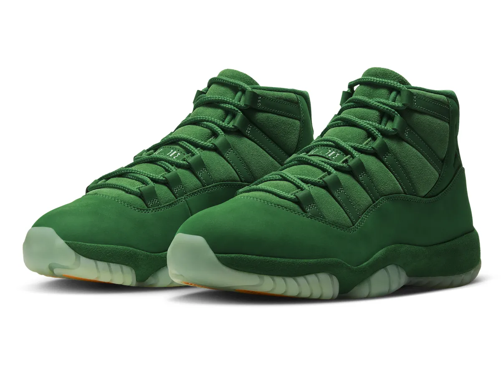
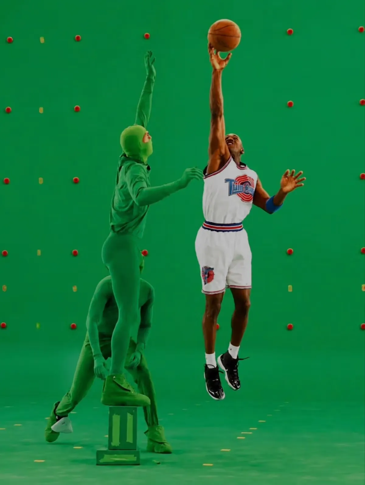
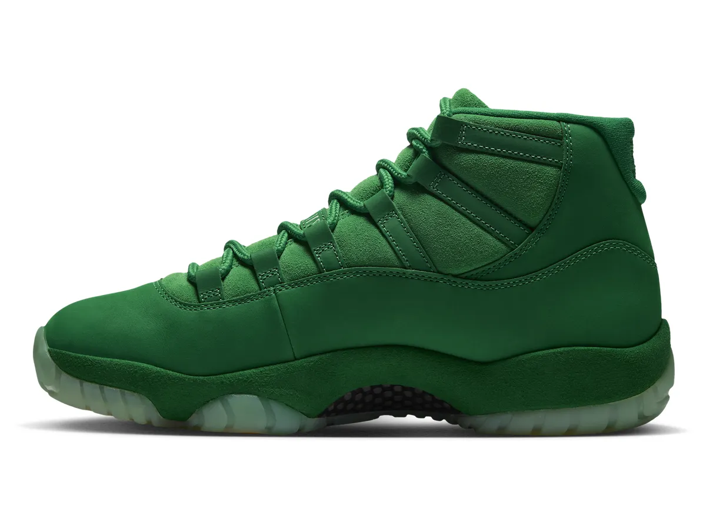
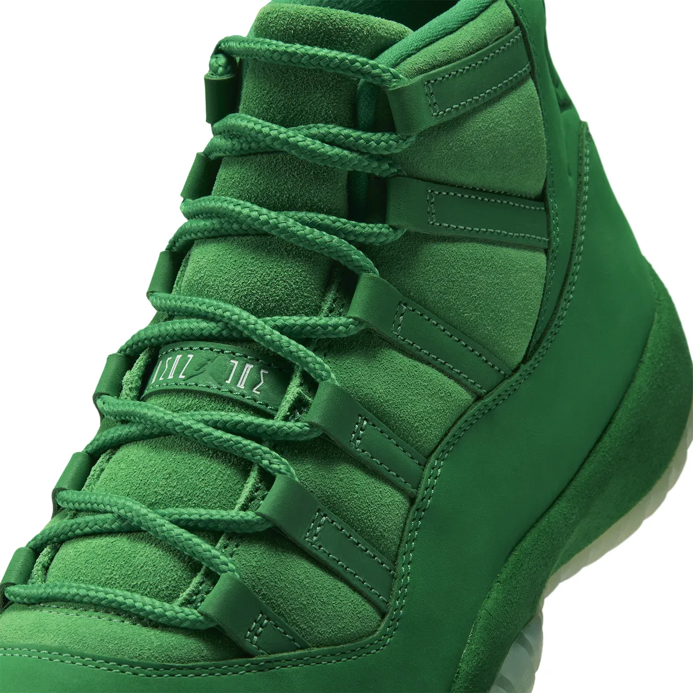
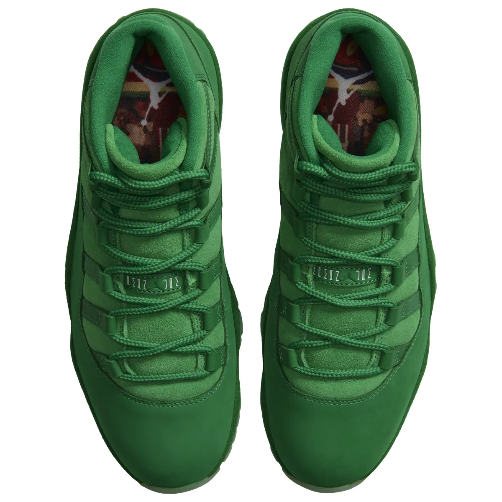
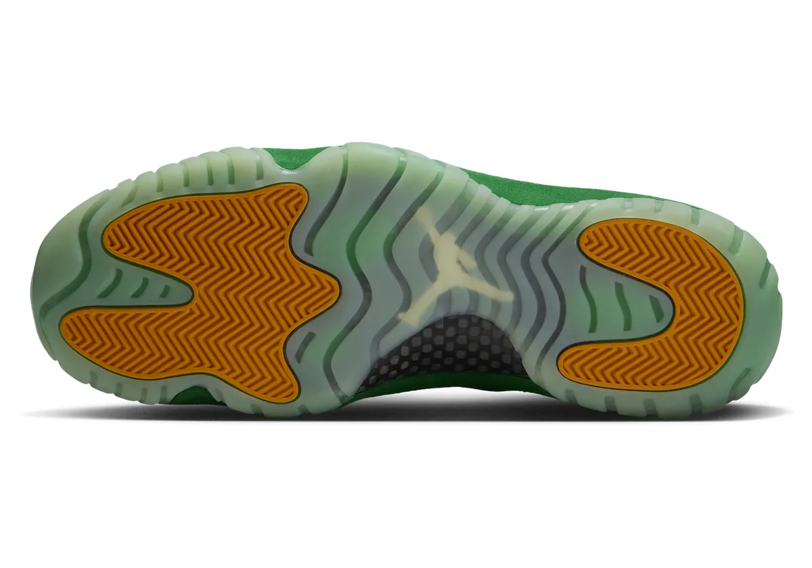
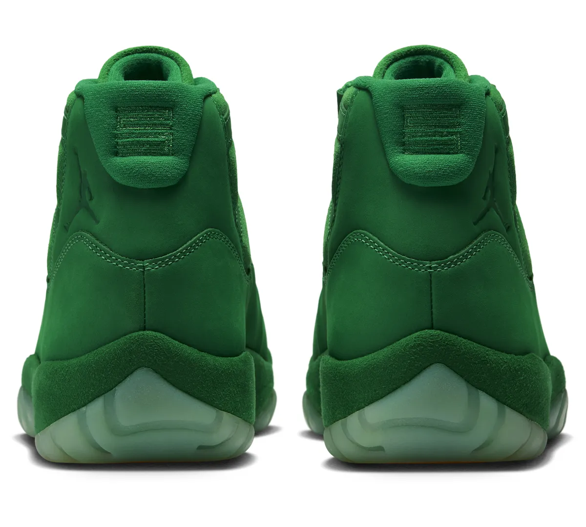
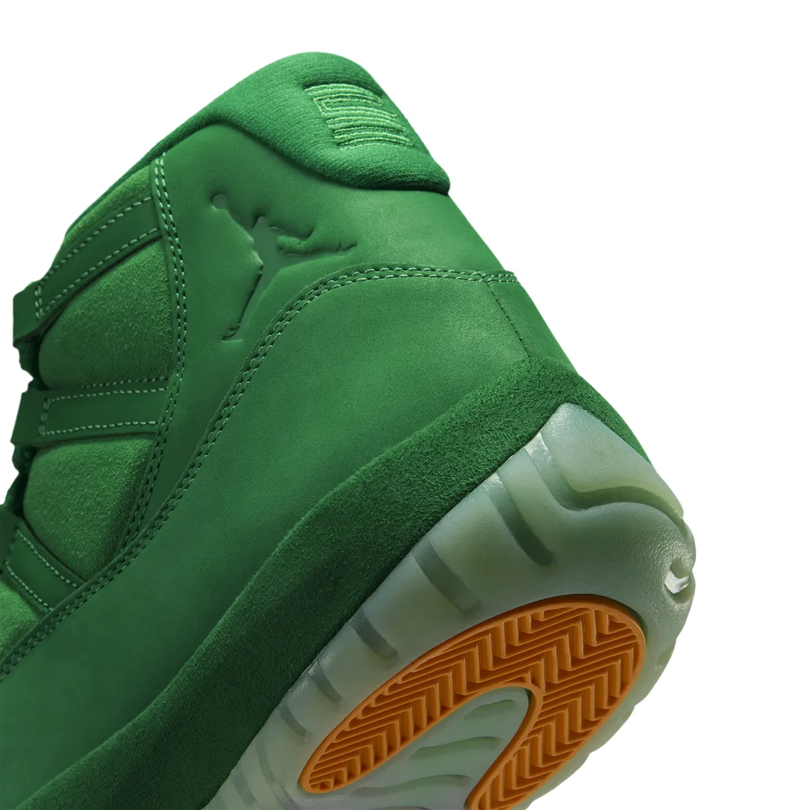
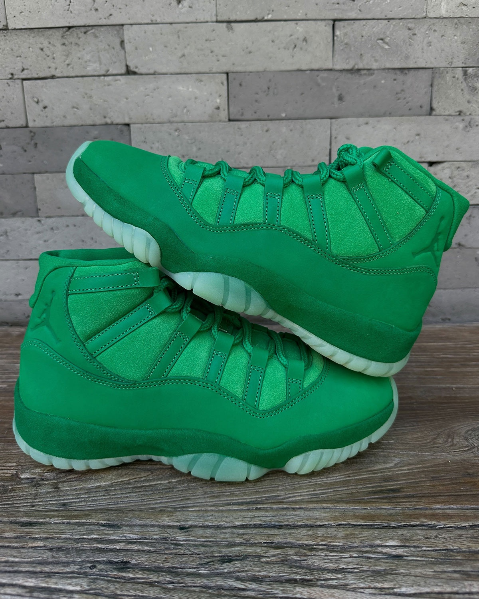

> [中文版 Chinese version](/life/air-jordan-11-green-screen-zh/)

The most interesting shoe releasing today is the one built from the part of the movie you were never supposed to see. When Michael Jordan filmed *Space Jam* in the mid-1990s, the cartoon world around him did not exist yet — he played his scenes against green screens, with performers in green suits standing in for the Looney Tunes and the Monstars, and the animation was painted in afterward. The Air Jordan 11 “Green Screen” (IQ5700-900) takes that invisible half of the production and makes it a colorway: one shoe, every shade of the trick, worn on feet. It releases Saturday, November 14, 2026, for $255 in adult sizes, through Nike SNKRS and select Jordan Brand NBHD retailers, with Big Kids’ sizes from $200.

One honest note up front: this is not a wear test of the “Green Screen” colorway. The pair releases today, and nobody outside Nike has put meaningful miles on this exact pair. What follows is a long first look — the facts, the thirty-year film history that makes a green Jordan 11 matter, the design and the technology as Jordan Brand built it, where this shoe sits inside the anniversary trilogy, and what $255 is actually buying — with the claims that can be checked separated from the ones that cannot.

*The Air Jordan 11 “Green Screen” in Nike’s official imagery: green suede and nubuck from toe to collar, green rope laces, and a translucent icy outsole. Image: Nike, via Sneaker Bar Detroit.*

## The facts

| | |
|---|---|
| **Model** | Air Jordan 11 Retro “Green Screen” |
| **Style code** | IQ5700-900 |
| **Colorway** | Multi-Color / Gym Green – Lucky Green – Orange Peel |
| **Release date** | Saturday, November 14, 2026, 10:00 a.m. ET / 7:00 a.m. PT |
| **Retail price** | $255 adult (Big Kids from $200) — price snapshot as of November 14, 2026, based on Nike, Nice Kicks, Sneaker Bar Detroit and Sole Retriever reporting; subject to change |
| **Where** | Nike SNKRS and select Jordan Brand NBHD retailers |
| **What it is** | The second of three Air Jordan 11s in Jordan Brand’s Space Jam 30th-anniversary run — a concept colorway built from the film’s green-screen production, with the patent-leather mudguard replaced by green suede and nubuck |

## Why this release is the story of the week

The heat is easy to prove, because the whole sneaker press lined up behind this pair in the same week. Complex put the Green Screen at the top of its sneakers-releasing-this-week guide, ahead of everything else on a crowded November calendar. The weekly release guides call it the headliner of the November 13–19 window — the priciest pair of the week, and the one to decide on early. Sneaker News carried it in its weekly guide and in a dedicated Foot Locker feature on the Space Jam collection. Nice Kicks, Sneaker Bar Detroit, HotNewHipHop, Sole Retriever and Sneaker News all published dedicated release coverage with the full official photo set, and mainstream outlets picked it up too: Parade covered the release on the morning of the drop, citing Variety’s report, and the story ran the same day the shoe went live.

That is a lot of attention for the middle chapter of a three-shoe anniversary set — and it is worth asking why. The answer is that the Green Screen is the only one of the three that is actually an idea rather than a reissue. The other two chapters are the film itself: the “Magic Ball” that opened the set on November 11, and the black-and-white “Space Jam” returning on December 12. This one is the film set. And the sneaker world, which has seen thirty years of anniversary colorways, noticed the difference.

## The story: how Space Jam was actually made

*Space Jam* turns thirty on November 15, 2026 — the film opened on November 15, 1996, and this drop lands one day before the anniversary. The story everyone knows is the one on screen: Michael Jordan, the Looney Tunes, the Monstars, the game for the fate of the Tune Squad. The story this shoe tells is the one behind the camera.

Jordan filmed his scenes on a set wrapped in green screen. The animated characters were not there. Performers in full green bodysuits stood in for Bugs Bunny and the Monstars, holding poses and eyelines so Jordan had something to play against, and the cartoon world was composited in afterward. The production stills from those sessions — Jordan in his Tune Squad jersey, rising for a shot, while a green-suited stand-in reaches beside him against a wall of green dotted with tracking markers — are some of the strangest images in sports-movie history: a real athlete, at the height of his powers, playing basketball against nothing.

*The image this shoe is built from: Michael Jordan filming Space Jam against a green screen, with performers in green suits standing in for the Looney Tunes and Monstars. The orange tracking markers on the green wall are the same idea as the orange pods on the outsole. Image: Warner Bros. production still, via Sneaker Bar Detroit.*

That is the concept, and it is a good one, because it is specific. Most movie-tie-in sneakers illustrate the poster. This one illustrates the process — the blank green void a real man played basketball in front of, before anyone drew the world he was saving. Nike’s own launch copy says it plainly: “Inspired by the green screens that brought the real world into the cartoon universe of Space Jam, the AJ11 ‘Green Screen’ brings that otherworldly energy to an icon. Lucky Green takes over the familiar silhouette.”

The community gave the shoe a nickname almost immediately — the “Monstars” — after the film’s villains, whose green-suited stand-ins are the visual the shoe is really quoting. The official name confirmed by Jordan Brand is “Green Screen,” but the nickname stuck, and it tells you how the shoe reads at a glance: not a Jordan 11 that happens to be green, but a Monstar that happens to be a Jordan 11.

There is also a small piece of release history worth knowing. The Green Screen fills the slot that was originally reported for a “Space Jam Galaxy” colorway — a release that was ultimately canceled before it ever saw a public launch, according to Nice Kicks. That shift in direction is what made room for a stranger idea, and the result is one of the most conceptually distinct Air Jordan 11 colorways in recent memory.

## The design: the patent leather is gone

The boldest decision on the shoe is a subtraction. The Air Jordan 11’s signature panel — the glossy patent-leather mudguard that made the silhouette famous when Tinker Hatfield designed it in 1995 — is gone on this colorway, replaced by matte green suede. Men’s Journal notes the swap directly: “vibrant green suede replacing patent leather.” An 11 without the patent shine is a little like the film without the cartoons: the shape is unmistakable, the surface is something else entirely.

The takeover is total. Short-cut nubuck covers the lower section and the mudguard, while hairy green suede takes over the tongue and upper panels. The laces are green rope laces. The inner lining is green. Even the midsole is wrapped in green suede. The only warm notes in the whole shoe are underneath it, where only the court sees them.

*Lateral profile: the patent leather is gone, replaced by matte green suede and nubuck — and the carbon-fiber shank is visible through the arch. Image: Nike, via Sneaker Bar Detroit.*

The details reward close inspection. The heel Jumpman is embossed and tonal instead of stitched in a contrast color, sitting above a stitched “23” on the heel pull tab. The lace keeper carries the Jumpman and “JORDAN” branding in tonal green. The tongue is hairy suede, the eyestay panels are smooth nubuck, and the two textures play against each other across the whole upper — the kind of material contrast that only shows up in person, and the reason the in-hand photos matter more than usual for this pair.

*Close-up on the lacing: green rope laces, hairy suede tongue, and the tonal Jumpman lace keeper. The two green textures — smooth nubuck against shaggy suede — are the whole material story. Image: Nike, via Sneaker Bar Detroit.*

Then there is the part of the shoe nobody sees while wearing it. The insoles carry a graphic of the film’s most famous frame — Jordan stretching for the game-winning dunk, with Bugs Bunny worked into the scene below — as reported by Sneaker Bar Detroit and Sneaker History, and as visible in Nike’s own top-down official photography, where the artwork shows through the collar. Nike’s launch page does not mention the insole, so this one is carried as reported coverage confirmed by the official photos, not as a Nike claim. If it lands as described, it is the right kind of Easter egg for this concept: the finished cartoon moment tucked inside a shoe built from everything that came before it.

*Top-down: the full pair, with the Space Jam graphic insoles visible through the collars — Jordan’s game-winning dunk, with Bugs Bunny in the scene. Image: Nike, via Sneaker Bar Detroit.*

## The tech: what is actually underfoot

Strip away the colorway and the Air Jordan 11 underneath is the same platform it has been since 1995: a full-length Air sole unit, a carbon-fiber spring plate in the midfoot for torsional support, and a herringbone traction pattern. That was a genuine performance package in its day — the shoe Jordan wore through the 1995–96 season, the 72-win season, and the film — and the retro keeps the same construction. The carbon shank is visible in the arch of the official lateral photography, and it shows through the translucent outsole as well.

What is new is the outsole itself. The translucent rubber is glow-in-the-dark — once the lights go out, the sole gives off a green glow, which plays directly into the green-screen theme — and the herringbone traction pods at the forefoot and heel are Orange Peel. The orange is doing double work: it is Bugs Bunny’s carrots, and it is the orange tracking markers dotted across the green-screen walls on the film set. One warm note, hidden underneath, where only the court sees it.

*The outsole: translucent glow-in-the-dark rubber, Orange Peel herringbone pods at forefoot and heel, the Jumpman in the middle, and the carbon-fiber shank showing through. Image: Nike, via Sneaker Bar Detroit.*

Be honest about what this means on a court in 2026. The Air Jordan 11 retro is a thirty-year-old performance design, and nobody is buying a $255 suede retro to run a pickup game — the suede and nubuck upper would scuff, soak, and stain in a way the original patent leather never did. The full-length Air and carbon plate are real technology, and the shoe would play fine indoors, but the honest framing is that this is a collector’s piece and a lifestyle shoe, not a performance purchase. The tech matters here because it is the heritage, not because it is the reason to buy.

## The box, and the details that sell the concept

Jordan Brand gave this release its own packaging, and it is doing real work for the concept. The bright green box carries Jumpman branding with artwork inspired by the Monstars — a Monstar pulling a ring around the Jumpman — with Tune Squad and Monstars logos across the front. Inside the lid, a clapperboard graphic reads “SJ 30th” and references Michael Jordan and Bugs Bunny, and the custom tissue paper is covered with sketches, characters, basketball graphics, and other nods to the film.

*Straight-on at the heel: the stitched “23” on the pull tab, the embossed tonal Jumpman, and the suede-wrapped midsole. Image: Nike, via Sneaker Bar Detroit.*

Packaging is usually the first thing a collector throws away and the last thing a reviewer mentions. Here it is part of the argument: the box is the clapperboard, the tissue is the storyboard, and the shoe is the set. For a $255 anniversary release, that completeness matters — it is the difference between a colorway and an object.

*Heel detail: the embossed Jumpman pressed into the suede, the stitching around the mudguard, and the Orange Peel heel pod peeking out below. Image: Nike, via Sneaker Bar Detroit.*

## The trilogy: three chapters, three different bets

This is the second of three Air Jordan 11s in the Space Jam 30th-anniversary run, and the three chapters are three different bets on what an anniversary should be.

The “Magic Ball” opened the set on November 11 — a women’s-first release that plays with the film’s imagery, and the first of the three to sell. The Green Screen is the concept piece: the film set, not the film. And the main “Space Jam” release — the one in the movie’s own black-and-white colors, the pair Jordan actually wore on screen in the final game — is still to come on December 12, at $235. The anniversary collection also includes an Air Jordan 9 “Space Jam,” for the completists.

The pricing tells the story of the set. The Green Screen, at $255, is the priciest of the three 11s — $20 more than the Magic Ball and the December “Space Jam” — and the priciest pair of its release week. Jordan Brand is charging for the concept, the materials, and the packaging, and the market will decide whether the weird one is worth more than the faithful one.

One rumor to carry carefully, because it concerns the December chapter and not this shoe: sneaker circles have been passing around a claim, sourced to @zsnakerheadz, that the December black “Space Jam” 11 could be produced in quantities above one million pairs. Nike has not confirmed any production number, and the figure should be treated as unconfirmed chatter, not a fact. It is worth one sentence here because, if true, it would change the December calculus — a million-pair “Space Jam” is a shoe you wait for at retail, not one you chase on release day — but it says nothing about the Green Screen, which is a different shoe with a different supply story.

*In-hand, away from the studio lighting: the green reads brighter and the suede reads softer in real life than in the official renders — which is exactly why the in-hand photos matter for this pair. Photos via Sneaker Bar Detroit.*

## The field: what else is happening this week

No release happens in a vacuum, and this week is crowded. Friday, November 13, brought the Nike KD 19 “Aunt Pearl” — the fifteenth chapter of Durant’s annual tribute series — and the Nike Air Diamond Turf II “Patent Black,” Deion Sanders’ retro, which the weekly guides ranked just above the KD 19. Tuesday, November 17, brings the Nike LeBron 24 “Stars,” billed as the lightest LeBron signature ever, and the NOCTA x Nike Air Modmax “Pink Spell” lands the same day. Thursday, November 19, is penciled in for the Travis Scott x Rockstar Games x Nike Air Force 1 Low tied to the *Grand Theft Auto VI* launch — but neither Nike nor Rockstar has officially announced that collaboration, and one report says Travis described it as a friends-and-family exclusive, so treat November 19 as expected, not locked, and do not plan a purchase around it.

The honest comparison for the Green Screen is not any of those. It is the December 12 “Space Jam” 11. Both are anniversary 11s, both are $235-or-more, and both will be judged as objects and as investments. The Green Screen has the advantage of novelty — the concept, the suede, the packaging — and the disadvantage of being a harder shoe to wear: all-green suede goes with very little. The December pair has the advantage of being the one from the movie, the safe choice, the one everyone already knows how to style. If you want the strange one, today is the day. If you want the safe one, wait four weeks.

## Buying advice

A few practical notes, in the order that matters on a Saturday drop.

**Sizing.** Air Jordan 11 retros are generally true to size, with a roomy toe box — the standard advice is your normal Nike size, and there is nothing in the Green Screen’s construction that changes that. The suede upper will not stretch the way mesh does, but it is not a narrow shoe. If you are between sizes, try it on in a store rather than guessing.

**The drop.** Saturday, November 14, 10:00 a.m. ET / 7:00 a.m. PT on SNKRS, plus select Jordan Brand NBHD retailers. This is a limited release, not a general release — expect a draw on SNKRS and raffles at retailers, not a walk-in purchase. If you missed the SNKRS window, check the NBHD retailers and the Foot Locker FLX raffle rather than going straight to resale. Do not pay a large markup in the first hours: release-day resale on anniversary 11s is at its most volatile before the market knows how deep the stock actually runs.

**Suede care, honestly.** This is the one practical warning that matters. An all-suede and nubuck shoe in Lucky Green will show water spots, scuffs, and dirt far faster than the patent leather it replaces. If you buy this shoe to wear it, budget for a suede protector spray before the first wear, keep it out of rain, and accept that the toe will not stay pristine. If that sounds like too much maintenance, you are a display buyer, and that is a fine thing to be — the shoe looks better on a shelf than most 11s do on feet.

**Who it is for.** If you collect Jordan 11s, this is a mandatory one — it is the most conceptually distinct colorway of the silhouette in years, and the one that will be remembered from the 30th-anniversary set. If you love *Space Jam* and you already own a black-and-white 11, this is the second chapter, not a duplicate. If you want a daily-wear green shoe, be honest with yourself: this is a loud, all-green, suede shoe, and it goes with very little. Buy it because the concept delights you, not because it fills a gap in your rotation.

**The one caveat.** The $255 price is the highest of the three anniversary 11s, and the premium is paying for the story, the materials, and the box — not for better technology. The shoe underneath is the same AJ11 platform as the $235 December pair. If the concept does not delight you, the December “Space Jam” is the same silhouette, in the movie’s own colors, for $20 less, and it is four weeks away.

## Verdict

The Green Screen is the strangest entry in the Space Jam 30th-anniversary set, and that is exactly why it leads the week. As a concept, it is the sharpest idea Jordan Brand has attached to the Air Jordan 11 in years — not the poster, but the process; not the cartoon, but the green void the cartoon was painted onto. As an object, it is the most complete anniversary release of the three: the suede takeover, the glow-in-the-dark outsole with its orange tracking-marker pods, the graphic insoles, the clapperboard box. And as a purchase, it is a limited $255 release on a Saturday morning, which means the usual rules apply: try SNKRS and the retailers first, do not pay release-day resale, and buy it because the idea makes you smile.

Thirty years on, Jordan Brand could have sold this anniversary on nostalgia alone — the movie’s colors, the movie’s poster, the safe tribute. Instead the strangest entry in the set sells the machinery: the blank green void a real man played basketball in front of, before anyone drew the world he was saving. Saturday’s drop will show whether the weird one of the three is the one people actually chase. The smart money says the green screen was never the background. It was the point.

*Price and availability are a snapshot as of November 14, 2026, based on Nike, Nice Kicks, Sneaker Bar Detroit and Sole Retriever reporting; both are subject to change. This is a first look at the “Green Screen” colorway, not a wear test — the pair releases today, and no independent wear testing of this colorway exists yet. The December production figure is unconfirmed chatter, not a Nike claim. No affiliate links.*

**Sources:** Nike — official launch page for the Air Jordan 11 “Green Screen” (IQ5700-900); Nice Kicks — “Air Jordan 11 ‘Green Screen’” release record (November 14, 2026, $255, SNKRS and select retailers); Sneaker Bar Detroit — “Air Jordan 11 ‘Green Screen’ 2026 Release Date” (official photos, insole and packaging details); Sneaker News — weekly release guide and “Space Jam Jordans” Foot Locker feature (November 5, 2026; updated November 13); Complex — sneakers-releasing-this-week guide (November 10, 2026); HotNewHipHop — “Official Photos Of The Air Jordan 11 ‘Green Screen’ Are Here” (October 7, 2026) and “Unboxing Experience Surfaces Of The Air Jordan 11 ‘Green Screen’” (October 30, 2026); Men’s Journal — “Air Jordan 11 ‘Green Screen’ Release Date & Price” (matte green suede replacing patent leather); Parade / Variety — “Nike Releases Air Jordan 11 ‘Green Screen’ Sneakers” (November 14, 2026); Sole Retriever — release-date listing for IQ5700-900; iahhm — “Sneaker Releases This Week: Nov. 13–19, 2026” (November 13, 2026); Sneaker History / Sole Retriever — reported sockliner detail, carried as reported coverage.
