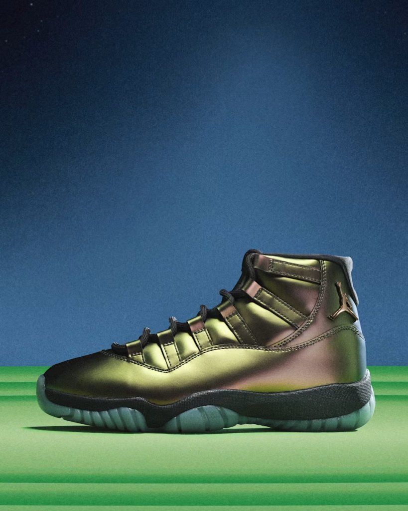
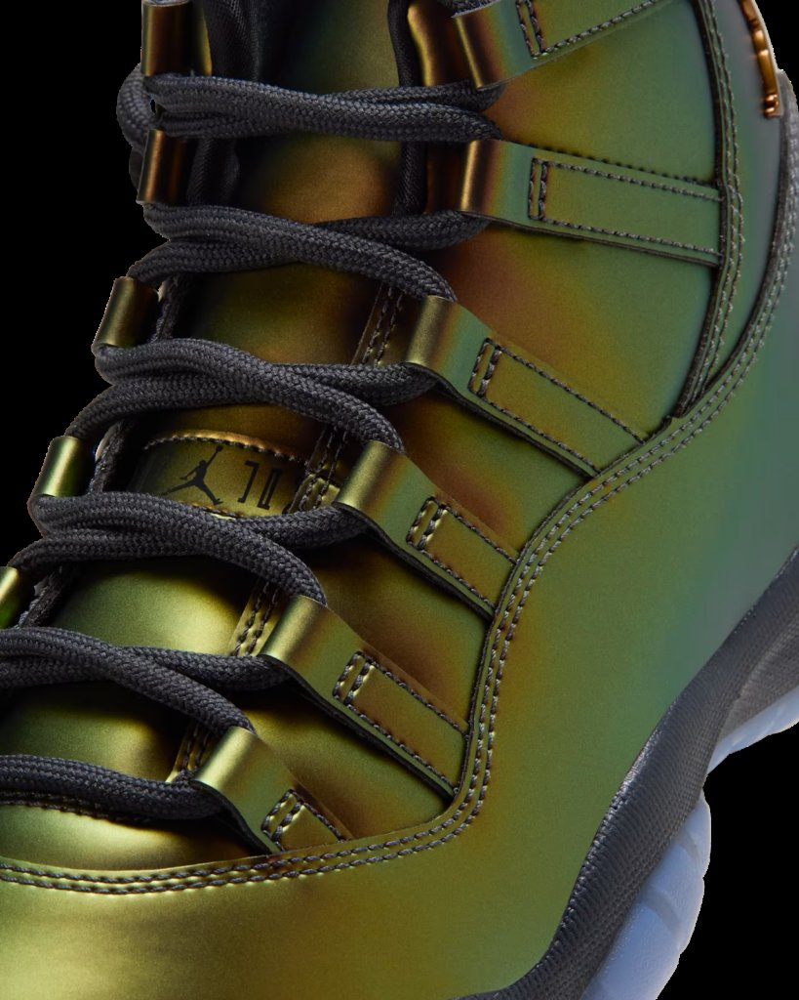
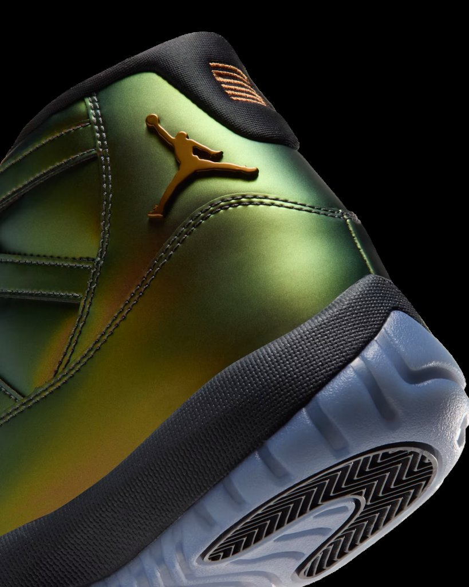
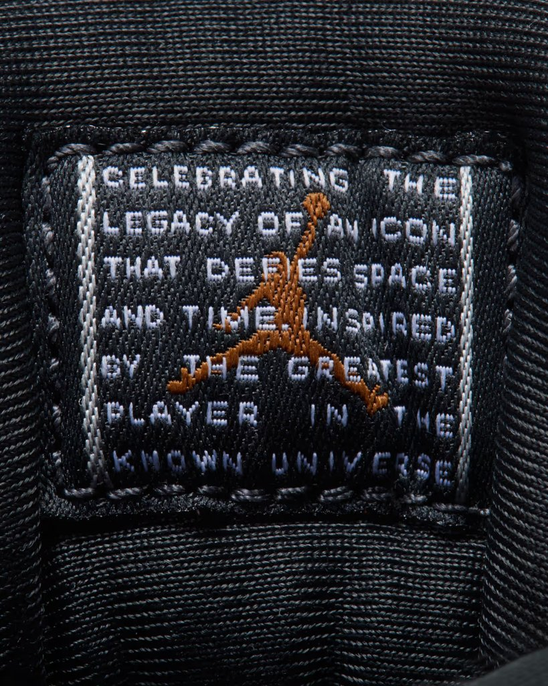
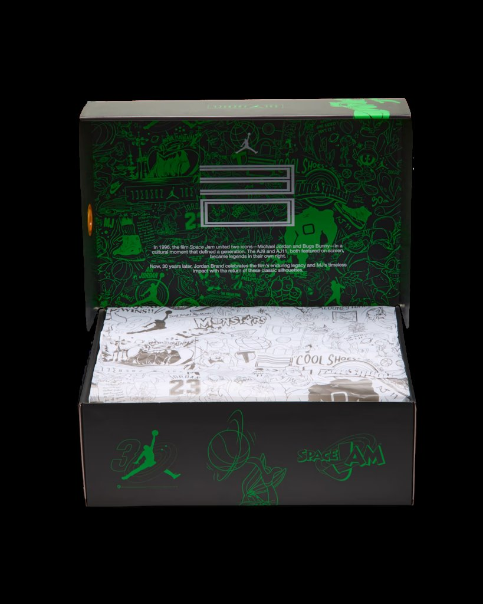
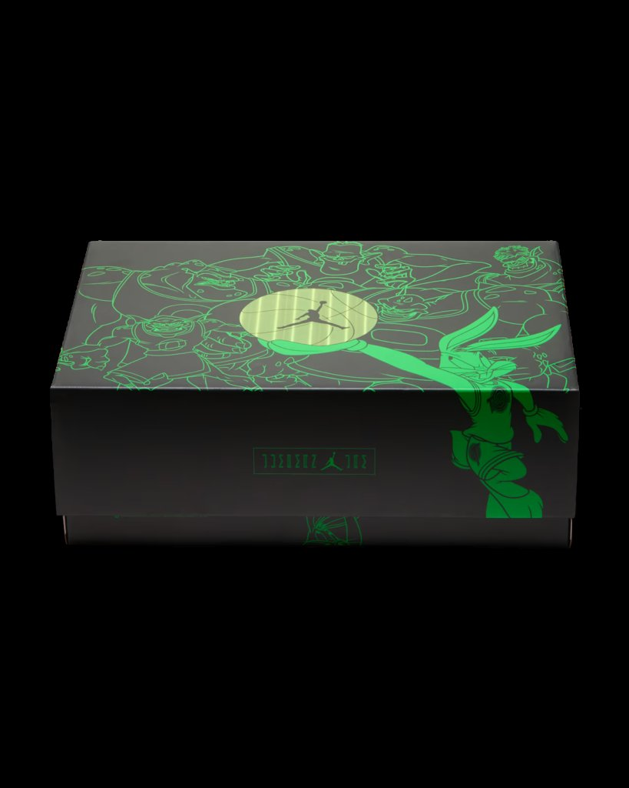

> [English version 英文版](/life/air-jordan-11-magic-ball/)

三十年前，一颗篮球偷走了五位 NBA 球星的天赋，把一群小外星人变成了怪兽。今天，这颗篮球变成了一双鞋。Air Jordan 11 “Magic Ball” 于今天——2026 年 11 月 11 日星期三，太平洋时间早上 7 点——在 Nike SNKRS 上架，售价 235 美元。它是 Jordan Brand《空中大灌篮》30 周年系列的第一双 Air Jordan 11，也是多年来设计上最大胆的一双 Jordan 11。原因不是它多忠实于原版，而是它打破了这个鞋型最神圣的一条规则：漆皮不见了。

先说一句实话：这不是上脚评测。鞋今天早上才发售，目前没有任何一家独立媒体对市售版做过有意义的实测。下面这篇长文是首次深度解析——事实、这双鞋在讲的电影故事、Jordan Brand 实际做出来的设计、让一双 11 值得被谈论的历史，以及 235 美元到底买到了什么——能核实的和暂时不能核实的会分开说清楚。

*侧面全貌：漆皮的位置变成了绿金幻彩鞋面，铜色 Jumpman 在后跟，黑色中底，冰蓝外底。图片：Nike，经 inthrill 转载。*

## 事实一览

| | |
|---|---|
| **型号** | Air Jordan 11 Retro “Magic Ball”（女款） |
| **货号** | IZ1800-200 |
| **配色** | Light British Tan / Metallic Silver – Off Noir（浅英伦棕／金属银－深黑） |
| **发售时间** | 2026 年 11 月 11 日星期三，美东时间上午 10 点／太平洋时间早上 7 点 |
| **发售价** | 235 美元（2026 年 11 月 11 日当日查询的 snapshot，以 Nike 及多家零售商为准，价格可能变动） |
| **发售渠道** | Nike SNKRS（先到先得）、Nike.com、Foot Locker、Champs Sports、Hibbett、SNIPES US、Sneaker Politics |
| **尺码** | 女款专属，加大尺码范围，一直延伸到男码大尺码 |
| **定位** | 《空中大灌篮》30 周年系列的 Air Jordan 11，灵感来自电影里那颗会发光、能偷走天赋的篮球——史上第一双变色幻彩鞋面的 AJ11 |

## Magic Ball 到底是什么

如果你没看过原版《空中大灌篮》，先用三十秒讲清楚，因为不讲电影，这双鞋就没法理解。怪兽队（Monstars）——电影里迈克尔·乔丹的外星对手——一开始只是 Nerdlucks，一群矮小、无害的外星人。他们需要篮球天赋，于是去偷：从五位 NBA 顶级球星——查尔斯·巴克利、帕特里克·尤因、马格西·博格斯、拉里·约翰逊和肖恩·布拉德利——身上抽走能力，装进一颗会发光的篮球里。这颗球是整部电影的麦高芬（MacGuffin），也是视觉上最难忘的道具：它泛着超现实的绿紫光芒，Nerdlucks 一碰到它就变身成怪兽。乔丹赢下比赛，就把天赋赢了回来——而天赋当时就住在这颗球里。

这双鞋讲的就是这颗球。不是乔丹，不是兔八哥，是球。Sneaker News 在发售日报道里写得很直白：“Magic Ball 的气场，被一整片绿铜幻彩皮面捕捉了下来。”自 10 月第一批实物图流出就一直在跟进的 Nice Kicks 则称它是周年系列“第四章，也是设计上最大胆的一章”。变色鞋面就是对那颗球的直接视觉还原——一个光线下是绿紫，换个角度又变金色——而且这双鞋的设计意图就是让它在每张照片里看起来都不一样，上脚和摆在架子上也不一样。这正是重点所在。

## 设计：史上第一双变色 Jordan 11

先讲那个“大逆不道”的改动，因为其余一切都从它推导出来。Air Jordan 11 的身份就是漆皮。自从 Tinker Hatfield 在 1995–96 赛季设计出这双鞋，包裹前掌的那圈亮面漆皮泥 guard 就是这个鞋型的签名——把正装细节借到篮球鞋上的神来之笔。“Magic Ball”把它拿掉了，换成一整片哑光幻彩合成皮革，覆盖整个鞋面。Nike 的说法是鞋面会在四种颜色之间变化——Men’s Journal 的发售日报道指出这是 Air Jordan 11 史上的第一次——而拿到过实物的媒体在不同光线下看到的颜色各不相同：Sneaker News 和 Nice Kicks 说是绿和紫，inthrill 说是从金变绿，etczine 则说是在绿与金之间闪现红紫色调。它们说的其实是同一回事，只是角度不同，而这正是幻彩材料的本质：它没有一张照片能定格的“本色”，只有当下光线给你的颜色。

必须承认，这是 Jordan Brand 冒的一次险，值得说清楚。一双 Concord、一双 Bred，一张照片就能看明白，你点购买之前就知道自己买的是什么。“Magic Ball”不行。在平直的中性光下它像一双偏暗的橄榄金；强光下变绿；斜着看闪紫。只看商品图下单的人，买到的是一系列可能的鞋，而不是一双确定的鞋。Jordan Brand 赌的是这个变化区间本身就是卖点——一双会随着你走路变色的鞋，比一双永远不变的鞋更有故事。这是品牌很少在 11 代上下的注——11 代是它最稳、最赚钱的复刻鞋型——光是这一点，就值得关注这双鞋。

鞋面之下，其余部分刻意收敛，而正是这种收敛让幻彩成立。鞋带、内衬、中底全是黑色；外底是冰蓝色半透明，经典的 11 代收尾。深黑与金属银的点缀贯穿鞋身，但不抢鞋面的戏。Nice Kicks 的判断很准：“当你的鞋面在实时变色时，鞋的其他部分只需要让开。”

细节才是周年叙事真正落点的地方，Jordan Brand 一点没省。后跟外侧是一枚铜色 TPU Jumpman，旁边是后跟织带上金线绣的 “23”。鞋舌文字是 “Jumpman Jam”，取代了这个型号惯用的 “Jumpman Jordan”——一个很小的改动，却在宣告这双鞋属于电影，而不只属于这个鞋款系列。鞋垫印着《空中大灌篮》30 周年标志。Nike 官方细节图里能看到的鞋舌织标上写着：“Celebrating the legacy of an icon that defies space and time. Inspired by the greatest player in the known universe.”（致敬一位超越时空的传奇；灵感来自已知宇宙中最伟大的球员。）纯粹的 Jordan Brand 造神文案，但也是这双鞋上最诚实的一句话：11 代卖的一向不只是鞋本身，更是它代表的东西。

*鞋眼片与绑带特写：这个角度下鞋面呈金色，换个光线会变绿。鞋舌上有 Jumpman 标志与周年元素。图片：Nike，经 inthrill 转载。*

*后跟细节——铜色 TPU Jumpman、后跟织带上的金色 “23”、黑色中底，以及带人字纹的半透明冰蓝外底。图片：Nike，经 inthrill 转载。*

*鞋舌织标：“Celebrating the legacy of an icon that defies space and time. Inspired by the greatest player in the known universe.”图片：Nike，经 inthrill 转载。*

## 鞋盒也是产品的一部分

还有一样不会出现在参数表里的东西：包装。“Magic Ball” 配的是特别版黑色鞋盒，盒身布满绿色线条画——怪兽队俯视着兔八哥，中间是那颗发光的球，球心一个 Jumpman，盒面还有一个 “30” Jumpman 标志。打开盒盖，内侧印着一段周年文案：1996 年，这部电影让迈克尔·乔丹和兔八哥走到一起，成就了一个定义一代人的文化时刻；三十年后，Jordan Brand 以这些经典鞋型的回归，致敬电影不朽的影响力。就连包装纸都延续了同样的线条画风格。

鞋盒通常是买家第一个扔掉的东西。这个盒子是设计来留着的，而对这双鞋的目标人群——已经有一双 Concord 或 Cool Grey 的收藏者——盒子在干实事：它把“一个配色”和“一个章节”区分开来。Jordan Brand 自己也明白，所以同样的处理贯穿整个周年系列：鞋盒就是告诉你“这不只是一双普通的 11”的画框。

*盒内：盖内侧的绿色线条画与周年文案，印花包装纸。图片：Nike，经 inthrill 转载。*

*合上的鞋盒——绿色线条画中的怪兽队与兔八哥，环绕着那颗会发光的球。图片：Nike，经 inthrill 转载。*

## 为什么是 11 代在扛这个分量

要理解一双三十年鞋型的女款专属配色为什么能霸占发售日历，得回到 11 代本身是什么。Tinker Hatfield 为 1995–96 赛季设计了它，那一年乔丹全职回归篮球，芝加哥公牛拿下 72 胜。它是一双伪装成篮球鞋的正装鞋：漆皮借自晚礼服，鞋底下是碳纤维弹力板和全掌 Air 气垫，鞋面是网布与 Cordura。乔丹在《空中大灌篮》电影里穿的正是黑白 Concord——电影和这双鞋在公众记忆里是焊在一起的。这也是为什么 “Space Jam” 配色（2000 年首次复刻，2009 年、2016 年又各复刻一次）至今仍是球鞋圈最受期待的发售之一。2016 年那次复刻几乎瞬间售罄，至今仍是“假日 Jordan 发售应该是什么样子”的标杆。

这段历史对 “Magic Ball” 来说是双刃剑。一方面，11 代是 Jordan Brand 手里最稳的画布：任何新配色默认就会有关注度，周年又给了它故事。另一方面，11 代的受众很保守，排队买 Concord 的人想要的就是 Concord。一双会变色、没有漆皮的 11，是在要求这群人接受一个顶着熟悉名字的不同鞋子——Men’s Journal 的发售日评价把这个分裂说得很直接：“如果你只看外观就被这个配色劝退，那电影情怀和经典鞋型的加持可能也不够。”这就是诚实的分界线。这双鞋不是给想让 11 代永远保持原样的人准备的，而是给想让 11 代做点新事的人准备的。

## 它周围的整个系列

“Magic Ball” 不是一次性产品。它是 Foot Locker 十二双装的《空中大灌篮》30 周年系列中三双 Air Jordan 11 的第一章，而接下来的一个月就是故事本身。系列于 11 月 5 日开场：Air Jordan 1 Low SE “Magic Ball”——同款哑光幻彩语言的低帮伴生款——外加两双 Air Jordan 1 Mid 和一双 Spizike Low；Air Jordan 9 “Space Jam” 也已经发售。下一章是 11 月 14 日星期六的 Air Jordan 11 “Green Screen”，255 美元（货号 IQ5700-900），男款与大童款，致敬电影实拍与动画场景的拍摄方式（绿幕），带夜光细节。再往后是 11 月 21 日的 Air Jordan 3 “Lola Bunny”。压轴是所有人真正等的那双：复刻电影原版的 OG Air Jordan 11 “Space Jam”，12 月 12 日发售，据报 255 美元（货号 CT8012-900）。

这个排期对今天要不要买很关键。“Magic Ball” 是设计先锋的章节；“Green Screen” 是幕后花絮的章节；12 月的 “Space Jam” 是忠实复刻的章节。Jordan Brand 故意把周年拆成了三次不同的购买决策，而 “Magic Ball” 是三章里唯一一双女款专属，也是唯一一双改了鞋身材质而不是只改颜色的。如果你要的是经典，等一个月；如果你要的是实验，今天就是那一天。

## 反响：热度、售罄信号，与“女款专属”这个问题

报道阵容本身就说明行业对这次发售有多重视。Sneaker News 在发售前夜专门做了一篇购买渠道清单；Sole Retriever 11 月 9 日发了完整购买指南；Nice Kicks 从 10 月第一批实物图起就一直在跟进；Men’s Journal、Sports Illustrated、Athlon 都在发售周做了拆解。House of Heat 给这双鞋打了 86.30° 的热度分。Sports Illustrated 的预览最直接：“大多数 Air Jordan 现在发售日已经卖不完了，这双应该是个例外。”

早期信号也指向同一个方向。Sneaker News 的实时购买追踪显示 Foot Locker 已经售罄，而 SNKRS 的发售是太平洋时间早上 7 点先到先得——没有抽签，没有摇号，只有速度。Nike 这个选择本身就很有信息量：抽签会把鞋分摊开，先到先得奖励的是那个时间点已经准备好的人；对一双女款专属、加大尺码的发售来说，那一分钟很关键。

这就说到了这双鞋最实际的一点：尺码。这是女款发售，但加大尺码范围一直延伸到男码大尺码——不同渠道给出的上限略有出入，inthrill 说大约到男码 12.5，Sports Illustrated 说到男码 14，Nike 自己的尺码表也是按女款加大范围走的。男士购买时按标准换算：女码比男码大 1.5，所以男码 12 对应女码 13.5。这很重要，因为 “Magic Ball” 悄悄成了这个假日季少数几条能买到真正新设计的 Jordan 11 大码的路——星期六的 Green Screen 才是男款发售，但 Magic Ball 先到，而且对最大尺码来说，它可能是拥有这款鞋面的唯一机会。

这里还有一个 Jordan Brand 多年来一直在绕的大问题：女款专属到底可以是什么。太多时候这个标签意味着粉色配色加缩小尺码范围。“Magic Ball” 正好相反——一双女款专属发售，扛着整个周年系列里最大胆的材质实验，也是三双 11 里唯一一双改了鞋身结构而不只是改颜色的。Nice Kicks 的表述很准确：这是“属于女鞋、而不是男女共享的 30 周年故事里的专属章节”。这是进步还是漂亮的营销，取决于下一双女款专属能不能得到同等待遇。就目前而言，鞋本身就是论据。

## 购买建议

按发售日真正重要的顺序，说几条实际的。

**尺码。** 按你的女码买，男士按男码加 1.5 换算。11 代历来合脚、鞋头略紧；这双合成皮革鞋面会不会改变这一点，目前还没有实测数据，所以如果在两个尺码之间，按惯例建议选大半码而不是小半码。

**现在还能买到吗。** SNKRS 先到先得是主战场；Sneaker News 的追踪显示 Foot Locker 已经售罄，Champs、Hibbett、SNIPES 和 Sneaker Politics 也都有货。如果错过了早上发售，转售市场是备选——但目前还没有可靠的转售价，第一批挂牌价还在波动，发售第一天不值得为它付高额溢价。Green Screen 星期六就到，OG “Space Jam” 12 月才来；周年是一整个月，不是一个早上。

**适合谁。** 如果你收藏 11 代，想要这次周年里唯一一双做了 11 代从没做过的事的鞋，就是它。如果你爱《空中大灌篮》，想要电影里最直观的物件变成鞋，就是它——它从字面上就是那颗球。如果你想要 Concord，或者想要一双在每张照片里看起来都一样的鞋，等 12 月 12 日。如果你是买来打球的，也对自己诚实一点：还没有人实测过市售版，11 代的全掌 Air 与碳板按今天的实战标准已经是三十年前的技术，这双鞋的价值在设计和故事，不在球场。

**一个提醒。** 幻彩涂层很难保养。变色鞋面是这双鞋的全部，也是最容易磨花、起皱、褪色的部分——而这种特定合成皮革会怎么老化，目前没人能告诉你，因为没人拥有一双超过几个小时。买了就穿着它，但要知道这个涂层本身就是实验。

## 结论

“Magic Ball” 是最好的一类周年鞋：它把周年当作做新事的许可，而不是重复旧事的借口。Jordan Brand 完全可以再出一双黑白 11、配个特别鞋盒就收工——12 月它确实会这么做。今天这双鞋是计划里更冒险的一半：一双没有漆皮、会变色的 11，看起来不像这个系列里的任何一双，围绕着《空中大灌篮》里那个没人想过要做成鞋的物件。幻彩鞋面会分化人群——真正的设计决策都会这样——但这双鞋是自洽的，细节是具体的，它讲的是电影的故事，不是市场部的故事。

三十年前，一颗发光的篮球把无名小卒变成了怪兽。今天，它把球鞋圈最稳妥的复刻鞋型，变成了日历上最有意思的一双。这就值 235 美元，也值得记住接下来的两章——星期六的 Green Screen、12 月 12 日的 OG——还没到来。

*价格与库存为 2026 年 11 月 11 日的 snapshot，依据 Nike、Sneaker News、Sole Retriever、Nice Kicks、Men’s Journal 与 Sports Illustrated 的报道；两者都可能变动。无 affiliate 链接。本文是首次解析，不是上脚评测——目前尚未有针对市售版的独立实测发表。*
