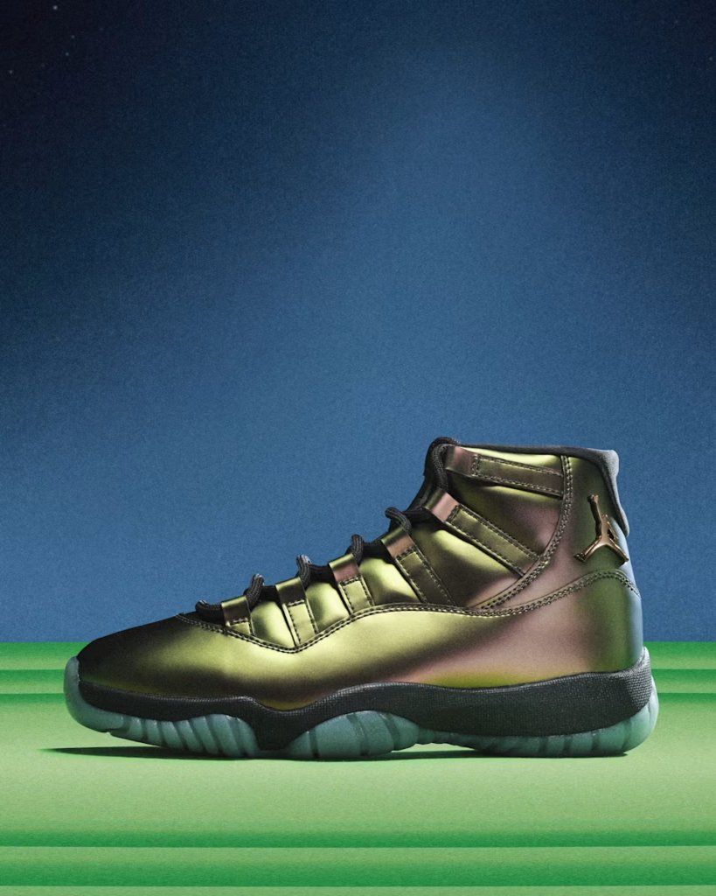
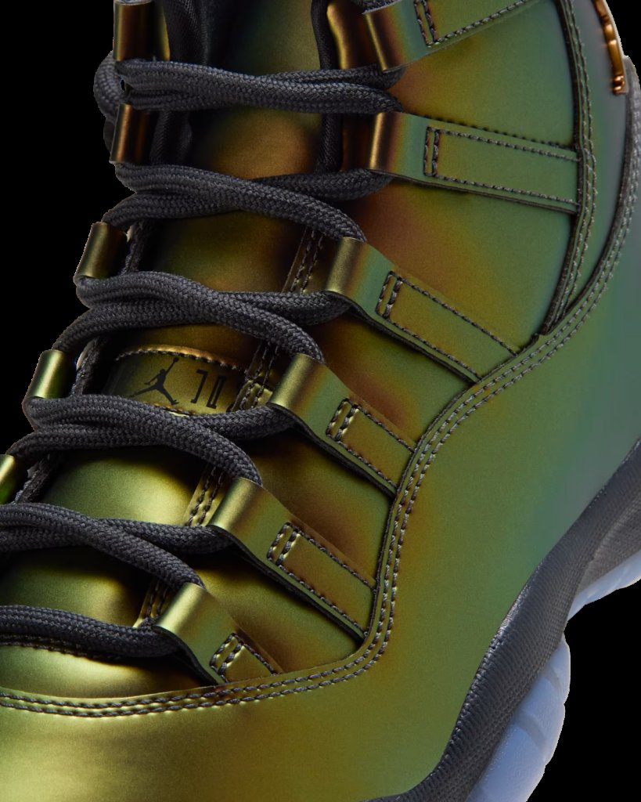
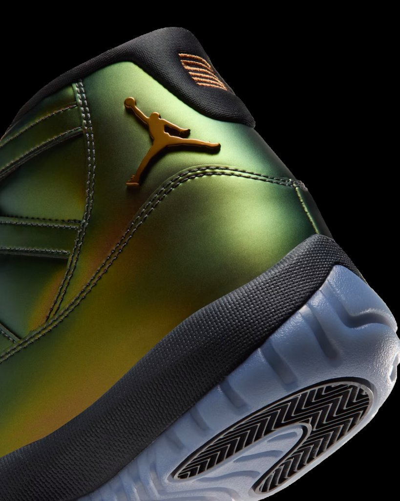
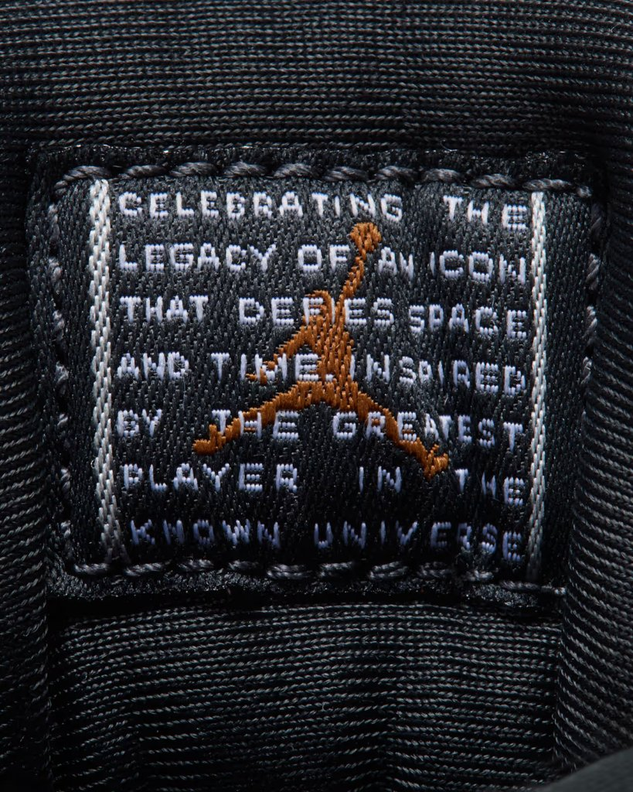
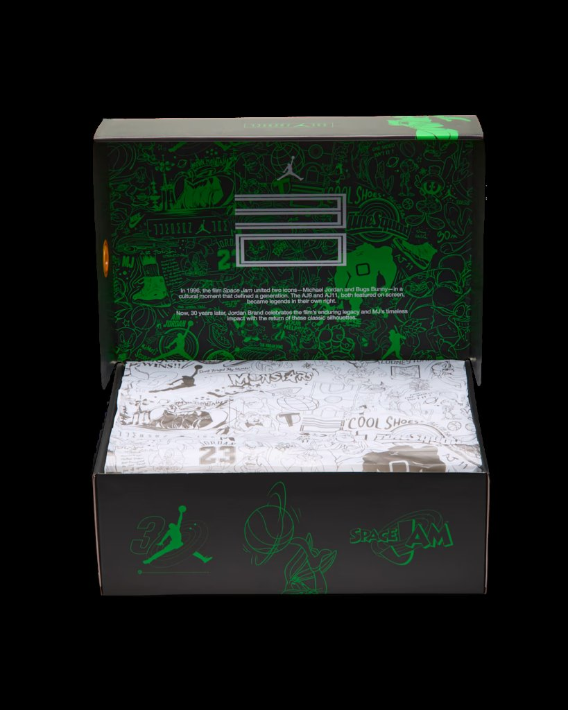
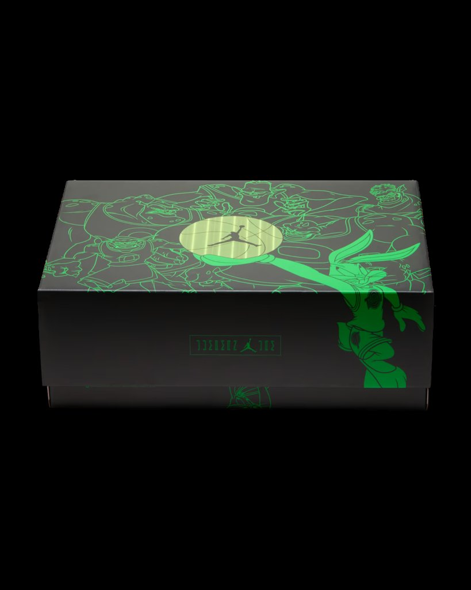

> [中文版 Chinese version](/life/air-jordan-11-magic-ball-zh/)

Thirty years ago, a basketball stole the talent of five NBA stars and turned a gang of tiny aliens into the Monstars. Today, that basketball became a shoe. The Air Jordan 11 “Magic Ball” dropped this morning — Wednesday, November 11, 2026, at 7:00 a.m. PT on Nike SNKRS — for $235, as the first Air Jordan 11 of Jordan Brand’s Space Jam 30th anniversary collection, and it is the most design-forward Jordan 11 the brand has released in years. Not because it is a faithful retro. Because it breaks the silhouette’s most sacred rule: the patent leather is gone.

One honest note up front: this is not a wear-test review. The shoes went on sale this morning, and no independent publication has put meaningful miles on a retail pair yet. What follows is a long first look — the facts, the film story the shoe is telling, the design as Jordan Brand built it, the history that makes an 11 matter, and what the $235 is actually buying — with the claims that can be checked separated from the ones that cannot.

*The “Magic Ball” in profile: an iridescent green-gold upper where patent leather used to be, a bronze Jumpman on the heel, black midsole, icy outsole. Image: Nike, via inthrill.*

## The facts

| | |
|---|---|
| **Model** | Air Jordan 11 Retro “Magic Ball” (W) |
| **Style code** | IZ1800-200 |
| **Colorway** | Light British Tan / Metallic Silver – Off Noir |
| **Release date** | Wednesday, November 11, 2026, 10:00 a.m. ET / 7:00 a.m. PT |
| **Retail price** | $235 (price snapshot as of November 11, 2026, per Nike and multiple retailers; subject to change) |
| **Where** | Nike SNKRS (first come, first served), Nike.com, Foot Locker, Champs Sports, Hibbett, SNIPES US, Sneaker Politics |
| **Sizing** | Women’s exclusive, in extended sizing that reaches well into men’s sizes |
| **What it is** | A Space Jam 30th anniversary Air Jordan 11 built around the film’s glowing talent-stealing basketball — the first AJ11 with a color-shifting iridescent upper |

## What the Magic Ball actually is

If you have never seen the original Space Jam, here is the thirty-second version, because the shoe makes no sense without it. The Monstars — Michael Jordan’s alien opponents in the 1996 film — start out as the Nerdlucks, a gang of small, unthreatening aliens. They need basketball talent, so they steal it: they siphon the abilities of five of the NBA’s biggest stars — Charles Barkley, Patrick Ewing, Muggsy Bogues, Larry Johnson and Shawn Bradley — and house the stolen talent in a single glowing basketball. The ball is the film’s MacGuffin and its most visually unforgettable prop: it pulses with an otherworldly green and purple light, and the moment the Nerdlucks touch it, they transform into the Monstars. When Jordan wins the game, he wins the talent back — and the ball, glowing, is where it all lived.

That is the object this shoe is built around. Not Michael Jordan. Not Bugs Bunny. The ball. Sneaker News put it plainly in its release-day coverage: “the very aura of the Magic Ball is captured through an iridescent green and copper finish across the entirety of the leather upper.” Nice Kicks, which has covered the collection since the first in-hand look in October, calls it “the fourth chapter and the most design-forward of them all” in Jordan Brand’s anniversary storytelling. The color-shifting finish is a direct visual reference to the basketball’s glow — green and purple in one light, gold in another — and the shoe is designed to photograph differently in every image and look different on foot than it does on a shelf. That is exactly the point.

## The design: the first color-shifting Jordan 11

Start with the heresy, because everything else follows from it. The Air Jordan 11’s identity is patent leather. Since Tinker Hatfield designed the shoe for the 1995–96 season, the glossy patent mudguard wrapping the forefoot has been the silhouette’s signature — the formalwear detail that made a basketball shoe look like it belonged at a black-tie event. The “Magic Ball” removes it. In its place is a matte, iridescent synthetic leather that runs across the entire upper. Nike says the finish shifts among four colors — a first for the Air Jordan 11, according to Men’s Journal’s release-day reporting — and the outlets that have handled the shoe describe the shift differently depending on the light: green and purple in Sneaker News and Nice Kicks’ telling, gold to green in inthrill’s, reddish-purple flashing between green and gold in etc zine’s. They are all describing the same thing from different angles, which is the nature of an iridescent material: there is no single true color to photograph, only the color the light gives you at that moment.

That is a genuine risk for Jordan Brand, and it is worth saying so. A Concord or a Bred is legible in a single photo; you know what you are buying before you click. The “Magic Ball” is not. In flat, neutral light it reads as a muted olive-gold; under bright light it goes green; at an angle it flashes purple. Anyone buying from a product photo is buying a range of possible shoes, not one shoe. Jordan Brand is betting that the range is the appeal — that the shoe changing as you walk is a better story than the shoe staying the same. It is the kind of bet the brand rarely makes on the 11, its safest and most commercial retro silhouette, and that alone makes this release worth paying attention to.

Underneath the statement upper, the rest of the shoe is deliberately restrained, and the restraint is what makes the iridescence work. The laces, sockliner and midsole are black; the outsole is icy blue, translucent, the classic 11 closer. Off Noir and Metallic Silver accents thread through the construction without competing with the upper. Nice Kicks’ read is the right one: “when your upper shifts between two colors in real time, the rest of the shoe just needs to stay out of the way.”

The details are where the anniversary storytelling lives, and Jordan Brand packed them in. A bronze TPU Jumpman sits on the lateral heel, next to a gold “23” embroidered on the nylon backtab. The tongue text reads “Jumpman Jam,” replacing the model’s usual “Jumpman Jordan” branding — a small change that signals this shoe belongs to the film, not just to the line. The insole carries a Space Jam 30th anniversary logo. And the tongue label, visible in Nike’s official detail photography, reads: “Celebrating the legacy of an icon that defies space and time. Inspired by the greatest player in the known universe.” It is pure Jordan Brand myth-making, and it is also the most honest sentence on the shoe: the 11 has always been sold as much on what it represents as on what it is.

*The iridescent eyestay and straps up close: the finish reads gold here, green in other light. The tongue carries the Jumpman logo above the anniversary branding. Image: Nike, via inthrill.*

*The heel in detail — bronze TPU Jumpman, gold “23” on the backtab, black midsole, and the translucent icy outsole with its herringbone traction. Image: Nike, via inthrill.*

*The tongue label: “Celebrating the legacy of an icon that defies space and time. Inspired by the greatest player in the known universe.” Image: Nike, via inthrill.*

## The box is part of the product

One more thing that does not show up in a spec sheet: the packaging. The “Magic Ball” ships in a special-edition black box covered in green line art — the Monstars looming over Bugs Bunny, the glowing ball with a Jumpman at its center, a “30” Jumpman mark on the front. Open it and the inside lid carries a short piece of copy marking the anniversary: in 1996, the film united Michael Jordan and Bugs Bunny in a cultural moment that defined a generation; thirty years later, Jordan Brand is celebrating the film’s enduring legacy with the return of these silhouettes. The tissue paper continues the line-art treatment.

Shoe boxes are usually the first thing a buyer throws away. This one is designed to be kept, and for the audience this release is aimed at — the collector who already owns a Concord or a Cool Grey — the box is doing real work. It is the difference between a colorway and a chapter. Jordan Brand knows that, which is why the same treatment runs across the anniversary collection: the box is the frame that tells you this is not just another 11.

*Inside the box: green line art across the lid, anniversary copy, and printed tissue. Image: Nike, via inthrill.*

*The closed box — the Monstars and Bugs Bunny in green line art around the magic ball itself. Image: Nike, via inthrill.*

## Why the 11 carries this weight

To understand why a women’s-exclusive colorway of a thirty-year-old silhouette can dominate a release calendar, you have to go back to what the 11 is. Tinker Hatfield designed it for the 1995–96 season, the year Jordan returned to basketball full-time and the Chicago Bulls won 72 games. It was a formal shoe disguised as a basketball shoe: patent leather borrowed from evening wear, a carbon fiber spring plate and a full-length Air unit underneath, mesh and cordura up top. Jordan wore the black-and-white Concord in Space Jam itself — the film and the shoe are fused in the public memory, which is why the “Space Jam” colorway, first retroed in 2000 and again in 2009 and 2016, remains one of the most anticipated releases in sneakers. The 2016 retro sold out almost instantly and still defines what a holiday Jordan release is supposed to feel like.

That history is a double-edged sword for the “Magic Ball.” On one side, the 11 is the safest canvas Jordan Brand owns: any new colorway of it gets attention by default, and the anniversary gives it a story. On the other, the 11’s audience is conservative. The people who line up for a Concord want a Concord. A color-shifting, patent-less 11 is asking that audience to accept a different shoe wearing a familiar name — and Men’s Journal’s release-day verdict was blunt about the split: “if you go on pure sight and this colorway turns you off, the connection to the film and the iconic silhouette may not be enough.” That is the honest divide. This is not a shoe for someone who wants the 11 to look like the 11 always has. It is a shoe for someone who wants the 11 to do something new.

## The collection around it

The “Magic Ball” is not a one-off. It is the first of three Air Jordan 11s anchoring a twelve-pair Space Jam 30th anniversary collection at Foot Locker, and the calendar is the story of the next month. The collection opened November 5 with the Air Jordan 1 Low SE “Magic Ball” — a companion low-top in the same matte iridescent language — plus two Air Jordan 1 Mids and a Spizike Low, and the Air Jordan 9 “Space Jam” has already released. Next up is the Air Jordan 11 “Green Screen” on Saturday, November 14, at $255 (style code IQ5700-900), a men’s and grade-school release that nods to how the film’s live-action and animated scenes were shot, with glow-in-the-dark details. The Air Jordan 3 “Lola Bunny” follows on November 21. And the finale is the one everyone is actually waiting for: the returning OG Air Jordan 11 “Space Jam” — the near-replica of the pair Jordan wore in the film — on December 12, reportedly at $255 (style code CT8012-900).

That sequencing matters for anyone deciding whether to buy today. The “Magic Ball” is the design-forward chapter; the “Green Screen” is the behind-the-scenes chapter; the December “Space Jam” is the faithful chapter. Jordan Brand has split the anniversary into three different buying decisions on purpose, and the “Magic Ball” is the only one of the three that is a women’s exclusive. It is also the only one that changes the material of the shoe itself. If you want the classic, wait a month. If you want the experiment, today was the day.

## The reception: heat, sellout signals, and the women’s-exclusive question

The coverage tells you how seriously the industry took this drop. Sneaker News ran a dedicated store list the night before release; Sole Retriever published a full where-to-buy guide on November 9; Nice Kicks has been tracking it since the first in-hand look in October; Men’s Journal, Sports Illustrated and Athlon all filed release-week breakdowns. House of Heat, which scores releases on its own heat scale, gave the pair an 86.30° rating. Sports Illustrated’s preview was the most direct about demand: “Most Air Jordans don’t sell out on release day anymore. That shouldn’t be the case with this highly anticipated release.”

The early signals point the same way. Sneaker News’ live buy tracker showed Foot Locker sold out, and the SNKRS drop was first come, first served at 7:00 a.m. PT — no draw, no raffle, just speed. That is a meaningful choice by Nike: a draw would have spread the pairs around; first come, first served rewards whoever was ready at the minute, and for a women’s-exclusive release with extended sizing, the minute mattered.

Which brings us to the sizing question, the most practical thing about this shoe. This is a women’s release, but the extended sizing runs well into men’s territory — outlets put the top end at roughly a men’s 12.5 (inthrill) to a men’s 14 (Sports Illustrated), and Nike’s own size chart runs the women’s extended range accordingly. For men buying in, the standard conversion applies: go 1.5 sizes up from your men’s size to find the women’s equivalent, so a men’s 12 is a women’s 13.5. That matters because the “Magic Ball” is, quietly, one of the few ways to get a genuinely new Jordan 11 design in a men’s 12 this holiday season — the Green Screen on Saturday is the men’s release, but the Magic Ball got there first, and for the biggest sizes it may be the only shot at this particular upper.

There is a larger question here that Jordan Brand has been circling for years: what a women’s exclusive can be. Too often the label has meant a pink colorway and a smaller size run. The “Magic Ball” is the opposite — a women’s-exclusive release that carries the most experimental material in the entire anniversary collection, and the only 11 in the trio that changes the shoe’s construction rather than its colors. Nice Kicks’ framing is exactly right: this is “a dedicated chapter within the 30th anniversary story that belongs entirely to women’s footwear rather than a shared general release.” Whether that is progress or just good marketing depends on whether the next women’s exclusive gets the same treatment. For now, the shoe itself is the argument.

## Buying advice

A few practical notes, in the order that matters on a release day.

**Sizing.** Buy your women’s size, or your men’s size plus 1.5. The 11 has historically fit true to size with a slightly snug toe box; there is no wear-test data on this pair yet to say whether the synthetic leather upper changes that, so if you are between sizes, the usual advice is to go up half a size rather than down.

**Availability now.** The SNKRS first-come-first-served drop is the main event; Foot Locker was already showing sold out in Sneaker News’ tracker, and Champs, Hibbett, SNIPES and Sneaker Politics carried it as well. If you missed the morning drop, the secondary market is the fallback — but there is no reliable resale price yet, the first listings are still settling, and nothing here is worth chasing at a large premium on day one. The Green Screen arrives Saturday and the OG “Space Jam” in December; the anniversary is a month long, not a morning long.

**Who it is for.** If you collect 11s and want the one pair from this anniversary that does something the silhouette has never done, this is it. If you love Space Jam and want the most literal piece of the film turned into a shoe, this is it — it is, quite literally, the ball. If you want a Concord, or a shoe that looks the same in every photo, wait for December 12. And if you are buying it to play basketball in, be honest with yourself: no one has wear-tested a retail pair, the 11’s full-length Air and carbon plate are thirty-year-old technology by modern performance standards, and this shoe’s value is in the design and the story, not in the court.

**The one caveat.** Iridescent finishes are hard to keep. The color-shifting upper is the whole shoe, and it is also the part most vulnerable to scuffs, creasing and fading — and nobody can tell you yet how this particular synthetic leather ages, because nobody has owned a pair longer than a few hours. If you buy it, wear it knowing the finish is the experiment.

## Verdict

The “Magic Ball” is the best kind of anniversary shoe: it uses the anniversary as permission to do something new instead of as an excuse to repeat something old. Jordan Brand could have shipped another black-and-white 11 with a special box and called it a day — and in December, it will. Today’s shoe is the riskier half of the plan: a patent-less, color-shifting 11 that looks like nothing else in the line, built around the one object in Space Jam that nobody had thought to turn into a shoe. The iridescent upper will divide people — that is what a real design decision does — but the shoe is coherent, the details are specific, and the story it tells is the film’s story, not a marketing department’s.

Thirty years ago, a glowing basketball turned nobodies into monsters. Today it turned the safest retro in sneakers into the most interesting one on the calendar. That is worth $235, and it is worth remembering that the next two chapters — Green Screen on Saturday, the OG on December 12 — are still to come.

*Price and availability are a snapshot as of November 11, 2026, based on Nike, Sneaker News, Sole Retriever, Nice Kicks, Men’s Journal and Sports Illustrated reporting; both are subject to change. No affiliate links. This is a first look, not a wear test — no independent wear testing of a retail pair has been published yet.*
