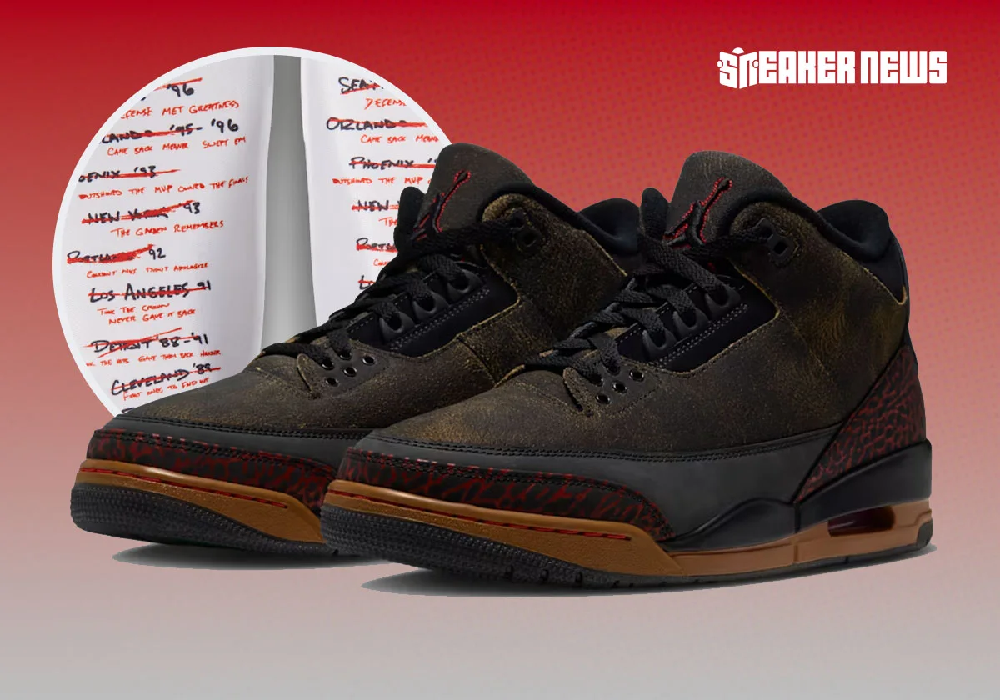
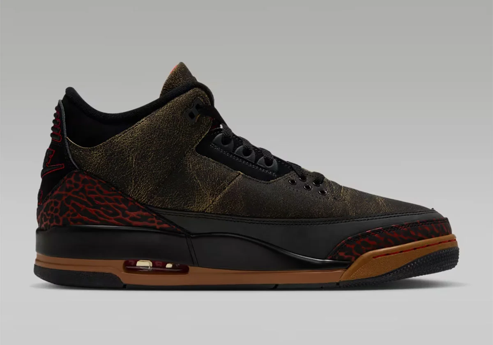
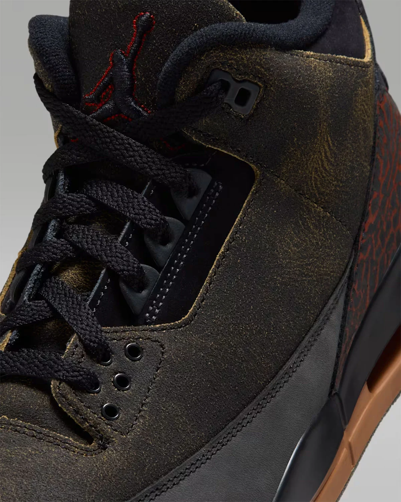
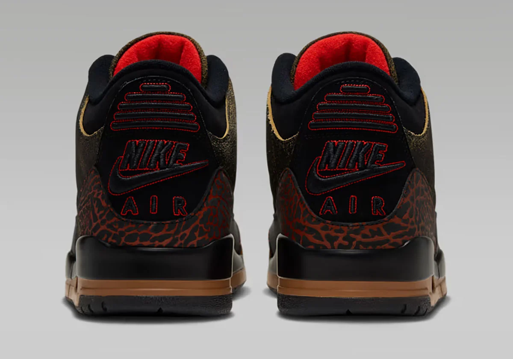
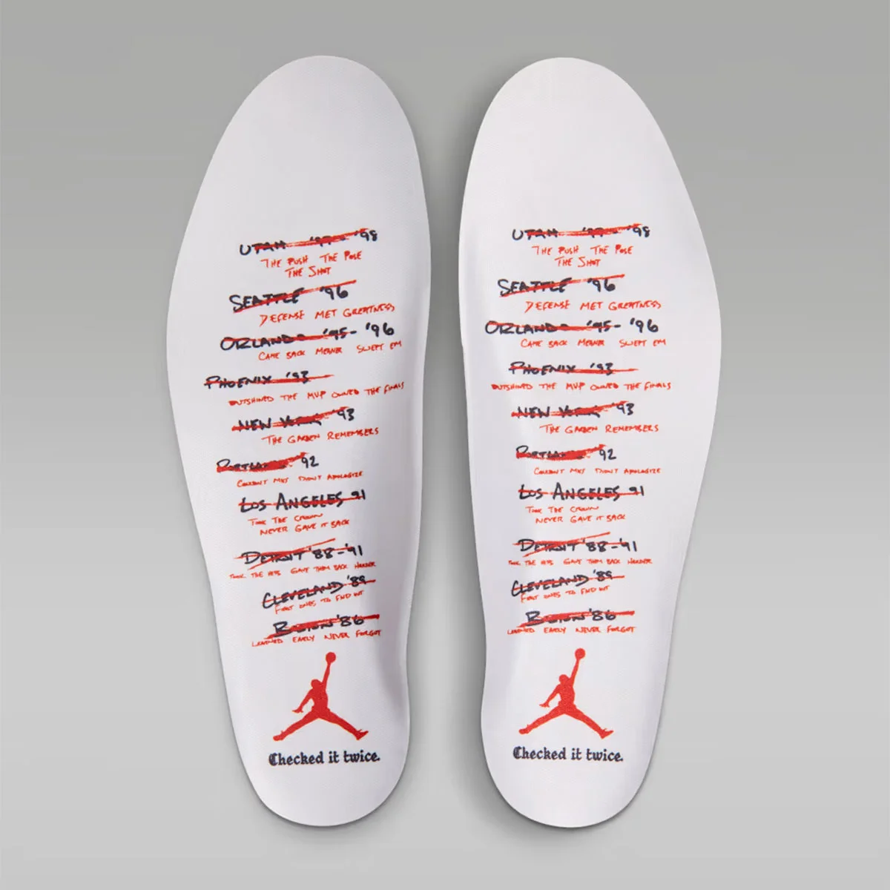
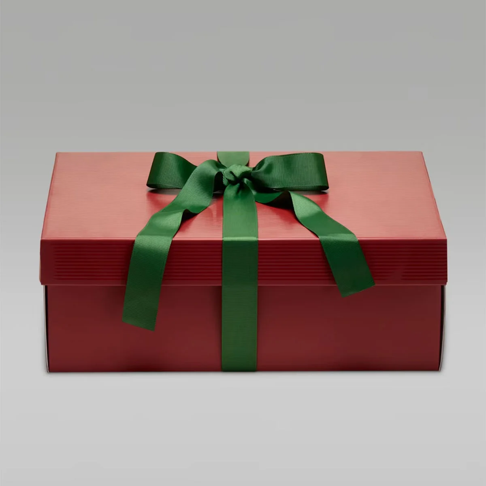
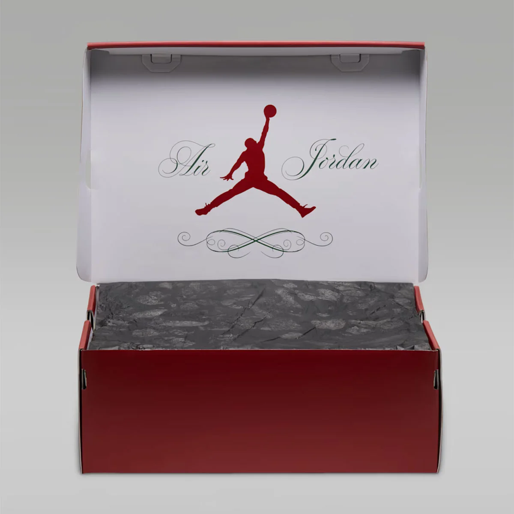

> [English version 英文版](/life/air-jordan-3-not-nice/)

这个星期六最值得关注的 Jordan 发售，跟“乖”没有半点关系。Air Jordan 3 Retro “Not Nice”（货号 IF4396-001）将于明天、2026 年 11 月 21 日星期六发售，男款 215 美元——一双围绕圣诞节另一面打造的球鞋：那块煤、圣诞老人的淘气名单，以及联盟历史上最好胜的球员。它是本周的头号 Jordan 发售：官方图片 11 月 9 日就已公布，Foot Locker 的发售页面已经上线，Sneaker News、Sole Retriever、Nice Kicks、DTLR、Sports Illustrated 和 Grailify 第 47 周最热发售榜单都做了报道。

先说一句实话：这不是上脚评测。这双鞋明天才面向公众发售，写稿时还没有任何针对它的独立上脚实测。下面是一篇基于官方图片与已确认事实的长篇初看：煤块灵感的设计逐个细节解读、把乔丹季后赛生涯做成账本的鞋垫、礼物一样的包装、让这个创意成立的 1988 年历史，以及明天早上 10 点（美东时间）值不值得定个闹钟。

*Air Jordan 3 “Not Nice”（IF4396-001）与淘气名单鞋垫：做旧黑皮、红黑爆裂纹、做旧棕色中底。图片：Nike，经 Sneaker News。*

## 基本事实

| | |
|---|---|
| **鞋款** | Air Jordan 3 Retro “Not Nice”（部分零售商也写作 “Not Nice List”） |
| **货号** | IF4396-001 |
| **配色** | Black / Challenge Red / Off Noir，裂纹之下透出 Elemental Gold 金色底色 |
| **发售日期** | 2026 年 11 月 21 日星期六，美东时间上午 10:00 |
| **发售价** | 男款 215 美元；全家尺码：大童 155 美元、小童 95 美元、婴童 80 美元——价格为 2026 年 11 月 20 日当日查询的 snapshot，subject to change |
| **发售渠道** | Nike SNKRS / Nike.com、Foot Locker、Finish Line、Hibbett、Shiekh、DTLR、Sneaker Politics、SNIPES US 及指定 Jordan Brand 零售商 |
| **这是什么鞋** | 圣诞主题 Air Jordan 3：煤块灵感的做旧裂纹皮革、红色爆裂纹，鞋垫印着迈克尔·乔丹整个季后赛生涯的圣诞老人淘气名单 |

## 为什么是今天的故事

热度很容易证明，因为报道从各个方向同时来了。Sneaker News 11 月 9 日发布官方图片，附 11 张照片。Sole Retriever 11 月 19 日出了购买指南。Nice Kicks、DTLR 和 Sports Illustrated 的 Kicks on SI 在同一时间段都做了完整解析。Grailify 把它放进第 47 周最热发售榜单，House of Heat 称它是本周的头号 Jordan 发售。Foot Locker 的发售页面已经上线，链接将于星期六美东时间上午 10:00 开放。

还有一个结构性的原因，让它比一般的节日配色更重要。11 月 21 日星期六是“三双 Jordan 3 同一天”：男款 “Not Nice” 215 美元发售的同时，还有两双仅限儿童尺码的配色——“Santa”（DM0967-601，大童 155 美元）和 “Lola Bunny” 大童款。而它只是 Jordan Brand 假日攻势的开场：Air Jordan 4 “Bred” 将于 11 月 27 日黑色星期五发售，230 美元；Air Jordan 11 “Space Jam” 将于 12 月 12 日发售，235 美元，是 Space Jam 30 周年系列的压轴。“Not Nice” 是这三根台柱子里第一双真正发售的，也是唯一一双靠故事而不是靠 OG 配色撑场面的。

这个故事就是它在官方图片公布整整 12 天之后、热度依然不减的原因。节日 Jordan 通常是红色、白色、求稳。这双是黑色、烧焦的、带着脾气的——而脾气正是重点所在。

## 设计：一块煤，穿在脚上

鞋面就是整个创意。它用做旧的裂纹皮革打造，Off Noir 底色——Sneaker Files 的描述是带裂纹的 Velvet Brown 麂皮——裂纹之下透出浅金色与 Elemental Gold 的底色，就像一块在火里烧过的煤块透出余烬。这是一双设计上就“看起来穿过”的 Jordan，旧化处理本身就是设计，而不是瑕疵。在官方照片里，金色像一层铜锈铺在鞋头、鞋带孔条和鞋领上，与黑色底形成暖对比。

爆裂纹——Air Jordan 3 的标志，自 1988 年这款鞋诞生就有的元素——也做了同样的处理。鞋头与鞋跟处的爆裂纹是黑色与 Challenge Red 的组合，像着了火的纹路。鞋头的挡泥板与鞋领是纯黑麂皮，把这双鞋拉回克制：最张扬的元素只留在爆裂纹一直存在的那两块区域。红色从鞋舌一路延续到内衬——一双几乎全黑的鞋，里面是亮眼的 Challenge Red。

*侧面：做旧皮革鞋面、鞋头与鞋跟的红黑爆裂纹、做旧棕色中底里的可见气垫。图片：Nike，经 Sneaker News。*

有两个细节在缩略图里容易错过，值得点名。第一是中底：做旧的棕色，延续了鞋面的陈旧感，鞋跟处的可见气垫在官方照片里透出一点粉红。第二个是外底：Off Noir 底色，前掌转轴处有一圈深绿色（Fir 冷杉绿）的圆形区域，压印着 Nike 标志——圣诞配色里的一点绿，从来没有上过鞋面。

品牌标识是 OG 规格，这一点老收藏家会先检查。鞋舌是黑色刺绣的立体 Jumpman，带红色描边；鞋跟是 Nike Air——不是 Jumpman——黑色刺绣带红色描边。在一双复刻 3 代上，鞋跟的 Nike Air 是区分忠实复刻与现代化改款的关键，这双做对了。

*鞋面特写：裂纹麂皮、鞋舌上黑底红边的 Jumpman 与鞋带孔。图片：Nike，经 Sneaker News。*

*鞋跟：黑底红边的 Nike Air 刺绣、红色爆裂纹、亮红色内衬。图片：Nike，经 Sneaker News。*

## 鞋垫：迈克尔·乔丹的淘气名单

这双鞋上最好的细节，是穿上之后谁也看不见的那一个。鞋垫是白色的，印着迈克尔·乔丹整个季后赛生涯，做成圣诞老人的淘气/乖孩子名单——每一个对手都被红笔划掉，旁边用红色手写体写着一句短评，底下是一个红色 Jumpman 和一句哥特字体的 “Checked it twice.（我都检查过两遍了）”。

名单按倒序排列，从鞋垫顶部往下读。最上面是 “The Last Shot（最后一投）”：犹他 ’98——“The Push, The Poke, The Shot（推、戳、投）”。然后是西雅图 ’96——“Defense Met Greatness（防守遇上了伟大）”。奥兰多 ’95–’96——“Came Back Meaner, Swept ’Em（回来得更狠，横扫了他们）”。菲尼克斯 ’93——“Outshined The MVP, Owned The Finals（盖过了 MVP，拿下了总决赛）”。纽约 ’93——“The Garden Remembers（花园球馆记得）”。波特兰 ’92。洛杉矶 ’91——“Took The Crown, Never Gave It Back（夺走了王冠，再也没还回去）”。底特律 ’88–’91——“Took The Hits, Gave Them Back Harder（挨了打，还得更狠）”。克利夫兰 ’88。名单的最底端，也就是故事的起点，是波士顿 ’86——“Learned Early, Never Forgot（很早就学会了，永远没忘）”——乔丹职业生涯的第一个季后赛系列赛，对手是拉里·伯德的凯尔特人。

这个设计聪明的地方在于它的具体。乔丹确实会把每一个对手的冒犯记在心里——Sports Illustrated 解析这双鞋的开篇说的正是这一点——鞋垫把一种性格特征做成了产品细节。被划掉的名字是笑点，但笑点成立，是因为背后的战绩是真的：六个总冠军，名单上的每一支球队都在输的那一边。

*鞋垫：乔丹的季后赛生涯做成圣诞老人的淘气名单，每个对手都被红笔划掉，从顶部的犹他 ’98 到底部的波士顿 ’86，底下是哥特字体的 “Checked it twice.”。图片：Nike，经 Sneaker News。*

还有一个隐藏细节，开箱报道都在反复提：Nike Air 的鞋跟标可以掀起来，底下绣着 “Not Nice” 几个字。这是鞋款的名字，藏在自己的品牌标识后面——加这个细节不花什么成本，却正是区分“主题配色”与“只是深色”的地方。

## 包装：它就是一份礼物

Jordan Brand 没有停在鞋本身。“Not Nice” 装在一个特别的红色鞋盒里，外面系着绿色丝带，打成蝴蝶结——这双鞋在打开之前，就已经是一份礼物。盒盖内侧，一个红色 Jumpman 夹在花体字的 “Air” 与 “Jordan” 之间，底下是一道绿色花纹。包装纸是煤黑色的。盒子里还附了一副红色鞋带和一张绿色字体的吊牌。

包装比平时更重要，因为盒子本身就是概念的一部分，而不是装概念的容器。一双圣诞鞋以礼物的样子出现——而且按它自己的说法，是送给今年“不太乖”的人的礼物——这个笑话讲了两遍：一遍在鞋垫上，一遍在货架上。这也是那种会让一次发售“感觉上”很限量的特殊包装，哪怕它其实并不是，这一点等到星期六下午转卖链接出现时值得记住。

*特别版红色鞋盒，系着绿色丝带。图片：Nike，经 Sneaker News。*

*打开的鞋盒：盒盖内侧是花体 “Air Jordan” 与红色 Jumpman，底下是煤黑色的包装纸。图片：Nike，经 Sneaker News。*

## 历史：为什么这个创意只有 3 代能成立

Air Jordan 3 是讲这个故事的正确鞋型，不只是因为它有爆裂纹。3 代由 Tinker Hatfield 设计、1988 年发售，被广泛认为是在 Air Jordan 2 代失手之后拯救了乔丹签名鞋系列的那双鞋——Hatfield 与乔丹本人密切合作，做了一双他真正想穿的鞋；斯派克·李扮演 Mars Blackmon 的广告则留下了那句 “It's gotta be the shoes!（一定是这双鞋的问题！）”。它是第一双带可见气垫的 Jordan、第一双带爆裂纹的 Jordan、第一双印上 Jumpman 标志的 Jordan。1988 年只有四个 OG 配色；Jordan Brand 从 2001 年开始复刻这款设计，此后一直在上面讲新的故事。

圣诞节的联系比 3 代本身还要早。Nice Kicks 指出，“Not Nice” 配色的灵感来自 1985 年那支著名的 Air Jordan 1 烟囱广告——圣诞老人的世界与篮球相撞的早期 Jordan Brand 影像。从这个意义上说，“Not Nice” 是一个酝酿了四十年的想法，终于有了属于自己的鞋：那个品牌从一开始就在打转的、节日的“淘气”一面。

这段历史也是做旧皮革在这双鞋上成立、而在大多数复刻鞋上不成立的原因。Air Jordan 3 是一双 1988 年的篮球鞋，如今没有人再为实战买它——Sports Illustrated 说得很直接：鞋型保留了原来的技术，皮革与麂皮鞋面、聚氨酯中底、前后掌 Nike Air，但它已经不再被归类为实战鞋型。人们买的是设计和故事。一双做旧的、煤黑色的 3 代，是用材质讲的故事，而材质做的工作，是干净的红白圣诞配色永远做不到的。

## 星期六，以及之后的假日档期

“Not Nice” 不是独自发售。星期六一次来三双 Air Jordan 3：男款 “Not Nice” 215 美元，以及两双仅限儿童尺码的 “Santa”（DM0967-601，大童 155 美元）和 “Lola Bunny” 大童款。“Santa” 是同一个节日的另一面——乖孩子名单，对应 “Not Nice” 的淘气名单——这个搭配是故意的：Jordan Brand 在同一个早上卖圣诞节的两面。

星期六之后，档期更大。Air Jordan 4 “Bred”——真正的黑色星期五台柱——将于 11 月 27 日发售，230 美元。Air Jordan 11 “Space Jam” 将于 12 月 12 日发售，235 美元，是 Space Jam 30 周年系列的收官之作，之后还有 12 月 19 日的 “Rust Pink Thunder” Jordan 4。“Not Nice” 是这些台柱子里第一双真正发售的，这也是本周报道如此密集的部分原因：它是检验今年假日 Jordan 热度到底有多高的第一次实测。

## 这双鞋是什么，不是什么

有必要说清楚你买的是什么。这是一双复刻生活方式鞋，不是实战鞋，215 美元是如今一双高端 Air Jordan 3 复刻的正常价格——与本月早些时候的 Air Jordan 6 “White Infrared” 同价，比黑色星期五的 “Bred” 4 代便宜 15 美元。裂纹皮革是出厂做旧，不是穿旧的，它起皱、老化的方式会和标准复刻 3 代的光面皮革不同——这正是设计的本意，但在决定这双鞋适不适合你之前，值得先看特写照片。爆裂纹、鞋跟的 Nike Air、可见气垫，都忠于 1988 年的原版；做旧处理、鞋垫和包装，都是新的。

也有必要说清楚它不是什么。它不是限量亲友款：它是男款常规发售，通过 Nike 和一长串零售商发售，全家尺码，发售时间提前公布在美东时间上午 10:00。它不是泄露或传闻——官方图片 11 月 9 日就已公开，货号和价格在 Nike 自己的产品页面上确认，零售商名单也已公布。它也不是上脚评测：Jordan Brand 之外还没有人穿过这双鞋，任何关于它穿八小时是什么感觉的说法都是猜测，包括这篇文章。唯一值得转述的尺码建议，是近期 Air Jordan 3 复刻的普遍情况——按正常尺码买——请把它当作这条产品线的既往经验，而不是针对这双鞋实测过的结论。

## 谁该去抢，怎么抢

购买策略很简单，关键全在时间。发售时间是 11 月 21 日星期六，美东时间上午 10:00，Nike SNKRS 和 Foot Locker 同步，Finish Line、Hibbett、DTLR 等其余零售商也会跟进。常规打法：先 SNKRS，再 Foot Locker——它的链接将于美东时间上午 10:00 开放——然后是其他零售商。发售实际开始之前，不要去付转卖价。一双定在明天早上发售的常规款，在发售前的转卖价是你能见到的最贵的价，它是真实数量、真实渠道、215 美元的常规发售。

这双鞋适合谁？为故事买 Jordan 3 的收藏者，会发现这是 Jordan Brand 一段时间以来在 3 代上讲得最完整的故事——光鞋垫本身，就是比大多数整套系列更好的设计文案。已经有标准黑红 3 代、想在鞋柜里添一双看起来不一样的，会发现做旧皮革与余烬爆裂纹在不改变鞋型的前提下做到了这一点。而要给 Jordan 球迷买圣诞礼物的人，请注意包装：这是一双罕见的不需要包装纸的鞋。

谁应该 pass？想要一双干净、百搭的黑色 Jordan 3，这双不是——做旧就是整双鞋，它永远不会看起来干净。想要实战鞋，去买现役款。如果没抢到，也不用慌：假日 Jordan 档期在它之后还有两根台柱子，而 “Not Nice” 是常规发售，不是一次性的早上活动。

## 结论

Air Jordan 3 “Not Nice” 是近年来最好的一双节日 Jordan，原因不在配色——而在于这个想法的完整程度。煤块皮革、余烬爆裂纹、淘气名单鞋垫、鞋跟标底下藏着的信息、礼物一样的鞋盒：鞋上的每一个部分都在讲同一个笑话，而这个笑话建立在一个真实的故事之上——关于这项运动历史上最好胜的球员。大多数主题配色挑一个细节就停了，这双把想法一路贯彻到了包装纸。

它也提醒了人们 Air Jordan 3 在 2026 年是用来干什么的。在 Tinker Hatfield 用它拯救了整个系列的 38 年之后，3 代早已不是一双篮球鞋，它是一个讲故事的平台——而在星期六早上，这个故事是：有时候，最好的礼物并不属于乖孩子。

*价格为 2026 年 11 月 20 日当日查询的 snapshot，subject to change。来源：Sneaker News（官方图片与发售信息，2026 年 11 月 9 日）；Sole Retriever（购买指南，2026 年 11 月 19 日）；Nice Kicks（发售日期、价格与 1985 年烟囱广告的联系）；Sports Illustrated / Kicks on SI（发售时间、全家尺码、技术参数与 AJ3 历史，2026 年 11 月 8 日）；DTLR（设计解析，2026 年 11 月 16 日）；Sneaker Bar Detroit（货号、配色与发售日期）；Sneaker Files（鞋面材质与发售细节）；Grailify（第 47 周最热发售）；Kick Supply（2026 年剩余 Jordan 发售日历，2026 年 11 月 19 日更新）；HotNewHipHop（开箱与包装细节）。这是一篇初看，不是上脚评测：Air Jordan 3 “Not Nice” 将于 2026 年 11 月 21 日发售，写稿时尚无独立上脚实测。*
