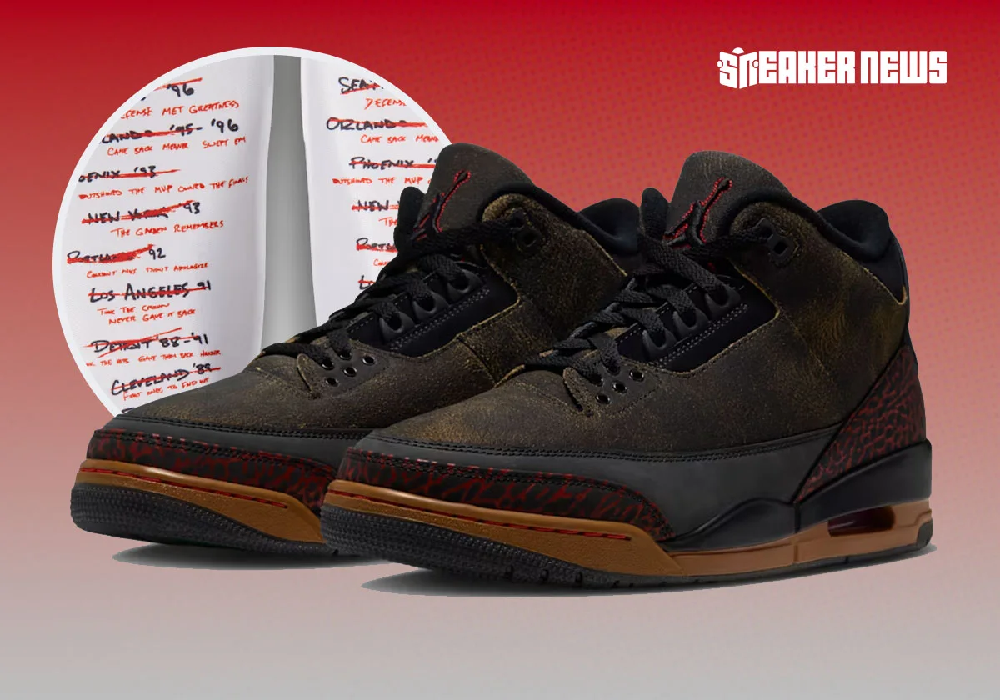
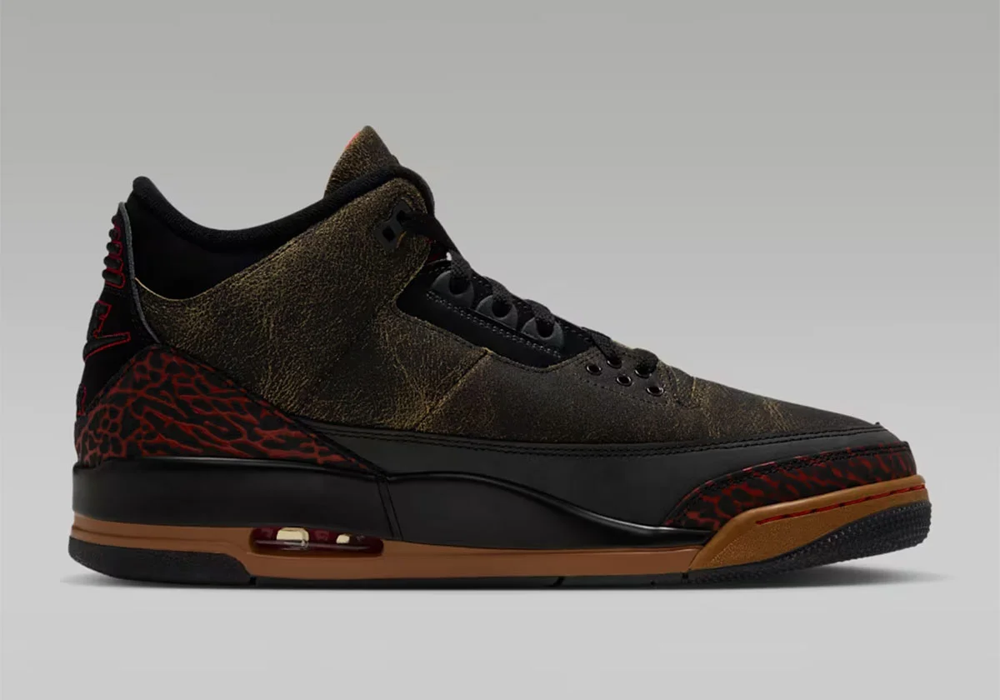
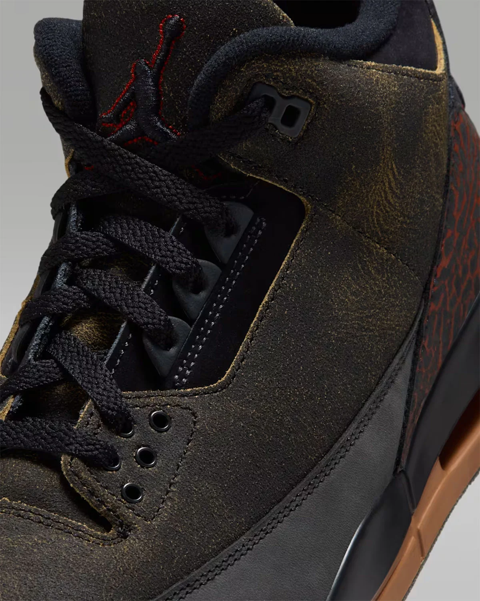
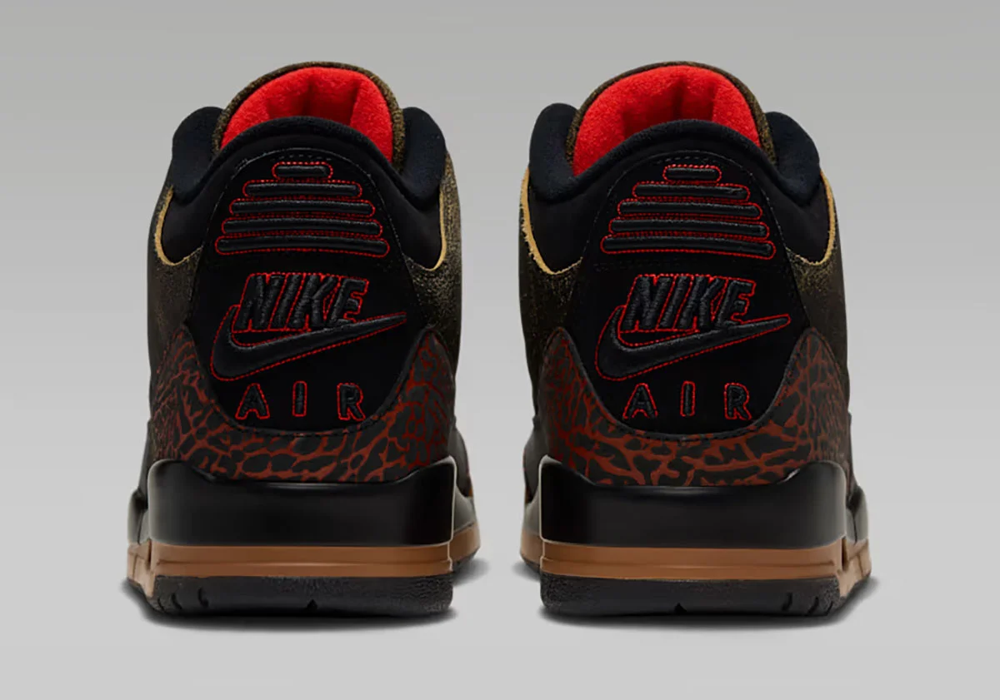
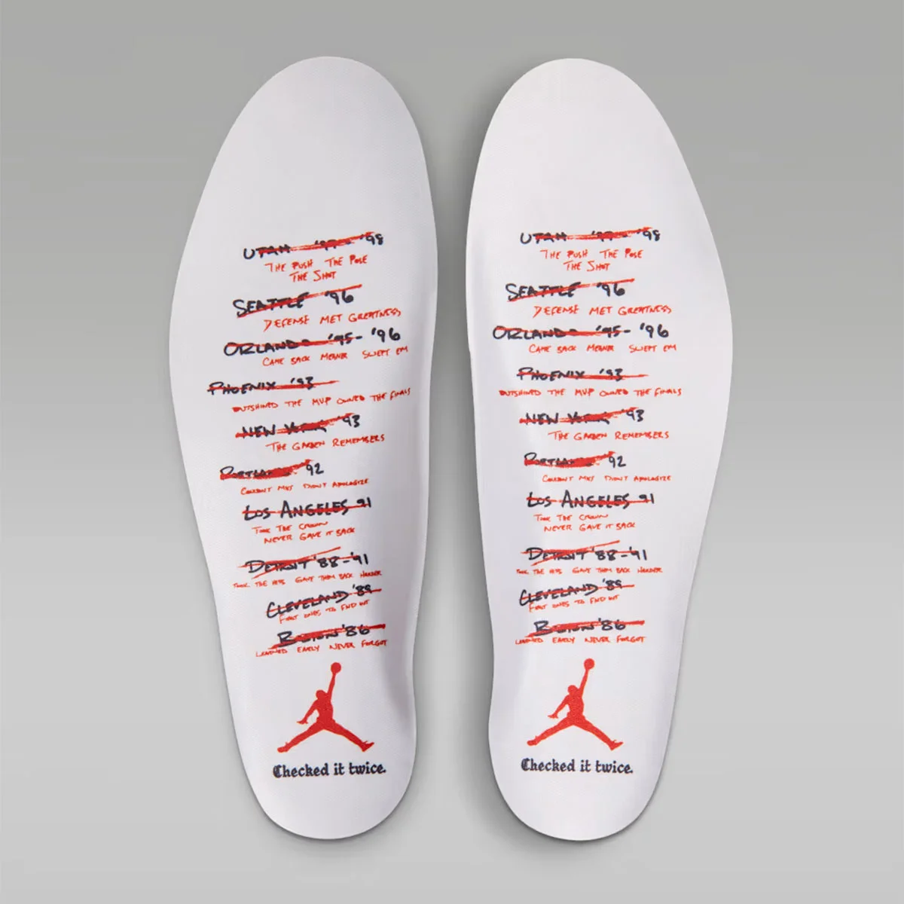
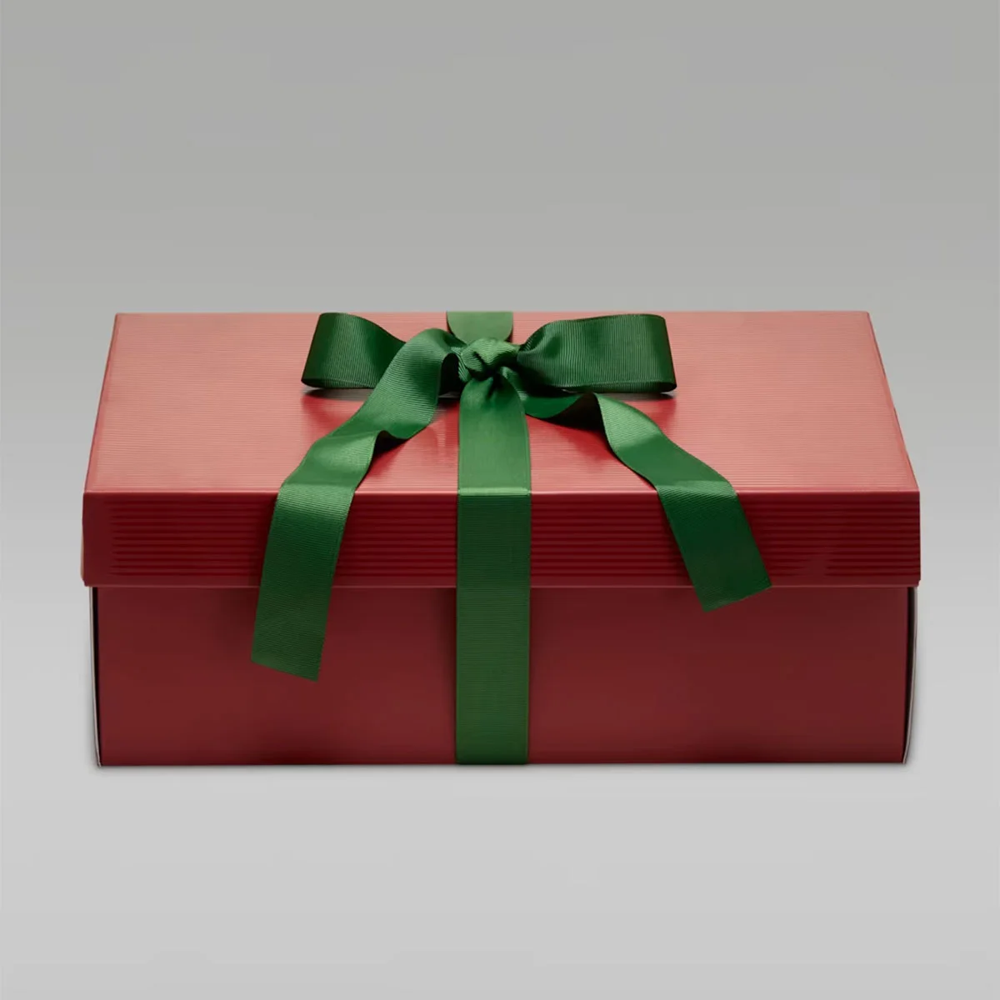
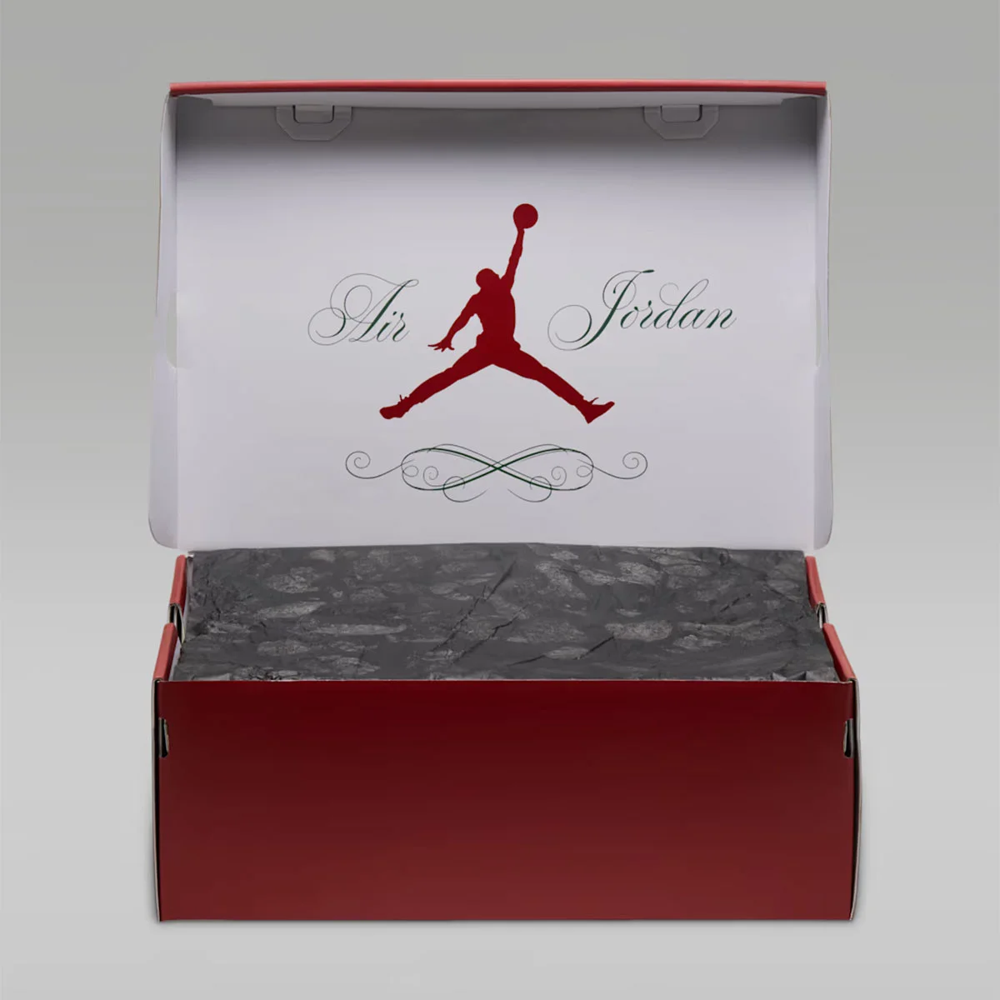

> [中文版 Chinese version](/life/air-jordan-3-not-nice-zh/)

The best Jordan release of this Saturday is not about being good. The Air Jordan 3 Retro "Not Nice" (IF4396-001) drops tomorrow, Saturday, November 21, 2026, for $215 in men's sizing — a Christmas shoe built around the other side of the holiday: the lump of coal, Santa's naughty list, and the most competitive player the league has ever seen. It is the headline Jordan release of the week, with official images out since November 9, a launch page live at Foot Locker, and coverage from Sneaker News, Sole Retriever, Nice Kicks, DTLR, Sports Illustrated, and Grailify's top-releases list for week 47.

One honest note up front: this is not a wear test. The shoe reaches the public tomorrow, and no independent wear testing of this pair existed at the time of writing. What follows is a long first look built on the official photography and the confirmed facts: the coal-inspired design decoded detail by detail, the insole that turns Jordan's playoff history into a ledger, the gift-wrapped packaging, the 1988 history that makes the concept work, and the honest case for setting an alarm for 10:00 AM ET tomorrow.

*The Air Jordan 3 "Not Nice" (IF4396-001) with its naughty-list insoles: cracked black leather, red-and-black elephant print, and a tan aged midsole. Image: Nike, via Sneaker News.*

## The facts

| | |
|---|---|
| **Model** | Air Jordan 3 Retro "Not Nice" (also listed as "Not Nice List" by some retailers) |
| **Style code** | IF4396-001 |
| **Colorway** | Black / Challenge Red / Off Noir, with Elemental Gold showing through the cracked finish |
| **Release date** | Saturday, November 21, 2026, 10:00 AM ET |
| **Retail price** | $215 men's; full-family sizing at $155 (Big Kid), $95 (Little Kid), $80 (Baby/Toddler) — price snapshot as of November 20, 2026, subject to change |
| **Where** | Nike SNKRS / Nike.com, Foot Locker, Finish Line, Hibbett, Shiekh, DTLR, Sneaker Politics, SNIPES US, and select Jordan Brand retailers |
| **What it is** | A Christmas-themed Air Jordan 3: a coal-inspired cracked leather upper, red elephant print, and insoles printed with Michael Jordan's entire playoff history as Santa's naughty list |

## Why this is the story of the day

The heat is easy to prove, because it arrived from every direction at once. Sneaker News published the official images on November 9 with an eleven-photo gallery. Sole Retriever ran its where-to-buy guide on November 19. Nice Kicks, DTLR, and Sports Illustrated's Kicks on SI all published full breakdowns in the same window. Grailify put it on its Top Sneaker Releases list for week 47, and House of Heat named it the headline Jordan release of the week. Foot Locker's launch page is already live, with its link going live at 10:00 AM EST on Saturday.

There is also a structural reason this one matters more than the average holiday colorway. Saturday, November 21 is a three-Jordan-3 day: the men's "Not Nice" arrives alongside two kids-only pairs, the "Santa" (DM0967-601) and the "Lola Bunny," both in grade-school sizing. And it is the opening act of Jordan Brand's holiday run — the Air Jordan 4 "Bred" lands on Black Friday, November 27, for $230, and the Air Jordan 11 "Space Jam" follows on December 12 for $235. The "Not Nice" is the first of the three tentpoles, and the only one of them built around a story rather than an OG colorway.

That story is the reason the shoe is getting this much attention a full twelve days after its official images dropped. Holiday Jordans are usually red, white, and safe. This one is black, charred, and mean — and it is mean on purpose, because the meanness is the point.

## The design: a lump of coal, worn in

The upper is the whole concept. It is built from a crackled, pre-aged leather in Off Noir — Sneaker Files describes it as a crackled Velvet Brown nubuck — with lighter golden and Elemental Gold tones showing through the textured finish, the way embers show through a lump of coal that has been in the fire. It is the rare Jordan colorway that is designed to look used before it has ever been worn, and the distressing is the design rather than a defect. In the official photography the gold reads as a patina across the toe box, the eyestay, and the collar, warm against the black base.

The elephant print — the Air Jordan 3's signature, introduced on this model in 1988 — gets the same treatment. On the toe cap and the heel it runs in black and Challenge Red, an ember-like red-on-black that reads as the print catching fire. The mudguard and collar are solid black suede, which keeps the shoe from tipping into costume: the loudest element is confined to the two panels where the print has always lived. Red accents continue through the tongue and the interior lining, which is a bright Challenge Red inside a shoe that is otherwise almost entirely black.

*Lateral side: the cracked leather upper, the red-and-black elephant print on the toe and heel, and the visible Air unit in the tan midsole. Image: Nike, via Sneaker News.*

Two details are easy to miss in a thumbnail and worth naming. The first is the midsole: a tan, aged brown that continues the worn-in idea underfoot, with a visible Air unit in the heel that picks up a pinkish-red tint in the official photos. The second is the outsole, in Off Noir with a dark green — Fir — pivot circle at the forefoot and a debossed Nike mark, a small nod to the Christmas palette that never makes it onto the upper itself.

The branding is OG-correct, which is the detail longtime collectors will check first. The tongue carries a puffy Jumpman embroidered in black with a red outline, and the heel carries Nike Air — not the Jumpman — stitched in black with red outlining. On a retro 3, the Nike Air heel is the difference between a faithful reissue and a modernized one, and this pair gets it right.

*Close-up of the cracked upper: the nubuck texture, the tongue Jumpman in black with a red outline, and the eyelets. Image: Nike, via Sneaker News.*

*The heel: Nike Air embroidery in black with red outlining, red elephant print, and the bright red inner lining. Image: Nike, via Sneaker News.*

## The insole: Michael Jordan's naughty list

The best detail on the shoe is one nobody will ever see while it is being worn. The insoles are white, printed with Michael Jordan's entire playoff history, styled as Santa's naughty-or-nice list — every opponent crossed off in red, each with a short note in red handwriting about what happened to them, and a red Jumpman above the words "Checked it twice." in gothic lettering.

The list reads in reverse chronological order, from the top of the insole down. It starts with the "Last Shot": Utah '98 — "The Push, The Poke, The Shot." Then Seattle '96 — "Defense Met Greatness." Orlando '95–'96 — "Came Back Meaner, Swept 'Em." Phoenix '93 — "Outshined The MVP, Owned The Finals." New York '93 — "The Garden Remembers." Portland '92. Los Angeles '91 — "Took The Crown, Never Gave It Back." Detroit '88–'91 — "Took The Hits, Gave Them Back Harder." Cleveland '88. And at the bottom, where the list begins, Boston '86 — "Learned Early, Never Forgot" — the first playoff series of Jordan's career, against Larry Bird's Celtics.

It is a clever piece of storytelling, and it works because it is specific. Jordan really did keep a mental list of every perceived slight — Sports Illustrated's breakdown of the shoe opens with exactly that observation — and the insole turns a personality trait into a product detail. The crossed-off names are the joke, but the joke lands because the record behind it is real: six championships, and every one of those teams on the wrong side of them.

*The insoles: Jordan's playoff history as Santa's naughty list, every opponent crossed off in red, from Utah '98 at the top to Boston '86 at the bottom, with "Checked it twice." in gothic lettering. Image: Nike, via Sneaker News.*

There is one more hidden detail, and it is the one the unboxing coverage keeps coming back to: the Nike Air heel tab lifts to reveal the words "Not Nice" stitched underneath. It is the shoe's name, hidden behind its own branding — the kind of detail that costs nothing to add and is exactly what separates a themed colorway from a merely dark one.

## The packaging: it arrives gift-wrapped

Jordan Brand did not stop at the shoe. The "Not Nice" arrives in a special red shoebox wrapped in a green ribbon tied in a bow — the pair, gift-wrapped, before it has even been opened. Inside the lid, a red Jumpman sits between the words "Air" and "Jordan" in curly script, with a green flourish underneath. The tissue paper is coal black. The box also includes an extra set of red laces and a hang tag with green lettering.

This matters more than packaging usually does, because the box is part of the concept rather than a container for it. A Christmas shoe that arrives looking like a present — and a present for someone who was, by the shoe's own account, not very good this year — is the joke told twice: once on the insole, once on the shelf. It is also the kind of special packaging that tends to make a release feel limited even when it is not, which is worth remembering when the resale listings start appearing on Saturday afternoon.

*The special red shoebox, wrapped in a green ribbon. Image: Nike, via Sneaker News.*

*Inside the lid: a red Jumpman between "Air" and "Jordan" in script, over coal-black tissue paper. Image: Nike, via Sneaker News.*

## The history: why this concept only works on a 3

The Air Jordan 3 is the right silhouette for this story, and not only because it is the one with elephant print. Designed by Tinker Hatfield and released in 1988, the 3 is widely credited with saving Jordan's signature line after the Air Jordan 2's sophomore slump — Hatfield worked closely with Jordan himself to build a shoe he actually wanted to wear, and the marketing campaign starring Spike Lee as Mars Blackmon coined the line "It's gotta be the shoes!" It was the first Jordan with a visible Air unit, the first with elephant print, and the first to carry the Jumpman logo. There were only four OG colorways in 1988; Jordan Brand began retro-releasing the design in 2001 and has been telling new stories on it ever since.

The Christmas connection goes back even further than the 3. Nice Kicks notes that the "Not Nice" colorway draws on the iconic Air Jordan 1 chimney ad from 1985 — the early Jordan Brand imagery of Santa's world colliding with basketball. The "Not Nice" is, in that sense, a forty-year-old idea finally getting its own shoe: the naughty side of a holiday the brand has been circling since the beginning.

That history is also why the distressed leather works here and would not work on most retros. The Air Jordan 3 is a 1988 basketball shoe that nobody buys for performance anymore — Sports Illustrated is blunt about it: the silhouette still carries its original technology, a leather and nubuck upper, a polyurethane midsole, and Nike Air in the heel and forefoot, but it is no longer categorized as a performance model. What people buy is the design and the story. A pre-aged, coal-black 3 is a story told in material, and the material is doing work that a clean white-and-red Christmas colorway never could.

## Saturday, and the holiday run after it

The "Not Nice" does not drop alone. Saturday brings three Air Jordan 3s at once: the men's "Not Nice" at $215, and the kids-only "Santa" (DM0967-601, grade school $155) and "Lola Bunny" in grade-school sizing. The "Santa" is the bright, festive side of the same holiday — the good list, to the "Not Nice" pair's naughty one — and the pairing is deliberate: Jordan Brand is selling both sides of Christmas on the same morning.

After Saturday, the calendar gets bigger. The Air Jordan 4 "Bred" — the true Black Friday tentpole — lands November 27 for $230. The Air Jordan 11 "Space Jam," the 30th-anniversary finale of the Space Jam pack, follows on December 12 for $235, with the "Rust Pink Thunder" Jordan 4 on December 19. The "Not Nice" is the first of those tentpoles to actually drop, which is part of why the coverage has been so heavy this week: it is the first real test of how hot the holiday Jordan run is going to be.

## What the shoe is, and what it is not

It is worth being plain about what you are buying. This is a retro lifestyle shoe, not a performance shoe, and the $215 price is the current going rate for a premium Air Jordan 3 retro — the same $215 as the Air Jordan 6 "White Infrared" from earlier this month, and $15 below the Black Friday "Bred" 4. The cracked leather is a factory finish, not wear, and it will crease and age differently from the smooth leather on a standard retro 3 — that is the point of the design, but it is also a reason to look at the close-up photos before deciding whether the look is for you. The elephant print, the Nike Air heel, and the visible Air unit are all faithful to the 1988 original; the distressing, the insole, and the packaging are all new.

It is also worth naming what the shoe is not. It is not a limited friends-and-family pair: it is a men's general release through Nike and a long list of retailers, in full-family sizing, with a 10:00 AM ET launch time published in advance. It is not a leak or a rumor — the official images have been public since November 9, the style code and price are confirmed on Nike's own product page, and the retailers are named. And it is not a wear test: nobody outside Jordan Brand has had these on foot, so any claim about how they feel after eight hours is a guess, including this article's. The one fit note worth passing along is the general one for recent Air Jordan 3 retros, which run true to size — treat that as an expectation from the line's track record, not a tested fact about this pair.

## Who should try for a pair — and how

The buying case is simple, and the timing is the whole game. The drop is Saturday, November 21, at 10:00 AM ET on Nike SNKRS and at Foot Locker, with Finish Line, Hibbett, DTLR, and the rest of the retailer list carrying it as well. The practical strategy is the usual one: SNKRS first, then Foot Locker — whose link goes live at 10:00 AM EST — then the other retailers. Do not pay a reseller before the drop has actually happened. Early resale prices on a shoe with a general release scheduled for tomorrow morning are the worst prices you will ever see for it, and this pair exists in real numbers, through real channels, at $215.

Who is it for? Collectors who buy Jordan 3s for the story will find the most complete one Jordan Brand has told on the silhouette in a while — the insole alone is a better piece of design writing than most full collections get. Anyone who owns the standard black-and-red 3s and wants the one pair in the rotation that looks different will find the cracked leather and ember print do that without changing the silhouette at all. And anyone buying a Christmas gift for a Jordan fan should note the packaging: this is the rare pair that does not need wrapping paper.

Who should pass? If you want a clean, versatile black Jordan 3, this is not it — the distressing is the whole shoe, and it will never look clean. If you want a performance shoe, buy a current model. And if you missed the drop, do not panic: the holiday Jordan run has two more tentpoles after this one, and the "Not Nice" is a general release, not a one-morning-only event.

## The verdict

The Air Jordan 3 "Not Nice" is the best holiday Jordan in a while, and the reason is not the colorway — it is the completeness of the idea. The coal leather, the ember elephant print, the naughty-list insole, the hidden message under the heel tab, the gift-wrapped box: every piece of the shoe is telling the same joke, and the joke is built on a true story about the most competitive player the sport has ever had. Most themed colorways pick one detail and stop. This one follows the idea all the way down to the tissue paper.

It is also a useful reminder of what the Air Jordan 3 is for in 2026. Thirty-eight years after Tinker Hatfield saved the line with it, the 3 is no longer a basketball shoe. It is a storytelling platform — and on Saturday morning, the story is that sometimes the best gifts are not reserved for the well-behaved.

*Price is a snapshot as of November 20, 2026, subject to change. Sources: Sneaker News (official images and release information, November 9, 2026); Sole Retriever (where-to-buy guide, November 19, 2026); Nice Kicks (release date, price, and the 1985 chimney-ad connection); Sports Illustrated / Kicks on SI (release time, full-family pricing, tech specs, and AJ3 legacy, November 8, 2026); DTLR (design breakdown, November 16, 2026); Sneaker Bar Detroit (style code, colorway, and release date); Sneaker Files (upper materials and release details); Grailify (Top Sneaker Releases, Week 47); Kick Supply (remaining 2026 Jordan release calendar, refreshed November 19, 2026); HotNewHipHop (unboxing and packaging details). This is a first look, not a wear test: the Air Jordan 3 "Not Nice" releases November 21, 2026, and no independent wear testing was available at the time of writing.*
