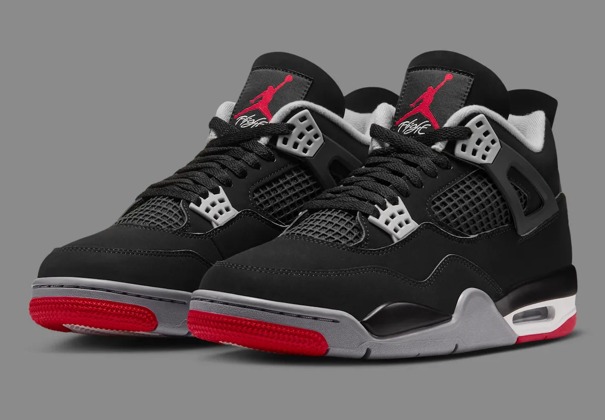
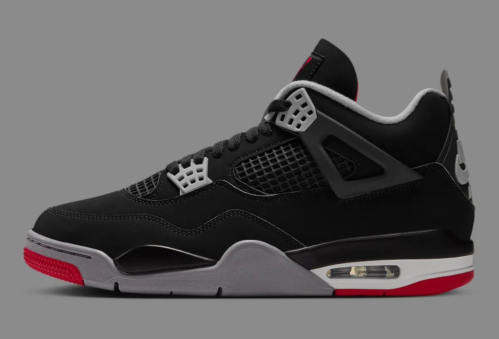
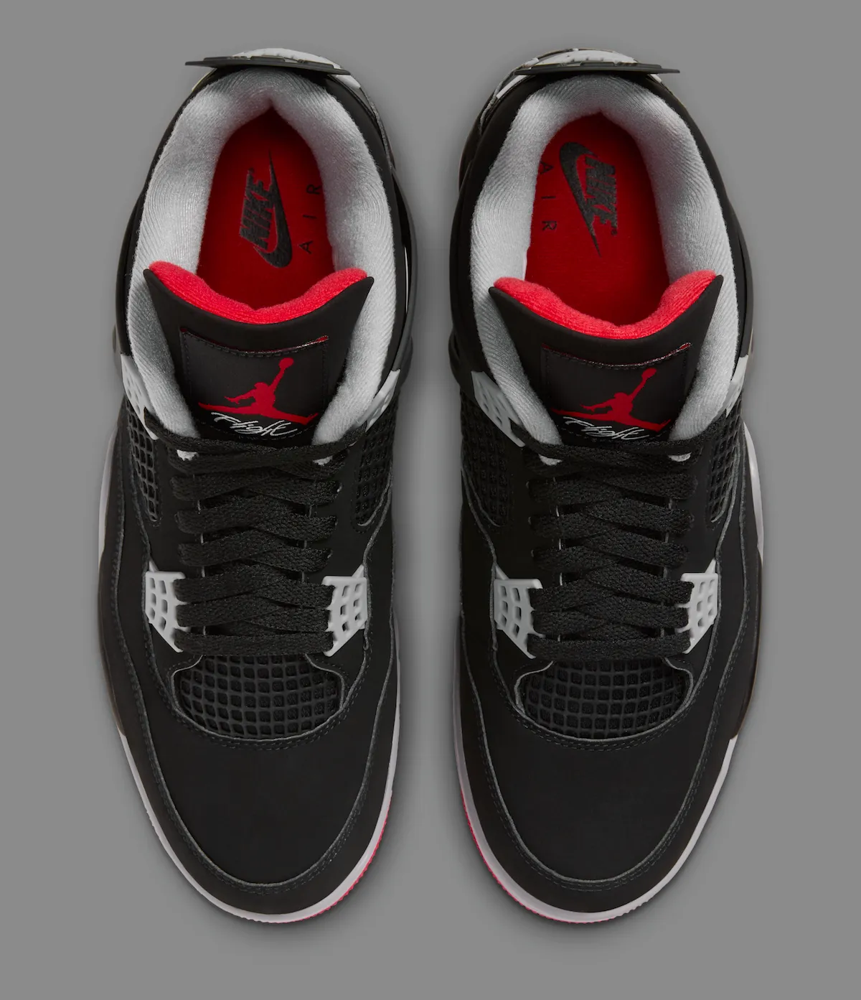
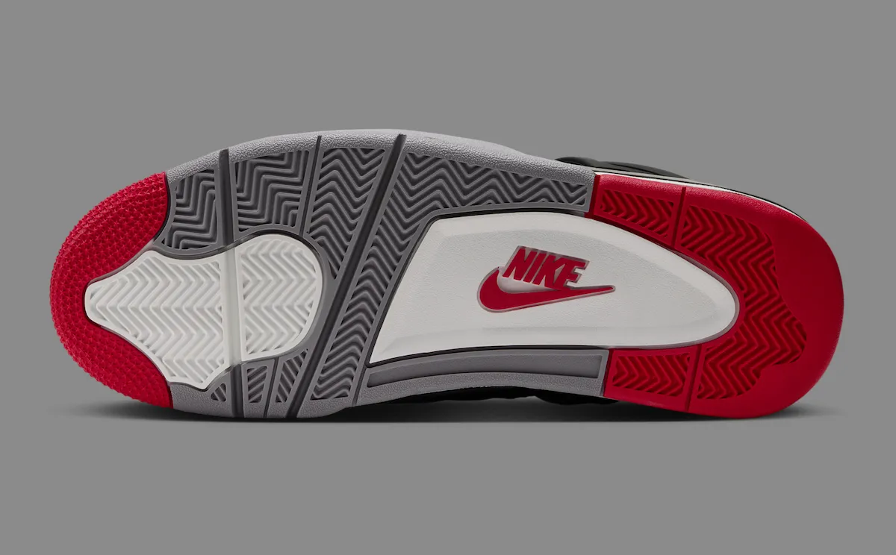
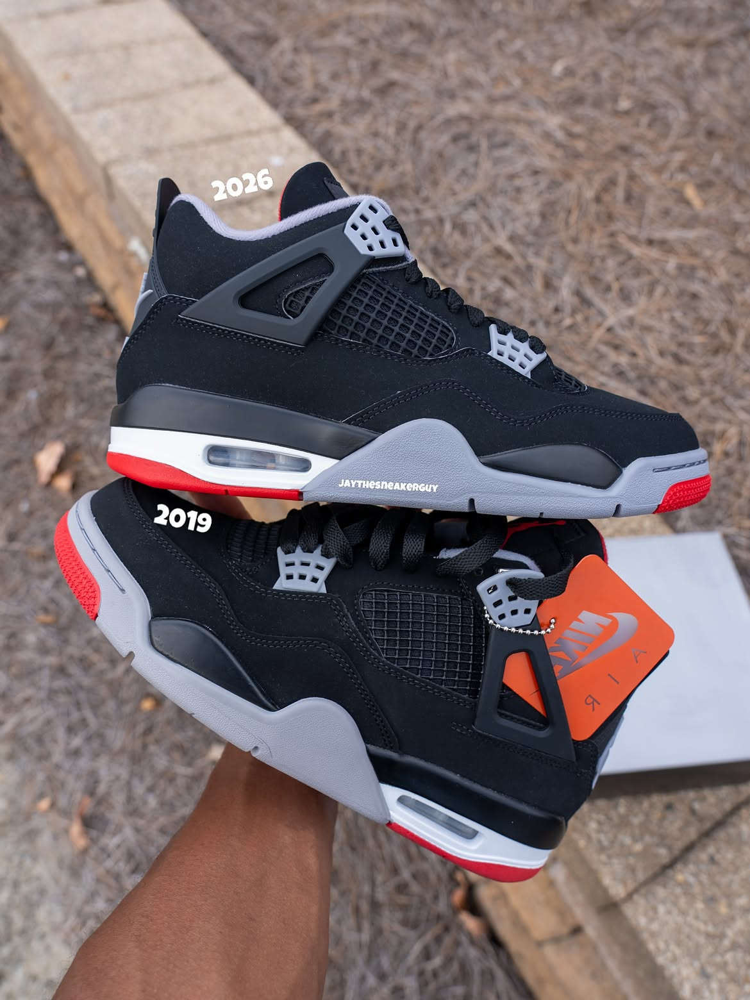
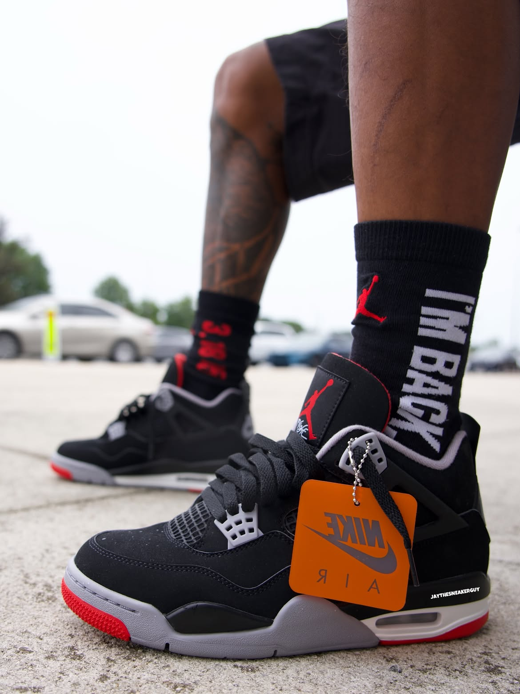

> [English version 英文版](/life/air-jordan-4-bred-2026/)

每年 11 月，Jordan Brand 都会留一双鞋来压轴黑色星期五。今年这双不需要任何介绍：Air Jordan 4 “Bred”，2026 年 11 月 27 日星期五发售，230 美元，全尺码发售，而且多家媒体报道称备货量巨大。这周的新闻不是这个配色又回来了——一双“Bred”4 永远离得不远——而是它以什么姿态回来。2024 年的“Bred Reimagined”把鞋招牌的黑色磨砂皮换成了光面皮革之后，2026 年的 Retro OG 把磨砂皮拿了回来，后跟的 Nike Air 回来了，而且按 Nike 的说法，鞋型、合脚程度和脚感都“按 1989 年原版规格重塑”。Sneaker News 在 11 月 9 日的发售专题里称之为“以真正的元年形态回归”。Men’s Journal 在今天——11 月 12 日凌晨 2 点 38 分——发了基于 Nike 官方图片的解析。Sports Illustrated、Nice Kicks 和一众发售追踪站都在同一 48 小时内跟进。黑色星期五的头牌已经定了，而且关于它的争论其实已经结束了：这就是收藏者从 2024 年起一直想要的那一版。

先说一句实话：这不是上脚评测。鞋要到 11 月 27 日才发售，目前没有任何一家独立媒体对市售版做过有意义的实测。下面这篇长文是首次深度解析——事实、Jordan Brand 实际做出来的设计、让一双黑红 4 号值得被谈论的 37 年历史、与 2019 和 2024 版的正面对照，以及 230 美元到底买到了什么——能核实的和暂时不能核实的会分开说清楚。

*2026 年“Bred”官方图：黑色磨砂皮、水泥灰护翼与中底、火焰红点缀，以及鞋舌上红色的 Jumpman Flight 标志。图片：Nike，经 Sneaker Bar Detroit 转载。*

## 事实一览

| | |
|---|---|
| **型号** | Air Jordan 4 Retro OG “Bred” |
| **货号** | IX8180-001（男码）；IX4857-001（大童）；IX4879-001（小童）；IX4880-001（幼童） |
| **配色** | Black / Cement Grey – Summit White – Fire Red（黑／水泥灰－峰白－火焰红） |
| **发售日期** | 2026 年 11 月 27 日星期五（黑色星期五），美东时间上午 10 点／美西时间上午 7 点 |
| **发售价** | 男码 230 美元；大童 165 美元；小童 105 美元；幼童 90 美元（2026 年 11 月 12 日查询的价格快照，来源 Nike、Sneaker News 与 Sports Illustrated；价格可能变动） |
| **发售渠道** | Nike SNKRS 与 Nike.com、Foot Locker、Champs Sports、Hibbett、SNIPES US、Sneaker Politics、Dick’s |
| **定位** | “Bred”4 第七次发售——黑色磨砂皮鞋面、后跟 Nike Air 标志、按 Nike 说法以 1989 年原版规格重塑的鞋型 |

## 为什么这双鞋是本周的故事

热度很容易证明，因为报道是一波涌来的，不是一篇一篇零散出现的。Sneaker News 在 11 月 9 日发了完整发售指南，附上了覆盖 Nike SNKRS、Foot Locker、SNIPES US、Sneaker Politics、Dick’s、Champs 等渠道的购买清单。Sports Illustrated 的球鞋栏目在 11 月 10 日发了黑色星期五专题。专业站点 becausesneakers 同一天发了深度分析，标题直接把论点写了出来：这双 Bred 4 “推翻了 Reimagined，而改变的关键是鞋型”。Men’s Journal 的官方图片解析则在今天凌晨上线，整篇建立在 Nike 自己的产品图上。Nike 的 SNKRS 发售页面已经上线，标明了发售时间。

一个配色第七次发售还能拿到这种关注度，原因在于前两次发售把受众分成了两派。2024 年的“Bred Reimagined”是一次有意的偏离：光面皮革代替磨砂皮、做旧处理、手感完全不同。不少人就事论事挺喜欢它。但对那些拿 1989 年当标尺的收藏者来说，那是正确的鞋用了错误的材质，这场争论此后就没停过。2026 年这双是 Jordan Brand 对这场争论的直接回应。它没有加噱头、没有联名、没有新材质，而是把偏离拿掉了。这比再出一个混搭版本更难得，也更有意思——这周的报道读起来与其说是发售预告，不如说是一份裁决。

还有日历的因素。黑色星期五是 Jordan Brand 一年里最大的商业舞台，品牌历来会把最强的复刻放在这一天。“Bred”4 就是那双复刻：Sneaker News 称它是“今年最大的 Jordan 发售之一”，各家假日指南也一致把它排在黑色星期五的压轴位置，排在 12 月那双 Space Jam 11 之前。时间本身就在起作用——这是 Jordan Brand 想放在圣诞树下的那双鞋。

## 设计：这次“OG”到底意味着什么

先讲材质，因为整个故事都在这里。2026 年“Bred”用的是黑色磨砂皮鞋面——那种柔软、哑光、类似翻毛皮的质感，自 1989 年起就定义了这个配色。严格说，原版用的并不是磨砂皮：Nike 在 1989 年的鞋上用的是 Durabuck，一种为了模仿磨砂皮、同时更耐用更轻而开发的合成材料，Sneaker News 在配色历史里专门提到了这一点。1999 年的复刻沿用了 Durabuck。现代复刻用的是真正的磨砂皮，而 2026 年这一版在 2024 年改用皮面之后又回到了磨砂皮。照片上差别一眼就能看出来：磨砂皮吸光而不是反光，所以黑色显得深沉而平整，水泥灰和火焰红是浮在它上面，而不是跟它抢戏。

第二个修正是鞋型。Nike 这次的文案写得异常具体：“鞋型、合脚程度和脚感都已按原版规格重塑。”Sneaker News 补上了让这句话有分量的背景：Jordan Brand 从 2023 年 Nike SB Jordan 4 “Pine Green” 开始，就在全线 Air Jordan 4 上启用了一种更接近元年的鞋型，而今年的“Bred”用的就是同一鞋型——“比 2019 年复刻更接近 1989 年的样子”。实际效果是轮廓更瘦、更低，鞋头更贴近原版的楦型，而不是 2010 年代末复刻那种更高、更鼓的造型。这种变化在并排照片里不用解释就能看出来，这周流传的对照图里，2026 年款放在 2019 年款旁边明显更修长。

*侧面：黑色磨砂皮、水泥灰塑料护翼与鞋带孔、网面侧窗，以及后跟的可见气垫——后跟鞋提上是 Nike Air 标志。图片：Nike，经 Sneaker Bar Detroit 转载。*

鞋的其他部分就是熟悉的 1989 年配方，原样执行。水泥灰覆盖塑料支撑护翼、鞋带孔和中底点缀。火焰红出现在鞋舌的 Jumpman 与“Flight”字样、外底和后跟细节上。中底是峰白色，后跟带可见气垫——这个细节是 Air Jordan 4 从一年前发布的 Air Jordan 3 那里继承来的，AJ3 是第一双用上可见气垫的 Jordan。外底重新用上了红色 Nike 标志，后跟是 Nike Air 而不是 Jumpman——正是这个细节把 OG 规格的复刻和 2008、2012 年那些 Jumpman 后跟的版本区分开来。按 Men’s Journal 对 Nike 产品信息的梳理，男码随鞋附带 Michael Jordan 人像鞋盒。

Nike 官方图里还有两个值得细看的小细节。俯视图里能看到鞋舌标签——红色 Jumpman 加“Flight”字样——以及红色的鞋垫，上面印着 Nike Air 标志，这抹红色只有脱下鞋才看得到。而外底图里是灰白相间的人字纹，红色 Nike 标志嵌在中足的白色面板上：这种年代感正确的品牌处理，正是 OG 规格这件事真正的含义。这些没有一样是新的。重点就在这里：2026 年“Bred”是一次修复，不是一次重新设计。

*从上方看：红色 Jumpman 与“Flight”鞋舌标签，以及印有 Nike Air 标志的红色鞋垫——这些细节只有脱下鞋才看得到。图片：Nike，经 Sneaker Bar Detroit 转载。*

*Nike 官方图中的外底：灰白人字纹，前掌与后跟为火焰红，红色 Nike 标志嵌在中足面板上。图片：Nike，经 Sneaker Bar Detroit 转载。*

## 1989 年：原版、首秀与“The Shot”

要理解为什么同一双黑红配色的鞋第七次发售还能主导发售日历，得回到 Air Jordan 4 本身是什么。Tinker Hatfield 设计了它——这是他的第二双 Jordan 设计——1989 年 2 月登场，Michael Jordan 在 1989 年 2 月 12 日休斯敦全明星赛上第一次穿着它上场。按 Nike 自己在 SNKRS 上的鞋款历史，它还是第一双全球发售的 Air Jordan。原版发售价 110 美元。那一年首发了四个配色：“Bred”“White Cement”“Fire Red”“Military Blue”。Jordan 在 NBA 比赛里穿过其中三双，而“Bred”正是他穿着完成那两个让这双鞋不朽的时刻所穿的配色。

第一个就是全明星首秀本身。第二个发生在三个月后，是篮球史上被重播次数最多的一个投篮。1989 年 5 月 7 日，东部季后赛首轮第五场，芝加哥公牛以 100 比 99 落后于克利夫兰骑士，还剩三秒。Jordan 接到边线发球，向罚球线运了两步，在 Craig Ehlo 头顶上滞空，把压哨绝杀投了进去——“The Shot”。Nike 自己对这一刻的记述写得很直白：“MJ 穿着 AJ4 ‘Bred’完成首秀固然令人难忘，但对克利夫兰投进‘The Shot’，让这双鞋成了传奇。”这段集锦每一次播放——而它被播放过无数次——你看到的都是那双黑色的鞋和红色的鞋底，以及随后那个挥拳庆祝的画面。这双鞋在那一天不再是一件商品，而变成了一段影像。

4 号在篮球之外的文化生命也是同一年开始的。Spike Lee 把 Air Jordan 4 放进了《Do the Right Thing》——是 White Cement，出现在 Buggin’ Out 刚买的新鞋被人踩脏的那个著名场景里——这双鞋成了第一双像电影角色一样存在的球鞋。这就是“Bred”继承的血统：一双在 1989 年穿着投进史上最著名绝杀、同一年又成了电影道具的鞋。此后任何一次复刻都不需要在这个故事上再加什么，只需要别挡路。

## 历代“Bred”4，1989 到 2026

这是该配色第七次上架。完整历程按 Sneaker News 与 Sports Illustrated 的记录如下：

| 年份 | 发售 | 关键特征 |
|---|---|---|
| **1989** | 原版 | Tinker Hatfield 设计；黑色 Durabuck；110 美元；后跟 Nike Air；“The Shot”所穿 |
| **1999** | 首次复刻 | 与原版相同的 Durabuck 结构；Jordan 第二次退役后的第一次回归 |
| **2008** | Countdown Pack | 与 Air Jordan 19 组成“倒计时”套装（两双鞋编号相加为 23）；Jumpman 后跟 |
| **2012** | 复刻 | Jumpman 后跟；Sneaker News 称其处于复刻品质最弱的年代 |
| **2019** | 30 周年复刻 | 磨砂皮、后跟 Nike Air、200 美元（货号 308497-060）；2019 年 5 月 4 日发售，正值球鞋热潮顶峰 |
| **2024** | “Bred Reimagined” | 光面皮革代替磨砂皮、做旧处理、215 美元（货号 FV5029-006）；2024 年 2 月 17 日 |
| **2026** | Retro OG | 磨砂皮回归、后跟 Nike Air、1989 鞋型重塑、230 美元（货号 IX8180-001）；11 月 27 日 |

价格阶梯本身就说明了问题：1989 年 110 美元，2019 年 200 美元，2024 年 215 美元，2026 年 230 美元。从 Reimagined 到这次涨的 15 美元，就是这次修正的成本——磨砂皮加一副重塑的鞋型——同时也只是 2026 年一双旗舰 Jordan 复刻的正常价位。对比一下，2019 年那双 200 美元在当时已经觉得不便宜；七年之后，230 美元买一双黑色星期五的压轴款已经是新常态，报道里没有人把价格当成故事。材质才是故事。

## 2026 对 2019 对 2024：这次修正，拿三双鞋说清楚

有意义的对照不是 2026 对 1989——除了博物馆，没人手里还有一双能穿的 1989 年原版，而且 Sneaker News 指出，全新未穿的原版现在在二级市场要四到五位数。真正有意义的，是 2026 对大多数人手里实际有、或者记得的那两双。

对 2019 年复刻，2026 年这双讲的是鞋型。两双都是黑色磨砂皮、后跟 Nike Air，隔着一个房间看就是同一双鞋。凑近看，2026 年更瘦：重塑的楦型把鞋头压低、把轮廓向 1989 年原版收拢，而 2019 年那双——用的是 2023 年之前的楦型——看起来略高、略鼓。这周流传的对照照片里，2026 和 2019 并排放在一起，中底线条和鞋头的坡度上能直接看出差别。如果你有 2019 年那双而且很喜欢，2026 年并不是一双不同的鞋，而是同一双鞋把轮廓修正了。值不值得再花 230 美元，完全取决于鞋型这件事有多困扰你——而对那些花了三年时间讨论 2023 年之后鞋型变化的收藏者来说，它确实很困扰。

对 2024 年“Bred Reimagined”，2026 年这双讲的是材质，而且差别要大得多。Reimagined 的光面皮革改变了鞋的性格：反光、折痕不同，看起来像一次时尚化的再演绎，而不是一次修复。也有人更喜欢它——皮面比磨砂皮好打理，做旧处理让它开箱就有穿旧的感觉。但 Reimagined 要求“Bred”成为它从来不是的东西，市场的回应也足够分裂，以至于 Jordan Brand 现在花了一个完整的发售周期把它往回走。2026 年这双就是这次回走的官方定论：磨砂皮、Nike Air、OG 鞋型，没有做旧、没有再演绎。Men’s Journal 对这次变化的评价直白而准确：230 美元比 Reimagined 贵 15 美元，“而这一双感觉终于不再‘重新想象’了”。

*2026 年款（上）与 2019 年复刻并排：同一配色、同一磨砂皮，新款的轮廓更修长。照片：jaythesneakerguy，经 Sneaker Bar Detroit 转载。*

## 同一天的足球兄弟款

还有一双鞋共享这个发售日，它是这次发售最奇怪的注脚。Air Jordan 4 Retro TD “Bred”——同一配色的足球钉鞋版，货号 HQ0207-001——也在 11 月 27 日发售，205 美元，通过 Nike SNKRS。它保留了黑红配色、网面和塑料护翼，但把磨砂皮换成光面黑皮、把橡胶外底换成带灰色钉尖的亮红色模制钉板，底下是 Air Zoom 气垫。它加入了一个规模不大但正在增长的系列：Jordan 复刻改造成的足球钉鞋，此前已有 Air Jordan 3 “True Blue”和 Air Jordan 1 “Chicago”的钉鞋版。黑色星期五大多数人排队不是为了它，但它很好地提醒了 4 号这个设计的延展性：1989 年赢下一轮季后赛的那双鞋面，换个鞋底，如今就是一双足球钉鞋。

## 会售罄吗？备货量的问题

这是真正不确定的部分，而报道的分歧本身就说明了问题。Sneaker News 称“据说生产了数量巨大的鞋”，Sneaker Bar Detroit 说得更直接：“这不会是一次限量发售。预计会是一次大范围的常规发售，备货比近期一些 Jordan 发售多得多。”如果属实，“Bred”4 将成为一件罕见的东西——一双你真的能按原价买到的殿堂级复刻，和近期那双同样大规模生产的“Royal”Jordan 1 复刻是同一打法。

但 Sneaker News 在同一篇文章里也加了提醒：“如果这双一直在你的愿望清单上，我们不建议干等。”这两件事可以同时成立。哪怕生产量巨大，黑色星期五这个量级的 SNKRS 抢购仍然可能在几分钟内卖光，而早期的市场信号也指向这个方向：Men’s Journal 提到，Stadium Goods 上 11 月 11 日抓取的预售价是 443 美元——在一双鞋还没发货之前就接近原价的两倍。这只是一个快照，不是价格，而且还会变动。但它说明，即使在官方没有确认具体数字的生产规模下，需求也是真实的。诚实的判断是：这是自 2019 年以来最容易买到的“Bred”4，但仍然是一双需要做计划而不是随便逛逛就能买到的鞋。把 27 日美东时间上午 10 点的闹钟定好；大范围发售是值得去抢的理由，不是在家等着的理由。

*上脚效果和它应有的样子完全一致：黑色磨砂皮、灰色护翼、红色外底，橙色 Nike Air 吊牌还挂在鞋上。照片：jaythesneakerguy，经 Sneaker Bar Detroit 转载。*

## 购买建议

按黑色星期五发售前的重要程度，说几条实际的。

**尺码。** Air Jordan 4 历史上按正常尺码买就可以，宽脚会觉得鞋头略紧。目前还没有市售版 2026 款的实测数据，所以如果在两个尺码之间，惯例是往大半码走而不是往小半码走——如果你有一双 2023 年之后的 Jordan 4（比如 SB “Pine Green”那个鞋型 lineage，这双用的就是它），那个尺码就是你最好的参考。

**发售。** 11 月 27 日星期五，美东时间上午 10 点／美西时间上午 7 点 SNKRS 开售——Nike 的产品信息显示入口在协调世界时 15:00 开放——此外还有 Foot Locker、Champs、Hibbett、SNIPES US 和 Sneaker Politics。全尺码同一天发售，男码、大童、小童、幼童都有，如果想买亲子同款，这次是真的能一次买齐。

**适合谁。** 如果你从来没有过一双“Bred”4，这就是该买的那双：自 1989 年以来最忠实的一版，历次“Bred”发售里备货最多的一次，230 美元原价而不是二级市场的加价。如果你有 2019 年那双，诚实的问题是鞋型修正对你有多重要——它是真实存在的，但很微妙，230 美元为这点微妙买单并不便宜。如果你有 2024 年 Reimagined 而且喜欢皮面，这双不是为你准备的；它是一次反向押注，而 Jordan Brand 是有意这么押的。至于想拿它打球的人，也请对自己诚实：可见气垫和 1989 年的鞋底科技，按现代实战标准已经是传承技术，这双鞋的价值在设计和历史，不在球场上。

**唯一的提醒。** 磨砂皮就是这双鞋的全部，也是最需要打理的部分。黑色磨砂皮怕刮、显折痕、怕水怕盐——而 11 月正是学到这个教训最不合时宜的季节。买了的话，第一次上脚前先做防护，别让它淋雨。2024 年的皮面款能原谅疏忽，这双不会。

## 结论

2026 年“Bred”4 是今年最不意外的一次出色发售，而这是一种夸奖。Jordan Brand 没有为这双鞋发明任何东西。它听了两年关于 Reimagined 的抱怨，把定义这个配色的材质和后跟标志恢复了回来，把鞋型向 Michael Jordan 穿着它让克利夫兰心碎的那双靠拢，然后生产了足够多的数量，让普通买家真的有机会买到。结果既不是一次再演绎，也不是一次怀旧练习，而是一次修正，在一年里最大的商业节点执行，价格不低，但对这双鞋来说已经不再令人吃惊。

原版发售 37 年之后，“Bred”4 的运作方式和 1989 年 5 月 7 日那天一模一样：黑色鞋面、灰色护翼、红色点缀，和一个站着不动也显得很快的鞋型。唯一变了的是价格标签——那时 110 美元，现在 230 美元——以及这一次，破天荒地，备货可能终于够分了。

*价格与发售信息为 2026 年 11 月 12 日的快照，依据 Nike、Sneaker News、Men’s Journal、Sports Illustrated 与 Sole Retriever 的报道；两者均可能变动。Stadium Goods 的预售价（443 美元，11 月 11 日）是市场快照，不是发售价。无 affiliate 链接。这是一篇首次深度解析，不是上脚评测——目前尚未有针对市售版的独立实测发表。*

**来源：** Nike SNKRS——Air Jordan 4 “Bred”发售页面与“Air Jordan 4: The Shot”；Sneaker News——“Air Jordan 4 ‘Bred’ Release Date 2026”（2026 年 11 月 9 日）；Men’s Journal——“Air Jordan 4 Bred 2026 IX8180-001: Release Date & Price”（2026 年 11 月 12 日）；Sports Illustrated / Kicks On SI——“The Air Jordan 4 ‘Bred’ Returns for Black Friday 2026”（2026 年 11 月 10 日）；Nice Kicks——“Air Jordan 4 OG ‘Bred’”（2026 年 11 月）；becausesneakers——“The Bred Air Jordan 4 Reverses the Reimagined, and the Shape Is What Changed”（2026 年 11 月 10 日）；Sneaker Bar Detroit——“Air Jordan 4 ‘Bred’ 2026 Release Date”（2026 年 11 月 9 日）；Sneaker Bar Detroit——“Jordan 4 Retro TD ‘Bred’ Releases November 27th”（2026 年 11 月 12 日）；Stadium Goods——“Sneakers You Need To Know: Air Jordan 4”。
