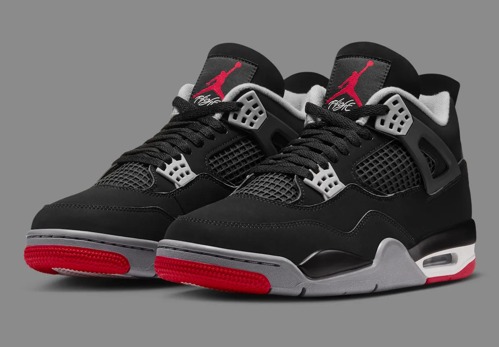
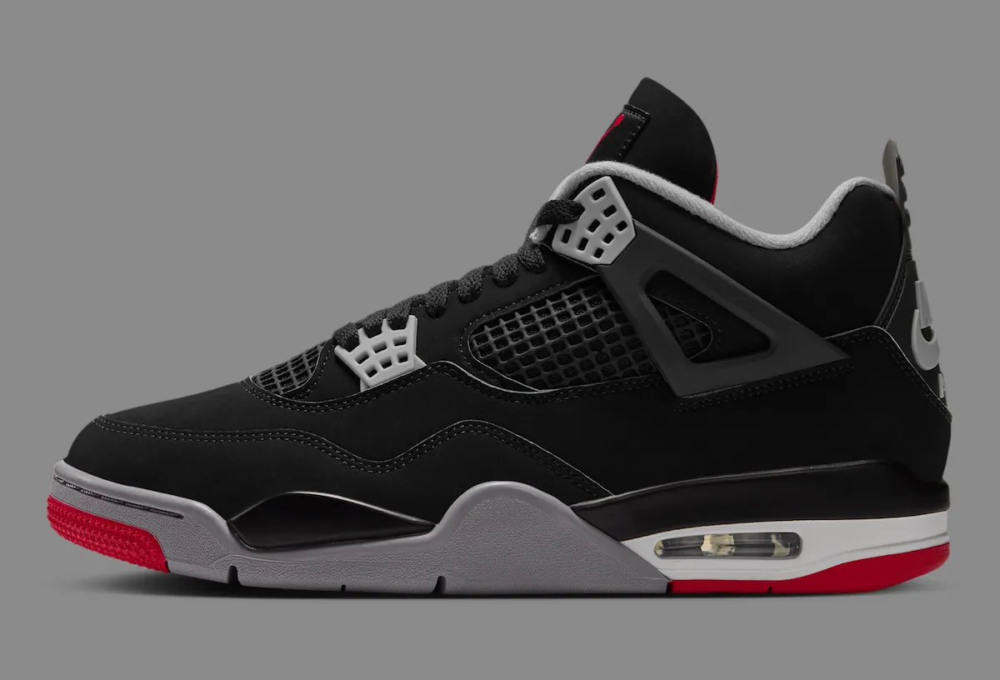
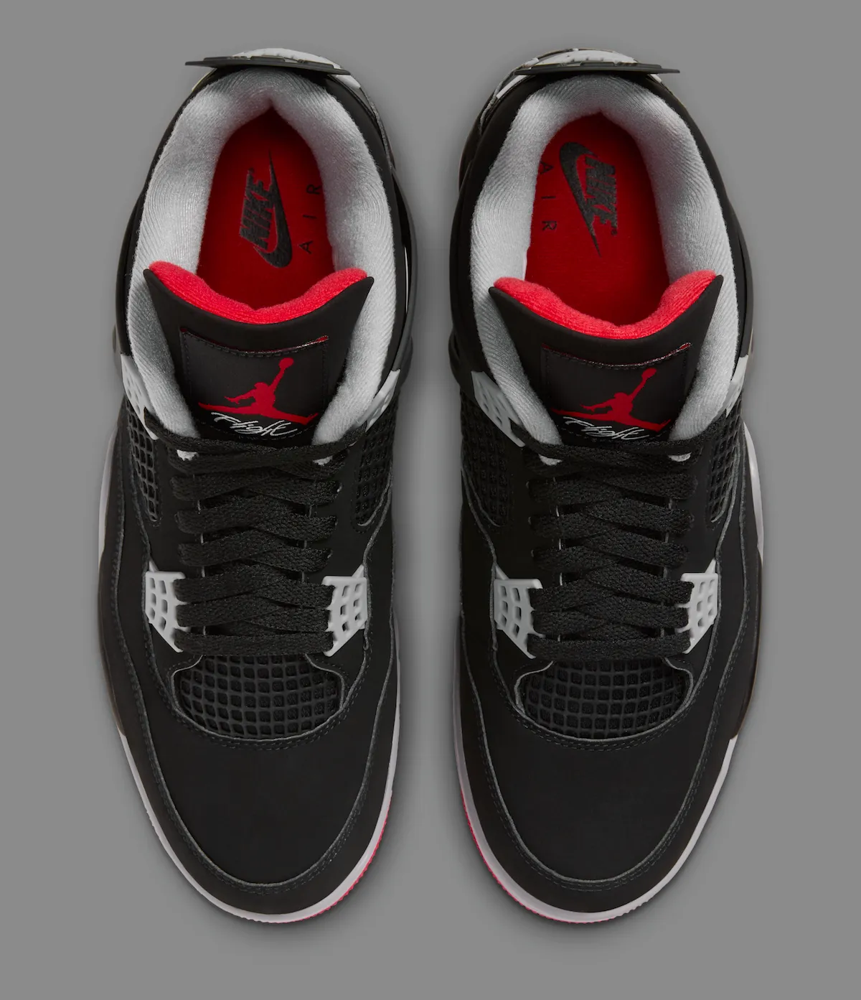
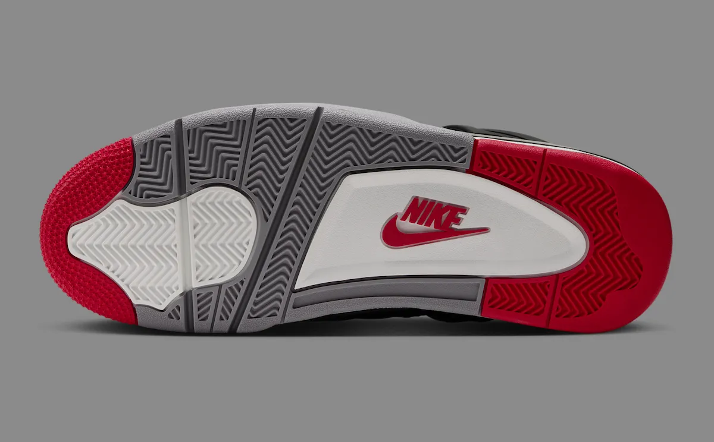
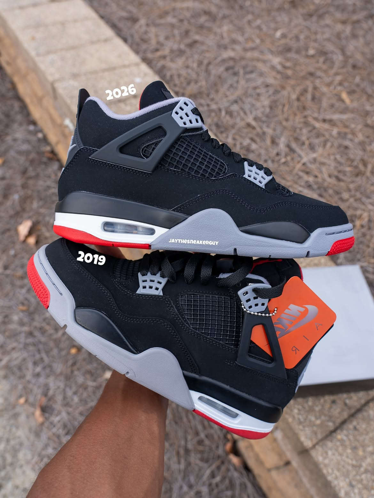
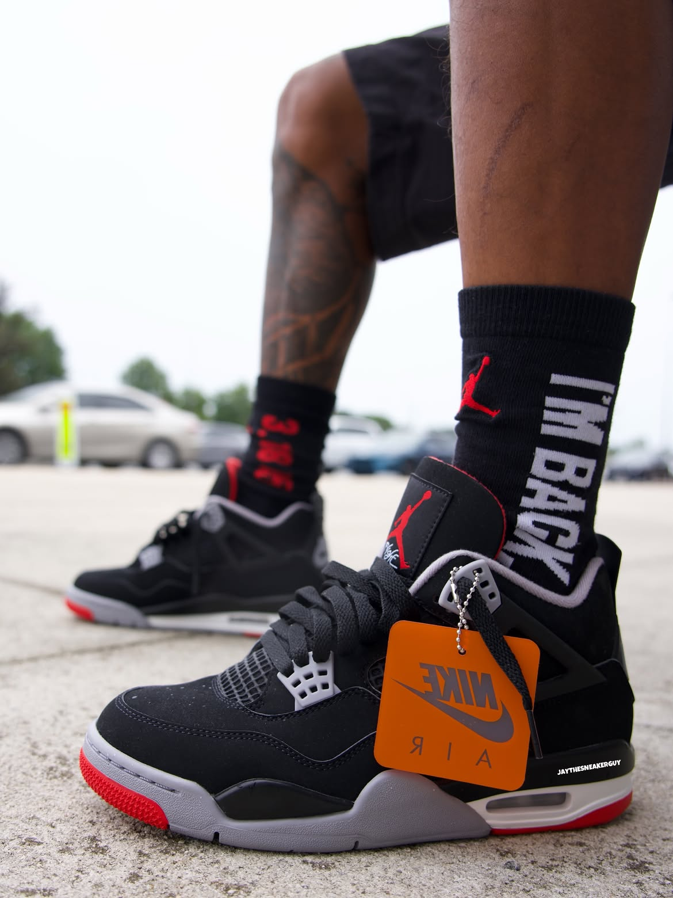

> [中文版 Chinese version](/life/air-jordan-4-bred-2026-zh/)

Every November, Jordan Brand saves one shoe to anchor Black Friday. This year it is the one that needs the least introduction: the Air Jordan 4 “Bred,” back on Friday, November 27, 2026, for $230, in full-family sizing, in what multiple outlets report will be massive quantities. The news this week is not that the colorway is returning — a “Bred” 4 is never far away — but how it is returning. After the 2024 “Bred Reimagined” swapped the shoe’s signature black nubuck for smooth leather, the 2026 Retro OG puts the nubuck back, restores Nike Air to the heel, and, according to Nike, remasters the shape, fit and feel to the original 1989 specs. Sneaker News, which published its dedicated release piece on November 9, calls it a return “in true original form.” Men’s Journal filed its official-images breakdown at 2:38 a.m. ET today, November 12. Sports Illustrated, Nice Kicks and a wave of release trackers followed within the same 48 hours. The Black Friday headliner is set, and the argument about it is already over: this is the version collectors have been asking for since 2024.

One honest note up front: this is not a wear-test review. The shoe does not release until November 27, and no independent publication has put meaningful miles on a retail pair yet. What follows is a long first look — the facts, the design as Jordan Brand built it, the 37-year history that makes a black-and-red 4 matter, a straight comparison with the 2019 and 2024 versions, and what the $230 is actually buying — with the claims that can be checked separated from the ones that cannot.

*The 2026 “Bred” in Nike’s official imagery: black nubuck, Cement Grey wings and midsole, Fire Red accents, and the red Jumpman Flight tongue label. Image: Nike, via Sneaker Bar Detroit.*

## The facts

| | |
|---|---|
| **Model** | Air Jordan 4 Retro OG “Bred” |
| **Style code** | IX8180-001 (men’s); IX4857-001 (GS); IX4879-001 (PS); IX4880-001 (TD) |
| **Colorway** | Black / Cement Grey – Summit White – Fire Red |
| **Release date** | Friday, November 27, 2026 (Black Friday), 10:00 a.m. ET / 7:00 a.m. PT |
| **Retail price** | $230 men’s; $165 grade school; $105 preschool; $90 toddler (price snapshot as of November 12, 2026, per Nike, Sneaker News and Sports Illustrated; subject to change) |
| **Where** | Nike SNKRS and Nike.com, Foot Locker, Champs Sports, Hibbett, SNIPES US, Sneaker Politics, Dick’s |
| **What it is** | The seventh release of the “Bred” 4 — black nubuck upper, Nike Air heel branding, and a shape Nike says is remastered to the original 1989 specs |

## Why this release is the story of the week

The heat is easy to evidence, because the coverage arrived as a wave rather than a trickle. Sneaker News ran its full release guide on November 9, with a where-to-buy list spanning Nike SNKRS, Foot Locker, SNIPES US, Sneaker Politics, Dick’s, Champs and more. Sports Illustrated’s Kicks vertical filed its Black Friday piece on November 10. The specialist site becausesneakers published a detailed analysis the same day under a headline that states the thesis plainly: the Bred 4 “reverses the Reimagined, and the shape is what changed.” And Men’s Journal’s official-images piece landed in the small hours of this morning, built entirely around Nike’s own product photos. Nike’s SNKRS launch page for the shoe is live, with the drop time listed.

That is a lot of attention for a colorway on its seventh release — and the reason is that the last two releases split the audience. The 2024 “Bred Reimagined” was a deliberate departure: smooth leather instead of nubuck, a weathered finish, a different feel. Plenty of people liked it on its own terms. But for the collectors who measure a “Bred” 4 against 1989, it was the wrong material on the right shoe, and the debate never really stopped. The 2026 pair is Jordan Brand answering that debate directly. It does not add a gimmick, a collaboration, or a new material. It removes the deviation. That is a rarer and more interesting decision than another remix, and it is why the coverage this week reads less like a release announcement and more like a verdict.

There is also the calendar. Black Friday is Jordan Brand’s biggest commercial stage of the year, and the brand has a tradition of putting its strongest retro on it. The “Bred” 4 is that retro: Sneaker News calls it “one of the biggest Jordan releases of the year,” and the holiday guides agree, ranking it as the Black Friday anchor ahead of a December Space Jam 11 that will get its own moment. The timing is doing real work here — this is the shoe Jordan Brand wants under the tree.

## The design: what “OG” actually means this time

Start with the material, because it is the whole story. The 2026 “Bred” is built on a black nubuck upper — the soft, matte, suede-like finish that has defined the colorway since 1989. The original was not technically nubuck at all: Nike’s 1989 shoe used Durabuck, a synthetic material introduced to mimic nubuck leather with more durability at a lighter weight, as Sneaker News notes in its history of the colorway. The 1999 retro kept the Durabuck build. The modern retros use genuine nubuck, and the 2026 pair returns to it after the 2024 leather detour. In photos, the difference is visible immediately: nubuck drinks light instead of reflecting it, which is why the black reads as deep and flat rather than glossy, and why the Cement Grey and Fire Red accents sit on top of it instead of competing with it.

The second correction is the shape. Nike’s own copy for the release is unusually specific: “The shape, fit and feel have been remastered to the original specs.” Sneaker News adds the context that makes that sentence meaningful: Jordan Brand began using a different, more original-inspired shape for the Air Jordan 4 across the board when the Nike SB Jordan 4 “Pine Green” dropped in 2023, and this year’s “Bred” carries that same shape — “more in line with the model’s 1989 appearance than the 2019 retro.” In practice that means a slightly slimmer, lower profile and a toe box that sits closer to the original last, rather than the taller, puffier silhouette of the late-2010s retros. It is the kind of change you can see in a side-by-side photo before you can describe it, and the comparison shots circulating this week show it: the 2026 pair looks leaner next to the 2019.

*The lateral side: black nubuck, Cement Grey plastic wings and eyelets, the mesh quarter panel, and the visible Air unit in the heel — with Nike Air branding on the heel tab. Image: Nike, via Sneaker Bar Detroit.*

The rest of the shoe is the familiar 1989 recipe, executed straight. Cement Grey covers the plastic support wings, the eyelets and the midsole accents. Fire Red hits the Jumpman and “Flight” script on the tongue label, the outsole, and the heel detailing. The midsole is Summit White with a visible Air unit in the heel — a detail the Air Jordan 4 inherited from the Air Jordan 3, which introduced visible Air to the line a year earlier. Nike branding returns to the outsole in red, and the heel carries Nike Air rather than a Jumpman — the detail that separates an OG-spec retro from the Jumpman-heeled versions of 2008 and 2012. Adult pairs ship in the Michael Jordan face box, according to Men’s Journal’s breakdown of Nike’s product information.

Two small details from Nike’s official photography are worth a closer look. The top-down shot shows the tongue label — a red Jumpman over the “Flight” script — and the red insole carrying the Nike Air logo, a flash of color you only see when the shoe is off the foot. And the outsole shot shows the herringbone traction in grey and white, with the red Nike logo set into the white midfoot panel: the kind of period-correct branding that the OG-spec treatment is really about. None of this is new. That is the point. The 2026 “Bred” is a restoration, not a redesign.

*From above: the red Jumpman and “Flight” tongue label, and the red insole with the Nike Air mark — details you only see off-foot. Image: Nike, via Sneaker Bar Detroit.*

*The outsole in Nike’s official imagery: grey and white herringbone, Fire Red at the forefoot and heel, and the red Nike logo set into the midfoot panel. Image: Nike, via Sneaker Bar Detroit.*

## 1989: the original, the debut, and “The Shot”

To understand why a seventh release of the same black-and-red shoe can dominate a release calendar, you have to go back to what the Air Jordan 4 is. Designed by Tinker Hatfield — his second Jordan design — it debuted in February 1989, when Michael Jordan first laced it up for the NBA All-Star Game in Houston on February 12, 1989. It was also, according to Nike’s own SNKRS history of the shoe, the first Air Jordan to get a global release. The original retail price was $110. Four colorways launched that year: the “Bred,” the “White Cement,” the “Fire Red,” and the “Military Blue.” Jordan wore three of them in NBA games; the “Bred” was the one he wore for the two moments that made the shoe immortal.

The first was the All-Star debut itself. The second, three months later, is the single most replayed shot in basketball history. On May 7, 1989, Game 5 of the first round of the Eastern Conference playoffs, the Chicago Bulls trailed the Cleveland Cavaliers 100–99 with three seconds left. Jordan caught the inbound, took two dribbles toward the foul line, hung in the air over Craig Ehlo, and sank the series-winning jumper as the buzzer sounded — “The Shot.” Nike’s own account of the moment puts it plainly: “While MJ’s debut of the AJIV ‘Bred’ was memorable, hitting ‘The Shot’ against Cleveland helped make the shoe iconic.” Every time that highlight plays — and it plays a lot — you see the black sneakers with the red sole, and the fist-pumping celebration that followed. The shoe stopped being a product that day and became a piece of footage.

The 4’s cultural life outside basketball started the same year. Spike Lee put the Air Jordan 4 on screen in *Do the Right Thing* — the White Cement, in the famous scene where Buggin’ Out’s brand-new pair gets scuffed — and the silhouette became the first sneaker to feel like a character in a film. That is the lineage the “Bred” inherits: a shoe that was worn for the most famous shot ever made, in the same year it became a movie prop. No retro since has needed to add anything to that story. It only needs not to get in its way.

## Every “Bred” 4, 1989 to 2026

This is the seventh time the colorway has hit shelves. The full run, as documented by Sneaker News and Sports Illustrated:

| Year | Release | What defined it |
|---|---|---|
| **1989** | Original | Tinker Hatfield design; black Durabuck; $110; Nike Air heel; worn for “The Shot” |
| **1999** | First retro | Same Durabuck construction as the original; first return after Jordan’s second retirement |
| **2008** | Countdown Pack | Paired with the Air Jordan 19 in the “Countdown” series that added up to 23; Jumpman heel |
| **2012** | Retro | Jumpman heel; released in what Sneaker News calls the weakest era for retro quality |
| **2019** | 30th anniversary retro | Nubuck, Nike Air heel, $200 (style 308497-060); released May 4, 2019, at the peak of sneaker hype |
| **2024** | “Bred Reimagined” | Smooth leather instead of nubuck, weathered finish, $215 (style FV5029-006); February 17, 2024 |
| **2026** | Retro OG | Nubuck returns, Nike Air heel, remastered 1989 shape, $230 (style IX8180-001); November 27 |

The price ladder tells its own story: $110 in 1989, $200 in 2019, $215 in 2024, $230 in 2026. The $15 jump from the Reimagined is the cost of the correction — nubuck and a remastered shape — and it is also just the going rate for a flagship Jordan retro in 2026. For context, the 2019 pair’s $200 already felt steep at the time; seven years later, $230 for the line’s Black Friday anchor is the new normal, and nobody covering the release is treating the price as the story. The material is.

## 2026 vs 2019 vs 2024: the correction, in three pairs

The comparison that matters is not 2026 against 1989 — nobody outside a museum owns a wearable 1989 pair, and Sneaker News notes that deadstock originals now command four and five figures. It is 2026 against the two pairs most people actually own or remember.

Against the 2019 retro, the 2026 pair is a shape story. Both are black nubuck with Nike Air on the heel, and from across a room they are the same shoe. Up close, the 2026 is leaner: the remastered last pulls the toe box down and slims the profile toward the 1989 original, where the 2019 pair — built on the pre-2023 tooling — reads slightly taller and puffier. The comparison photos circulating this week, with the 2026 and 2019 pairs held side by side, make the difference visible in the midsole line and the slope of the toe. If you own the 2019 and love it, the 2026 is not a different shoe; it is the same shoe with the silhouette corrected. Whether that is worth another $230 depends entirely on how much the shape bothers you — and for the collectors who have spent three years talking about the post-2023 shape change, it bothers them a lot.

Against the 2024 “Bred Reimagined,” the 2026 pair is a material story, and a much bigger one. The Reimagined’s smooth leather changed the shoe’s character: it reflected light, creased differently, and read as a fashion reinterpretation rather than a restoration. Some people preferred it — leather is easier to keep clean than nubuck, and the weathered finish gave it a broken-in look out of the box. But the Reimagined asked the “Bred” to be something it had never been, and the market’s answer was mixed enough that Jordan Brand has now spent a full release cycle walking it back. The 2026 pair is the walk-back made official: nubuck, Nike Air, OG shape, no weathering, no reinterpretation. Men’s Journal’s verdict on the change is blunt and about right: at $230 it costs $15 more than the Reimagined, “and this one feels like it’s finally done reimagining.”

*The 2026 pair (top) next to the 2019 retro: same colorway, same nubuck, a leaner profile on the new pair. Photo: jaythesneakerguy, via Sneaker Bar Detroit.*

## The football sibling, same day

One more pair shares the date, and it is the strangest footnote of the release. The Air Jordan 4 Retro TD “Bred” — a football cleat version of the same colorway, style HQ0207-001 — also releases November 27, for $205 through Nike SNKRS. It keeps the black-and-red identity, the mesh and the plastic wings, but swaps the nubuck for smooth black leather and the rubber outsole for a glossy red molded-stud plate with grey-tipped studs, with Air Zoom cushioning underneath. It joins a small but growing line of Jordan retros adapted for the gridiron, alongside the Air Jordan 3 “True Blue” and Air Jordan 1 “Chicago” cleats. It is not the shoe most people are lining up for on Black Friday, but it is a useful reminder of how far the 4’s design travels: the same upper that won a playoff series in 1989 is now, with a different sole, a football cleat.

## Will it sell out? The quantity question

Here is the genuinely uncertain part, and the coverage is split in a way that tells you something. Sneaker News reports that “a massive number of pairs have been produced,” and Sneaker Bar Detroit is explicit: “This won’t be a limited drop. A wide general release is expected, with plenty more pairs available than some recent Jordan launches.” If that holds, the “Bred” 4 will be that rare thing — a grail-level retro you can actually buy at retail, the same play Jordan Brand ran with the recent “Royal” Jordan 1 retro, which was also produced in huge numbers.

Sneaker News, in the same article, adds the caution: “we wouldn’t advise waiting around if these have been on your wish list for a while.” Both things can be true. A massive production run still sells through a SNKRS drop in minutes if the demand is Black Friday-sized, and the early market signal points that way: Men’s Journal notes a $443 pre-release ask on Stadium Goods, pulled November 11 — roughly double retail before a single pair has shipped. That is a snapshot, not a price, and it will move. But it says the demand is real even at a production scale nobody has confirmed in hard numbers. The honest read is that this is the most gettable “Bred” 4 since 2019, and still a shoe you should plan for rather than wander into. Set the alarm for 10:00 a.m. ET on the 27th; the wide release is a reason to try, not a reason to wait.

*On foot, the 2026 “Bred” reads exactly as it should: black nubuck, grey wings, red outsole, with the orange Nike Air hangtag still attached. Photo: jaythesneakerguy, via Sneaker Bar Detroit.*

## Buying advice

A few practical notes, in the order that matters before a Black Friday drop.

**Sizing.** The Air Jordan 4 has historically fit true to size, with a slightly snug toe box on wider feet. There is no wear-test data on a retail pair of the 2026 yet, so if you are between sizes, the usual advice is to go up half a size rather than down — and if you own a post-2023 Jordan 4 (the SB “Pine Green” shape lineage this pair shares), your size there is the best guide you have.

**The drop.** Friday, November 27, 10:00 a.m. ET / 7:00 a.m. PT on SNKRS — Nike’s product feed lists the entry opening at 15:00 UTC — plus Foot Locker, Champs, Hibbett, SNIPES US and Sneaker Politics. Full-family sizing means men’s, grade school, preschool and toddler all release the same day, which makes this a genuine family purchase if you want matching pairs.

**Who it is for.** If you have never owned a “Bred” 4, this is the one to get: it is the most faithful version since 1989, it is being made in the largest numbers of any “Bred” release, and it is $230 at retail rather than a resale markup. If you own the 2019 pair, the honest question is whether the shape correction matters to you — it is real, but it is subtle, and $230 is a lot for subtle. If you own the 2024 Reimagined and liked the leather, this shoe is not for you; it is the opposite bet, and Jordan Brand is making it on purpose. And if you want to play basketball in it, be honest with yourself: the visible Air unit and the 1989 tooling are heritage technology by modern performance standards, and this shoe’s value is in the design and the history, not in the court.

**The one caveat.** Nubuck is the whole shoe, and it is also the part that needs care. Black nubuck scuffs, shows creasing, and hates water and salt — and November is the wrong season to learn that the hard way. If you buy it, treat the upper before the first wear and keep it out of the rain. The 2024 leather pair forgave neglect; this one will not.

## Verdict

The 2026 “Bred” 4 is the least surprising great release of the year, and that is a compliment. Jordan Brand did not invent anything for this shoe. It listened to two years of complaints about the Reimagined, restored the material and the heel branding that made the colorway what it is, sharpened the shape toward the pair Michael Jordan wore when he broke Cleveland’s heart, and then made enough of them that ordinary buyers have a real chance. The result is not a reinterpretation and not a nostalgia exercise. It is a correction, executed at the biggest commercial moment of the year, at a price that is high but no longer shocking for what the shoe is.

Thirty-seven years after the original, the “Bred” 4 still works the same way it did on May 7, 1989: black upper, grey wings, red accents, and a shape that looks fast standing still. The only thing that has changed is the price tag — $110 then, $230 now — and the fact that this time, for once, there might be enough pairs to go around.

*Price and availability are a snapshot as of November 12, 2026, based on Nike, Sneaker News, Men’s Journal, Sports Illustrated and Sole Retriever reporting; both are subject to change. The Stadium Goods pre-release ask ($443, November 11) is a market snapshot, not a retail price. No affiliate links. This is a first look, not a wear test — no independent wear testing of a retail pair has been published yet.*

**Sources:** Nike SNKRS — Air Jordan 4 “Bred” launch page and “Air Jordan 4: The Shot”; Sneaker News — “Air Jordan 4 ‘Bred’ Release Date 2026” (Nov 9, 2026); Men’s Journal — “Air Jordan 4 Bred 2026 IX8180-001: Release Date & Price” (Nov 12, 2026); Sports Illustrated / Kicks On SI — “The Air Jordan 4 ‘Bred’ Returns for Black Friday 2026” (Nov 10, 2026); Nice Kicks — “Air Jordan 4 OG ‘Bred’” (Nov 2026); becausesneakers — “The Bred Air Jordan 4 Reverses the Reimagined, and the Shape Is What Changed” (Nov 10, 2026); Sneaker Bar Detroit — “Air Jordan 4 ‘Bred’ 2026 Release Date” (Nov 9, 2026); Sneaker Bar Detroit — “Jordan 4 Retro TD ‘Bred’ Releases November 27th” (Nov 12, 2026); Stadium Goods — “Sneakers You Need To Know: Air Jordan 4.”
