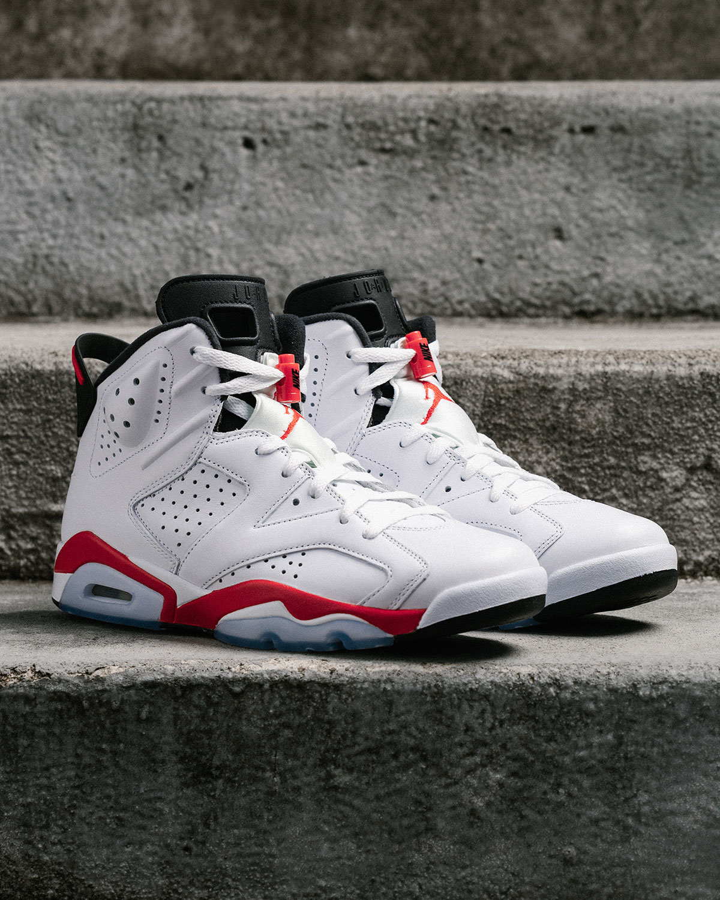
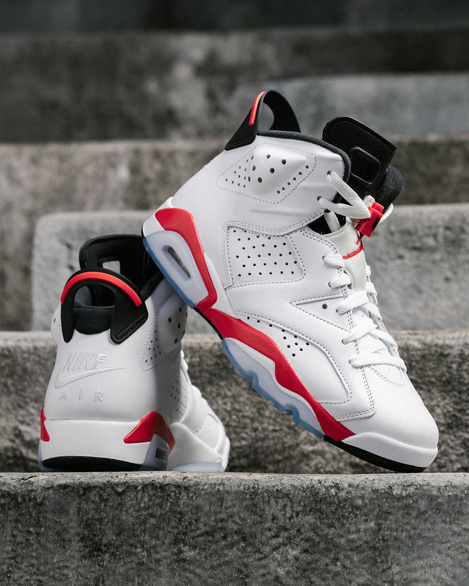
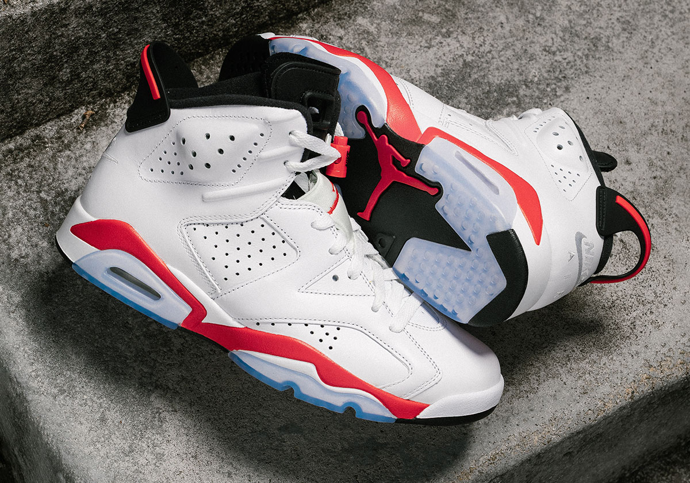
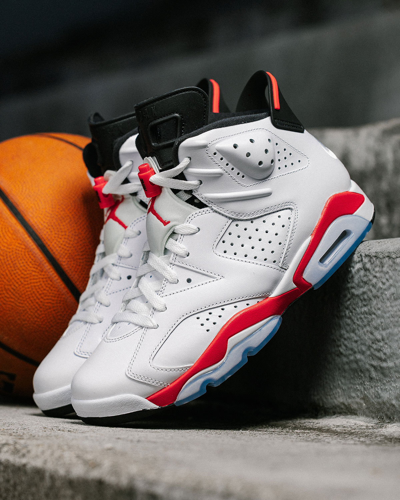
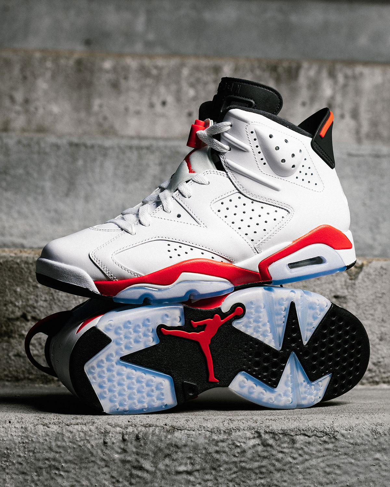

> [English version](/life/air-jordan-6-white-infrared/)

Air Jordan 6 “White Infrared” 今天早上开售了：2026 年 11 月 7 日，美东时间上午 10 点，成人款 $215，全尺码发售，Nike SNKRS、Foot Locker、Champs Sports、Hibbett’s 和指定 Jordan 零售店同步上架。这是迈克尔·乔丹赢下第一个 NBA 总冠军时脚下的那双鞋。今年是 Air Jordan 6 的 35 周年。按常年报道这类鞋的媒体的说法，这是这个配色有史以来最忠于原版的一次复刻。

而到了午饭时间，它的转售价已经跌破发售价了。

这个矛盾就是这次发售的全部故事。一半是情怀上的胜利：阔别 12 年，第一双冠军鞋带着收藏者们喊了多年的细节回来了。另一半是市场的现实检验：一双 OG Jordan，发售当天，转售平台上已经有人 $157 就肯出。两半同时成立，而弄明白为什么，比只看其中一半有意思得多。

先说一句老实话，免得后面被误读：这不是一篇上脚评测。鞋今天才开售，Jordan Brand 之外还没人对市售版做过有意义的实测。下面是一篇长篇初看——讲历史、讲设计、讲这次改了什么、讲发售第一天实际发生了什么，能核实的和不能核实的会分开写。

*Air Jordan 6 “White Infrared”（CT8529-105）：白色皮革、Light Crimson 红色点缀、黑色细节、冰蓝水晶底。图片：Jordan Brand 官方图，经 Sneaker News。*

## 先看事实

| | |
|---|---|
| **鞋款** | Air Jordan 6 Retro OG “White Infrared” |
| **货号** | CT8529-105 |
| **配色** | White / Light Crimson–Black（白 / 浅绯红–黑） |
| **发售时间** | 2026 年 11 月 7 日（周六），美东时间上午 10:00 |
| **发售价** | 成人 $215 · 大童 $155 · 小童 $95 · 婴童 $80 |
| **发售渠道** | Nike SNKRS、Foot Locker、Champs Sports、Hibbett’s、指定 Jordan 零售店 |
| **周年** | Air Jordan 6 诞生 35 周年（原版：1991 年） |

这是 “White Infrared” 配色的第三次复刻，前两次是 2010 年和 2014 年——时隔 12 年首次回归（据 Sports Illustrated 的 Kicks On SI 与 Sneaker News）。原版诞生于 1991 年。

## 为什么这双鞋重要：1991 年 6 月

每一双 Air Jordan 都有故事，但 6 代的故事是改变了一切的那个。迈克尔·乔丹穿着 Air Jordan 6 赢下了第一个 NBA 总冠军——1991 年总决赛击败洛杉矶湖人。那是十年统治的开端，无论是在球场上，还是在球鞋行业里。在那枚戒指之前，乔丹是联盟里最耀眼、却什么都没赢过的球员；在那之后，他成了之后所有签名球星被拿来衡量的标准——而他脚下那双鞋，成了那个转折点的实物。

设计出自 Tinker Hatfield 之手，灵感来源毫不掩饰。Air Jordan 6 以乔丹当时开的德国跑车——他的保时捷 911——为蓝本，你能在鞋型里直接看到它：低趴流畅的线条、后跟那个像尾翼一样的提环、雕塑感的鞋面拼接，看着像车身钣金而不像装饰。Hatfield 之前已经设计了 3、4、5 代；到了 6 代，这条线不再像“一双有想法的篮球鞋”，而像一件从别的东西上借来的设计。

所以 “White Infrared” 不只是一个配色。它是第一双冠军鞋的主场版本——乔丹打总冠军征程时穿的白底配色，鞋名里的红就是它的灵魂。对老球迷来说，它就是 1991 年的样子；对年轻买家来说，它解释了为什么一个 35 年前的设计今天早上还能占一个周六发售日。

## 设计，一个细节一个细节地看

2026 版的思路很简单：白色高级皮革、Light Crimson 红色点缀、黑色细节、冰蓝色半透明大底。写在纸上显得很克制。看官方图就明白，克制正是重点：白色鞋面是画布，红色负责说话，黑色负责不让它飘起来。

把 Air Jordan 6 之所以是 Air Jordan 6 的细节逐个过一遍：

- **打孔鞋面。** 中足和脚踝处的大面积打孔覆盖层是 6 代最具辨识度的质感——一半是透气，一半是雕塑。位置和原版一样，也是视线落在配色之后第一个注意到的地方。
- **鞋带锁扣。** 鞋带顶端那个粗壮的锁扣是纯正的 1991 年：一个功能件，来自快速系带还不是时尚宣言的年代。它也是让这双鞋一眼就能断代的细节之一——也正是它今天看起来依然成立的原因。
- **后跟提环。** 领口后方那个尾翼形状的提环，是把保时捷的梗做成了实物。实际用处上，它也是你穿鞋时抓的地方——6 代的高帮领口不是一脚蹬。
- **鞋舌。** 鞋舌上有 Air Jordan 字标，舌面绣着 Jumpman。鞋舌同时也是 6 代内靴结构的入口——那层加厚的内衬让这双鞋穿起来比前代更像靴子。
- **中底。** 轻质聚氨酯中底，前掌和后跟内置 Air-Sole 气垫，后跟有可见气窗。红色中底包边——也就是鞋名里 “Infrared” 的由来——绕鞋一圈，是整双鞋上最醒目的那一抹红。
- **大底。** 冰蓝色半透明橡胶，黑色多向抓地纹路，前掌嵌着一枚绯红 Jumpman。用 Sports Illustrated 的话说，它本身就是一件艺术品——同时也是这双鞋最容易随时间变黄的部分，而这正是收藏者争论最多的地方。

这些都不是新技术。这也不是重点。重点是每一个细节都是 1991 年的细节，是复现而不是重新设计。

*对收藏者来说最重要的细节：后跟 Nike Air 标志回来了，取代了 2010 和 2014 年复刻版上的 Jumpman。图片：Jordan Brand 官方图，经 Sneaker News。*

## 2026 版不一样的地方：两处修正

如果你有 2010 或 2014 年的复刻版，2026 这双看着很眼熟——然后你会注意到 Jordan Brand 改掉的两件事。

**第一，后跟标志。** 前两次复刻的后跟都是 Jumpman。2026 版恢复了 1991 年原版的 Nike Air 后跟标志。上面这张图看得很清楚：后跟压印着 “NIKE AIR”，上方是尾翼提环。对收藏者来说，这是整双鞋最大的改动——它是“致敬原版”和“复现原版”的区别。Jordan Brand 近几年一直在给 OG 复刻恢复 Nike Air 后跟，Infrared 是最新、也是最重要的一双受益者。

**第二，那一抹红。** 2010 和 2014 年的复刻用的 Bright Crimson 红色，按不同人的说法，不是太深就是太浅——尤其是 2014 年那双偏粉，这是至今还能听到的一句抱怨。2026 版落在了两者中间，更接近原版的红。Sneaker News 的措辞很谨慎，说它“肯定比 2014 年那双更接近”，但方向很清楚：Jordan Brand 这次认真对了 Pantone 色号，结果是一抹看着就是红色、而不是粉色或橘色的红。

这两处修正，就是这双鞋被称为“有史以来最忠实的 Infrared 复刻”的原因。也是为什么官方名字里有 “OG”——Retro OG——而不是一个新配色。整个卖点就是忠实度。

## 科技：1991 年，实话实说

直接说脚下是什么：轻质聚氨酯中底，前掌和后跟内置 Air-Sole 气垫。1991 年，这是篮球鞋的顶尖水平。2026 年，不是——谁也不该抱着现代实战的期待去买这双鞋。

这不是缺点，是品类问题。Air Jordan 6 早就不是实战篮球鞋了。它现在是生活方式鞋、情怀鞋，应该按这个标准评判：日常穿着的舒适度、皮革和大底的耐用度、上脚后鞋型挺不挺。聚氨酯中底比现代泡棉硬，气垫不大，鞋也比今天任何一双实战鞋都重。真要打球，Jordan Brand 有的是别的鞋卖你——不会是这双。

6 代真正有的、而现代复刻有时会丢的，是结构感。高帮领口、内靴、硬质后跟稳定片、厚实的皮革鞋面，让它上脚是挺着的，而不是塌下去的。这也是它拍照好看、日常穿搭成立的原因之一。

老实话的提醒，和所有冰蓝水晶底复刻一样：半透明大底会随时间变黄，白色皮革也比深色鞋面更不耐脏。买之前先知道这一点。变黄是材料的已知特性，不是质量问题——但它就是为什么有人会多囤一双不穿，也是为什么其余人应该把冰蓝底当作“好看但有保质期”的东西。

## 市场反应：发售当天就跌破发售价

下面这部分，放在几年前是不可想象的。发售当天美东时间上午 10 点开售，几小时后，Air Jordan 6 “White Infrared” 在转售市场的挂价已经低于 $215 的发售价。Men’s Journal 在发售当天美东时间下午 12:32 报道：StockX 上男码 8–14 码的挂价是 $157–$177，GOAT 是 $177–$205——而作者本人早上刚在 Nike 以 $215 买了自己的 14 码，“毫无难度”。

关于这组数字，有三件事要先说清楚。第一，它们是*挂价*，不是成交价——是卖家希望拿到的价，不一定是买家实际付的价。第二，GOAT 的标价含手续费，StockX 的手续费在结账时另加，这会缩小两者之间的差距。第三，这是 2026 年 11 月 7 日下午的快照，转售价变得很快——把它当作发售日需求的读数，而不是价格指南。

但方向本身就是新闻。一双 OG Jordan——第一双冠军鞋、35 周年、最忠实的复刻——没有瞬间售罄，转售商几小时内就开始低于发售价出货。Men’s Journal 自己的判断是：Jordan Brand 排得过密的发售日程可能正在反噬消费者——值得买的复刻越来越多，买家的选择多了、预算有限，单靠情怀可能撑不起从前的溢价；年轻买家也在看跑鞋轮廓和其他品牌。这只是“可能的解释”，不是确认的原因——这个措辞值得保留，因为没有任何一次发售能单独证明一个趋势。

但它确实符合一个值得留意的模式。Jordan Brand 现在发复刻的频率比稀缺时代高得多，而市场对供给增加的反应就是市场一贯的反应：挑着买。大家最想要的鞋还是会售罄；只是“不错”的鞋——哪怕历史地位再高——越来越不一定售罄。White Infrared 可能是这个转变最清晰的试金石，因为鞋本身没有任何问题。如果*这双*都在发售当天跌破发售价，问题就不在鞋上，而在市场能消化多少复刻、以及支撑了 Jordan 发售十年的情怀溢价有没有天花板。

对买家来说，实际结论很直接，而且对你有利：想要这双鞋，就在有码的时候按发售价买。没有任何理由为一双 Nike 官网还有货的鞋付转售价；而低于发售价的转售市场意味着，即使你在发售渠道错过了自己的码，等等很可能比抢着加价买更划算。这和过去 Jordan 发售的老剧本正好相反，对真正想穿鞋的人来说是好消息。

*冰蓝色半透明大底，黑色抓地纹路，一枚绯红 Jumpman——这双鞋上收藏者争论最多的部分，因为它会随时间变黄。图片：Jordan Brand 官方图，经 Sneaker News。*

## 谁该买，谁该再想想

**该买，如果：** 你一直在等一双忠实的 Infrared 复刻——就是这双，只凭后跟 Nike Air 这一处，就值得它取代 2010 和 2014 年的版本。该买，如果你想要一双百搭、又有真实历史的白底 Jordan；白 / 红 / 黑的配色是 Jordan Brand 做过的最好穿的配色之一。该买，如果你是 OG 复刻收藏者，在意 Pantone 色号、后跟标志这类细节，因为这双正是为这些细节修正过的版本。

**再想想，如果：** 你已经有 2014 年那双，而且后跟 Nike Air 对你来说不重要——离几步远看，它们就是同一双鞋。再想想，如果你要的是实战鞋——这是情怀鞋，现代实战鞋更轻、更软、干活更好。再想想，如果你是当投资买的：发售当天的转售市场已经明明白白告诉你，这不是一双能倒手的鞋。

**给孩子买：** 全尺码发售——大童 $155、小童 $95、婴童 $80——让它成为面向家庭的 OG 发售里比较容易下手的一双。反正孩子一个季度就穿小了，转售价偏软对你反而是好事。

**关于尺码：** Jordan Brand 没有针对这次发售发布过尺码建议，目前也没有实测报告。Air Jordan 6 历来多数人穿正常码，但高帮领口加内靴的结构，让它成为一双值得先试穿再下单的鞋——尤其当你处于两个码之间，或者习惯穿厚袜子。别默认你在 Jordan 1 或者现代跑鞋上的码能直接沿用。

*鞋舌上有 Air Jordan 字标和 Jumpman，鞋带锁扣与打孔鞋面都是纯正的 1991 年。图片：Jordan Brand 官方图，经 Sneaker News。*

## 同一天：Black Pack 收官

White Infrared 不是今天早上唯一的 Jordan 发售。Jordan Brand 今天还用 Air Jordan 15 “Black Pack”（$240，货号 IZ2585-001）和 Air Jordan 17 Low “Black Pack”（$245，货号 IZ2638-001）为四双鞋的 “Black Pack” 收了尾——这是该系列的第二批，Air Jordan 14 Low 和 Air Jordan 16 已于 10 月发售，在精品店售罄。Black Pack 把乔丹公牛时代之后的签名鞋——14 到 17 代——做成黑色配动物纹理：15 代是蛇纹，17 代鞋带处是 stingray 纹。

和 Infrared 的对比很有启发性。Black Pack 是精品店限定（NBHD）发售，只在指定店铺和 Jordan Brand 的 232323232323.com 微型站卖——不上 SNKRS，不进 Foot Locker。这是面向收藏端的一场稀缺游戏。而 Infrared 正相反：全渠道大面积发售，每家大零售店都有。Jordan Brand 在同一个周六跑了两种策略，而市场对两者的反应各不相同——精品店那边是即刻售罄的压力，大面积发售这边是低于发售价的挂价——这本身就是一张关于需求到底在哪里的快照。

## 结论：鞋是成功的，问题在市场

单看鞋本身，Air Jordan 6 “White Infrared” 是成功的。它是对 Jordan Brand 做过的最重要的鞋之一最忠实的复刻——第一双冠军鞋，恢复了 Nike Air 后跟，红也对上了，赶上 35 周年，$215 全尺码发售，定价公道。这双鞋没什么可道歉的。

没解决的是鞋之外的语境。一双 OG Jordan 在发售当天几小时内就跌破发售价，这是新的现象，它给 Jordan Brand 留了一个要用发售日程、而不是用某一双鞋来回答的问题：市场能消化多少情怀，以什么节奏消化？如果答案是“更少、更慢”，那对真正穿鞋的人来说未必是坏事——发售价能买到的码更多，抢鞋的疯狂更少，倒手更难。如果答案是复刻本身已经太熟悉了，那即使是最忠实的复刻、最有历史的鞋，单凭自己也可能不够。

不管怎样，White Infrared 值得它的位置。十二年是很久的等待，而这个版本就是值得等的那一个。按发售价买，穿上它，让转售市场自己折腾去——这双鞋的工作，它在 1991 年就已经完成了。

*叠放：侧面轮廓与完整大底。中底那圈红，就是鞋名里的 “Infrared”。图片：Jordan Brand 官方图，经 Sneaker News。*

**事实汇总（截至 2026 年 11 月 7 日）：** 2026 年 11 月 7 日美东时间上午 10:00 发售，Nike SNKRS、Foot Locker、Champs Sports、Hibbett’s 及指定 Jordan 零售店；成人 $215、大童 $155、小童 $95、婴童 $80；货号 CT8529-105；配色 White/Light Crimson–Black；该配色第三次复刻（前两次 2010、2014 年）；后跟 Nike Air 标志恢复；原版 1991 年，迈克尔·乔丹穿它赢下第一个 NBA 总冠军。转售价为 2026 年 11 月 7 日下午的快照（Men’s Journal：StockX 挂价 $157–$177，GOAT 挂价 $177–$205，男码 8–14 码），随时会变——且是挂价，不是成交价。这不是一篇上脚评测：鞋今天才开售，目前不存在针对市售版的独立实测。

**来源：** [Sneaker News — Where To Buy The Air Jordan 6 “Infrared”](https://sneakernews.com/2026/11/06/air-jordan-6-white-infrared-store-list/) · [Sports Illustrated / Kicks On SI — The Air Jordan 6 “White Infrared” Drops This Week](https://www.si.com/fannation/sneakers/news/air-jordan-6-white-infrared-drops-this-week) · [Men’s Journal — Air Jordan 6 White Infrared Below Retail](https://www.mensjournal.com/style/air-jordan-6-white-infrared-below-retail-ct8529-105) · [Sneaker News — Air Jordan 15 “Black Pack”](https://sneakernews.com/2026/11/04/air-jordan-15-black-pack-iz2585-001-release-date/) · [Sneaker News — Air Jordan 17 Low “Black Pack”](https://sneakernews.com/2026/11/04/air-jordan-17-low-black-pack-iz2638-001/?amp)
