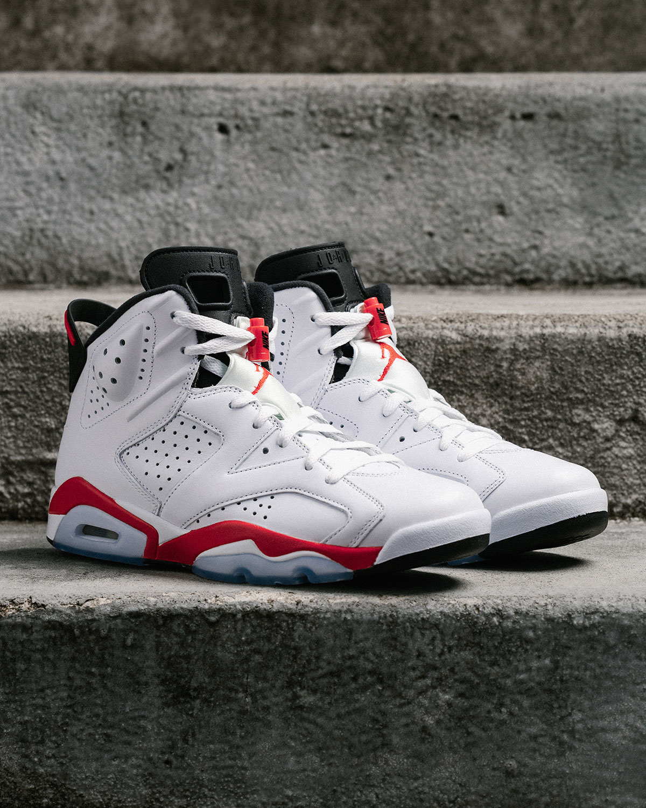
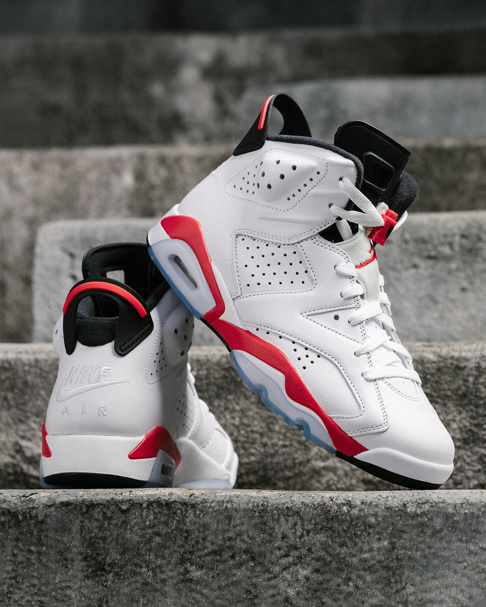
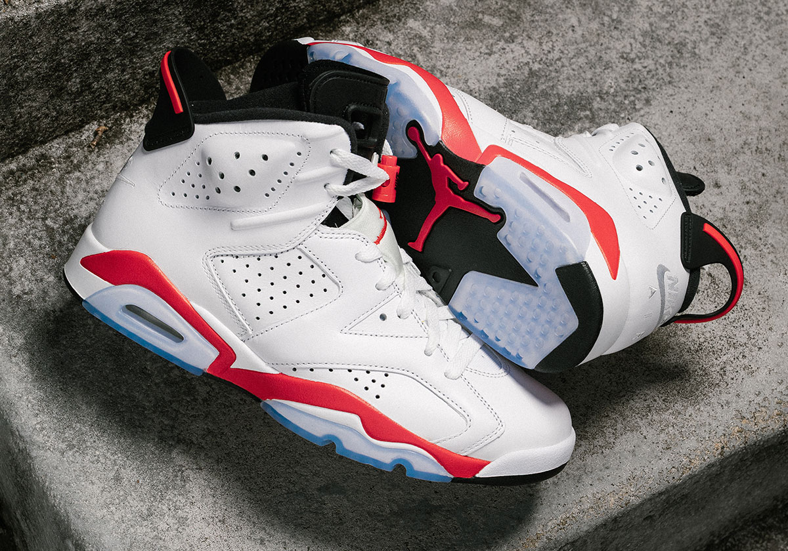
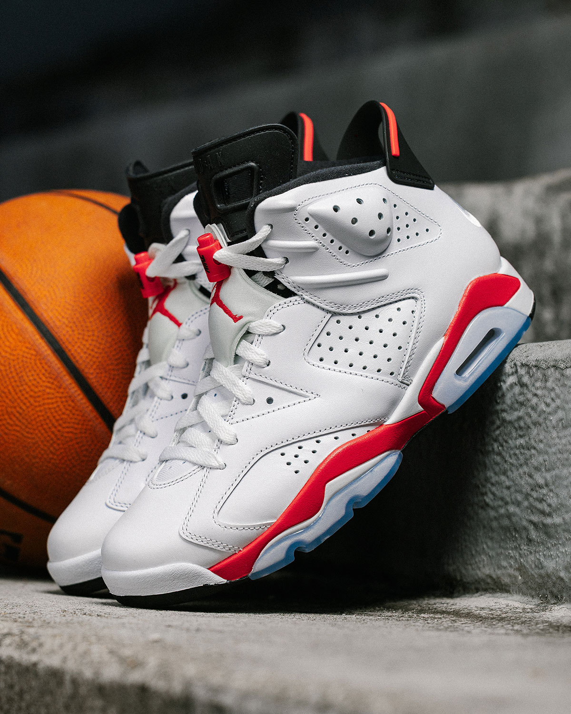
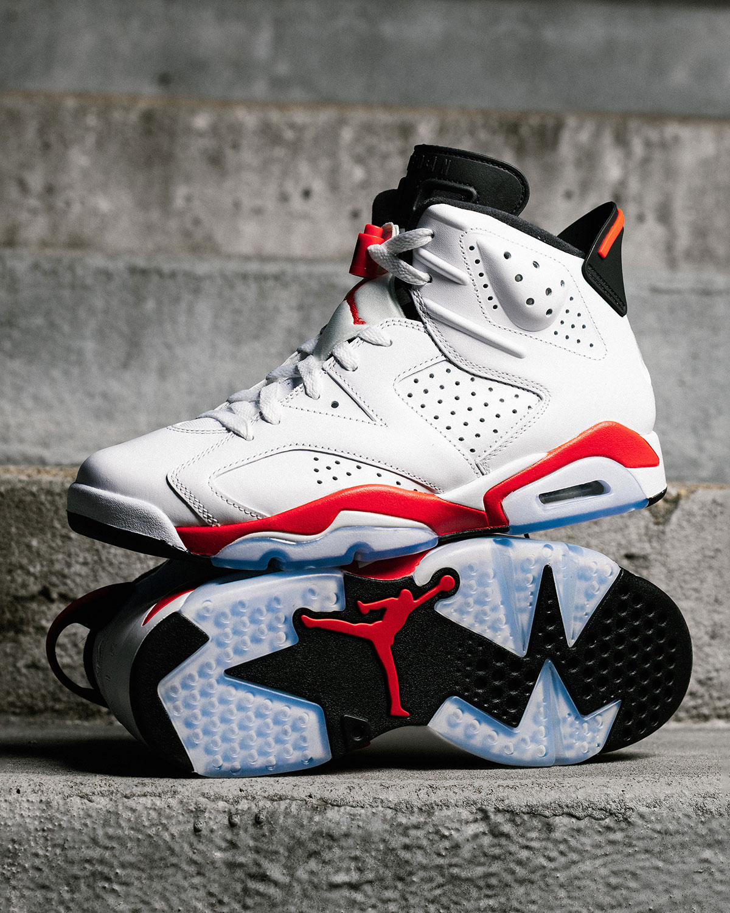

> [中文版 Chinese version](/life/air-jordan-6-white-infrared-zh/)

The Air Jordan 6 “White Infrared” went on sale this morning, November 7, 2026, at 10 a.m. ET — $215 for adults, full family sizing, on Nike SNKRS and at Foot Locker, Champs Sports, Hibbett’s and select Jordan retailers. It is the shoe Michael Jordan wore when he won his first NBA championship. It is the 35th-anniversary year of the Air Jordan 6. It is, by the account of the people who cover these shoes for a living, the most faithful retro of this colorway ever made.

And by lunchtime, it was listed below retail.

That contradiction is the whole story of this release. One half is a heritage triumph: after 12 years away, the first title shoe returns with the details collectors have been asking for. The other half is a market reality check: an OG Jordan, on release day, with resellers asking $157 on StockX. Both halves are true at the same time, and understanding why is more interesting than either half alone.

One honest note up front: this is not a wear-test review. The shoe only went on sale today, and nobody outside Jordan Brand has put meaningful miles on a retail pair yet. What follows is a long first look — the history, the design, what changed this time, and what the first day of sales actually tells us — with the claims that can be checked separated from the ones that cannot.

*The Air Jordan 6 “White Infrared” (CT8529-105): white leather, Light Crimson accents, black detailing, icy outsole. Image: Jordan Brand official imagery, via Sneaker News.*

## The facts

| | |
|---|---|
| **Model** | Air Jordan 6 Retro OG “White Infrared” |
| **Style code** | CT8529-105 |
| **Colorway** | White / Light Crimson–Black |
| **Release date** | Saturday, November 7, 2026, 10:00 a.m. ET |
| **Retail price** | Adult $215 · Grade school $155 · Little kid / preschool $95 · Toddler $80 |
| **Where** | Nike SNKRS, Foot Locker, Champs Sports, Hibbett’s, select Jordan Brand retailers |
| **Anniversary** | 35th anniversary of the Air Jordan 6 (original: 1991) |

This is the third retro of the “White Infrared” colorway, after 2010 and 2014 — the first time it has returned in 12 years, per Sports Illustrated’s Kicks On SI and Sneaker News. The original launched in 1991.

## Why this shoe matters: June 1991

Every Air Jordan has a story, but the 6 has the one that changed everything. Michael Jordan won his first NBA championship in the Air Jordan 6, closing out the Los Angeles Lakers in the 1991 Finals. It kicked off a decade of dominance on the court and, just as importantly, in the sneaker industry. Before that ring, Jordan was the most electrifying player alive who hadn’t won anything. After it, he was the standard every signature athlete since has been measured against — and the shoe on his feet became the artifact of the turning point.

The design is Tinker Hatfield’s, and it wears its inspiration openly. The Air Jordan 6 was modeled on the German sports car Jordan drove at the time — his Porsche 911 — and you can see it in the silhouette: the sleek, low-slung lines, the spoiler-like pull tab at the heel, the sculpted panels that read as bodywork rather than decoration. Hatfield had already designed the 3, 4 and 5; the 6 was where the line stopped looking like a basketball shoe with ideas and started looking like an object designed from something else entirely.

That is why “White Infrared” is not just another colorway. It is the home version of the first title shoe — the white-based pair Jordan wore through the championship run, with the red that gave the shoe its name. For older fans, it is the one that looks like 1991. For younger buyers, it is the one that explains why a 35-year-old design still gets a Saturday-morning release date.

## The design, piece by piece

The 2026 version is built around a simple idea: white premium leather, Light Crimson accents, black detailing, and an icy blue translucent outsole. It sounds minimal on paper. In person — in the official imagery, at least — the restraint is the point. The white upper is the canvas, the red does the talking, and the black keeps it from floating away.

Working through the details that make an Air Jordan 6 an Air Jordan 6:

- **The perforated panels.** The big perforated overlays on the midfoot and ankle are the 6’s most recognizable texture — part ventilation, part sculpture. They are here, in the same placement as the original, and they are what your eye lands on first after the color blocking.
- **The lace toggle.** The chunky lace lock at the top of the laces is pure 1991: a functional detail from the era before speed-lacing was a fashion statement. It is one of the details that immediately dates the shoe — and one of the reasons it still looks right.
- **The heel pull tab.** The spoiler-shaped tab at the back of the collar is the Porsche reference made literal. It is also, practically, the thing you grab to pull the shoe on — the 6’s high collar is not a slip-on.
- **The tongue.** The Air Jordan wordmark sits on the tongue, with a Jumpman embroidered on the tongue itself. The tongue is also where the 6 shows its inner bootie construction, the padded sleeve that made the shoe feel more like a boot than its predecessors.
- **The midsole.** A lightweight polyurethane midsole carries Air-Sole units in the forefoot and heel, with a visible Air window at the heel. The red midsole accent — the “Infrared” part of the name — wraps the shoe in a band that is the single most recognizable color hit on the whole design.
- **The outsole.** Icy blue translucent rubber with black multidirectional traction pods, and a Crimson Red Jumpman set into the forefoot. It is, as Sports Illustrated put it, a work of art — and it is the part of the shoe most likely to yellow with age, which is also the part collectors argue about most.

None of this is new technology. That is not the point. The point is that every one of these details is a 1991 detail, reproduced rather than redesigned.

*The detail that matters most to collectors: Nike Air branding is back on the heel, replacing the Jumpman used on the 2010 and 2014 retros. Image: Jordan Brand official imagery, via Sneaker News.*

## What makes the 2026 version different: two corrections

If you owned the 2010 or 2014 retro, the 2026 pair looks familiar — and then you notice the two things Jordan Brand fixed.

**First, the heel branding.** Both previous retros put a Jumpman logo on the heel. The 2026 version restores Nike Air branding on the heel, as the original 1991 pair had. This is visible in the photo above: “NIKE AIR” embossed on the heel, with the spoiler pull tab above it. For collectors, this is the single biggest change in the shoe — it is the difference between a retro that quotes the original and a retro that reproduces it. Jordan Brand has been restoring Nike Air branding to OG retros across the line in recent years, and the Infrared is the latest and most significant beneficiary.

**Second, the red.** The 2010 and 2014 retros both used a shade of Bright Crimson that was, depending on who you ask, either too dark or too light — the 2014 pair in particular veered toward pink, which is the complaint you still hear about it. The 2026 version lands in the middle of that spectrum, closer to the original’s red. Sneaker News, which has handled both pairs, calls it “certainly closer than 2014’s pair” — careful wording, but the direction is clear: Jordan Brand paid attention to the exact Pantone this time, and the result is a red that reads as red, not pink, not orange.

Those two corrections are why this release is being described as the most faithful Infrared retro yet. They are also why it matters that this is an OG — a “Retro OG” in the official name — rather than a new colorway. The whole pitch is fidelity.

## The technology: 1991, honestly assessed

Let us be direct about what is underfoot. The Air Jordan 6’s cushioning is a lightweight polyurethane midsole with Air-Sole units in the forefoot and heel. In 1991, that was the state of the art for a basketball shoe. In 2026, it is not — and nobody should buy this shoe expecting modern performance.

That is not a flaw; it is a category. The Air Jordan 6 stopped being a performance basketball shoe years ago. It is a lifestyle and heritage shoe now, and it should be judged as one: comfort for all-day wear, durability of the leather and the outsole, and whether the shape holds up on foot. The polyurethane midsole is firmer than a modern foam, the Air units are modest, and the shoe is heavier than anything you would actually play in today. If you want a basketball shoe for basketball, Jordan Brand will happily sell you one — it will not be this one.

What the 6 does offer, and what modern retros sometimes lose, is structure. The high collar, the inner bootie, the rigid heel counter and the substantial leather upper make it a shoe that holds its shape on foot rather than collapsing around it. That is part of why it photographs so well and why it works as a daily shoe in a way that a softer, lighter retro sometimes does not.

The honest caveat, as with every icy-outsole retro: the translucent outsole will yellow over time, and the white leather will show wear faster than a darker shoe. Buy it knowing that. The yellowing is a known property of the material, not a defect — but it is the reason some collectors keep a second pair unworn, and the reason the rest of us should think of the icy sole as beautiful and temporary.

## The market reaction: below retail on day one

Here is the part that would have been unthinkable a few years ago. Hours after the 10 a.m. ET release, the Air Jordan 6 “White Infrared” was listed below its $215 retail price on the resale market. Men’s Journal reported at 12:32 p.m. ET on release day that StockX asking prices ran $157–$177 for men’s sizes 8–14, and GOAT asking prices ran $177–$205 — and its writer had bought his own size 14 directly from Nike for $215 “without a problem.”

Three things to keep straight about those numbers. First, they are *asking* prices, not confirmed sales — what sellers hope to get, not necessarily what buyers pay. Second, GOAT’s listed prices include fees while StockX adds fees at checkout, which closes some of the gap. Third, this is a snapshot from the afternoon of November 7, 2026, and resale prices move fast; treat it as a read on release-day demand, not a price guide.

But the direction is the story. An OG Jordan — a first-title shoe, in its 35th-anniversary year, in its most faithful retro ever — did not sell out instantly, and resellers were undercutting retail within hours. Men’s Journal’s own read is that Jordan Brand’s crowded release calendar may be catching up with consumers: with desirable retros arriving regularly, buyers have more choices and limited budgets, and nostalgia alone may not carry the same weight with younger buyers who are also looking at running-inspired silhouettes and competing brands. That is presented as a possible explanation, not a confirmed cause — and it is worth keeping that framing, because no single release proves a trend.

It does, however, fit a pattern worth watching. Jordan Brand is releasing more retros, more often, than it did during the scarcity era — and the market is responding the way markets respond to more supply: selectively. The shoes people want most still sell out. The ones that are merely good, even historically important ones, increasingly do not. The White Infrared may be the clearest test case yet of that shift, because there is nothing wrong with the shoe itself. If *this* one goes below retail on day one, the question is not about the shoe — it is about how many retros the market can absorb, and whether the nostalgia premium that powered the last decade of Jordan releases has a ceiling.

For buyers, the practical consequence is straightforward, and it cuts in your favor: if you want this shoe, buy it at retail while sizes are available. There is no reason to pay resale for a shoe that is still sitting on Nike’s site, and the below-retail resale market means that if you miss your size at retail, patience is likely to be rewarded rather than punished. That is the opposite of the old Jordan-release playbook, and it is good news for anyone who actually wants to wear the shoe.

*The icy translucent outsole with black traction pods and a Crimson Jumpman — the part of the shoe collectors argue about most, because it yellows with age. Image: Jordan Brand official imagery, via Sneaker News.*

## Who should buy it — and who should pass

**Buy it if:** you have been waiting for a faithful Infrared retro — this is the one, and the Nike Air heel alone justifies it over the 2010 and 2014 pairs. Buy it if you want a white-based Jordan that goes with everything and carries real history; the white/red/black blocking is one of the most wearable colorways Jordan Brand has ever made. Buy it if you collect OG retros and care about details like the Pantone and the heel branding, because this is the version those details were corrected for.

**Think twice if:** you already own the 2014 pair and the Nike Air heel does not matter to you — the shoes are, from more than a few feet away, the same shoe. Think twice if you need a shoe for actual basketball — this is a heritage shoe, and modern performance shoes are lighter, softer and better at the job. And think twice if you were buying it as an investment: the release-day resale market is telling you, plainly, that this is not a shoe to flip.

**For kids:** the full family run — grade school $155, little kid $95, toddler $80 — makes this one of the more accessible OG releases for families. If your kid is going to outgrow the shoe in a season anyway, the resale softness works in your favor there too.

**On sizing:** Jordan Brand has not published fit guidance specific to this release, and there are no wear-test reports yet. The Air Jordan 6 has historically run true to size for most wearers, but the high collar and inner bootie make it a shoe worth trying on before committing — especially if you are between sizes or plan to wear thicker socks. Do not assume your size in a Jordan 1 or a modern runner carries over.

*The tongue carries the Air Jordan wordmark and a Jumpman; the lace toggle and perforated panels are pure 1991. Image: Jordan Brand official imagery, via Sneaker News.*

## Also today: the Black Pack finale

The White Infrared was not the only Jordan release this morning. Jordan Brand also closed out its four-shoe “Black Pack” today with the Air Jordan 15 “Black Pack” ($240, style code IZ2585-001) and the Air Jordan 17 Low “Black Pack” ($245, IZ2638-001) — the second delivery of the pack, after the Air Jordan 14 Low and Air Jordan 16 released in October and sold out at boutiques. The Black Pack dresses Jordan’s post-Bulls signature models — 14 through 17 — in black with animal textures: snakeskin on the 15, stingray on the 17’s lace panel.

The contrast with the Infrared is instructive. The Black Pack is a boutique-only (NBHD) release, sold through select shops and Jordan Brand’s 232323232323.com microsite — no SNKRS, no Foot Locker. It is a scarcity play for the collector end of the market. The Infrared is the opposite: a wide, general release at every major retailer. Jordan Brand ran both strategies on the same Saturday, and the market’s different reaction to each — instant sellout pressure on the boutiques, below-retail asks on the wide release — is a useful snapshot of where the demand actually sits.

## Verdict: the shoe is a triumph; the market is the question

The Air Jordan 6 “White Infrared” is, on its own terms, a success. It is the most faithful retro of one of the most important shoes Jordan Brand has ever made — the first title shoe, restored with the Nike Air heel and the correct red, in the 35th-anniversary year, at a fair $215 with full family sizing. There is nothing about the shoe to apologize for.

What is unresolved is not the shoe but the context around it. A release-day market that puts an OG Jordan below retail within hours is new, and it raises a question Jordan Brand will have to answer with its calendar, not with any single shoe: how much nostalgia can the market absorb, and at what pace? If the answer is “less, slower,” that is arguably good for the people who actually wear these shoes — more pairs at retail, less frenzy, less flipping. If the answer is that the retros have simply become too familiar, then even the most faithful reproduction of the most historic shoe may not be enough on its own.

Either way, the White Infrared earns its place. Twelve years is a long time to wait for a shoe this good, and this version is the one to wait for. Buy it at retail, wear it, and let the resale market do whatever it is going to do — the shoe itself has already done its job. It did it in 1991.

*Stacked: the lateral profile and the full outsole. The midsole’s red band is the “Infrared” in the name. Image: Jordan Brand official imagery, via Sneaker News.*

**The facts, as of November 7, 2026:** released November 7, 2026, 10:00 a.m. ET, at Nike SNKRS, Foot Locker, Champs Sports, Hibbett’s and select Jordan retailers; adult $215, grade school $155, little kid $95, toddler $80; style code CT8529-105; colorway White/Light Crimson–Black; third retro of the colorway after 2010 and 2014; Nike Air heel branding restored; original 1991, worn by Michael Jordan to his first NBA championship. Resale figures are a snapshot from the afternoon of November 7, 2026 (Men’s Journal: StockX asks $157–$177, GOAT asks $177–$205, men’s sizes 8–14) and are subject to change — they are asking prices, not confirmed sales. This is not a wear-test review: the shoe went on sale today and no independent wear-test of a retail pair exists yet.

**Sources:** [Sneaker News — Where To Buy The Air Jordan 6 “Infrared”](https://sneakernews.com/2026/11/06/air-jordan-6-white-infrared-store-list/) · [Sports Illustrated / Kicks On SI — The Air Jordan 6 “White Infrared” Drops This Week](https://www.si.com/fannation/sneakers/news/air-jordan-6-white-infrared-drops-this-week) · [Men’s Journal — Air Jordan 6 White Infrared Below Retail](https://www.mensjournal.com/style/air-jordan-6-white-infrared-below-retail-ct8529-105) · [Sneaker News — Air Jordan 15 “Black Pack”](https://sneakernews.com/2026/11/04/air-jordan-15-black-pack-iz2585-001-release-date/) · [Sneaker News — Air Jordan 17 Low “Black Pack”](https://sneakernews.com/2026/11/04/air-jordan-17-low-black-pack-iz2638-001/?amp)
