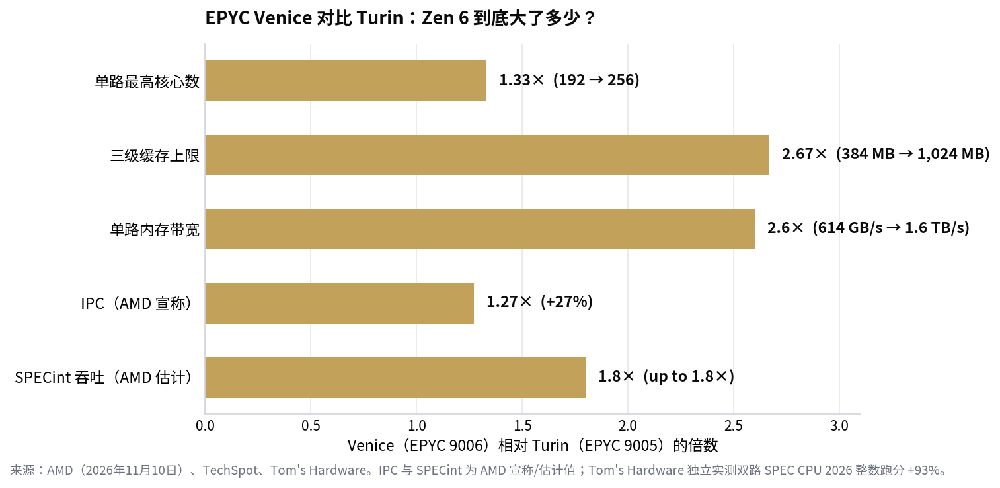
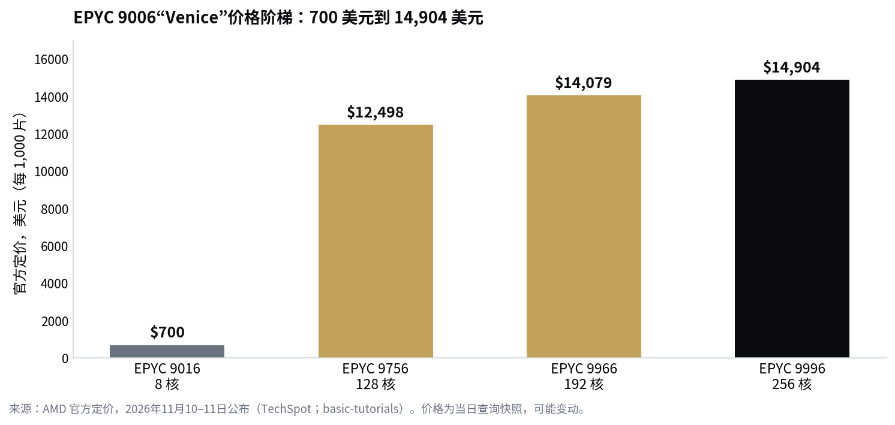

> [English version](/life/amd-epyc-9006-venice-zen-6-launch/)

*价格为 2026 年 11 月 10–11 日查询的美国官方定价快照，后续可能变化。AMD 的性能宣称已标注为厂商说法；独立实测已标注出处。*

## 发布了什么

AMD 第六代 EPYC 服务器处理器、代号 **"Venice"**（EPYC 9006 系列）于**11 月 10 日（周二）**发布，采用全新的 SP7 接口，OEM 厂商当天开始出货，微软 Azure 与甲骨文云（OCI）的云实例随后上线。该系列 7 月在 AMD Advancing AI 大会上预览过，台积电 2nm 工艺的生产爬坡从 5 月开始——但 11 月 10 日是完整规格、价格与独立测试同时落地的日子。

AMD 公布的关键数字：

- 单路最高 **256 核 / 512 线程**（EPYC 9996，Zen 6c 高密度核心），**1 GB 三级缓存**
- 相对 Zen 5 平均 **IPC +27%**——但据一家行业媒体指出，AMD 是用 Zen 6c 在固定频率下测的，这个测法对新核心比较有利
- 单路 **16 条 DDR5 内存通道**，带宽最高 **1.6 TB/s**（Turin 的 2.6 倍），MRDIMM 最高 12,800 MT/s，单路内存容量最高 8 TB
- **96 条 PCIe Gen 6 通道**，频率优化版 96 核 EPYC 9686F 睿频最高 **5.3 GHz**
- 价格从 **700 美元**（8 核 EPYC 9016）到 **14,904 美元**（EPYC 9996），共 31 个型号
- 封装功耗最高 **600 W**——而且是新接口 SP7，Venice 装不上现有的 SP5 主板

*EPYC Venice 对比 Turin：Zen 6 到底大了多少？来源：AMD（2026 年 11 月 10 日）、TechSpot、Tom's Hardware。IPC 与 SPECint 为 AMD 宣称/估计值；Tom's Hardware 独立实测双路 SPEC CPU 2026 整数跑分 +93%。*

## 独立测试撑住了宣传

发布当天的跑分通常是厂商幻灯片。这次独立数据同一天就来了，而且很硬。Tom's Hardware 实测，双路 EPYC 9996 服务器在 SPEC CPU 2026 整数率测试中比双路 EPYC 9965（Turin）快 **93%**——而 96 核的 EPYC 9686F 在整数性能上领先英伟达新款 Vera CPU **17%**。

第二个对比最值得盯着看，因为发布会也正是在这里变得奇怪。AMD 宣称其 256 核 400W 芯片每瓦可跑的并发 Agent 数量是 Vera 的 **3.3 倍**——这是厂商数字，不是独立测试。但 AMD 的 Zen 首席架构师与一位公司副总裁对媒体表示，AMD**并没有为 Agent AI 设计 Venice**——这是对英伟达与 Arm 把自家新 CPU 包装成"为 Agent 而生"的直接反驳。AMD 一边把 Venice 当作 Agent 时代的 CPU 来卖，一边让自己的架构师说 Agent 这个框是营销话术。两件事可以同时成立：一颗快的通用服务器 CPU 对 Agent 工作负载确实有用，而"为 Agent 设计"仍然基本是个口号。

超微（Supermicro）第二天早上从需求侧加了一把火，宣布搭载新芯片的 H15 服务器即刻出货，宣称前沿模型宿主节点的每秒 token 数比上一代 AMD 平台高 **1.8 倍**，并扩展了 Helios（AMD Instinct MI455X GPU）与 Helion 机架级平台。出货量、订单与收入均未披露。

*EPYC 9006"Venice"价格阶梯：700 美元到 14,904 美元。来源：AMD 官方定价，2026 年 11 月 10–11 日公布（TechSpot；basic-tutorials）。价格为当日查询快照，可能变动。*

## 为什么这次不只是一次常规服务器升级

有三点让 Venice 超出了例行换代的范畴。

第一，这是首款采用 **2nm 级工艺**（台积电 N2 计算芯片 + N6 I/O 芯片）的高性能 x86 CPU。服务器 CPU 的工艺领先地位，十年来先是英特尔的故事，后来是谁都用台积电；AMD 拿着量产服务器芯片第一个上 N2，是实打实的制程胜利，也是每瓦性能大幅提升的主要原因——AMD 宣称每瓦性能提升最高 2.6 倍。

第二，内存系统才是真正的产品。单路 16 通道、1.6 TB/s，决定了 Venice 能不能当好 GPU 重型 AI 机架的宿主 CPU：这类系统里 CPU 的活就是给加速器喂数据，而 Turin 在这方面是带宽不够的。SP8 平台（8 通道、8–128 核）将于 2027 年上半年跟进，Venice-X（3D V-Cache）与 Verano（LPDDR5X）在下半年。

第三，消费级产品的时钟现在滴答作响。Zen 6 今天只存在于 EPYC 芯片里；还没有任何一款消费级锐龙用上它。锐龙 9000 的继任者（普遍预计叫 Ryzen 10000）预计在 2027 年 CES 上发布、上半年上市。AMD 本周证明的是核心与制程；桌面端是下一步。

AMD 同一天还发布了嵌入式版本 EPYC Embedded 9006 SP7——最高 256 核，用于半导体测试设备、存储控制器与防火墙，提供七年产品生命周期。128 核型号 11 月 15 日出货，其余型号年底前出货。

## 结论

Venice 是少见的"厂商宣称与独立测试指向同一方向"的发布：核心数大跳、制程大跳、内存系统为 AI 机架时代而建。27% 的 IPC 数字值得打个星号——AMD 是在有利的测试设置下测的——但双路系统独立实测 SPECint +93%，不需要有利设置也足够亮眼。

更有意思的信号是 AMD 在公开场合选的这场争论。在英伟达大举押注"Agent CPU"标签的时候拒绝这个标签，是在赌买家能看穿品类营销、按每瓦吞吐量买单。如果 Helios 机架与 Azure/OCI 实例大量出货，AMD 就凭数字赢了这场赌；如果没有，这场争论就会被读作借口。接下来看英特尔的回应：Diamond Rapids（至强 7），同样 256 核，现据报 2027 年发布——比 Venice 晚大约一年，采用英特尔 18A-P 工艺。

## 来源

- AMD Newsroom，"6th Gen AMD EPYC Now Available"（发布资料包），2026 年 11 月 10 日（发布；Azure 与 OCI 实例；Helion 机架）。
- AMD Newsroom，"AMD Launches 6th Gen AMD EPYC Embedded Processors"，2026 年 11 月 10 日（嵌入式 9006 SP7；256 核；吞吐 1.8 倍；128 核型号 11 月 15 日上市）。
- TechSpot，"AMD launches Zen 6 Epyc 9006 series with up to 256 cores, 512 threads, and TSMC N2"，2026 年 11 月 11 日（规格；Tom's Hardware SPEC CPU 2026 +93%；700–14,904 美元定价；每瓦性能 2.6 倍）。
- MLQ，"AMD launches Zen 6 EPYC 'Venice' server CPUs pitched at agentic AI as Nvidia's Vera gets its first full reviews"，2026 年 11 月 10 日（与 Vera 对比；3.3 倍 Agent/瓦为厂商说法；AMD 架构师"并非为 Agent AI 设计"的反驳）。
- basic-tutorials.com，"AMD Zen 6 in Detail: EPYC Venice Delivers 27 Percent More IPC and Up to 256 Cores"，2026 年 11 月 11 日（27% IPC 为 Zen 6c 固定频率下测得；各型号价格；SP8/Venice-X/Verano 路线图）。
- Stocktwits，"Supermicro Begins Shipping New AMD-Powered AI Servers"，2026 年 11 月 11 日（H15 出货；每秒 token 数最高 1.8 倍；Helios/Helion；未披露出货量）。
