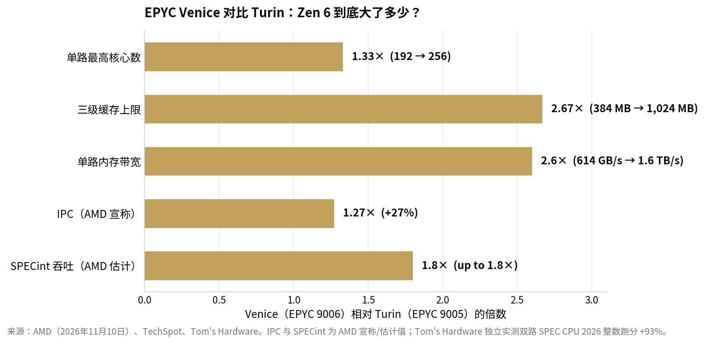
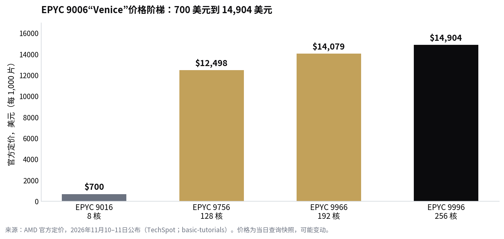

> [English version](/life/amd-epyc-9006-venice-zen-6-launch/)

*价格为 2026 年 11 月 10–11 日查询的美国官方定价快照，后续可能变化。AMD 的性能宣称已标注为厂商说法；独立实测已标注出处。*

## 发布了什么

AMD 第六代 EPYC 服务器处理器、代号 **"Venice"**（EPYC 9006 系列）于**11 月 10 日（周二）**发布，采用全新的 SP7 接口，OEM 厂商当天开始出货，微软 Azure 与甲骨文云（OCI）的云实例随后上线。该系列 7 月在 AMD Advancing AI 大会上预览过，台积电 2nm 工艺的生产爬坡从 5 月开始——但 11 月 10 日是完整规格、价格与独立测试同时落地的日子。

AMD 公布的关键数字：

- 单路最高 **256 核 / 512 线程**（EPYC 9996，Zen 6c 高密度核心），**1 GB 三级缓存**
- 相对 Zen 5 平均 **IPC +27%**——但据一家行业媒体指出，AMD 是用 Zen 6c 在固定频率下测的，这个测法对新核心比较有利
- 单路 **16 条 DDR5 内存通道**，带宽最高 **1.6 TB/s**（Turin 的 2.6 倍），MRDIMM 最高 12,800 MT/s，单路内存容量最高 8 TB
- **96 条 PCIe Gen 6 通道**，频率优化版 96 核 EPYC 9686F 睿频最高 **5.3 GHz**
- 价格从 **700 美元**（8 核 EPYC 9016）到 **14,904 美元**（EPYC 9996），共 31 个型号
- 封装功耗最高 **600 W**——而且是新接口 SP7，Venice 装不上现有的 SP5 主板

*EPYC Venice 对比 Turin：Zen 6 到底大了多少？来源：AMD（2026 年 11 月 10 日）、TechSpot、Tom's Hardware。IPC 与 SPECint 为 AMD 宣称/估计值；Tom's Hardware 独立实测双路 SPEC CPU 2026 整数跑分 +93%。*

## 九年时间：从无人问津到平分秋色，AMD 是怎么爬上来的

Venice 看起来是一次发布，实际上是九年攀登的第六步。2017 年 AMD 推出第一代基于 Zen 架构的 EPYC 时，英特尔的至强（Xeon）处理器在 2000 年代与 2010 年代的大部分时间里控制着服务器 CPU 市场 99% 以上的份额，营业利润率估计在 60–70%，把数据中心变成了半导体史上利润最丰厚的护城河。AMD 的服务器份额只有个位数低段，很多人把它看作一家错过了数据中心的桌面与游戏厂商。攀登是一步一步来的：Genoa 于 2022 年底到来，单路最高 96 核；Turin——第五代、2024 年 10 月 10 日随 Zen 5 发布——把核心数推到 192 核，比英特尔 Xeon 6 Granite Rapids 的 128 核多出 50%，价格还更低。192 核的 EPYC 9965 标价约 14,813 美元，而英特尔 128 核的 Xeon 6980P 是 17,800 美元。

份额数字比任何发布幻灯片都更能说明这场攀登。根据 Mercury Research 的 2026 年第一季度数据，AMD 的 EPYC 处理器拿下了服务器 CPU 收入的 46.2%——历史最高，比上一季度的 41.3% 又上了一个台阶——出货量份额为 33.2%。英特尔出货的芯片仍然更多，大约是 AMD 的两倍，但 AMD 每颗芯片赚得更多，因为它的产品组合偏向高核心数的高价型号。AMD 数据中心业务 2026 年第一季度单季营收 58 亿美元，同比增长 57%，第一次超过英特尔的数据中心业务。AMD 在 2021 年第一季度突破 10% 的服务器份额关口，此前多年一直在个位数徘徊；五代 EPYC，每一代都抢在英特尔路线图前面拿到台积电的新工艺与核心数提升，在一个每年 220 亿美元的市场里累积出约 40 个百分点的份额 swing。Venice 不是这场故事的起点，而是巩固它的那一次发布——AMD 从此不再是挑战者，而是英特尔必须设法夺回份额的在位者。

这个背景也解释了为什么市场对 Venice 的反应如此认真。一家份额还在个位数时发布的芯片，买家会问"它会不会消失"；一家收入份额 46.2% 的公司发布的芯片，买家问的是"它能不能按时交货"。问题的性质变了，从生存问题变成了执行问题——而执行问题恰恰是 AMD 现在最需要证明的东西。

## 独立测试撑住了宣传

发布当天的跑分通常是厂商幻灯片。这次独立数据同一天就来了，而且很硬。Tom's Hardware 实测，双路 EPYC 9996 服务器在 SPEC CPU 2026 整数率测试中比双路 EPYC 9965（Turin）快 **93%**——而 96 核的 EPYC 9686F 在整数性能上领先英伟达新款 Vera CPU **17%**。

第二个对比最值得盯着看，因为发布会也正是在这里变得奇怪。AMD 宣称其 256 核 400W 芯片每瓦可跑的并发 Agent 数量是 Vera 的 **3.3 倍**——这是厂商数字，不是独立测试。但 AMD 的 Zen 首席架构师与一位公司副总裁对媒体表示，AMD**并没有为 Agent AI 设计 Venice**——这是对英伟达与 Arm 把自家新 CPU 包装成"为 Agent 而生"的直接反驳。AMD 一边把 Venice 当作 Agent 时代的 CPU 来卖，一边让自己的架构师说 Agent 这个框是营销话术。两件事可以同时成立：一颗快的通用服务器 CPU 对 Agent 工作负载确实有用，而"为 Agent 设计"仍然基本是个口号。

超微（Supermicro）第二天早上从需求侧加了一把火，宣布搭载新芯片的 H15 服务器即刻出货，宣称前沿模型宿主节点的每秒 token 数比上一代 AMD 平台高 **1.8 倍**，并扩展了 Helios（AMD Instinct MI455X GPU）与 Helion 机架级平台。出货量、订单与收入均未披露。

*EPYC 9006"Venice"价格阶梯：700 美元到 14,904 美元。来源：AMD 官方定价，2026 年 11 月 10–11 日公布（TechSpot；basic-tutorials）。价格为当日查询快照，可能变动。*

## 2nm 竞赛："第一"到底意味着什么

制程的说法值得单独审视，因为"首个 2nm"这个标题背后藏着一场三方竞赛。台积电 N2 是该代工厂第一个放弃 FinFET 晶体管、改用环绕栅极（gate-all-around）纳米片晶体管的工艺，于 2025 年第四季度进入大批量生产，在中国台湾的新竹与高雄两地爬坡。到 2026 年第三季度，它已经占台积电晶圆收入的 8%，比上一季度翻了一倍多；台积电表示，N2 是其历代工艺中客户采用最强的一代，截至 2026 年 4 月已收到 20 多个流片、70 多个在排队。已出货的 N2 芯片包括苹果的 A20 Pro（2026 年 9 月随 iPhone 18 Pro 上市），以及 AMD 的 EPYC Venice——AMD 于 2025 年 4 月将 Venice 作为首款 N2 工艺的高性能计算产品流片，2026 年 5 月宣布在台湾开始生产爬坡，计划之后在台积电亚利桑那工厂爬坡。

竞争是真实的，但并不均衡。英特尔的 18A 是 1.8nm 级环绕栅极工艺、带背面供电，已于 2025 年底进入大批量生产，用于其 Panther Lake PC 处理器；三星的 SF2 于 2025 年进入量产、用于 Exynos 2600，但据报良率到 2026 年初仍在 55% 附近，低于可盈利量产的水平。台积电一个季度的代工收入大约是三星代工部门的 11 倍。所以 Venice 的"第一"在服务器品类里是真实的——首款 2nm 级工艺的高性能 x86 CPU、首款在 N2 上进入生产爬坡的高性能计算产品——但它同时也是关于"谁先拿到台积电最好工艺"的一份声明。苹果拿它做手机，AMD 拿它做服务器，这个排队顺序本身就是地位的度量：台积电把最稀缺的产能分配给它相信能填满产能的客户。

这里还有一个隐藏的成本：据报 N2 晶圆每片成本约 30,000 美元，旗舰型号 14,904 美元的标价，部分就是"抢先"的成本转嫁给了那些对密度需求迫切到愿意付这个价的买家。制程领先从来不是免费的，它只是把账单从性能那一栏挪到了价格那一栏。

## 为什么这次不只是一次常规服务器升级

有三点让 Venice 超出了例行换代的范畴。

第一，这是首款采用 **2nm 级工艺**（台积电 N2 计算芯片 + N6 I/O 芯片）的高性能 x86 CPU。服务器 CPU 的工艺领先地位，十年来先是英特尔的故事，后来是谁都用台积电；AMD 拿着量产服务器芯片第一个上 N2，是实打实的制程胜利，也是每瓦性能大幅提升的主要原因——AMD 宣称每瓦性能提升最高 2.6 倍。

第二，内存系统才是真正的产品。单路 16 通道、1.6 TB/s，决定了 Venice 能不能当好 GPU 重型 AI 机架的宿主 CPU：这类系统里 CPU 的活就是给加速器喂数据，而 Turin 在这方面是带宽不够的。SP8 平台（8 通道、8–128 核）将于 2027 年上半年跟进，Venice-X（3D V-Cache）与 Verano（LPDDR5X）在下半年。

第三，消费级产品的时钟现在滴答作响。Zen 6 今天只存在于 EPYC 芯片里；还没有任何一款消费级锐龙用上它。锐龙 9000 的继任者（普遍预计叫 Ryzen 10000）预计在 2027 年 CES 上发布、上半年上市。AMD 本周证明的是核心与制程；桌面端是下一步。

AMD 同一天还发布了嵌入式版本 EPYC Embedded 9006 SP7——最高 256 核，用于半导体测试设备、存储控制器与防火墙，提供七年产品生命周期。128 核型号 11 月 15 日出货，其余型号年底前出货。

## 发布之下的缺货

发布当天的跑分之下还跑着第二个故事，而它将决定 Venice 在 2027 年是否真的有分量：供应。据行业采购报道，AMD 的 EPYC Turin 到 2026 年底实际上已经售罄，官方交货期报 12–18 周，但大多数型号的实际交付窗口超过 30 周；英特尔分销商的积压订单只能满足约 40%，交货期 8–22 周。2026 年的服务器 CPU 缺货被描述为自 2020–2022 年疫情时期以来最严重的一次，而驱动因素与"Agent CPU"的说法是同一个：AMD CEO 苏姿丰表示，Agent AI 是把服务器 CPU 潜在市场（TAM）预测翻倍至 1,200 亿美元的主要驱动力，因为 AI 机架里的 CPU 与 GPU 配比正从一颗 CPU 配四到八颗 GPU，转向一比一。每个 Agent 都需要一颗宿主 CPU，而每颗宿主 CPU现在都成了瓶颈。

这让发布会换了一个读法。Venice 进入的不是一个买家按跑分在 AMD 与英特尔之间选择的市场，而是一个买家连任何一家的芯片都拿不到足够数量的市场——在那里，分配（谁拿到晶圆）比规格表更重要。在这个市场里，AMD 在 N2 上的先发优势比 27% 的 IPC 数字更值钱，因为它意味着 AMD 的供应先到，而英特尔的回应 Diamond Rapids 要晚大约一年。但它也意味着发布当天的结论在跑分捕捉不到的意义上是暂时的：一颗不能大批量买到的芯片，就是一份带价目表的新闻稿。Venice 真正的考验，是 AMD 能不能把制程领先变成实际出货的系统——Azure 与 OCI 的实例、超微的 H15 机架、Helios 的部署——赶在英特尔 18A 产能上线之前。盯着交货期看，别只盯着幻灯片：如果 Turin 式的 30 周等待延续到 2027 年，瓶颈就是台积电的产能，而不是 AMD 的设计，而再多的 IPC 也修不好它。

## 对普通消费者的意义：Ryzen 10000 正在路上

最后回到大多数人真正关心的问题：Zen 6 什么时候到桌面上？今天的答案是还没有。Zen 6 目前只存在于 EPYC 芯片里，锐龙 9000 的继任者——普遍预计叫 Ryzen 10000——预计在 2027 年 CES 上发布、上半年上市。对桌面用户来说，Venice 的意义是间接的，但它是真实的：它验证了 Zen 6 核心与 N2 制程在量产条件下的表现，而桌面芯片将继承同一套核心与同一套工艺，只是在功耗、频率与缓存配置上做不同的取舍。

历史上有过类似的剧本：每一代 EPYC 先行、锐龙跟进的节奏，意味着服务器市场的验证结果会提前半年左右告诉桌面用户"这代核心行不行"。Turin 时代的教训是，核心数与 IPC 的提升在服务器上兑现之后，桌面端往往能在单核性能与游戏表现上拿到更大比例的红利——因为桌面芯片可以用更高的频率跑更少的核心。如果 Venice 的独立测试结果（双路 SPECint +93%）在桌面端按比例兑现，Ryzen 10000 将是 AMD 自 Zen 架构以来最值得期待的一次换代。当然，这一切的前提是 AMD 能解决供应问题：如果服务器订单把 N2 产能占满，桌面芯片的上市节奏就可能被推迟。盯住 CES 2027 的发布日期，和它之后的第一批实测——那才是 Venice 对普通人的最终答卷。

## 别忘了第三个玩家：Arm

AMD 与英特尔的对决之外，还有第三个玩家正在改写服务器 CPU 的版图：Arm。据 Mercury Research 的数据，Arm 架构的处理器——由云厂商与芯片公司基于 Arm 授权架构设计，而不是由 Arm 自己制造——现在约占全球服务器 CPU 出货量的 17–21%，五年前这个数字几乎可以忽略不计。亚马逊的 Graviton 系列是最典型的例子：Graviton5 采用 192 个 Neoverse V3 核心、台积电 3nm 工艺，是云厂商"自己设计、自己用"的路线的代表作。英伟达的 Grace 系列也在推动 Arm 服务器出货量增长，2025 年第三季度 Arm 服务器 CPU 销量中有一半的增长来自 Grace Blackwell 的组合。

这对 Venice 意味着什么？意味着 x86 的战争不再是唯一的战争。云厂商自己设计芯片的趋势越强，AMD 与英特尔争夺的"第三方服务器 CPU 市场"就越小——最大的买家正在变成自己的供应商。AMD 的回应是把 EPYC 做成云厂商愿意买、而不是自己造的芯片：更高的核心密度、更大的内存带宽、更低的每瓦成本，都是在说服云厂商"买比造划算"。这个论证在 Turin 时代成立，在 Venice 时代需要重新证明一次，因为云厂商的自研芯片也在以同样的速度进步。Venice 的对手名单上，英特尔是第一位，Arm 是第二位——而第二位正在以更快的速度接近。

## 结论

Venice 是少见的"厂商宣称与独立测试指向同一方向"的发布：核心数大跳、制程大跳、内存系统为 AI 机架时代而建。27% 的 IPC 数字值得打个星号——AMD 是在有利的测试设置下测的——但双路系统独立实测 SPECint +93%，不需要有利设置也足够亮眼。

更有意思的信号是 AMD 在公开场合选的这场争论。在英伟达大举押注"Agent CPU"标签的时候拒绝这个标签，是在赌买家能看穿品类营销、按每瓦吞吐量买单。如果 Helios 机架与 Azure/OCI 实例大量出货，AMD 就凭数字赢了这场赌；如果没有，这场争论就会被读作借口。接下来看英特尔的回应：Diamond Rapids（至强 7），同样 256 核，现据报 2027 年发布——比 Venice 晚大约一年，采用英特尔 18A-P 工艺。

## 来源

- AMD Newsroom，"6th Gen AMD EPYC Now Available"（发布资料包），2026 年 11 月 10 日（发布；Azure 与 OCI 实例；Helion 机架）。
- AMD Newsroom，"AMD Launches 6th Gen AMD EPYC Embedded Processors"，2026 年 11 月 10 日（嵌入式 9006 SP7；256 核；吞吐 1.8 倍；128 核型号 11 月 15 日上市）。
- TechSpot，"AMD launches Zen 6 Epyc 9006 series with up to 256 cores, 512 threads, and TSMC N2"，2026 年 11 月 11 日（规格；Tom's Hardware SPEC CPU 2026 +93%；700–14,904 美元定价；每瓦性能 2.6 倍）。
- MLQ，"AMD launches Zen 6 EPYC 'Venice' server CPUs pitched at agentic AI as Nvidia's Vera gets its first full reviews"，2026 年 11 月 10 日（与 Vera 对比；3.3 倍 Agent/瓦为厂商说法；AMD 架构师"并非为 Agent AI 设计"的反驳）。
- basic-tutorials.com，"AMD Zen 6 in Detail: EPYC Venice Delivers 27 Percent More IPC and Up to 256 Cores"，2026 年 11 月 11 日（27% IPC 为 Zen 6c 固定频率下测得；各型号价格；SP8/Venice-X/Verano 路线图）。
- Stocktwits，"Supermicro Begins Shipping New AMD-Powered AI Servers"，2026 年 11 月 11 日（H15 出货；每秒 token 数最高 1.8 倍；Helios/Helion；未披露出货量）。
