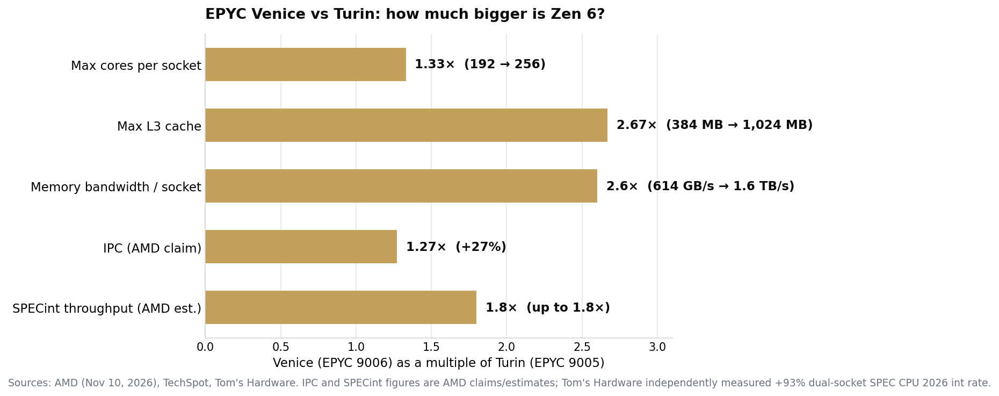
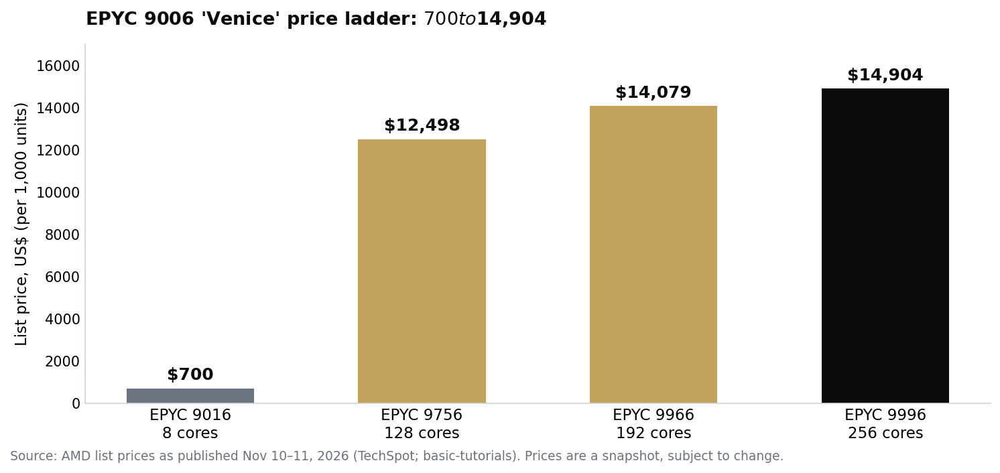

> [中文版 Chinese version](/life/amd-epyc-9006-venice-zen-6-launch-zh/)

*Prices are US list prices as of November 10–11, 2026 — a snapshot, subject to change. AMD's performance claims are labelled as AMD claims; independent measurements are labelled as such.*

## What launched

AMD's 6th Gen EPYC server processors, codenamed **"Venice"** (EPYC 9006 series), launched on **Tuesday, November 10** for the new SP7 socket, with systems shipping from OEMs the same day and cloud instances coming from Microsoft Azure and Oracle Cloud Infrastructure. The family had been previewed at AMD's Advancing AI event in July, and production ramp on TSMC's 2nm process began in May — but November 10 is when the full specs, prices, and independent benchmarks all landed at once.

The headline numbers, from AMD:

- Up to **256 cores / 512 threads** per socket (EPYC 9996, Zen 6c dense cores), with **1 GB of L3 cache**
- **+27% IPC** over Zen 5 on average, per AMD — measured, as one trade outlet noted, with Zen 6c at a fixed clock speed, a setup that flatters the new core
- **16 DDR5 memory channels** per socket, up to **1.6 TB/s** of bandwidth (2.6× Turin), with MRDIMMs up to 12,800 MT/s and up to 8 TB per socket
- **96 PCIe Gen 6 lanes**, up to **5.3 GHz** boost on the frequency-optimized 96-core EPYC 9686F
- Prices from **$700** (8-core EPYC 9016) to **$14,904** (EPYC 9996), across 31 SKUs
- Peak package power up to **600 W** — and a new SP7 socket, so Venice does not fit existing SP5 boards

*EPYC Venice vs Turin: how much bigger is Zen 6? Sources: AMD (November 10, 2026), TechSpot, Tom's Hardware. IPC and SPECint figures are AMD claims/estimates; Tom's Hardware independently measured +93% dual-socket SPEC CPU 2026 integer rate.*

## The independent numbers hold up

Launch-day benchmarks are usually vendor slides. This time the independent data arrived the same day, and it is strong. Tom's Hardware measured a dual-EPYC 9996 server at **93% faster** than a dual-EPYC 9965 (Turin) on the SPEC CPU 2026 integer-rate test — and the 96-core EPYC 9686F led NVIDIA's new Vera CPU by **17%** on integer performance in the same coverage.

That second comparison is the one to watch, because it is also where the launch got strange. AMD claims its 256-core chip at 400 W delivers **3.3× as many concurrent agents per watt** as Vera — a company figure, not an independent test. But AMD's chief Zen architect and a corporate vice president told press that AMD **did not design Venice for agentic AI** — a direct rebuttal to NVIDIA and Arm marketing their new CPUs as purpose-built for agents. AMD is simultaneously selling Venice as the CPU for the agentic era and having its own architects say the agentic framing is marketing. Both things can be true: a fast general-purpose server CPU is genuinely useful for agent workloads, and "designed for agents" is still mostly a slogan.

Supermicro underlined the demand side the next morning, announcing its H15 servers on the new chips are shipping now, claiming up to **1.8× the tokens per second** for frontier-model host nodes versus the previous AMD generation, and expanding its Helios (AMD Instinct MI455X GPUs) and Helion rack-scale platforms. No shipment volumes, orders, or revenue were disclosed.

*EPYC 9006 "Venice" price ladder: $700 to $14,904. Source: AMD list prices as published November 10–11, 2026 (TechSpot; basic-tutorials). Prices are a snapshot, subject to change.*

## Why this one matters beyond the spec sheet

Three things make Venice more than a routine server refresh.

First, it is the first high-performance x86 CPU built on a **2nm-class process** (TSMC N2 for the compute dies, N6 for the I/O die). Process leadership in server CPUs has been Intel's story for a decade and then TSMC's for everyone else; AMD getting to N2 first in a shipping server part is a real node win, and it is the main reason the per-watt numbers moved as much as they did — AMD claims up to a 2.6× improvement in performance per watt.

Second, the memory system is the actual product. Sixteen channels and 1.6 TB/s per socket is what makes Venice a credible host CPU for GPU-heavy AI racks: the CPU's job in those systems is feeding the accelerators, and Turin was bandwidth-starved for it. The SP8 platform (8 channels, 8–128 cores) follows in the first half of 2027, with Venice-X (3D V-Cache) and Verano (LPDDR5X) in the second half.

Third, the consumer clock is now ticking audibly. Zen 6 exists only in EPYC silicon today; no consumer Ryzen chip built on it has launched. The successor to the Ryzen 9000 lineup, widely expected to be called Ryzen 10000, is now expected to be announced at CES 2027 with first-half availability. What AMD proved this week is the core and the node; the desktop is next.

AMD also launched the embedded variant, EPYC Embedded 9006 SP7, the same day — up to 256 cores for semiconductor test equipment, storage controllers, and firewalls, with seven-year product longevity. The 128-core SKU ships November 15; the rest by year-end.

## The verdict

Venice is the rare launch where the vendor claims and the independent tests point the same way: a big core-count jump, a real node jump, and a memory system built for the AI-rack era. The 27% IPC figure deserves its asterisk — AMD measured it in a flattering setup — but a 93% independent SPECint gain on dual-socket systems does not need a favourable setup to be impressive.

The more interesting signal is the argument AMD picked in public. Refusing the "agentic AI CPU" label while NVIDIA leans into it is a bet that buyers will see through category marketing and buy on throughput per watt instead. If the Helios racks and Azure/OCI instances ship in volume, AMD wins that bet on the numbers. If they don't, the argument will read as an excuse. Watch Intel's answer next: Diamond Rapids (Xeon 7), also 256 cores, is now reported for 2027 — roughly a year behind Venice, on Intel's 18A-P process.

## Sources

- AMD Newsroom, "6th Gen AMD EPYC Now Available" (press kit), November 10, 2026 (launch; Azure and OCI instances; Helion rack).
- AMD Newsroom, "AMD Launches 6th Gen AMD EPYC Embedded Processors," November 10, 2026 (embedded 9006 SP7; 256 cores; 1.8× throughput; November 15 availability for the 128-core SKU).
- TechSpot, "AMD launches Zen 6 Epyc 9006 series with up to 256 cores, 512 threads, and TSMC N2," November 11, 2026 (specs; Tom's Hardware +93% SPEC CPU 2026; $700–$14,904 prices; 2.6× performance per watt).
- MLQ, "AMD launches Zen 6 EPYC 'Venice' server CPUs pitched at agentic AI as Nvidia's Vera gets its first full reviews," November 10, 2026 (Vera comparison; 3.3× agents-per-watt company claim; AMD architects' "not designed for agentic AI" rebuttal).
- basic-tutorials.com, "AMD Zen 6 in Detail: EPYC Venice Delivers 27 Percent More IPC and Up to 256 Cores," November 11, 2026 (27% IPC measured with Zen 6c at fixed clock; SKU prices; SP8/Venice-X/Verano roadmap).
- Stocktwits, "Supermicro Begins Shipping New AMD-Powered AI Servers," November 11, 2026 (H15 shipping; up to 1.8× tokens per second; Helios/Helion; no volumes disclosed).
