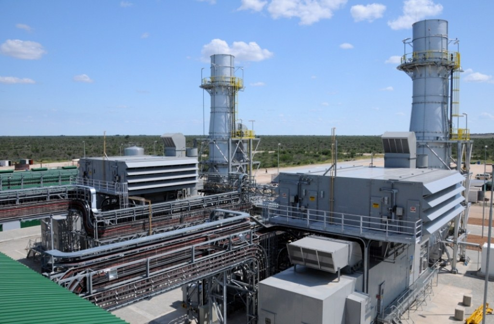
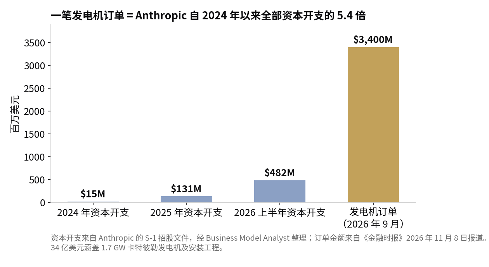

> [English version](/life/anthropic-3-4b-gas-generators/)

*一座燃气轮机电厂。Anthropic 据报购买的发电设备为 1.7 GW 卡特彼勒燃气机组。图片：Pro-Per Energy Services，CC BY-SA 4.0，来自 Wikimedia Commons。*

## 《金融时报》报道了什么

11 月 8 日周日，《金融时报》报道称，Anthropic 于 9 月底同意支付约 34 亿美元，购买 1.7 GW 重型燃气发电机的相关权益。《金融时报》称，这是已知 AI 实验室最大的一笔发电设备采购。

交易结构解释了一家软件公司为何突然进入重型机械生意：这批卡特彼勒发电机是圣安东尼奥的 OnePWR Solutions 约两年前下单订购的，但该公司需要融资才能完成采购。Anthropic 原本计划作为 OnePWR 的客户购买电力，最终改为直接接手卡特彼勒的订单。据报道，交易包括安装这些设备所需的工程与施工，但 Anthropic 并未收购 OnePWR，也没有 OnePWR 的员工转入。

这则报道有两处佐证，也有一处缺失。OnePWR 的独家财务顾问 Piper Sandler 在其网站上将这笔交易列为以 34 亿美元向一家前沿 AI 实验室出售 OnePWR 发电平台。但 Anthropic 与 OnePWR 均未公开置评，路透社表示无法立即核实该报道。因此，金额、容量与交易结构应视为"据报道"，而非公司确认的信息。目前尚未披露任何选址与交付时间表。

## 一家语言模型公司为什么买涡轮机

如果以为 AI 竞赛仍然是芯片之争，这笔采购看起来会很奇怪。但它已经不只是芯片之争了。据 TechCrunch 报道，天然气轮机的订单积压已排到 2030 年代初——想要 1 GW 的稳定电力，排队要按年计算，而一份两年前下的工厂订单比现金更值钱。Anthropic 买的是别人排队的位置。

公司自己的文件用证券法的语言说了同样的话。在 11 月 2 日提交的修订版 S-1 招股文件中，Anthropic 披露了 8954 亿美元的长期算力与基础设施承诺，其中约 698 亿美元在 12 个月内到期——并警告潜在股东，其第三方基础设施合作伙伴依赖外部融资来建设它已签约租赁的设施，如果这些合作伙伴融不到钱，容量可能被推迟、涨价、缩减，甚至永远无法交付。

OnePWR 这笔交易就是把这条警告从纸面翻译成了钢铁：开发商手握一家前沿实验室需要的发电机订单，在硬件发货前撞上融资墙，客户不得不拿出 34 亿美元来挽救交付时间表。规模本身就是信号：Anthropic 公布的资本开支为 2024 年 1500 万美元、2025 年 1.31 亿美元、2026 年上半年 4.82 亿美元——仅这一笔发电机订单就相当于它自 2024 年 1 月至 2026 年 6 月全部资本开支的 5.4 倍。一家历来避免拥有实体基础设施的公司，现在开始买发电厂，因为租电已经成了风险更大的选择。

*资本开支来自 Anthropic 的 S-1 文件，经 Business Model Analyst 整理；订单金额来自《金融时报》2026 年 11 月 8 日报道。图表：本站制作。*

这笔采购的算术很直接：34 亿美元买 1.7 GW，折合每千瓦发电容量约 2000 美元（含工程与施工）。1.7 GW 的容量大约可供约 130 万美国家庭用电，约相当于一座大型核反应堆的输出。Anthropic 还在 5 月的 S-1 文件中披露，它每月向 xAI 支付 12.5 亿美元使用算力，直至 2029 年 5 月——这提醒我们，这家公司一边以惊人的规模租用算力，一边又在买发电设备。

## 无人解决的张力

这个故事里还有第二个故事，也是它会持续产生头条的原因：燃料。Anthropic 是一家以安全与责任为公众形象的公司，而它刚刚买下了一支燃气发电机队。这笔交易符合该公司 2 月作出的电力承诺，但天然气就是天然气，每一家自购化石燃料发电的 AI 实验室，其气候账本现在都要经过一根烟囱。就在同一周，选民正在追问数据中心由谁为电网买单——这是我们 11 月 7 日数据中心反弹帖子的主题。Anthropic 的回答实质上是：不再求电网，自己建电。

这个回答的代价尚未定价。没有任何选址被公布，这意味着还没有任何空气排放许可被公开争夺，没有任何当地社区被告知一座燃气电厂即将到来，也没有人说清 1.7 GW 的涡轮机最终会落在哪里。这些是接下来要盯的文件，也是这个故事从 AI 话题变成区划、排放与地方政治的转折点——而正是这些地方政治，已经在全美拖慢数据中心的建设。

## 判断

AI 的瓶颈三年里移动了三次：先是芯片，然后是电力，现在是融资。Anthropic 的 34 亿美元表明，行业已经理解了这个顺序。买芯片是一张采购单；买 1 GW 是在排到 2030 年的队伍里占一个位置；买别人两年前下的订单，是当你认定队伍本身就是风险时的做法。悬而未决的问题不是交易是否发生——Piper Sandler 的挂牌让这一点很难怀疑——而是拥有发电机是否真的降低了风险，还是只是把风险从一家开发商的融资转移到一座电厂的许可审批上。《金融时报》的报道是容易的部分，空气许可是真正的故事。

*来源：《金融时报》〈Anthropic strikes $3.4bn deal to generate gas-fired power for data centres〉，2026 年 11 月 8 日，经路透社、MLQ、Silicon Report 与 TechCrunch（2026 年 11 月 9 日）转述；Piper Sandler 交易挂牌（OnePWR 发电平台出售给一家前沿 AI 实验室，34 亿美元）；Anthropic, PBC，S-1 注册声明，2026 年 10 月 26 日，修订版 2026 年 11 月 2 日（8954 亿美元承诺、约 698 亿美元 12 个月内到期；每月向 xAI 支付 12.5 亿美元至 2029 年 5 月，见 5 月版 S-1）；Business Model Analyst，2026 年 11 月 9 日（资本开支 1500 万 / 1.31 亿 / 4.82 亿美元；订单相当于自 2024 年以来资本开支的 5.4 倍）；TechCrunch，2026 年 11 月 9 日（涡轮机积压排到 2030 年代初）。*
