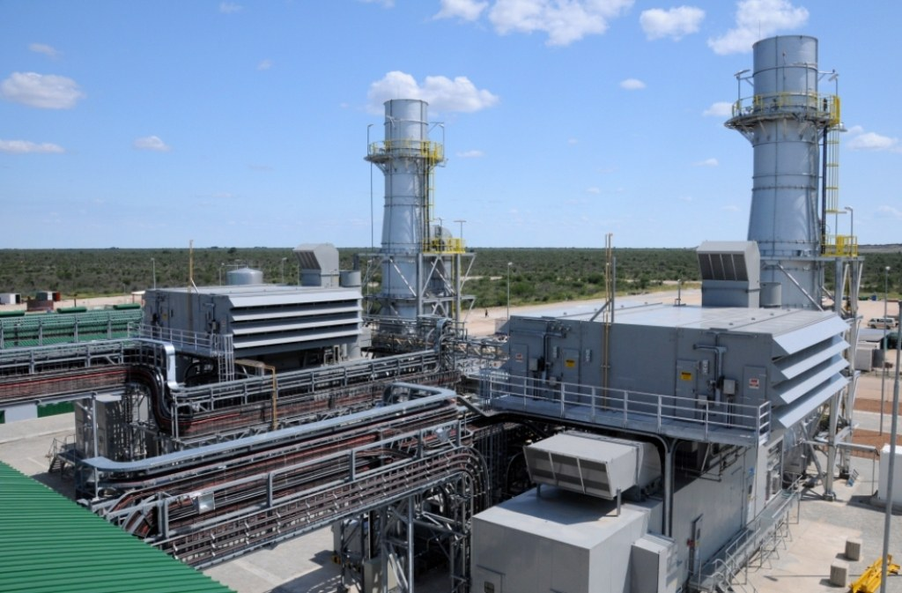
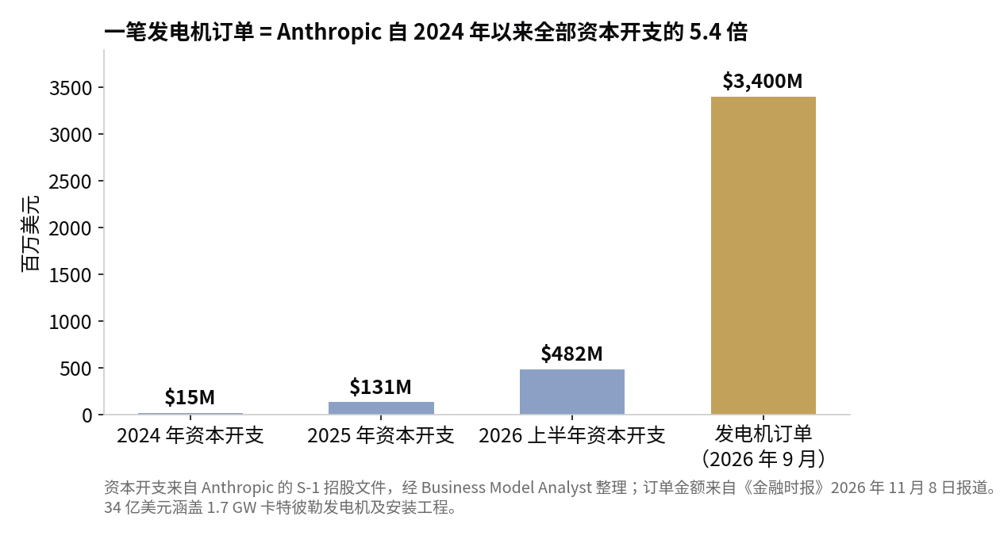

> [English version](/life/anthropic-3-4b-gas-generators/)

*一座燃气轮机电厂。Anthropic 据报购买的发电设备为 1.7 GW 卡特彼勒燃气机组。图片：Pro-Per Energy Services，CC BY-SA 4.0，来自 Wikimedia Commons。*

## 《金融时报》报道了什么

11 月 8 日周日，《金融时报》报道称，Anthropic 于 9 月底同意支付约 34 亿美元，购买 1.7 GW 重型燃气发电机的相关权益。《金融时报》称，这是已知 AI 实验室最大的一笔发电设备采购。

交易结构解释了一家软件公司为何突然进入重型机械生意：这批卡特彼勒发电机是圣安东尼奥的 OnePWR Solutions 约两年前下单订购的，但该公司需要融资才能完成采购。Anthropic 原本计划作为 OnePWR 的客户购买电力，最终改为直接接手卡特彼勒的订单。据报道，交易包括安装这些设备所需的工程与施工，但 Anthropic 并未收购 OnePWR，也没有 OnePWR 的员工转入。

这则报道有两处佐证，也有一处缺失。OnePWR 的独家财务顾问 Piper Sandler 在其网站上将这笔交易列为以 34 亿美元向一家前沿 AI 实验室出售 OnePWR 发电平台。但 Anthropic 与 OnePWR 均未公开置评，路透社表示无法立即核实该报道。因此，金额、容量与交易结构应视为"据报道"，而非公司确认的信息。目前尚未披露任何选址与交付时间表。

## 排队的人数，用数字说话

如果以为 AI 竞赛仍然是芯片之争，这笔采购看起来会很奇怪。但它已经不只是芯片之争了。据 TechCrunch 报道，天然气轮机的订单积压已排到 2030 年代初——想要 1 GW 的稳定电力，排队要按年计算，而一份两年前下的工厂订单比现金更值钱。Anthropic 买的是别人排队的位置。

这条队伍是可以量化的，数字相当惊人。全球最大的燃气轮机制造商 GE Vernova 在 2026 年第三季度末报告称，燃气设备积压订单与舱位预订合计 122 GW——相当于其每年约 20 GW 产能的 6.1 年产量——并预计年底将达到至少 130 GW。西门子能源的燃气轮机积压为 69 GW，交货期三年以上；三菱重工的大型机组积压为 35 GW，一年内增长 52%。三家最大的制造商合计持有约 226 GW 的积压（各家统计口径不同）。Wood Mackenzie 把结构性失衡说得很直白：全球订单超过 100 GW，而年制造产能只有 60–70 GW，新订单的交付已集中到 2030–2031 年。重型轮机的交货期为 36 至 84 个月，Wood Mackenzie 预计轮机价格到 2027 年底将达到每千瓦 600 美元，比 2019 年高出 195%。电力系统的其余部分也不更快：电力变压器平均交货期 128 周，升压变压器 144 周。一座数据中心 12 到 24 个月就能建成；让它运转起来的电力，要三到七年才能到货。

## 一家语言模型公司为什么买涡轮机

公司自己的文件用证券法的语言说了同样的话。在 11 月 2 日提交的修订版 S-1 招股文件中，Anthropic 披露了 8954 亿美元的长期算力与基础设施承诺，其中约 698 亿美元在 12 个月内到期——并警告潜在股东，其第三方基础设施合作伙伴依赖外部融资来建设它已签约租赁的设施，如果这些合作伙伴融不到钱，容量可能被推迟、涨价、缩减，甚至永远无法交付。

OnePWR 这笔交易就是把这条警告从纸面翻译成了钢铁：开发商手握一家前沿实验室需要的发电机订单，在硬件发货前撞上融资墙，客户不得不拿出 34 亿美元来挽救交付时间表。规模本身就是信号：Anthropic 公布的资本开支为 2024 年 1500 万美元、2025 年 1.31 亿美元、2026 年上半年 4.82 亿美元——仅这一笔发电机订单就相当于它自 2024 年 1 月至 2026 年 6 月全部资本开支的 5.4 倍。一家历来避免拥有实体基础设施的公司，现在开始买发电厂，因为租电已经成了风险更大的选择。

*资本开支来自 Anthropic 的 S-1 文件，经 Business Model Analyst 整理；订单金额来自《金融时报》2026 年 11 月 8 日报道。图表：本站制作。*

这笔采购的算术很直接：34 亿美元买 1.7 GW，折合每千瓦发电容量约 2000 美元（含工程与施工）。1.7 GW 的容量大约可供约 130 万美国家庭用电，约相当于一座大型核反应堆的输出。Anthropic 还在 5 月的 S-1 文件中披露，它每月向 xAI 支付 12.5 亿美元使用算力，直至 2029 年 5 月——这提醒我们，这家公司一边以惊人的规模租用算力，一边又在买发电设备。

## 用一段话讲清 Anthropic 的资产负债表

发电机订单与它周围的承诺相比，只是小数目。Anthropic 的 S-1 文件显示，2026 年前九个月收入 332 亿美元，仅第三季度就达 170 亿美元——高于一年前的 25 亿美元。与之相对，文件列出的算力义务约为 4170 亿美元（2026–2027 年起）、另有 1250–1500 亿美元已下单（2028–2031 年）、与亚马逊的不可撤销承诺至少 1100 亿美元（至 2036 年 4 月）、以及在谷歌 TPU 上的 1145 亿美元（至 2033 年）。上半年约 48% 的收入来自 AWS、谷歌云与微软 Azure，文件还指出，亚马逊、谷歌与微软"同时是我们的投资者、客户、分销合作伙伴与竞争对手"。

文件还承认了一件发电机订单让它变得具体的事：Anthropic 称自己过去低估过算力需求，影响了产品开发与部署计划。前九个月算力与基础设施支出增加 144 亿美元，增长 329%。一家增长如此之快、账单如此之大的公司，承受不起供应商的融资失败——而 OnePWR 这笔交易，就是它认定自己承受不起时的做法。

## 需求端：这条队伍为什么存在

轮机积压是症状，需求才是病因。国际能源署预计，全球数据中心用电量将从 2025 年的 485 TWh 翻倍至 2030 年约 950 TWh，其中 AI 数据中心用电量仅 2025 年一年就增长了 50%。在美国，劳伦斯伯克利国家实验室测算数据中心用电量 2023 年为 176 TWh——占全国用电量的 4.4%——预计到 2028 年将达到 325 至 580 TWh。电网跟不上：截至 2025 年底，美国电网排队等待接入的发电与储能容量已超过 2060 GW，超过全国已装机容量总和；从申请并网到投运的中位时间已经翻倍，超过四年。2000 至 2019 年间申请并网的项目中，到 2024 年底只有约 13% 真正投运。

这就是为什么天然气正在走向"表后"（behind-the-meter，即不经过公共电网、自发自用）。国际能源署估计，到 2030 年可能有 15 至 27 GW 的现场天然气为数据中心供电；美国数据中心项目已提出超过 130 GW 的现场能源方案，其中天然气占比超过 80%。Anthropic 不是异类，它只是这个模式里最新、最大的一个例子：客户不再等电网，自己建电厂。

## 还有谁在自己买电

Anthropic 不是第一个得出这个结论的。2026 年 4 月，Crusoe 与 ProEnergy 签约购买 13 台航空衍生燃气轮机发电机组，总计 650 MW，目标 2027 年夏季交付，理由是"获得电力的速度"是决定性因素。xAI 位于孟菲斯的 Colossus 设施在电网容量跟上之前一直靠燃气轮机运行。美国新轮机的平均交货期已达六年，开发商也开始转向翻新与二手轮机——从其他用途拆下的喷气式发动机发电机——来填补缺口。二手发电设备的市场，就像 2021 年的二手芯片市场一样，是短缺蔓延到实体经济时的样子。

这个模式背后的逻辑超越了任何一家公司。数据中心的服务器全年接近满负荷运行，需要全天候的稳定电力——太阳能与风能单独提供不了，电网也越来越无法按时交付。天然气是最快的稳定电力：比核电建设快、比输电许可快——而既然轮机本身就是约束，那就先买轮机，问题以后再问。

## 无人解决的张力

这个故事里还有第二个故事，也是它会持续产生头条的原因：燃料。Anthropic 是一家以安全与责任为公众形象的公司，而它刚刚买下了一支燃气发电机队。这笔交易符合该公司 2 月作出的电力承诺，但天然气就是天然气，每一家自购化石燃料发电的 AI 实验室，其气候账本现在都要经过一根烟囱。就在同一周，选民正在追问数据中心由谁为电网买单——这是我们 11 月 7 日数据中心反弹帖子的主题。Anthropic 的回答实质上是：不再求电网，自己建电。

这个回答的代价尚未定价。没有任何选址被公布，这意味着还没有任何空气排放许可被公开争夺，没有任何当地社区被告知一座燃气电厂即将到来，也没有人说清 1.7 GW 的涡轮机最终会落在哪里。这些是接下来要盯的文件，也是这个故事从 AI 话题变成区划、排放与地方政治的转折点——而正是这些地方政治，已经在全美拖慢数据中心的建设。

## 天然气发电的账：便宜吗？干净吗？

34 亿美元买 1.7 GW，折合每千瓦约 2000 美元，这个数字本身值得拆开看。Wood Mackenzie 预计轮机设备本身到 2027 年底将达到每千瓦 600 美元——那只是轮机，不包括安装、厂房、输电接入与工程费用。Anthropic 的 2000 美元是全包价：设备加工程与施工。两者之间的差价，就是把一台轮机变成一座电厂的成本。相比之下，一座联合循环燃气电厂的全部造价约为每千瓦 2300 至 2500 美元——Anthropic 的价格落在这个区间里，说明它买的不便宜，但也不算被宰。

"干净吗"的答案则更复杂。天然气发电的二氧化碳排放约为燃煤的一半左右，联合循环机组的效率可达 60%——这是它相对煤炭的优势。但天然气仍然是化石燃料：燃烧产生二氧化碳，开采与运输过程中的甲烷泄漏会进一步削弱气候收益，而甲烷的短期温室效应远强于二氧化碳。Anthropic 的处境因此格外微妙：它是一家以"安全与责任"为公众形象的公司，又是一家正在上市的公司，招股文件里对气候的承诺会被投资者逐字对照。一支燃气轮机舰队不会出现在招股文件的"风险因素"里作为气候风险——它会出现在"我们需要电力"的段落里。这正是这笔交易最难评价的地方：从工程角度看，它合理；从气候账本看，它是一笔负债；而这两本账，Anthropic 现在要同时向市场交代。

## 许可审批：下一道关

发电机买到了，电厂还没有。接下来要过的关不在华尔街，而在地方政府。燃气电厂需要空气排放许可，需要符合州与联邦的环保标准，需要过区划（zoning）与土地用途审查，需要与当地社区就噪音、交通与用水达成一致——而这些流程的每一步都可以被拖延、被起诉、被政治化。美国数据中心建设已经在这些环节上吃过苦头：同一个社区，上个月还在欢迎数据中心带来的税收，这个月就可能因为一座燃气电厂而反对。

Anthropic 至今没有公布任何选址，这意味着这些战斗一场都还没打。值得盯住的下一批文件不是财报，而是环评报告、空气许可申请与地方议会的会议记录。1.7 GW 的涡轮机最终落在哪里、落在几个地方、每个地方的许可要花多长时间——这些问题的答案，将决定这 34 亿美元到底是买到了电力，还是买到了一场旷日持久的审批马拉松。发电机可以两年前下单、今天接手；许可没有"接手"这个选项，只能从头开始。

## 瓶颈的三次迁移：芯片、电力、融资

判断里有一句话值得展开成一节：AI 的瓶颈三年里移动了三次。第一次是芯片：2023 到 2024 年，H100 一卡难求，交货期以季度计，谁能拿到英伟达的产能，谁就能训练更大的模型。那时的瓶颈是物理的——台积电的 CoWoS 封装产能就那么多。第二是电力：2025 年起，芯片开始到货，电网却接不上，美国并网排队超过 2060 GW，中位等待超过四年。那时的瓶颈是基础设施的——发电厂与输电线路的建设速度跟不上数据中心。第三次是融资，也就是现在：电有了、芯片有了，但建设这些设施的开发商融不到钱。Anthropic 的 S-1 文件把这一点写进了风险提示：第三方合作伙伴依赖外部融资，如果融不到钱，容量可能被推迟、涨价、缩减，甚至永远无法交付。

三次迁移有一个共同的模式：瓶颈每次都向后移动一格，从产品移到基础设施，再移到为基础设施融资的资本。每一次，行业都以为解决了上一个瓶颈就万事大吉，每一次都有新的瓶颈在后面等着。OnePWR 的故事就是第三次迁移的缩影：开发商有订单、有设备、有客户，唯独没有完成采购的融资，于是客户不得不自己掏 34 亿美元。下一个瓶颈会是什么？可能是变压器，可能是熟练工人，可能是空气许可——但模式已经很清楚了：AI 竞赛的约束条件正在从技术问题变成土木工程问题，再变成金融问题。而金融问题，是这三个里面最难用工程手段解决的。

## 判断

AI 的瓶颈三年里移动了三次：先是芯片，然后是电力，现在是融资。Anthropic 的 34 亿美元表明，行业已经理解了这个顺序。买芯片是一张采购单；买 1 GW 是在排到 2030 年的队伍里占一个位置；买别人两年前下的订单，是当你认定队伍本身就是风险时的做法。悬而未决的问题不是交易是否发生——Piper Sandler 的挂牌让这一点很难怀疑——而是拥有发电机是否真的降低了风险，还是只是把风险从一家开发商的融资转移到一座电厂的许可审批上。《金融时报》的报道是容易的部分，空气许可是真正的故事。

更长远的视角对所有相关方都不太客气。如果最大的 AI 实验室都在自己买电厂，原因是电网无法交付，那么约束就不再是某一家公司的资产负债表能解决的市场失灵——而是基础设施的失灵，而它只有在发电与输电建设速度达到美国几十年来未曾达到的水平时才能解决。Anthropic 的 34 亿美元为它买到了一个排队位置，但买不到一条更短的队伍。

最后值得把视线拉远一点：Anthropic 的发电机订单，可能是 AI 行业第一次如此直白地承认，算力竞赛的终点不在实验室，而在电网、轮机厂与许可办公室。过去三年，行业的注意力从模型架构移到芯片供应，再移到电力供应，现在移到了为电力融资的资本。下一步会是什么，取决于哪一环先断：可能是变压器，可能是熟练电工，可能是空气许可，也可能是天然气价格本身。但有一点已经确定：训练下一个大模型所需要的东西，越来越多地不在 AI 公司的控制范围之内。而一家语言模型公司花 34 亿美元买燃气轮机，就是这种失控最诚实的注脚。值得记住的是：这 34 亿美元买到的不是电力本身，而是在一条排到 2030 年的队伍里，别人两年前就占好的位置。位置本身，如今比发电机更值钱。这也是为什么这笔交易值得被记住：它不是一家公司的采购决策，而是整个行业第一次为“排队”这件事本身付费——而且付的是 34 亿美元。下一家为排队付费的公司会是谁、会付多少，是 2027 年能源市场最值得盯住的问题——因为当排队本身开始定价，短缺就不再是暂时的现象，而是一种可以交易的资产。短缺一旦可以交易，价格就会先行——而价格先行，意味着后来者要付得更多。这就是这笔交易真正的标价，也是整个行业的标价。
*来源：《金融时报》〈Anthropic strikes $3.4bn deal to generate gas-fired power for data centres〉，2026 年 11 月 8 日，经路透社、MLQ、Silicon Report 与 TechCrunch（2026 年 11 月 9 日）转述；Piper Sandler 交易挂牌（OnePWR 发电平台出售给一家前沿 AI 实验室，34 亿美元）；Anthropic, PBC，S-1 注册声明，2026 年 10 月 26 日，修订版 2026 年 11 月 2 日（8954 亿美元承诺、约 698 亿美元 12 个月内到期；每月向 xAI 支付 12.5 亿美元至 2029 年 5 月，见 5 月版 S-1）；Business Model Analyst，2026 年 11 月 9 日（资本开支 1500 万 / 1.31 亿 / 4.82 亿美元；订单相当于自 2024 年以来资本开支的 5.4 倍）；TechCrunch，2026 年 11 月 9 日（涡轮机积压排到 2030 年代初）。扩写部分新增来源：GE Vernova 2026 年第三季度业绩（经 XCyberNow / TradingJournl 转引：122 GW 积压与舱位预订、约 6.1 年产量、年底至少 130 GW）；西门子能源与三菱重工（经 XCyberNow / Acquire.fi 转引：69 GW 与 35 GW 积压、三年以上交货期）；Wood Mackenzie（经路透社 / TFTC，2026 年 11 月 9 日转引：全球订单超 100 GW 对 60–70 GW 年产能、交付集中于 2030–2031 年、2027 年底每千瓦 600 美元、比 2019 年高 195%、重型轮机交货期 36–84 个月、变压器 128–144 周）；国际能源署《能源与 AI》/《能源与 AI 的关键问题》（2026 年）（全球数据中心用电量 2025 年 485 TWh 至 2030 年约 950 TWh、AI 数据中心 2025 年增长 50%、2030 年现场天然气 15–27 GW）；劳伦斯伯克利国家实验室《Queued Up》（2026 年）（美国并网排队 2060 GW、中位等待超四年、2000–2019 年申请中约 13% 投运）与能源部 / LBNL 2024 年报告（2023 年 176 TWh、2028 年 325–580 TWh）；Anthropic S-1（经 Betonai / Sentisense 转引：前九个月收入 332 亿美元、第三季度 170 亿美元、2026–2027 年算力义务约 4170 亿美元、2028–2031 年 1250–1500 亿美元、亚马逊 1100 亿美元以上至 2036 年 4 月、谷歌 TPU 1145 亿美元至 2033 年、约 48% 收入来自云市场、曾低估算力需求、算力成本增长 329%）；Crusoe / ProEnergy，2026 年 4 月 16 日（13 台航空衍生机组、650 MW、2027 年夏季交付）。*
