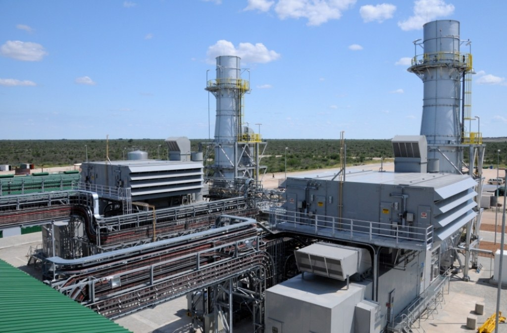
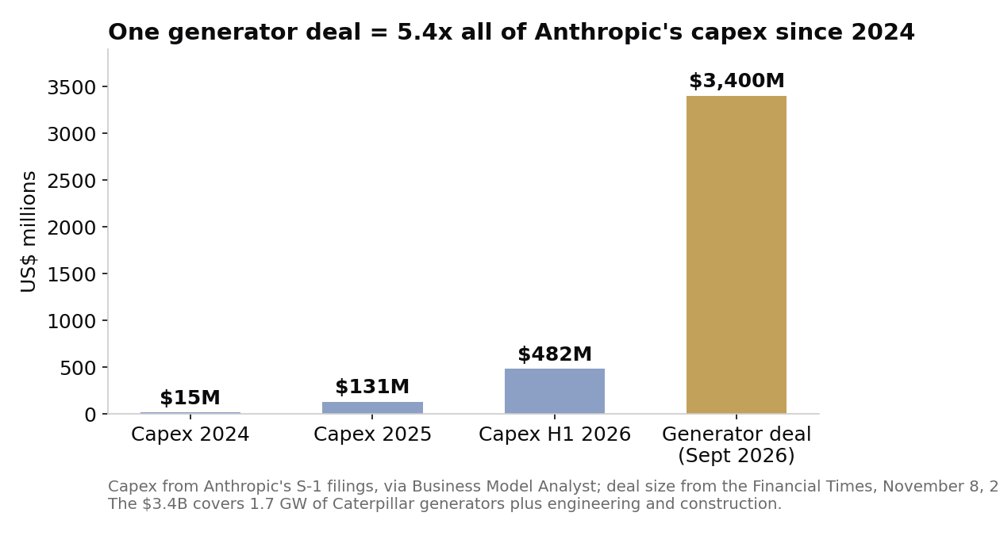

> [中文版 Chinese version](/life/anthropic-3-4b-gas-generators-zh/)

*A gas turbine power plant. Anthropic's reported purchase covers 1.7 GW of Caterpillar gas-fired generation. Photo: Pro-Per Energy Services, CC BY-SA 4.0, via Wikimedia Commons.*

## What the FT reported

On Sunday, November 8, the Financial Times reported that Anthropic agreed in late September to pay about $3.4 billion for commitments covering 1.7 gigawatts of heavy-duty gas-fired generators. The FT called it the largest known single purchase of power-generation equipment by an AI lab.

The mechanics explain why a software company is suddenly in the heavy-machinery business. The generators are Caterpillar units that San Antonio-based OnePWR Solutions ordered about two years ago but needed financing to complete. Anthropic had originally planned to be OnePWR's customer and buy the electricity; instead it took over the Caterpillar orders directly. The deal includes the engineering and construction work needed to install the machines, but Anthropic did not acquire OnePWR and no OnePWR employees moved over, according to the report.

Two things corroborate the account, and one thing does not. The investment bank Piper Sandler, which advised OnePWR, lists the transaction on its website as a $3.4 billion sale of OnePWR's power generation platform to a frontier AI lab. But neither Anthropic nor OnePWR commented publicly, and Reuters said it could not immediately verify the report. Treat the amount, the capacity and the structure as reported, not company-confirmed. No sites and no delivery schedule have been disclosed.

## Why a language-model company buys turbines

The purchase only looks strange if you think the AI race is still about chips. It is not, or not only. The backlog for natural gas turbines now stretches into the early 2030s, according to TechCrunch — if you want a gigawatt of firm power, the queue is measured in years, and a two-year-old factory reservation is worth more than cash. Anthropic bought someone else's place in line.

The company's own filings say the same thing in securities-law language. In its amended S-1 registration statement filed November 2, Anthropic disclosed $895.4 billion in long-term compute and infrastructure commitments, with roughly $69.8 billion due within twelve months — and warned prospective shareholders that its third-party infrastructure partners depend on outside financing to build the facilities it has contracted to rent, and that if those partners fail to raise the money, the capacity could be delayed, repriced, reduced, or never delivered.

The OnePWR deal is that warning translated from paper into steel: a developer held generator reservations a frontier lab needed, ran into a financing wall before the hardware could ship, and the customer had to put up $3.4 billion to rescue the delivery schedule. The scale is the tell. Anthropic's reported capital expenditures were $15 million in 2024, $131 million in 2025 and $482 million in the first half of 2026 — the generator deal alone equals 5.4 times all the capex it reported from January 2024 through June 2026. A company that has historically avoided owning physical infrastructure is now buying power plants because renting power has become the riskier option.

*Capex from Anthropic's S-1 filings, via Business Model Analyst; deal size from the Financial Times, November 8, 2026. Chart: this site.*

The arithmetic of the purchase is straightforward: $3.4 billion for 1.7 GW works out to roughly $2,000 per kilowatt of generating capacity, including engineering and construction. The capacity itself is about enough to power roughly 1.3 million American homes, or roughly the output of a large nuclear reactor. Anthropic also disclosed in its S-1 in May that it is paying $1.25 billion per month through May 2029 to use computing power from xAI — a reminder that the company is renting compute at extraordinary scale on one side while buying power generation on the other.

## The tension nobody has resolved

There is a second story inside this one, and it is the reason it will keep generating headlines: the fuel. Anthropic is a company whose public identity is built on safety and responsibility, and it just bought a fleet of gas-fired generators. The deal matches a power pledge the company made in February, but gas is gas, and every AI lab buying its own fossil generation is a lab whose climate math now runs through a smokestack. The same week, voters were pressing data centers on who pays for the grid — the theme of our November 7 post on the data-center backlash. Anthropic's answer, in effect, is to stop asking the grid and build its own power instead.

That answer has a cost that has not been priced yet. No sites have been named, which means no air permits have been fought over in public, no local community has been told a gas plant is coming, and no one has said where 1.7 GW of turbines will actually sit. Those are the next documents to watch, and they are where this story stops being about AI and starts being about zoning, emissions and the same local politics that is already slowing data center construction across the country.

## The judgment

The bottleneck in AI has moved three times in three years: first chips, then power, now financing. Anthropic's $3.4 billion says the industry has understood the sequence. Buying a chip is a purchase order; buying a gigawatt is a position in a queue that stretches to 2030, and buying someone else's two-year-old reservation is what you do when you have decided the queue itself is the risk. The open question is not whether the deal happened — Piper Sandler's listing makes that hard to doubt — but whether owning the generators actually de-risks anything, or just moves the risk from the financing of a developer to the permitting of a power plant. The FT's report is the easy part. The air permits are the story.

*Sources: Financial Times, "Anthropic strikes $3.4bn deal to generate gas-fired power for data centres," November 8, 2026, via Reuters, MLQ, Silicon Report and TechCrunch (November 9, 2026); Piper Sandler transaction listing (sale of OnePWR's power generation platform to a frontier AI lab, $3.4 billion); Anthropic, PBC, Form S-1 Registration Statement, October 26, 2026, and amended filing, November 2, 2026 ($895.4 billion in commitments, ~$69.8 billion due within 12 months; $1.25 billion per month to xAI through May 2029, per the May S-1); Business Model Analyst, November 9, 2026 (capex $15M / $131M / $482M; deal equals 5.4x capex since January 2024); TechCrunch, November 9, 2026 (turbine backlog into the early 2030s).*
