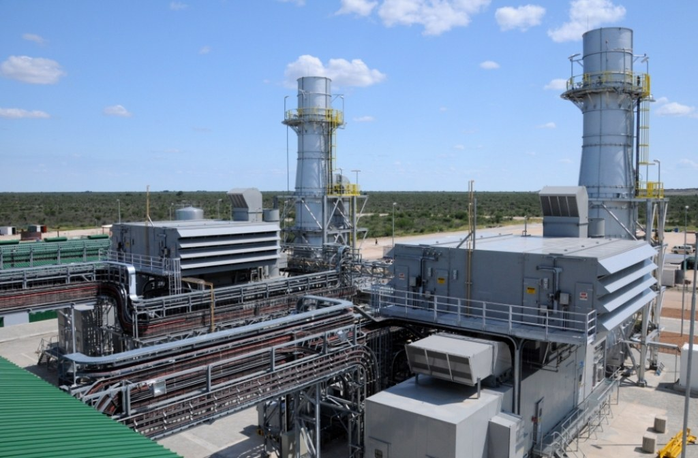
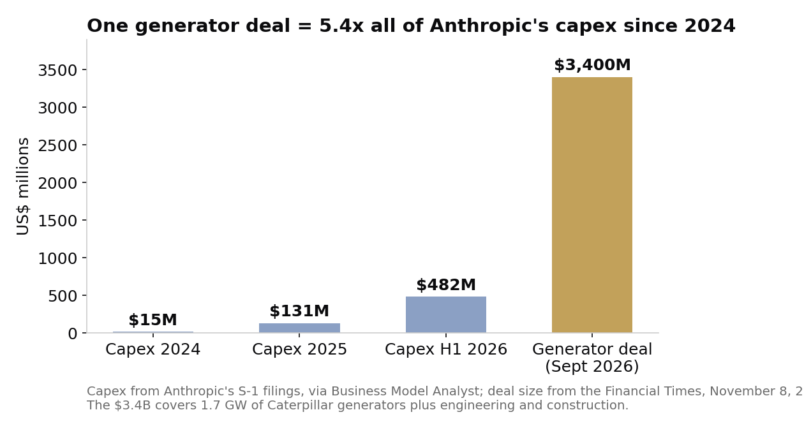

> [中文版 Chinese version](/life/anthropic-3-4b-gas-generators-zh/)

*A gas turbine power plant. Anthropic's reported purchase covers 1.7 GW of Caterpillar gas-fired generation. Photo: Pro-Per Energy Services, CC BY-SA 4.0, via Wikimedia Commons.*

## What the FT reported

On Sunday, November 8, the Financial Times reported that Anthropic agreed in late September to pay about $3.4 billion for commitments covering 1.7 gigawatts of heavy-duty gas-fired generators. The FT called it the largest known single purchase of power-generation equipment by an AI lab.

The mechanics explain why a software company is suddenly in the heavy-machinery business. The generators are Caterpillar units that San Antonio-based OnePWR Solutions ordered about two years ago but needed financing to complete. Anthropic had originally planned to be OnePWR's customer and buy the electricity; instead it took over the Caterpillar orders directly. The deal includes the engineering and construction work needed to install the machines, but Anthropic did not acquire OnePWR and no OnePWR employees moved over, according to the report.

Two things corroborate the account, and one thing does not. The investment bank Piper Sandler, which advised OnePWR, lists the transaction on its website as a $3.4 billion sale of OnePWR's power generation platform to a frontier AI lab. But neither Anthropic nor OnePWR commented publicly, and Reuters said it could not immediately verify the report. Treat the amount, the capacity and the structure as reported, not company-confirmed. No sites and no delivery schedule have been disclosed.

## The queue, in numbers

The purchase only looks strange if you think the AI race is still about chips. It is not, or not only. The backlog for natural gas turbines now stretches into the early 2030s, according to TechCrunch — if you want a gigawatt of firm power, the queue is measured in years, and a two-year-old factory reservation is worth more than cash. Anthropic bought someone else's place in line.

The queue is measurable, and the numbers are stark. GE Vernova, the world's largest gas turbine maker, reported 122 GW of gas equipment backlog and slot reservations at the end of the third quarter of 2026 — about 6.1 years of its roughly 20 GW annual output — and expects to end the year with at least 130 GW. Siemens Energy reported a 69 GW gas turbine backlog with lead times of three years or more, and Mitsubishi Heavy Industries reported 35 GW of large-frame backlog, up 52% in a year. Combined, the three largest makers hold about 226 GW of backlog, measured on different bases. Wood Mackenzie puts the structural mismatch plainly: global orders exceed 100 GW against annual manufacturing capacity of only 60–70 GW, and new deliveries are now focused on the 2030–2031 window. Heavy-duty turbine lead times run 36 to 84 months, and Wood Mackenzie projects turbine prices will reach $600 per kilowatt by the end of 2027 — 195% above 2019 levels. The rest of the power train is no faster: power transformers average 128 weeks of lead time, generator step-up units 144 weeks. A data center can be built in 12 to 24 months; the power to run it takes three to seven years to arrive.

## Why a language-model company buys turbines

The company's own filings say the same thing in securities-law language. In its amended S-1 registration statement filed November 2, Anthropic disclosed $895.4 billion in long-term compute and infrastructure commitments, with roughly $69.8 billion due within twelve months — and warned prospective shareholders that its third-party infrastructure partners depend on outside financing to build the facilities it has contracted to rent, and that if those partners fail to raise the money, the capacity could be delayed, repriced, reduced, or never delivered.

The OnePWR deal is that warning translated from paper into steel: a developer held generator reservations a frontier lab needed, ran into a financing wall before the hardware could ship, and the customer had to put up $3.4 billion to rescue the delivery schedule. The scale is the tell. Anthropic's reported capital expenditures were $15 million in 2024, $131 million in 2025 and $482 million in the first half of 2026 — the generator deal alone equals 5.4 times all the capex it reported from January 2024 through June 2026. A company that has historically avoided owning physical infrastructure is now buying power plants because renting power has become the riskier option.

*Capex from Anthropic's S-1 filings, via Business Model Analyst; deal size from the Financial Times, November 8, 2026. Chart: this site.*

The arithmetic of the purchase is straightforward: $3.4 billion for 1.7 GW works out to roughly $2,000 per kilowatt of generating capacity, including engineering and construction. The capacity itself is about enough to power roughly 1.3 million American homes, or roughly the output of a large nuclear reactor. Anthropic also disclosed in its S-1 in May that it is paying $1.25 billion per month through May 2029 to use computing power from xAI — a reminder that the company is renting compute at extraordinary scale on one side while buying power generation on the other.

## Anthropic's balance sheet in one paragraph

The generator deal is small next to the commitments that surround it. Anthropic's S-1 shows revenue of $33.2 billion in the first nine months of 2026, with $17.0 billion in the third quarter alone — up from $2.5 billion a year earlier. Against that, the filing lists roughly $417 billion in compute obligations starting in 2026–2027, another $125–150 billion ordered for 2028–2031, a non-cancellable commitment of at least $110 billion with Amazon through April 2036, and $114.5 billion on Google TPUs through 2033. Nearly half of first-half revenue — about 48% — came through AWS, Google Cloud, and Microsoft Azure, and the filing notes that Amazon, Google, and Microsoft "simultaneously serve as our investors, customers, distribution partners, and competitors."

The filing also admits something the generator deal makes concrete: Anthropic says it has underestimated its compute requirements in the past, which affected its product development and deployment plans. Compute and infrastructure expenses rose $14.4 billion in the nine months, up 329%. A company growing that fast, with bills that large, cannot afford a financing failure at a supplier — and the OnePWR deal is what happens when it decides it cannot afford one.

## The demand side: why the queue exists at all

The turbine backlog is the symptom; the demand is the cause. The International Energy Agency projects global data center electricity use roughly doubling from 485 terawatt-hours in 2025 to about 950 terawatt-hours in 2030, with AI-focused data centers growing 50% in 2025 alone. In the United States, Lawrence Berkeley National Laboratory put data center consumption at 176 TWh in 2023 — 4.4% of national electricity — and projects 325 to 580 TWh by 2028. The grid cannot keep up: more than 2,060 GW of generation and storage capacity was waiting in U.S. interconnection queues at the end of 2025, more than the country's entire installed power capacity, and the median time from interconnection request to commercial operation has doubled to more than four years. Only about 13% of projects that requested connection between 2000 and 2019 had reached operation by the end of 2024.

That is why the gas is going behind the meter. The IEA estimates 15 to 27 GW of onsite gas could power data centers by 2030, and more than 130 GW of onsite energy resources have been proposed for U.S. data center projects, with gas making up over 80% of that pipeline. Anthropic is not an outlier; it is the latest and largest example of a pattern in which the customer stops waiting for the grid and builds the power plant itself.

## Who else is buying their own power

Anthropic is not the first to reach this conclusion. In April 2026, Crusoe signed a contract with ProEnergy for 13 aeroderivative gas turbine generator sets totaling 650 MW, targeting delivery by summer 2027, citing speed to power as the decisive factor. xAI's Colossus facility in Memphis has run on gas turbines while grid capacity caught up. With new turbines carrying a six-year average lead time in the U.S., developers are also turning to refurbished and used turbines — jet-engine generators pulled from other service — to close the gap. The secondhand market for power equipment, like the secondhand market for chips in 2021, is what a shortage looks like when it reaches the real economy.

The pattern has a logic that goes beyond any single company. A data center's servers run at close to the same load all year, so they need firm, around-the-clock power — the kind solar and wind cannot provide alone, and the kind the grid increasingly cannot deliver on schedule. Gas is the fastest firm power available: faster to build than nuclear, faster to permit than transmission, and — since the turbines are the constraint — the thing you buy first and ask questions about later.

## The tension nobody has resolved

There is a second story inside this one, and it is the reason it will keep generating headlines: the fuel. Anthropic is a company whose public identity is built on safety and responsibility, and it just bought a fleet of gas-fired generators. The deal matches a power pledge the company made in February, but gas is gas, and every AI lab buying its own fossil generation is a lab whose climate math now runs through a smokestack. The same week, voters were pressing data centers on who pays for the grid — the theme of our November 7 post on the data-center backlash. Anthropic's answer, in effect, is to stop asking the grid and build its own power instead.

That answer has a cost that has not been priced yet. No sites have been named, which means no air permits have been fought over in public, no local community has been told a gas plant is coming, and no one has said where 1.7 GW of turbines will actually sit. Those are the next documents to watch, and they are where this story stops being about AI and starts being about zoning, emissions and the same local politics that is already slowing data center construction across the country.

## The judgment

The bottleneck in AI has moved three times in three years: first chips, then power, now financing. Anthropic's $3.4 billion says the industry has understood the sequence. Buying a chip is a purchase order; buying a gigawatt is a position in a queue that stretches to 2030, and buying someone else's two-year-old reservation is what you do when you have decided the queue itself is the risk. The open question is not whether the deal happened — Piper Sandler's listing makes that hard to doubt — but whether owning the generators actually de-risks anything, or just moves the risk from the financing of a developer to the permitting of a power plant. The FT's report is the easy part. The air permits are the story.

The longer view is less flattering to everyone involved. If the largest AI labs are buying their own power plants because the grid cannot deliver, the constraint is no longer a market failure to be solved by one company's balance sheet — it is an infrastructure failure, and it will be solved, if at all, by building generation and transmission at a pace the United States has not managed in decades. Anthropic's $3.4 billion buys it a place in line. It does not buy a shorter line.

*Sources: Financial Times, "Anthropic strikes $3.4bn deal to generate gas-fired power for data centres," November 8, 2026, via Reuters, MLQ, Silicon Report and TechCrunch (November 9, 2026); Piper Sandler transaction listing (sale of OnePWR's power generation platform to a frontier AI lab, $3.4 billion); Anthropic, PBC, Form S-1 Registration Statement, October 26, 2026, and amended filing, November 2, 2026 ($895.4 billion in commitments, ~$69.8 billion due within 12 months; $1.25 billion per month to xAI through May 2029, per the May S-1); Business Model Analyst, November 9, 2026 (capex $15M / $131M / $482M; deal equals 5.4x capex since January 2024); TechCrunch, November 9, 2026 (turbine backlog into the early 2030s). Additional sources for the expanded sections: GE Vernova Q3 2026 results via XCyberNow / TradingJournl (122 GW backlog and slot reservations, ~6.1 years of output, at least 130 GW by year-end); Siemens Energy and Mitsubishi Heavy Industries via XCyberNow / Acquire.fi (69 GW and 35 GW backlogs, lead times of three years or more); Wood Mackenzie via Reuters / TFTC, November 9, 2026 (global orders over 100 GW vs. 60–70 GW annual capacity, deliveries focused on 2030–2031, $600/kW by end-2027, +195% vs. 2019, heavy-duty lead times 36–84 months, transformers 128–144 weeks); IEA, "Energy and AI" / "Key Questions on Energy and AI" (2026) (global data center electricity 485 TWh in 2025 to ~950 TWh in 2030, AI-focused growth 50% in 2025, 15–27 GW onsite gas by 2030); Lawrence Berkeley National Laboratory, "Queued Up" (2026) (2,060 GW in U.S. interconnection queues, median wait over four years, ~13% of 2000–2019 requests operational) and DOE/LBNL 2024 report (176 TWh in 2023, 325–580 TWh by 2028); Anthropic S-1 via Betonai / Sentisense (revenue $33.2B nine months, Q3 $17.0B, ~$417B compute obligations 2026–2027, $125–150B for 2028–2031, $110B+ Amazon through April 2036, $114.5B Google TPUs through 2033, ~48% revenue via cloud marketplaces, underestimated compute needs, compute costs +329%); Crusoe / ProEnergy, April 16, 2026 (13 aeroderivative sets, 650 MW, delivery by summer 2027).*
