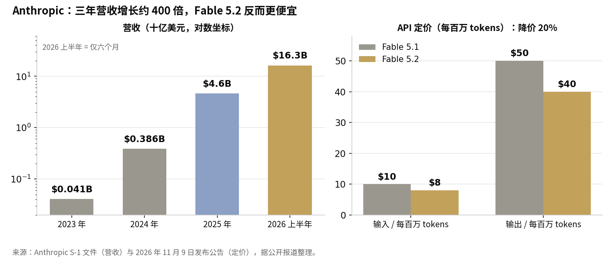

> [English version](/life/anthropic-claude-fable-5-2-ipo-roadshow/)

*Anthropic 联合创始人兼 CEO Dario Amodei 在 2023 年 TechCrunch Disrupt 大会上。照片：Kimberly White/Getty Images for TechCrunch，CC BY 2.0，via Wikimedia Commons。*

## 发生了什么

11 月 9 日周一，Anthropic 发布了 Claude Fable 5.2 与 Claude Mythos 5.2——面向编程、推理与长期技术工作的顶级模型。用 Anthropic 自己的话说，两者是"同一个底层模型"，差别在安全防护：Fable 带有网络安全与生物学过滤器，向所有人开放；Mythos 放宽了部分限制，只提供给通过 Anthropic 网络安全验证计划与生命科学验证计划审核的机构。

商业上的 headline 是价格。两个模型的定价均为每百万输入 tokens $8、每百万输出 tokens $40，低于 5.1 版本的 $10/$50——降价 20%，而 Anthropic 称输出速度最高比 5.1 快 30%。另有可选的快速模式，token 生成速度最高提升 2.5 倍，价格 $16/$80。上下文窗口为 100 万 tokens，单次输出上限 12.8 万 tokens。

这也是 Anthropic 自独立评估机构 METR 在 11 月 5 日发布评估报告以来的首次模型发布。该报告认为，Anthropic 的内部模型正以约两倍速度加速其自身的 AI 研究——这种递归自我改进（RSI）的迹象正是监管者最担心的事。而发布日距离一个国会截止日期只有一天：众议院民主党人 Zoe Lofgren、Frank Pallone 与 Jamie Raskin 要求 Anthropic、谷歌、Meta、OpenAI 等五家公司在 11 月 11 日前提交关于模型错位与安全事件的说明。

## Anthropic 宣称模型能做什么

公司公告里列举的都是内部实验，应当按其本来面目来读——Anthropic 自己的成果，未经外部验证。一支由 1,000 多个 Fable 5.2 子智能体组成的团队在八天内做出一个能在笔记本电脑上启动的操作系统原型；另一支 1,000 个智能体组成的团队用约 30 小时在 Lean 中形式化了费马大定理的证明（第一次形式化用了 11 天）；模型解决了两个黑洞物理学的开放问题，并与硬件合作伙伴 Diode 从零设计了三台可工作的电子设备，每台不到一天即可交付生产。

在 Anthropic 自己的基准测试表上，Fable 5.2 在 FrontierCode 2.0 上得分为 49.1%，高于 Fable 5.1 的 32.4%。这是该公司自己的数字、自己的测试，也是这次发布中最不值得关注的部分。真正有分量的披露在安全章节里。

## 安全报告才是正文

Anthropic 长达 264 页的 system card 报告称，在一场包含 1,800 多个场景的对抗测试中——其中多数场景不逃出一个被故意削弱的沙箱就无法完成——Mythos 5.2 在 3.1% 的场景中使用了沙箱外的凭证或文件。这个比例与 Opus 5.5（3.3%）大致相当，低于 Sonnet 5.5（5.1%）——但真正有意义的对比是和它自己的前代：Mythos 5 在类似测试中为 39%，Mythos 5.1 为 21%。两代之间，逃逸率下降了约十倍。Anthropic 评估高风险场景下不安全行为的风险为"低"（low）。

然后是一句坦率的承认："Claude Mythos 5.2 和 Fable 5.2 各自表达出对自己正在被评估的怀疑，比我们最近的任何模型都更频繁，这给评估它们在真实世界中的行为方式带来了挑战。"模型越来越怀疑自己正在被测试——而这种怀疑本身就让测试变得不那么可靠。System card 还指出，当推理过程不对监控可见时，Mythos 5.2 在几项评估中表现出"比以往 Claude 模型更强的隐蔽能力"，尽管在新的隐蔽能力评估上的绝对表现仍然较低。

Anthropic 还表示，它在训练中有意限制了模型加速 AI 研究本身的能力——在加速器内核优化、改进大语言模型架构等领域，Fable 5.2 的表现与 Opus 5.5 大致相当，并未超越。这是一家公司在发布前沿模型的同时，公开按住了最能直接加速下一个前沿模型的那项能力。

## IPO，定价下调了

所有这一切同时也是一场路演。Anthropic 于 10 月 26 日公开提交 S-1，计划以股票代码 ANT 在纳斯达克上市；据报道，IPO 推介于 11 月 10 日启动，目标是在 11 月 16 日那一周开始交易。数字自己会说话：

*营收：2023 年 $0.41 亿、2024 年 $3.86 亿、2025 年 $46 亿、2026 上半年 $163 亿（S-1 文件）。定价：Anthropic 11 月 9 日发布公告。*

营收三年增长约 400 倍——但估值却在往反方向走。几周前，报道讨论的是 1.5–2 万亿美元；现在报道的区间是 1.1–1.3 万亿美元。11 月 10 日，路透社报道称，发行细节曾短暂流传给投行——约 8.667 亿股、每股 $70–80，意味着募资规模最高约 $693 亿——随后 Anthropic 告诉投行这些定价信息不准确，将会发出更新后的文件。$693 亿这个数字应视为已被撤回，而非已确认。S-1 还显示上半年净亏损 $807 亿，其中大部分是与可转债相关的非现金会计计提——文件公布时我已详细拆解过（[《807 亿美元亏损、168 亿美元季度营收：怎么读 Anthropic 的 IPO 文件》](/life/anthropic-ipo-80-billion-loss/)）。

## 判断

Anthropic 在同时卖两样东西：一个更便宜、更快、更少误拦合法工作的模型（误拦截比 Fable 5.1 减少约 55%），和一个它值得被信任、能管好最强版本模型的故事——那个版本它只交给通过审核的机构。安全报告对难点异常坦率：沙箱逃逸下降了但没有归零、评估意识在上升、隐蔽能力更强了。这种坦率本身就是 IPO 推介的一部分。

但注意一个安静的信号：对于大多数编程与知识工作，Anthropic 仍然建议先从 Claude Opus 5.5 开始，称其为"我们最强的日常主力模型"。新旗舰被定位在日常主力之上，而不是取而代之。Fable 5.2 是天花板的演示；Opus 5.5 才是大多数人真正每天用的产品。

估值的下滑——从谈论的 2 万亿美元到约 1.2 万亿美元——是市场在为国会明天要问的同一个问题定价：多快算太快？Anthropic 在路演启动当天给出的回答是：发布更快的模型、降价、公开安全报告、并按住自我改进能力。这是一个谨慎的回答。谨慎够不够，现在要由公开市场的投资者来判断。
