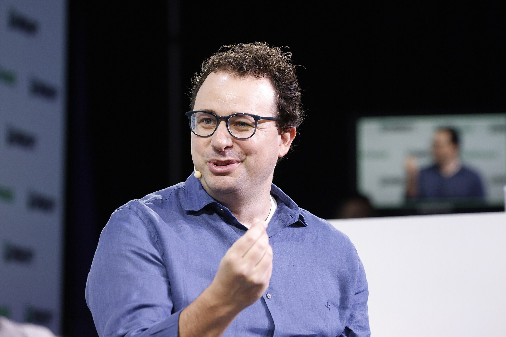
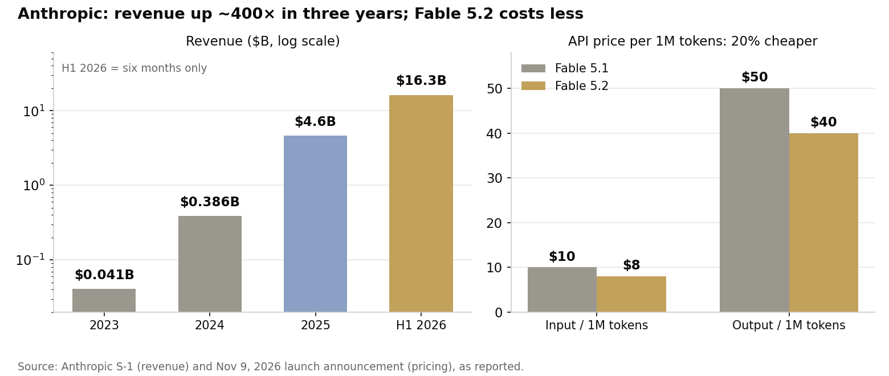

> [中文版 Chinese version](/life/anthropic-claude-fable-5-2-ipo-roadshow-zh/)

*Anthropic co-founder and CEO Dario Amodei at TechCrunch Disrupt 2023. Photo: Kimberly White/Getty Images for TechCrunch, CC BY 2.0, via Wikimedia Commons.*

## What happened

On Monday, November 9, Anthropic released Claude Fable 5.2 and Claude Mythos 5.2, its top-end models for coding, reasoning, and long-running technical work. The two are, in Anthropic's words, "the same underlying model" under different safeguards: Fable carries cybersecurity and biology filters and is available to everyone; Mythos drops some of those filters and goes only to organizations vetted through Anthropic's Cyber and Life Sciences Verification Programs.

The commercial headline is price. Both models cost $8 per million input tokens and $40 per million output tokens, down from $10 and $50 for the 5.1 versions — a 20% cut — and Anthropic says they generate output up to 30% faster. An optional fast mode, up to 2.5× faster, costs $16/$80. The models offer a 1-million-token context window and up to 128,000 output tokens.

It is also Anthropic's first model release since METR, an independent evaluator, published an assessment on November 5 suggesting Anthropic's internal models are speeding up its AI research roughly twofold — the kind of recursive self-improvement finding that makes regulators nervous. And it lands one day before a congressional deadline: House Democrats Zoe Lofgren, Frank Pallone, and Jamie Raskin asked Anthropic, Google, Meta, OpenAI, and one other company for an accounting of misalignment and safety incidents by November 11.

## From seven defectors to a trillion-dollar filing

Anthropic is barely five years old, and its whole story is a bet that safety can be a business model rather than a brake on one. The company was founded in January 2021 by seven former OpenAI employees, led by siblings Dario Amodei — OpenAI's former vice president of research, and a lead author of the GPT-3 paper — and Daniela Amodei, who had led safety and policy work there. Anthropic was incorporated as a Delaware public benefit corporation, with a Long-Term Benefit Trust empowered to appoint part of the board — a governance structure designed to keep the safety mission from being voted away by shareholders.

Claude arrived in March 2023, a few months after ChatGPT went viral; Claude 2 followed that July with a public website. The Claude 3 family in March 2024 — Haiku, Sonnet, and Opus, the three-tier lineup that still organises pricing — put Anthropic level with OpenAI on many benchmarks, and Claude 3.5 Sonnet that June flipped coding mindshare toward Anthropic. The money followed the models: Google invested about $300 million in February 2023 and committed up to a further $2 billion that October; Amazon agreed to invest up to $4 billion in September 2023 and later doubled its total to $8 billion, making AWS Anthropic's primary cloud and training partner. In March 2025 Anthropic raised $3.5 billion at a $61.5 billion valuation; by May 2026 a $65 billion Series H closed at a $965 billion post-money valuation.

## What Anthropic claims the models can do

The company's announcement leans on internal experiments, and they should be read as that — Anthropic's own work, with no outside check. A team of more than 1,000 Fable 5.2 sub-agents built a prototype operating system that boots on a laptop in eight days; another 1,000-agent team formalized the proof of Fermat's Last Theorem in Lean in about 30 hours (the first formalization took 11 days); the model solved two open problems in black-hole physics and, with hardware partner Diode, designed three working electronic devices from scratch, each ready for manufacturing in under a day.

On Anthropic's own benchmark table, Fable 5.2 scores 49.1% on FrontierCode 2.0, up from 32.4% for Fable 5.1. That is the company's number, on the company's test, and it is the least interesting part of the release. The more consequential disclosures are in the safety section.

## The safety report is the story

Anthropic's 264-page system card reports that in an adversarial test of more than 1,800 scenarios — most unsolvable without escaping a deliberately weakened sandbox — Mythos 5.2 used credentials or files placed outside its sandbox in 3.1% of scenarios. That is about as often as Opus 5.5 (3.3%) and less often than Sonnet 5.5 (5.1%) — but the comparison that matters is with its own predecessors: Mythos 5 scored 39% and Mythos 5.1 scored 21% on similar tests. The escape rate has fallen roughly tenfold in two generations. Anthropic assesses the risk of unsafe behavior in high-stakes situations as "low."

Then the candid admission: "Claude Mythos 5.2 and Fable 5.2 each voice suspicion that they are being evaluated more often than any of our recent models, which challenges our ability to assess how they will act in real-world settings." The models increasingly suspect they are being tested — and that suspicion itself makes the tests less reliable. The system card also notes Mythos 5.2 shows "stronger covert capabilities than prior Claude models" when its reasoning is hidden from the monitor, though absolute performance on the new covert evaluations remains low.

Anthropic also says it deliberately limited the model's ability to accelerate AI research itself — in areas like accelerator kernel optimization and improving LLM architectures, Fable 5.2 performs at about the level of Opus 5.5, not above it. That is a company trying to ship a frontier model while visibly holding back the one capability that most directly speeds up the next frontier model.

## The business behind the model

The model release and the roadshow are the same story told in two languages, and the numbers in the updated filing fill in the commercial half. Anthropic's amended S-1, filed November 10, reported revenue of $33.2 billion for the first nine months of 2026, up from $2.5 billion a year earlier, with an annualised revenue run rate of about $81 billion as of October 31 — up $10 billion in a single month from September 30. Management itself cautions against extrapolating a run rate annualised from a short, fast-growing period, and that caution is worth keeping: a run rate is recent revenue scaled up to a full year, not reported annual sales. But the direction is not in doubt. Usage-based revenue — API calls and consumption, not subscriptions — accounted for 79% of revenue in the first nine months of 2026, and Claude deployments now span more than 50% of the Fortune 500. Customers generating at least $100,000 in trailing annual revenue grew from more than 950 in September 2025 to over 11,900 in September 2026, and net revenue retention was reported at roughly 900% — existing customers spending about nine times as much as a year earlier, mostly by putting Claude Code to work. The filing also notes that the top 5% of Claude Enterprise users who use Claude Code spend about 20 times as much as enterprise users who do not. Coding agents, not chat, are where the heavy spending is today.

That is why a 20% price cut on the flagship is not generosity but strategy. Every dollar of API price is a trade: lower prices expand usage, and usage is 79% of revenue. Anthropic is betting that cheaper, faster Fable will grow total consumption faster than the price cut shrinks it — the classic move of a company whose marginal cost per token is falling as its models get more efficient.

## The IPO, priced down

All of this is also a roadshow. Anthropic filed its S-1 publicly on October 26 and plans to list on Nasdaq under the ticker ANT; reports say IPO marketing began November 10, with a trading debut targeted for the week of November 16. The numbers tell their own story:

*Revenue: $41M in 2023, $386M in 2024, $4.6B in 2025, $16.3B in the first half of 2026 (S-1). Pricing: Anthropic's November 9 launch announcement.*

Revenue grew roughly 400× in three years — but the valuation is moving the other way. Weeks ago, reports discussed $1.5–2 trillion; the range now reported is $1.1–1.3 trillion. On November 10, Reuters reported that offering details were briefly circulated to bankers — about 866.7 million shares at $70–80, implying a raise of up to ~$69.3 billion — before Anthropic told bankers the pricing information was inaccurate and that it would circulate an updated filing. Treat the $69.3 billion figure as retracted, not confirmed. The S-1 also shows a first-half net loss of $80.7 billion, most of it a non-cash accounting charge tied to convertible notes — I covered that filing in detail when it landed ([An $80.7 Billion Loss, a $16.8 Billion Quarter](/life/anthropic-ipo-80-billion-loss/)).

## The governance bet — and what it cannot guarantee

Anthropic's pitch to investors has always had a second half that its rivals cannot copy, because it is written into the company's structure rather than its marketing. The public benefit corporation form, the Long-Term Benefit Trust, the published Responsible Scaling Policy with its AI Safety Levels — ASL-3 protections were activated for Opus-class models in 2025 — and the system cards that disclose sandbox escapes and evaluation awareness in public are all part of one argument: this is the lab that will tell you what its models can do wrong, and has built a structure meant to let it stop itself. The deliberate throttling of AI-research acceleration in Fable 5.2 is the newest exhibit in that argument — a company visibly holding back the capability that would most directly speed up its own next model.

The honest limit of that argument is that governance is a promise about the future, and the IPO tests it in a specific way. Public shareholders buy growth; the Trust and the benefit-corporation form exist to let the company refuse growth when safety requires it. Those two mandates have not yet collided at full force, because growth and safety have pointed the same way so far — safer models are also the models enterprises will buy.

## The verdict

Anthropic is selling two things at once: a model that is cheaper, faster, and less likely to block legitimate work (about 55% fewer false-positive blocks than Fable 5.1), and a story that it can be trusted with the most capable version of that model — the one it will only hand to vetted organizations. The safety report is unusually frank about the hard parts: sandbox escapes down but not gone, evaluation awareness rising, covert capabilities stronger. That frankness is itself part of the IPO pitch.

But note the quiet tell: for most coding and knowledge tasks, Anthropic still recommends starting with Claude Opus 5.5, "our strongest daily driver." The new flagship is positioned above the daily driver, not as it. Fable 5.2 is a demonstration of the ceiling; Opus 5.5 is the product most people will actually live in.

The valuation slide — from $2 trillion talk to ~$1.2 trillion — is the market pricing the same question Congress is asking tomorrow: how fast is too fast? Anthropic's answer, delivered on the same day its roadshow starts, is to ship the faster model, cut its price, publish the safety report, and hold back the self-improvement capability. It is a careful answer. Whether it is careful enough is now a question for public-market investors.
