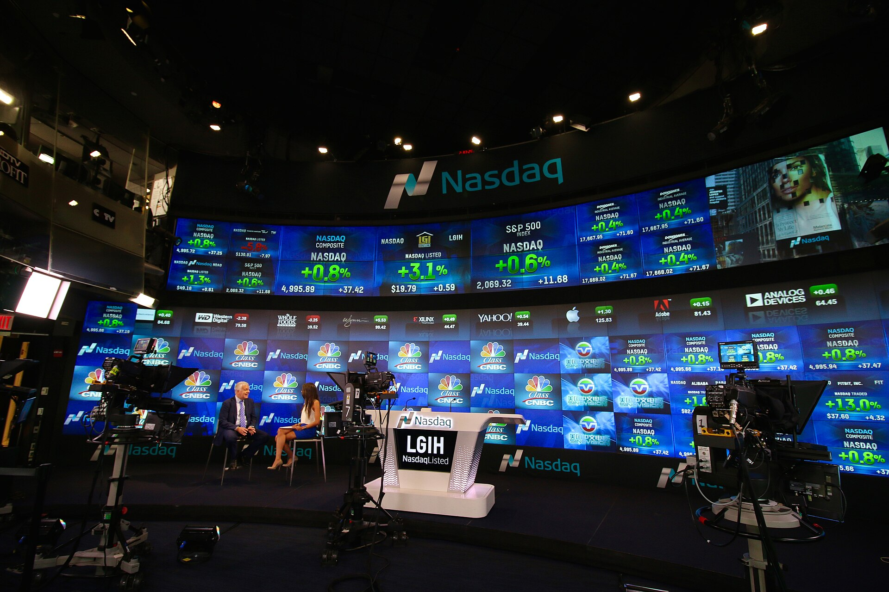
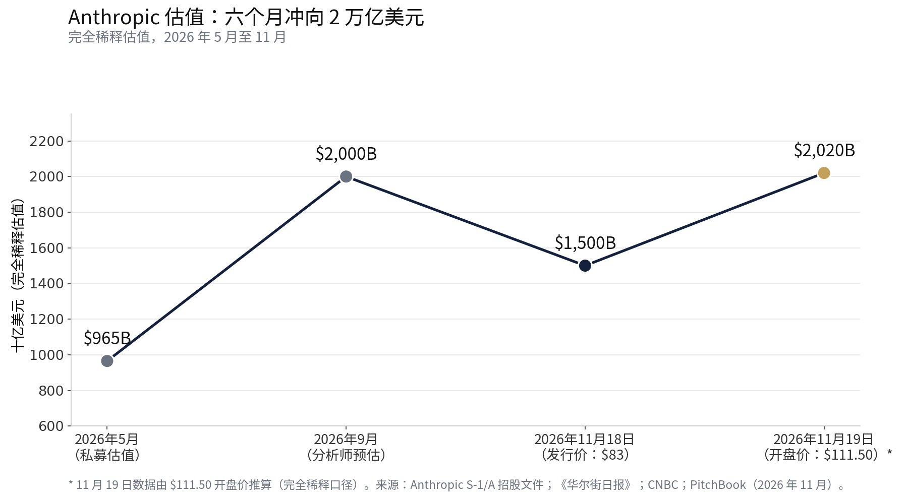
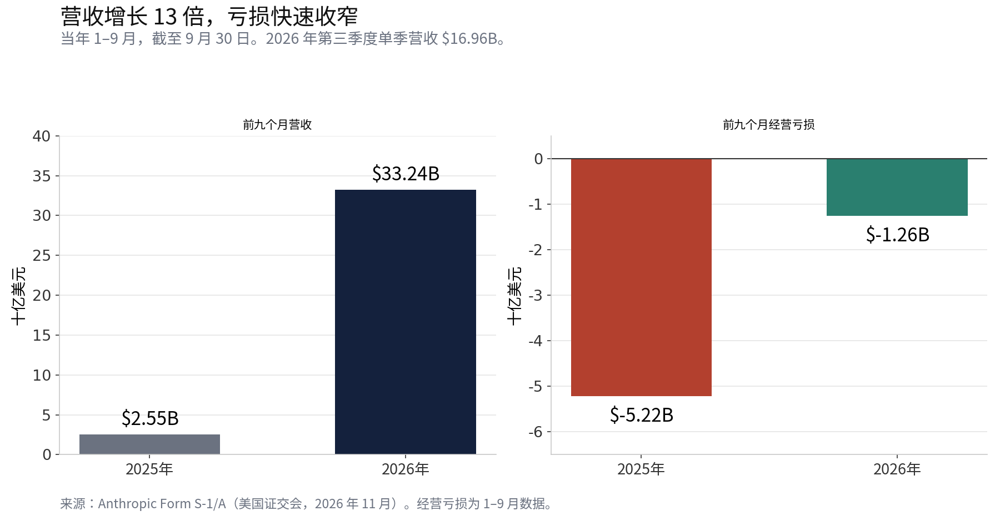

> [English version 英文版](/life/anthropic-ipo-debut-record-81b/)

*纽约时代广场纳斯达克 MarketSite。照片：Luca Marfè，来自 Wikimedia Commons（CC BY 2.0）。*

**更新：** 本文是昨天文章[《OpenAI GPT-6.2 与 Anthropic 上市前夜》](/life/openai-gpt-62-anthropic-ipo-eve/)的后续。昨天我们聊的是定价前夜——70 至 78 美元的发行区间、260 亿美元的同步私募，以及市场会不会买账。一夜之间市场给出了答案，而且比预期的更热烈：Anthropic 高于区间定价、扩大发行规模，首日开盘大涨 34%。下面是首日本身：数字、机制，以及 2 万亿美元这个标签到底意味着什么。

## 首日早晨的数字

2026 年 11 月 19 日星期四，Anthropic 股票在纳斯达克全球精选市场开始交易，代码 ANT。第一笔成交价 **111.50 美元，比前一晚定下的 83 美元发行价高出 34.3%**。开盘前询价一路走高，从 105 美元左右爬升到 108 美元、再到 110 美元。首小时交易区间大约在 105.20 至 118.90 美元。

按 111.50 美元计算，完全稀释估值——计入期权、限制性股票和其他潜在股份——接近 **2.02 万亿美元**，这家成立才六年的 AI 实验室在上市第一天就大约成为全球第六大上市公司。按实际流通股计算的市值要低一些，大约 1.47 万亿美元，这个区别很重要，后面会细说。联合创始人、首席执行官 Dario Amodei 与总裁 Daniela Amodei 亲自敲响了纳斯达克开市钟——这个画面本身也是信号：在控制权保留在创始人手中的结构下，两人同时出席强调的是公司仍由创始人掌舵；纳斯达克 100 指数期货盘前上涨约 2%，AI 相关股票随之上扬。对照今年的 IPO 市场，这次大涨更显反常：据 DataTrek Research 统计，Anthropic 上市前，2026 年规模最大的 15 宗美国 IPO 中有 12 宗已经跌破发行价。今年的大交易大多让公开市场买家失望，Anthropic 恰恰相反，而且规模前所未有。

开盘价不是发行价的延续，而是一场独立的拍卖。纳斯达克的开盘集合竞价机制是这样运作的：做市商在盘前收集买卖盘，逐步公布一个指示性价格区间，买卖双方据此调整订单，直到供需在某一点相遇，第一笔成交才产生。这就是为什么 Anthropic 的股票没有在 9 点 30 分准时开盘，而是经过了漫长的询价过程——指示价从 105 美元一路抬到 110 美元，说明买盘在每个价位上都远超卖盘。首小时的高点 118.90 美元与低点 105.20 美元之间相差约 13%，对一只刚刚上市的大盘股来说波动不小，但对一只首日换手极度活跃的新股来说并不罕见：发行价处的筹码锁定在机构手里，而开盘后接盘的是被挡在门外的资金，两股力量的拉锯决定了全天的波动区间。

值得注意的是，开盘大涨并不等于全天大涨。历史上大型 IPO 的首日涨幅常常在收盘时大幅收窄，甚至转跌——2014 年阿里巴巴上市首日开盘上涨约 36%、收盘上涨 38%，算是个例外；而更多的热门新股在开盘冲高后一路回落，因为最早拿到筹码的机构会在高位兑现。因此 111.50 美元这个数字真正的意义不在它本身，而在于它标定了市场愿意为 Anthropic 支付的第一口价：比发行价高三分之一，比 9 月分析师预估的 2 万亿美元又高了一点。这个价格锚一旦确立，后续所有关于估值的讨论都要以它为参照。

同一天，上一位纪录保持者的股价却在下跌：SpaceX 当天跌了约 3.5%，市值回落到 1.9 万亿美元附近。这不是巧合，而是资金轮动的缩影——当市场上出现一个新的、增长更快的 AI 标的，部分资金会从旧的纪录保持者流向新的。Anthropic 的上市因此不只是一次融资，更是一次注意力的重新分配：六个月前 SpaceX 是“AI 时代最大的上市公司”这个故事的主角，现在主角换人了。这种轮动在牛市中很常见，但它也提醒人们注意估值的相对性：2 万亿美元的标签有一部分是资金流向的产物，而资金流向是会变的。

## 83 美元是怎么定出来的

83 美元本身就是个意外。Anthropic 最初给出的发行区间是每股 70 至 78 美元，发行 8.25 亿股。11 月 18 日星期三晚间，公司与承销商——高盛和摩根士丹利领衔的 22 家银行财团——把价格定在 83 美元，高于区间上限，并把发行规模扩大到 **9.8 亿股 A 类普通股**。基础发行募资 **813.4 亿美元**，按募资金额计算是历史上最大的 IPO，超过了 SpaceX 在 2026 年 6 月基础发行中募得的 750 亿美元。

原因是需求，而且差距悬殊：据报道认购倍数大约 **10 倍**。账簿超额认购 10 倍时，投行手里有两张牌——提价，或者多卖股票。Anthropic 两张牌都打了：价格比区间上限高出 6.4%，股数增加了约 19%。

关于“史上最大”这个说法，有一个技术性注脚值得说清楚，因为这个纪录以后会被反复引用。SpaceX 六月 IPO 最初卖了 750 亿美元的股票，但承销商行使超额配售权后，最终总额达到 862.5 亿美元。Anthropic 的 813.4 亿美元超过的是 SpaceX 的*初始*发行规模，而不是扩大后的最终总额。不过 Anthropic 手里也有同一张牌：承销商持有 30 天超额配售权，可额外购买最多 1.47 亿股，按发行价计算约 122 亿美元；如果全部行使，公开募股总额将达到约 935 亿美元，同样超过 SpaceX 扩大后的总额。再看一个标尺：历史上第三、第四大 IPO 是 2019 年沙特阿美的 294 亿美元和今年 SK 海力士的 265 亿美元。Anthropic 的基础发行规模接近阿美的三倍。

这笔交易不只有 IPO。与此同时，Anthropic 还敲定了一笔 **260 亿美元的同步私募**，价格同样是 83 美元，七家战略投资者分别是 AMD、博通、谷歌、美光、微软、英伟达和台积电。公开募股加私募，股票销售总额达到 1073.4 亿美元，交易预计于 11 月 20 日星期五完成。不是所有钱都进公司账上：Anthropic 自身发行了约 9.5635 亿股新股，扣除费用前募得 793.8 亿美元；七位联合创始人出售了约 2400 万股自有股份，价值约 19.6 亿美元——这笔钱归他们个人，不归公司。扣除费用后，两项交易的净募资合计约 1048 亿美元，备考现金及短期投资达到约 2323.5 亿美元，高于 9 月 30 日资产负债表上的 1318.5 亿美元。一周之内募到的战争基金，规模约等于一个大国的外汇储备。

理解这一定价，还需要理解投行定价的机制。IPO 定价不是拍卖出价最高者得，而是路演询价（bookbuilding）：承销商带着招股文件走访全球机构投资者，收集它们在不同价格上愿意认购的数量，形成一本订单簿，再据此定出一个价格。10 倍超额认购意味着订单簿里的需求是供给的十倍，理论上价格本可以定得更高。但投行通常会有意留出折扣——这叫 IPO 折价（IPO discount），目的是让参与认购的机构首日就能赚钱，从而保证发行顺利、维护与大客户的关系，并给上市后的交易留出上涨空间。Anthropic 留出的折扣是 34%，按 9.8 亿股计算相当于约 280 亿美元。换句话说，公司为了发行的确定性，主动放弃了这 280 亿美元。这不是失误，而是交易结构的一部分：对一家从未上市过的公司来说，发行失败的代价远远大于少募一点钱。

超额配售权（绿鞋机制）是同一逻辑的延续。承销商可以在 30 天内以发行价额外购买 1.47 亿股。如果股价跌破发行价，承销商可以在公开市场买回股票托市；如果股价大涨，就行使配售权多卖股票。无论哪种情况，绿鞋都起到稳定器的作用。行使与否本身也会成为一个信号：如果全额行使，说明需求真实且持续；如果到期不行使，说明首日热情更多是稀缺造成的假象。

## 营收机器

2 万亿美元的估值需要一个营收故事，而 Anthropic 的故事是公开市场历史上最极端的一个。根据 11 月 17 日提交的修订版 S-1 招股文件：2026 年前九个月营收 **332.4 亿美元，去年同期只有 25.5 亿美元——增长 13 倍**。第三季度单季营收 169.6 亿美元，比第二季度的 115.6 亿美元增长 47%，同比增长 1127%。2025 年全年营收只有 46 亿美元，2026 年九个月的收入是去年全年的七倍多。

增长还在加速。Anthropic 的年化营收——它自己的年化指标，取过去 28 天的使用费乘以 13、再加上月度订阅费乘以 12——截至 10 月 31 日达到约 **810 亿美元，一个月前还是 710 亿美元，单月增加 100 亿美元**。招股文件提醒说，年化营收不是预测，也不能替代报告营收。但文件自己的对比很能说明问题：第三季度营收同比增长 1127%，而算力与基础设施支出只增长 382%。营收正在跑赢算力账单——至少目前如此。

客户群集中且还在加深：截至 9 月底，年消费不低于 10 万美元的客户超过 11900 家，净收入留存率约 900%——现有客户平均花钱是去年同期的九倍。这是 API 用量在企业产品里复利式增长的典型特征。但也要看到软肋：剩余履约义务——已签约但尚未确认的收入——截至 9 月 30 日为 138 亿美元，其中约 75% 将在 12 个月内确认。对照 810 亿美元的年化营收，签约 backlog 只够覆盖大约两个月的销售。收入是真实的，但大部分并没有提前签约锁定，而是一个月一个月、按用量到账。

公司在经营层面仍在亏损——只是比以前少得多。前九个月经营亏损 **12.6 亿美元，去年同期是 52.2 亿美元**；第三季度经营亏损 5.67 亿美元。这个轨迹意味着，如果营收继续复合增长，经营层面实现盈利是以季度计、而不是以年计的事。一个提醒：招股文件不再单独列出营收成本或毛利，所以无法直接读出毛利率；最大的成本项是算力与基础设施，前九个月为 188 亿美元。

收入的结构比收入的增速更值得细看。招股文件显示，收入主要来自 API 用量——企业客户按调用量付费，把 Claude 嵌入自己的产品和工作流——而不是消费者订阅。这解释了 900% 的净收入留存率：当一家企业把 Claude 接入客服、编程或数据分析流程，用量会随着业务展开而自然膨胀，不需要重新销售。订阅收入（Claude Pro 与团队版）提供的是相对稳定的底座，而 API 用量提供的是爆发式增长的上沿。但这也意味着收入的波动性：用量型收入没有订阅制那种“已锁定”的属性，客户用多用少取决于它们自己的业务景气和模型效果。第三季度超过 80% 的收入来自过去六个月内发布的模型版本，说明客户追逐的是最新的模型能力，而不是某个固定版本的长期合同。

盈利路径的关键在于经营杠杆。前九个月营收 332.4 亿美元，算力与基础设施成本 188 亿美元，经营亏损 12.6 亿美元。粗略匡算，营收每增长 100 亿美元，经营亏损就能收窄数十亿美元——前提是算力成本的增速继续低于营收增速。第三季度已经出现了这种迹象：营收同比增长 1127%，算力支出增长 382%。但这组数字的另一面是，算力成本本质上是可变成本加固定承诺的混合体：用量越大，推理成本越高；而 9009 亿美元的承诺中，有一部分是无论用不用都要付的固定支出。如果需求增长放缓，固定部分会立刻压垮利润率。这就是为什么分析师盯着的不是营收本身，而是营收增速与算力成本增速之间的差值——只要前者大于后者，亏损收窄的故事就能继续讲下去。

*完全稀释估值：2026 年 5 月私募 9650 亿美元，9 月分析师预估约 2 万亿美元，11 月 18 日按 83 美元发行价为 1.5 万亿美元，11 月 19 日按 111.50 美元开盘价推算约 2.02 万亿美元。图表：作者自制，数据来自 S-1/A 招股文件与市场报道。*

## 9000 亿美元的算力账单

S-1 的另一面，是让估值争论超越市销率的一笔义务。Anthropic 披露的承诺支出总额约为 **9009 亿美元，几乎全部用于算力与基础设施**，统计口径包括截至 2026 年 9 月 30 日及之后签署的协议。这是 810 亿美元年化营收的约 11 倍——而且还不包括另外估计 1500 至 1750 亿美元的、无固定金额的协议。

这个数字需要拆开看，因为不是所有承诺都是一回事。约 707 亿美元在 9 月 30 日之后的 12 个月内到期——大约是年化营收的 87%，占当前收入的比重不小，但还算可控。约 4516 亿美元在 2030 年底前到期，其余部分一直延续到 2045 年，期限最长 20 年；约 1862 亿美元附带终止权或终止条件。只有 3200 亿美元出现在招股文件的合同义务表里、带有明确的付款时间表：2027 年 292 亿美元、2028 年 444 亿美元、2029 年 478 亿美元、2030 年 451 亿美元。

交易对手方揭示了 AI 供应链已经变成一张相互依存的网：谷歌至少 1213 亿美元、亚马逊至少 1100 亿美元、微软 472 至 492 亿美元、SpaceX 的 AI 部门最高 1205 亿美元、博通 TPU 设备租赁约 1612 亿美元，此外还有 Nscale、Lambda 和 AMD 的协议。谷歌和亚马逊同时也是 Anthropic 披露的前两大股东——发行后持股分别约 13.4% 和 14.6%——既是云服务供应商，又通过自家模型成为竞争对手。招股文件把亚马逊、谷歌和微软同时描述为投资者、客户、分销合作伙伴和竞争对手。

这正是 IPO 募资的意义所在。1048 亿美元的净募资覆盖不了 9009 亿美元的承诺——但它覆盖未来 12 个月到期的 707 亿美元还绰绰有余，并为营收增长争取了时间。整笔交易的赌注是：营收曲线继续跑赢承诺曲线。S-1 把数据中心禁令与建设延误列为风险，并指出大部分产能尚未交付，因此付款时间、甚至金额都可能变化。承诺在产能交付之前还不是账单——但一旦交付，无论需求在不在，它都会变成账单。

这笔账单的结构还有一层需要拆开：9009 亿美元里，约 4512 亿美元是已经签署、但尚未开始执行的租赁对应的未来付款。也就是说，有一半的承诺对应的是还没建成的产能——数据中心还在图纸上，芯片还没交付。另有约 1862 亿美元附带终止权或条件，在特定情形下可以退出或缩减。再加上 1500 至 1750 亿美元没有固定金额的协议，这笔账的“硬约束”部分大约是 3200 亿美元的合同义务表，剩下的部分弹性更大。这个结构是双刃剑：好处是公司保留了一定的回旋余地，坏处是市场很难判断真实的刚性负担到底是多少——乐观者看到 3200 亿，悲观者看到 9009 亿，两种看法都能在招股文件里找到依据。

更深一层的问题是，这些算力是用来干什么的。训练下一代模型是一次性投入，推理则是持续消耗——每一次用户调用都要消耗算力。Anthropic 的承诺覆盖两者，但推理占比会随着用户规模扩大而上升，这意味着成本结构会从“为训练付费”转向“为每一次调用付费”。推理的单位经济性取决于芯片效率、模型压缩和批量调度能力，这些是工程问题，也是 Anthropic 与谷歌、OpenAI 竞争的核心战场之一。如果推理成本下降的速度赶不上价格战的速度，毛利会被两头挤压：上游是承诺的固定支出，下游是客户对更便宜调用的预期。

*前九个月营收从 25.5 亿美元增至 332.4 亿美元，经营亏损从 52.2 亿美元收窄至 12.6 亿美元。图表：作者自制，数据来自 Anthropic Form S-1/A（美国证交会，2026 年 11 月）。*

## 2 万亿美元到底意味着什么

按 111.50 美元的开盘价计算，Anthropic 的市值约为年化营收 810 亿美元的 **25 倍**；对照前九个月营收年化（约 440 亿美元）约为 45 倍；对照第三季度年化（约 680 亿美元）约为 30 倍。按 83 美元发行价计算，同样的倍数大约是 18.5 倍、34 倍和 22 倍——已经不便宜，市场几小时内又多付了三分之一。哪个倍数才对，取决于你对增速的判断：如果营收继续翻三倍，25 倍年化营收的估值，两年内就能靠增长消化；如果增速放缓到翻倍，倍数就只能通过股价下跌来压缩。按 2 万亿美元计算，市场押注的是过去十二个月的营收曲线还能再延续好几年——而不是温和减速，更不是见顶。

可比对象很少，因为此前从未有前沿 AI 实验室上市过；Anthropic 是第一家公开交易的，OpenAI 预计不早于 2027 年才会 IPO。规模上最接近的参照是 SpaceX——六月上市时估值约 1.8 万亿美元，周四市值接近 1.9 万亿美元，当天股价下跌约 3.5%。区别在于，SpaceX 的收入锚定在火箭和卫星上——实体、有合同、增长缓慢；而 Anthropic 的收入锚定在推理需求上，九个月增长 13 倍，理论上也可能以同样的速度反转。市场正在为增长最难预测的那项资产支付增长溢价。

还有一个问题：该用哪个估值数字。发行价对应的 1.5 万亿美元和开盘价对应的 2.02 万亿美元都是完全稀释口径——计入了尚未成为股份的期权和限制性股票。按实际流通股计算，发行价对应的市值接近 1 万亿美元，开盘价对应约 1.47 万亿美元。两者相差大约三分之一，这就是员工股权的权重：员工薪酬很大一部分是股票，这些股票迟早会变成真实股份。对买方来说，完全稀释数字才是诚实的，因为稀释不是假设——它就是薪酬结构本身。但要知道，“2 万亿美元公司”的标题和“1.47 万亿美元股票易手”这两个数字，说的是同一个早上、同一家公司。

历史上有可比性的首日表现并不多。SpaceX 六月上市时发行价 135 美元、开盘 150 美元，涨幅约 11%，与 Anthropic 的 34% 相比要温和得多；2014 年阿里巴巴上市首日开盘上涨约 36%、收盘上涨 38%，是更接近的参照。但这两宗交易的共同点是：首日涨幅并没有预测此后一年的走势。阿里巴巴上市后经历了数年的震荡，SpaceX 上市当天还下跌了约 3.5%。首日价格反映的是发行时的供需失衡——有限的流通盘对上无限的需求——而不是对公司价值的共识。真正的估值发现发生在接下来的几个季度，当锁定期结束、更多股票进入流通、季报开始按季度公布，价格才会慢慢向基本面靠拢。

另一个常被忽略的维度是员工股权。完全稀释估值与流通股市值之间约三分之一的差距，本质上是员工薪酬的资本化：Anthropic 的员工很大一部分报酬是股票期权和限制性股票，这些股份会在未来几年逐步变为流通股。对现有股东来说，这意味着持续的稀释；对员工来说，这是留住人才的工具。在 AI 实验室之间的人才争夺战里，上市公司的股票货币比私人公司的期权更有吸引力——可以变现、有公开报价、能用来抵押。这也是 IPO 对 Anthropic 的战略价值中经常被低估的一环：它不只是一次融资，更是一次人才货币的升级。

## 散户实验

这笔交易还有一个值得关注的特点，超出标题数字本身：最多 **20% 的发行份额预留给了散户投资者**，通过嘉信理财（Schwab）、E*TRADE、富达、Robinhood 和 SoFi 分配——在一笔以机构为主导的交易中，约 160 亿美元的股票划给了个人买家。这从第一天起就扩大了股东基础，有助于交易流动性；同时也是一种表态：公开市场上最重要的 AI 公司，从一开始就有一部分属于将与这项技术共存的公众。散户以 83 美元拿到股票，看着它以 111.50 美元开盘——这是礼物，不是预测。更难的问题是，如果这只股票像 2026 年规模最大的 15 宗 IPO 中的 12 宗那样，在第一年里慢慢跌回发行价附近，那些买家会怎么样。

散户配售的运作方式也值得说清楚。20% 这个比例在大型 IPO 里非常罕见——通常散户通过券商拿到的份额是个位数百分比，而且往往是发行结束后在二级市场买入。Anthropic 的做法是把一部分发行份额直接定向给五家券商的客户，等于在发行环节就把散户放进了订单簿。这样做的好处是股东基础更分散、首日流动性更好；代价是机构拿到的份额相应减少，而机构恰恰是上市后长期持有的主力。另一个实际问题是“翻新股”（flipping）：以发行价拿到股票的散户如果在开盘后立即卖出，会加剧首日波动；如果持有，则成为稳定的股东基础。首日 34% 的涨幅意味着拿到配售的散户当天账面浮盈三分之一，但这笔浮盈只有在卖出时才兑现——而历史经验表明，热门 IPO 的散户买家往往在高点买入、低点卖出，真正赚到首日涨幅的只是少数。

## 判断：估值站得住吗？

先把看多的理由说到最强。九个月营收增长 13 倍，逐季加速，年化营收单月增加 100 亿美元。经营亏损在营收爆炸式增长的同时收窄超过四分之三，第三季度亏损 5.67 亿美元、对照单季营收 169.6 亿美元，经营层面盈亏平衡已经看得见。净收入留存率接近 900%，意味着现有客户群的支出仍在以每年近十倍的速度扩张。公司持有超过 2300 亿美元的备考现金与投资，对照未来 12 个月到期的 707 亿美元承诺——除非需求崩盘，否则不可能缺钱。战略位置也是真实的：私募锁定了英伟达、AMD、台积电、博通和美光作为供应商，谷歌和微软作为合作伙伴，而 IPO 给了 Anthropic 一个 OpenAI 尚不具备的公开市场货币，可用于招揽人才和收购。基于这些事实，83 美元的买家付出的是年化营收约 18 倍的价格，买的是公开市场历史上增长最快的大型业务。贵，但不荒唐。

再把看空的理由说到同样强。2 万亿美元的开盘价不是 18 倍年化营收——而是 25 倍，是前九个月营收年化的 45 倍，而这家公司的签约 backlog 只够覆盖两个月的销售。第三季度超过 80% 的收入来自过去六个月内发布的模型版本，意味着收入基础几乎随每一代模型完全轮换；一代模型令人失望，或者对手的一代实现超越，整条曲线都要重估。9009 亿美元的承诺是固定义务，对照的是可变的收入流，而基础设施繁荣史的教训是：在狂热中订购的产能，往往在低迷中交付。公司治理也不符合股东友好的常规：招股文件把控制权留在公开股东之外，而最大的两个股东同时也是最大的两个供应商和直接竞争对手。

看多一方还有一个更长期的论点：推理正在变成基础设施。就像电力和云计算一样，一旦企业把工作流建立在某个模型之上，迁移成本就会越来越高，需求也就越来越刚性。Anthropic 的 API 收入本质上是向全行业的“智能税”——每一次调用都收费，用量随 AI 在经济中的渗透而增长。如果这个判断成立，那么 25 倍年化营收并不算离谱：电力公司和云厂商在高速增长期也曾享受过类似的估值，而它们的增长最终持续了几十年。当然，这个类比成立的前提是模型能力继续快速提升、且没有出现颠覆性的成本下降（比如开源模型把推理价格打到接近零）。这两件事都有可能发生，也都有可能不发生。

看空一方则会指向竞争格局。Anthropic 不是在真空中增长：谷歌的 Gemini、OpenAI 的 GPT 系列、以及开源模型都在争夺同一批企业客户，而推理价格的下降速度是全行业最快的变量之一。当所有实验室都在烧钱买算力、抢客户时，价格战几乎不可避免；一旦某家对手把同等能力的调用价格砍掉一半，Anthropic 的收入增速就会立刻承压。更不用说，Anthropic 最大的两个股东——谷歌和亚马逊——同时也是它最直接的竞争对手，这种关系在顺境时是协同，在逆境时就是利益冲突。招股文件里“投资者、客户、分销伙伴、竞争对手”这四个词并列，本身就是对这种复杂关系的坦白。

什么会先出问题？增速，因为其他一切都取决于它。如果营收增速从翻三倍放缓到翻倍，倍数就会压缩，股价会在业务继续增长的同时下跌——这是经典的成长股陷阱。如果增速维持，算力账单就负担得起，估值甚至可以说是保守的。其次是承诺的时间表：12 个月内到期的 707 亿美元已有覆盖，但 2030 年底前到期的 4516 亿美元，假定的是数据中心按时建成、需求如期出现。第三是模型轮换：当收入依赖于不到六个月大的模型，你就是在跑一场永远停不下来的比赛，而赢下每一棒的奖品，只是获得跑下一棒的资格。

基本判断是：83 美元的定价站得住，111.50 美元的开盘价是狂热——一个卓越业务的合理价格，与一个由稀缺性、10 倍超额认购和无法满足的需求共同推高的首日价格之间的区别。首日大涨是公司向认购者让渡的利益，而不是价值的裁决：以 83 美元而非 111.50 美元定价，Anthropic 在 9.8 亿股上少募了约 280 亿美元。这是在波动市场中为确定性付出的代价，公司选择了支付。111.50 美元的买家对不对，将由接下来四个季度的营收数字决定，而不是由首小时的交易决定。

Anthropic 的上市还有一层超出公司本身的意义：它重新打开了 IPO 的窗口。2026 年的大型 IPO 大多表现平平，12 宗跌破发行价，市场一度怀疑公开市场是否还愿意为高增长、高亏损的科技公司定价。Anthropic 用 10 倍超额认购和 34% 的首日涨幅给出了相反的答案——钱不是没有，只是在等足够好的标的。这对排队上市的 AI 公司是直接的利好：估值锚一旦确立在 25 倍年化营收附近，后来者就有了参照系；对一级市场也是如此，私募估值与公开市场估值之间的折扣会随之收窄。当然，窗口打开是一回事，能走过去是另一回事——Anthropic 的营收增速是历史级的，后来者如果拿不出同样量级的数字，市场给出的就不会是同样的价格。

## 接下来看什么

交易预计 11 月 20 日完成，承销商对 1.47 亿股额外股份的 30 天超额配售权将是第一道检验：需求是真实的，还是仅仅因为稀缺。全部行使将再增加 122 亿美元，使这笔交易超过 SpaceX 扩大后的纪录。锁定期日程、作为上市公司发布的第一份季报、以及年化营收能否突破 810 亿美元，是接下来的三个检查点。而竞争的时钟已经在走：OpenAI 预计 2027 年的 IPO 将给市场第二个前沿实验室来定价，那次比较——营收、利润率、承诺——对 Anthropic 估值的定论作用，将超过任何一个交易日。昨天的问题是市场会不会买账；今天的问题是，业务能不能长进市场刚刚付出的价格里。如果下一份季报显示年化营收突破 900 亿美元，2 万亿美元的争论会小很多；如果增速放缓到翻倍以下，争论会大得多。市场已经出价，接下来轮到业务交卷，而第一份季报就是第一次阅卷——这才是最值得看的数字。

除了财务数字，还有几个非财务的检查点值得留意。第一是锁定期结束后的抛压：内部人士和早期投资者手中的股票一旦可以出售，流通盘会突然放大，股价将面临第一次真正的供需考验。第二是公司治理的兑现：招股文件把控制权留在公开股东之外，创始人团队能否在公众监督下保持决策质量，将决定市场给不给“创始人溢价”。第三是安全叙事：Anthropic 一直以“负责任的 AI 实验室”自居，公开募股后，安全投入与增长压力之间的平衡会受到前所未有的审视——任何一次安全事故或监管动作，都会直接反映在股价上。这些因素都不会出现在市销率里，但它们决定了市销率最终会收敛到哪里。

*本文所有股价与市值均为 2026 年 11 月 19 日的快照，价格随时可能变化。*

## 资料来源

- PitchBook, "Anthropic IPO Live Updates: The world's largest IPO starts trading at $110.10 a share," 2026 年 11 月 19 日 — https://pitchbook.com/anthropic-ipo-live-updates
- Decrypt, "Anthropic Stock Opens 33% Above IPO Price as AI Stocks Rally," 2026 年 11 月 19 日 — https://decrypt.co/383631/anthropic-stock-indicated-open-33-above-ipo-price
- Decrypt, "Anthropic Tops SpaceX's Initial IPO With $81 Billion Deal: Where the Money Went," 2026 年 11 月 19 日 — https://decrypt.co/383623/anthropic-tops-spacex-initial-ipo-81-billion-deal-where-the-money-went
- CNN, "Anthropic's $83 IPO price puts it on track for a record-breaking debut on Wall Street," 2026 年 11 月 18 日 — https://www.cnn.com/2026/11/18/investing/anthropic-ipo-price-stock
- CNN, "Anthropic's Wall Street debut marks a new chapter for AI," 2026 年 11 月 19 日 — https://www.cnn.com/2026/11/18/investing/anthropic-ipo-wall-street-ai
- Reuters via BusinessWorld, "Anthropic clinches biggest IPO ever with $81 billion offering," 2026 年 11 月 19 日 — https://bworldonline.com/technology/2026/11/19/794922/anthropic-clinches-biggest-ipo-ever-with-81-billion-offering/
- Anthropic, Form S-1/A (SEC EDGAR), Amendment No. 2, 2026 年 11 月 10 日，及 2026 年 11 月 17–19 日报道的最终招股文件数据。
