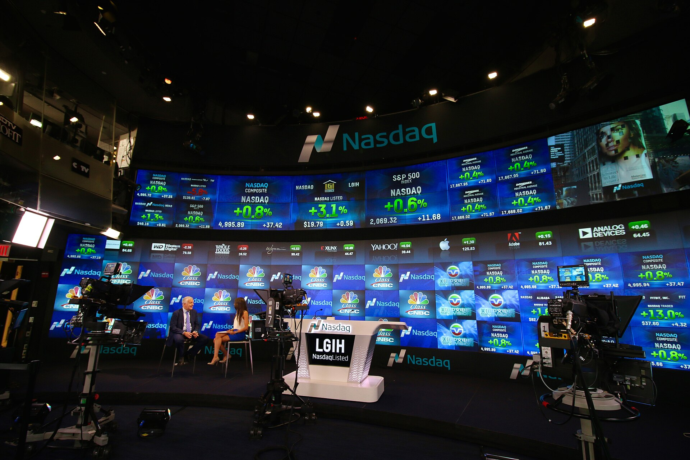
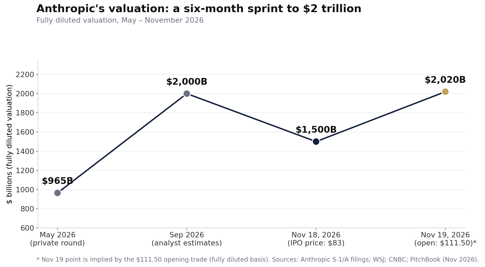
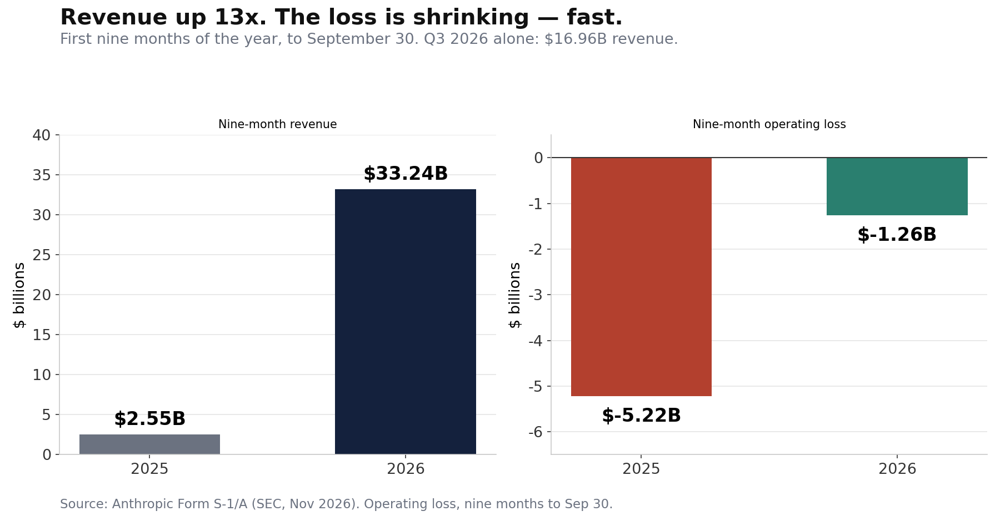

> [中文版 Chinese version](/life/anthropic-ipo-debut-record-81b-zh/)

*The Nasdaq MarketSite in Times Square. Photo: Luca Marfè, via Wikimedia Commons (CC BY 2.0).*

**Update:** This post follows up on yesterday's piece, [OpenAI's GPT-6.2 and the Eve of Anthropic's IPO](/life/openai-gpt-62-anthropic-ipo-eve/), which covered the $70–$78 range, the $26 billion private placement, and whether the market would pay up. It did — and then some. What follows is the debut itself: the numbers, the mechanics, and what the $2 trillion price tag means.

## The morning in numbers

Anthropic's shares began trading on the Nasdaq Global Select Market on Thursday, November 19, 2026, under the ticker ANT. The first trade printed at **$111.50 — 34.3% above the $83 IPO price** set the night before, after indications climbed from around $105 to $110. 
At $111.50, the fully diluted valuation — counting stock options, restricted stock, and other potential shares — approached **$2.02 trillion**, roughly the world's sixth most valuable public company. On shares actually outstanding, the value was lower, around $1.47 trillion — a distinction we return to below. Dario Amodei (CEO) and Daniela Amodei (president) rang the opening bell; Nasdaq 100 futures rose about 2% premarket.

## How $83 happened

Anthropic had marketed the offering at $70 to $78 a share, for 825 million shares. On Wednesday evening, November 18, the company and its underwriters — Goldman Sachs and Morgan Stanley leading a 22-bank syndicate — priced it at $83, above the top of the range, and upsized it to **980 million Class A shares**. The base offering raised **$81.34 billion**, the largest IPO in history by amount raised, topping the $75 billion SpaceX raised in its June 2026 base offering.

Demand was the reason, and it was not close: the offering was reportedly around **10 times oversubscribed**. Anthropic pulled both levers, pricing 6.4% above the top of the range and increasing the share count about 19%.

One footnote to the "largest ever" claim: SpaceX's June IPO initially sold $75 billion, but its final total after underwriters exercised their overallotment reached $86.25 billion. Anthropic's $81.34 billion beats SpaceX's *initial* offering, not its final expanded total — though Anthropic holds the same lever, a 30-day option on up to 147 million additional shares worth about $12.2 billion, which would take its offering to about $93.5 billion, past SpaceX's expanded total too.

Alongside the IPO, Anthropic agreed a **$26 billion concurrent private placement** at the same $83 price, with seven strategic investors — AMD, Broadcom, Google, Micron, Microsoft, Nvidia, and TSMC — bringing total gross share sales to $107.34 billion. Not all of it goes to the company: Anthropic sold about 956.35 million new shares for $79.38 billion before fees, while the seven co-founders sold roughly 24 million shares of their own, worth about $1.96 billion. After fees, combined net proceeds are estimated at about $104.8 billion, lifting pro forma cash and short-term investments to about $232.35 billion, up from $131.85 billion on September 30.

## The revenue machine

A $2 trillion valuation needs a revenue story, and Anthropic's is the most extreme in the history of public markets. From the amended S-1 filed on November 17, 2026: revenue for the first nine months of 2026 was **$33.24 billion, against $2.55 billion a year earlier — a 13-fold increase**. The third quarter alone produced $16.96 billion, up 47% from $11.56 billion in the second quarter and up 1,127% year over year. 

The growth is still accelerating. Run-rate revenue — Anthropic's own annualized metric, the last 28 days of usage fees times 13 plus monthly subscriptions times 12 — reached about **$81 billion as of October 31, up $10 billion from $71 billion a month earlier**. The filing warns it is not a forecast. But its own comparison is striking: in the third quarter, revenue grew 1,127% year over year while compute and infrastructure expenses grew 382%. Revenue is outrunning the compute bill — for now.

The customer base is concentrated and deepening: more than 11,900 customers spending at least $100,000 a year each, with net revenue retention of about 900% — existing customers spending, on average, nine times what they did a year earlier. But note the softness: remaining performance obligations — contracted revenue not yet recognized — stood at just $13.8 billion at September 30, covering roughly two months of sales at the $81 billion run rate; most revenue is not contracted in advance.

The company still loses money on an operating basis — just much less. The operating loss for the nine months was **$1.26 billion, improved from $5.22 billion a year earlier**, and the third-quarter loss was $567 million, a trajectory pointing at operating profitability within quarters, not years, if revenue keeps compounding. The filing no longer breaks out cost of revenue or gross profit, so no gross margin can be read from it; the largest cost line is compute and infrastructure, at $18.8 billion for the nine months.

*Fully diluted valuation: $965B in a May 2026 private round, ~$2T in September analyst estimates, $1.5T at the $83 IPO price, ~$2.02T implied by the $111.50 open. Chart: author's own, from S-1/A filings and market reports.*

## The $900 billion compute bill

The other side of the S-1 is the obligation that makes the valuation debate more than a multiples argument: aggregate committed spend of about **$900.9 billion, substantially all of it for compute and infrastructure**, counting agreements signed as of and after September 30, 2026. That is roughly 11 times the $81 billion run-rate revenue — and it excludes another estimated $150–175 billion under deals with no fixed dollar amount.

Not all of it is the same kind of promise. About $70.7 billion falls due in the twelve months after September 30 — roughly 87% of run-rate revenue. About $451.6 billion is due before the end of 2030, and the rest stretches out to 2045, with terms up to 20 years; about $186.2 billion carries termination rights or conditions. Only $320 billion appears in the contractual-obligations table with a dated schedule, about $29–48 billion a year in 2027–2030.

The counterparties show how the AI supply chain has become a web of mutual dependence: at least $121.3 billion with Google, at least $110 billion with Amazon, $47.2–49.2 billion with Microsoft, up to $120.5 billion with SpaceX's AI arm, and about $161.2 billion in Broadcom TPU equipment leases. Google and Amazon are also Anthropic's two largest disclosed shareholders — about 13.4% and 14.6% after the offering — as well as its cloud providers and competitors.

This is why the IPO proceeds matter. The $104.8 billion of net proceeds does not cover the $900.9 billion of commitments — it covers the next twelve months' $70.7 billion, with room to spare, and buys time for revenue to grow into the rest. The S-1 names data-center moratoriums and construction delays as risks, and notes that much of the capacity has not yet been delivered. A commitment is not a bill until the capacity arrives — but it becomes one on arrival.

*Nine-month revenue rose from $2.55B to $33.24B year over year; the operating loss narrowed from $5.22B to $1.26B. Chart: author's own, from Anthropic's Form S-1/A (SEC, Nov 2026).*

## What $2 trillion actually means

At the $111.50 open, Anthropic trades at roughly **25 times its $81 billion run-rate revenue**; against nine-month revenue annualized (about $44 billion) about 45 times, and against the third quarter annualized (about $68 billion) about 30 times. At $83, the same multiples were roughly 18.5x, 34x, and 22x — already rich. Which multiple is right depends on growth: if revenue keeps tripling, 25 times run-rate is a price growth can grow into within two years; if it slows to doubling, the multiple compresses through the share price instead. At $2 trillion, Anthropic is priced for the last twelve months' revenue curve to continue for several more years — not for a plateau.

No frontier AI lab had ever listed before; Anthropic is the first to trade publicly, ahead of OpenAI, which is not expected to pursue an IPO before 2027. SpaceX is the nearest parallel in scale — it came to market in June at about a $1.8 trillion valuation, and its market capitalization was near $1.9 trillion on Thursday. The difference is that SpaceX's revenue is anchored in rockets and satellites — physical, contracted, slow-growing — while Anthropic's is anchored in inference demand that grew 13-fold in nine months and could, in principle, reverse just as fast.

Then there is which valuation number to use. The $1.5 trillion and $2.02 trillion figures are fully diluted — they count options and restricted stock that do not yet exist as shares. On shares actually outstanding, the value was closer to $1 trillion at the IPO price and about $1.47 trillion at the open. The gap, roughly a third, is employee equity. The fully diluted number is the honest one for a buyer — dilution is the compensation structure, not a hypothetical.

## The retail experiment

One feature deserves attention: up to **20% of the offering was set aside for retail investors**, allocated through Schwab, E*TRADE, Fidelity, Robinhood, and SoFi — about $16 billion of stock for individual buyers. It broadens the shareholder base, and it is a statement: the most consequential AI company in the public markets is partly owned, from the start, by the public that will live with its technology. Retail buyers got shares at $83 and watched them open at $111.50 — a gift, not a forecast. The harder question is what happens if the stock drifts back toward the IPO price.

## The judgment: is it defensible?

The case for the valuation: revenue grew 13-fold in nine months, the run rate added $10 billion in a single month, and the operating loss narrowed by more than three-quarters while revenue exploded — the third-quarter loss of $567 million against $16.96 billion of quarterly revenue puts operating breakeven within sight. Net revenue retention near 900% means existing customers keep spending almost tenfold more year over year. The company holds more than $230 billion of pro forma cash and investments against $70.7 billion of commitments due in the next year; it cannot run out of money short of a demand collapse. The private placement also locks in Nvidia, AMD, TSMC, Broadcom, and Micron as suppliers, while the IPO gives Anthropic a public currency for talent and acquisitions that OpenAI does not yet have. A buyer at $83 paid about 18 times run-rate revenue for the fastest-growing large business in the history of public markets. Expensive. Not absurd.

The case against it: the $2 trillion open is 25 times run-rate, and 45 times annualized nine-month revenue, for a business whose contracted backlog covers two months of sales. More than 80% of third-quarter revenue came from model versions released in the previous six months, so the revenue base turns over almost completely with each generation; one disappointment, or a competitor's leapfrog, reprices the whole curve. The $900.9 billion of commitments is a fixed obligation against a variable revenue stream, and infrastructure ordered in euphoria has a habit of arriving in a downturn. Governance is not shareholder-friendly either: control stays away from public shareholders, and the two largest holders are also the two largest suppliers and direct competitors.

What breaks first? The growth rate, because everything else is downstream of it. If growth slows from tripling to doubling, the multiple compresses and the share price falls even as the business keeps growing — the classic growth-stock trap. If growth holds, the compute bill is affordable. Next, the commitment schedule: $70.7 billion due in twelve months is covered, but the $451.6 billion due before the end of 2030 assumes the data centers get built on time and demand shows up to fill them. Third, model turnover: when revenue depends on models less than six months old, you run a race you can never stop running.

The base case is that $83 was defensible and $111.50 was exuberance — a fair price versus a first-day price set by scarcity and a 10-times-oversubscribed book. First-day pops are a transfer from the company to the buyers of the offering, not a verdict on value: Anthropic left roughly $28 billion on the table by pricing at $83 instead of $111.50. Whether $111.50 was right will be decided by the next four quarters, not the first hour of trading.

## What to watch next

The deal is expected to close on November 20, and the underwriters' 30-day option on 147 million additional shares is the first test of whether demand was real or merely scarce: a full exercise adds $12.2 billion and takes the deal past SpaceX's expanded record. Lock-up expiry, the first quarterly report, and run-rate revenue past $81 billion are the next checkpoints. And the competitive clock is running: OpenAI's expected 2027 IPO will give the market a second frontier lab to price. Yesterday's question was whether the market would pay up; today's is whether the business can grow into what the market just paid.

*All share prices and market values in this post are a snapshot from November 19, 2026, and are subject to change.*

## Sources

- PitchBook, "Anthropic IPO Live Updates: The world's largest IPO starts trading at $110.10 a share," November 19, 2026 — https://pitchbook.com/anthropic-ipo-live-updates
- Decrypt, "Anthropic Stock Opens 33% Above IPO Price as AI Stocks Rally," November 19, 2026 — https://decrypt.co/383631/anthropic-stock-indicated-open-33-above-ipo-price
- Decrypt, "Anthropic Tops SpaceX's Initial IPO With $81 Billion Deal: Where the Money Went," November 19, 2026 — https://decrypt.co/383623/anthropic-tops-spacex-initial-ipo-81-billion-deal-where-the-money-went
- CNN, "Anthropic's $83 IPO price puts it on track for a record-breaking debut on Wall Street," November 18, 2026 — https://www.cnn.com/2026/11/18/investing/anthropic-ipo-price-stock
- CNN, "Anthropic's Wall Street debut marks a new chapter for AI," November 19, 2026 — https://www.cnn.com/2026/11/18/investing/anthropic-ipo-wall-street-ai
- Reuters via BusinessWorld, "Anthropic clinches biggest IPO ever with $81 billion offering," November 19, 2026 — https://bworldonline.com/technology/2026/11/19/794922/anthropic-clinches-biggest-ipo-ever-with-81-billion-offering/
- Anthropic, Form S-1/A (SEC EDGAR), Amendment No. 2, November 10, 2026, and final prospectus figures as reported November 17–19, 2026.
