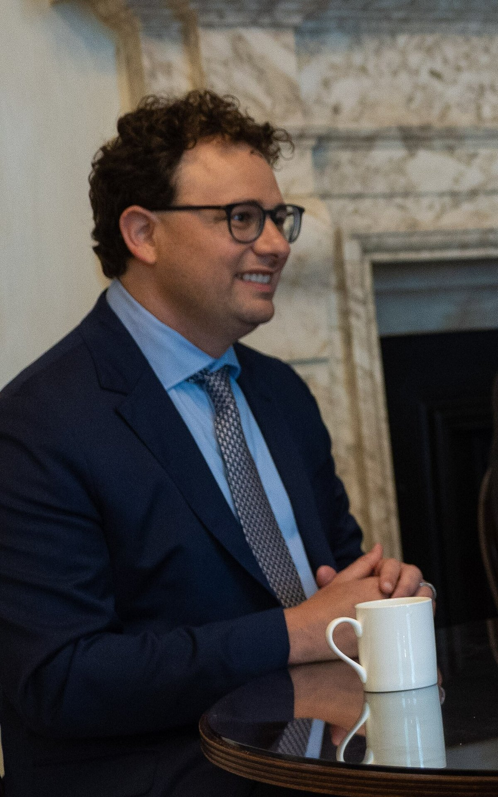
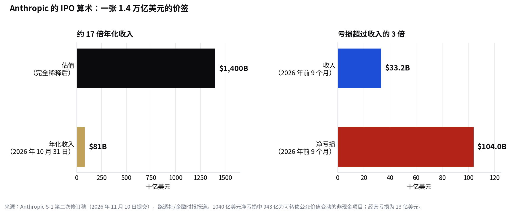

> [English version](/life/anthropic-ipo-priced-70-78/)

*Anthropic 联合创始人兼 CEO Dario Amodei，2023 年。照片：英国首相府，来自 Wikimedia Commons（CC BY 2.0）。*

**更新：** 本文是 11 月 10 日帖子 [Anthropic 发布更便宜更快的 Fable 5.2——万亿美元 IPO 路演启动](/life/anthropic-claude-fable-5-2-ipo-roadshow-zh/) 的后续，那篇讲了模型发布和路演启动。新进展是已提交的定价：以下数字来自 Anthropic 于 11 月 10 日提交的 S-1 第二次修订稿。

## 发生了什么

11 月 10 日，Anthropic 提交了 S-1 的第二次修订稿，封面第一次有了数字。公司预计以**每股 70 至 78 美元**发售 **8.25 亿股 A 类股**，在纳斯达克全球精选市场上市，代码 ANT。其中约 8.0135 亿股来自 Anthropic 自身，约 2365 万股来自售股股东。按区间上限计算，本次发行募资最高约 **644 亿美元**——其中约 625 亿美元归 Anthropic。按区间下限计算，约 578 亿美元。

按上限计算，估值约为完全稀释后 **1.4 万亿美元**，按非稀释口径（发行后 131 亿股流通股）约为 1 万亿美元。金融时报给出的完全稀释估值区间为 1.26–1.41 万亿美元。据路透社和 CNBC 报道，交易预计 **11 月 18 日定价、11 月 19 日开始交易**。这只是预期，不是文件中的承诺——定价区间本身就是估计数，招股书仍待完成。

比估值标题更值得注意的是文件里的两个细节：

**第一，供应商也在买入。** Anthropic 计划以 IPO 价格向自己的供应商定向配售约 **260 亿美元**无投票权 N 类股，买方包括 AMD、博通、谷歌、美光、微软、英伟达和台积电。加上 IPO，总额最高达 904 亿美元。卖给 Anthropic 算力的公司也在给它出资——这本身不是丑闻，但值得警惕：AI 供应链最大的客户与最大的供应商，如今在两个方向上都产生了财务纠缠。

**第二，正式提交的条件比先泄露的版本要小。** 在定价文件提交前几小时，流传给银行家的版本显示约 8.67 亿股、每股 70–80 美元，募资最高约 693 亿美元。据路透社报道，Anthropic 随后发邮件给银行家，称这些数字不准确。正式版本减少了约 4200 万股、上限定价低了 2 美元——按上限计算少了约 50 亿美元。请把 693 亿美元这个数字当作已撤回，而非已确认。

## 五年时间里的这家公司

Anthropic 不是一路漂进这个估值的；它是在 2021 年 1 月，作为与 OpenAI 的一次决裂而成立的。Dario Amodei——OpenAI 前研究副总裁、 scaling laws（规模法则）论文的主要作者——带着妹妹 Daniela 离开，后者曾负责 OpenAI 的安全与政策业务；随行的还有一批资深研究员，包括规模法则背后的物理学家 Jared Kaplan 与 GPT-3 的主工程师 Tom Brown。他们的前提是：这个领域扩张的速度已经超过了它学会控制扩张速度的速度，而安全应当是创立前提、而不是一个附属团队。公司注册为公益公司（public benefit corporation），其标志性研究理念"宪法 AI"（Constitutional AI）——训练模型对照一套成文原则自我批判——于 2022 年 12 月发表。

商业突破是分阶段到来的。2023 年推出的 Claude 系列助手成为旗舰产品；2024 年初的 Claude 3 与随后推出的 Claude 3.5 系列，让它成为 ChatGPT 真正的挑战者。Anthropic 开源了模型上下文协议（Model Context Protocol），它成了全行业工具调用的插拔标准；Claude Code 则成了历史上增长最快的开发者工具之一。值得注意的是收入结构的变化：Anthropic 的收入几乎完全来自 Claude——一端是 Claude.ai 的消费者与企业订阅，另一端是开发者与企业用来构建应用的 Claude API。API 收入的增长尤其关键，因为它意味着 Claude 不再只是一个聊天产品，而是一层基础设施：其他公司的产品建在它上面，转换成本随之上升。这正是年化收入能在 2025 年底到 2026 年初一路爬升的底气——订阅带来现金流，API 带来锁定。

融资紧跟着算力胃口走：2021 年 A 轮 1.24 亿美元；2023 年 5 月谷歌领投 B 轮 4.5 亿美元；同年 9 月亚马逊首笔投资 12.5 亿美元——这笔承诺最终会达到 80 亿美元；2024 年 3 月一轮 27.5 亿美元，估值约 184 亿美元。到 2025 年 3 月，E 轮估值 615 亿美元。二十个月后，公开市场被要求支付约 23 倍的价格。

这条轨迹最引人注目的一点是，其中很大一部分是由 Anthropic 自己的供应商与客户出资的。亚马逊的 80 亿美元让 Claude 成为了 AWS Bedrock 上的旗舰模型，Anthropic 则承诺使用亚马逊的 Trainium 芯片；谷歌投入超过 20 亿美元，同时通过 Google Cloud 提供 Claude。公司由两家云计算对手支持，而这两家既是它的分销渠道、也是它的芯片供应商——而截至本次提交，它们还是它的股东。IPO 没有解开这个结，它只是给这个结定了价。

## 644 亿美元在历史上排第几

这笔交易的规模怎么强调都不为过。人类历史上最大的 IPO 是 SpaceX 在 2026 年 6 月的 750 亿美元。在此之前，纪录是沙特阿美 2019 年的 294 亿美元，再之前是阿里巴巴 2014 年的 250 亿美元。按区间上限计算，Anthropic 的 644 亿美元将是史上第二大 IPO——超过阿美纪录的两倍多，约为 SpaceX 的 86%。加上 260 亿美元的供应商配售，筹资总额达到 904 亿美元，将超过 SpaceX 的纪录。

流通盘对这个规模的交易来说很小。发行后约 131 亿股流通股中发售约 8.25 亿股，流通比例约 6%——与 SpaceX 的 4.2% 相当，远低于阿里巴巴的 14.9%。小流通盘是双刃剑：它把需求集中在有限的股份供应上，上市初期可能支撑价格；但它也意味着价格由一个很薄的市场决定，而第一次限售股解禁的影响会比流通盘大的公司更显著。11 月 18 日与 19 日的市场考验不只是价格能不能站住——而是在只有 6% 的公司流通的情况下能不能站住。

## 算术

文件也更新了价签背后的业务：

- **年化收入约 810 亿美元**（截至 10 月 31 日），一个月内增加 100 亿美元（9 月底约为 710 亿美元）。年化收入是将近期月销售额年化得出的数字，并不意味着 810 亿美元已在完整一年内到账。
- **第三季度收入 169.6 亿美元**，环比增长 47%——强劲，但慢于上一季度 144% 的增幅。第三季度收入增加 54 亿美元，少于第二季度的 68 亿美元：这是第一个新增收入少于上一季度的季度。
- **前 9 个月收入 332.4 亿美元**，同比增长约 1200%。
- **前 9 个月净亏损 1040.4 亿美元。** 这个数字会出现在每条吓人的标题里，但其中 943 亿美元是可转债及类似工具的公允价值变动，文件将其主要归因于公司自身估值的上升——越成功，账面亏损越大。经营亏损，即业务本身，是 **13 亿美元**，低于一年前的 52 亿美元。仅第三季度，经营业绩就从第二季度 9.74 亿美元的盈利转为 5.67 亿美元的亏损。
- **算力承诺近 9000 亿美元**，高于 10 月文件中的约 8000 亿美元。

*Anthropic 的 IPO 算术。来源：Anthropic S-1 第二次修订稿（2026 年 11 月 10 日提交），路透社/金融时报报道。*

## 循环，拆开来讲

260 亿美元的供应商配售值得细看，因为它是这笔交易最不寻常的特征。买方不是被动投资者，而是卖给 Anthropic 芯片与云容量的公司：AMD 与英伟达卖加速器，台积电代工，博通做网络，美光供内存，谷歌与微软提供云基础设施与分销渠道。每一家都以 IPO 价格买入无投票权的 N 类股——持股随 Anthropic 股价涨跌，但没有投票权。

供应商为什么要买客户的股票？最直接的解读是需求信号：通过向 Anthropic 投入 260 亿美元，供应商在告诉市场，那 9000 亿美元的算力承诺是真实的——因为那些必须兑现承诺的人，愿意持有做出承诺的公司的股票。这也是一种锁定机制：持有最大客户股份的供应商，有理由优先处理该客户的订单、给出更好的条件、保持关系的排他性；而 Anthropic 反过来也有理由继续向出资的供应商采购。这套安排短期内统一了激励，长期则集中了激励。

风险在于，同样的统一会在反方向上运转。如果 Anthropic 的需求令人失望，供应商手里拿着一家下跌公司的股票，同时还失去了当初证明这笔投资合理的订单——双重敞口。而循环在估值上也是双向的：供应商愿意以 IPO 价格买入是一种信心投票，但这是来自与价格走势有利害关系的交易方的投票。公开投资者应当把它看作它本来的样子——来自交易对手的战略承诺，而不是独立的价格发现。11 月 18 日与 19 日真正的市场考验，是与 Anthropic 没有商业关系的买家是否愿意付同样的价格。

## 治理上的转折

在 11 月 19 日之前，公开投资者还应当理解第二个结构上的特殊之处。Anthropic 是一家公益公司，其治理结构中包括一个长期受益信托（Long-Term Benefit Trust）——一个独立的监督机构，被设计为防止公司被劫持的保险装置，拥有任命与罢免董事的权力。信托存在的原因是 Anthropic 的创立前提：建造强大 AI 的公司，不应纯粹由股东回报来治理。上市不会取消这个结构；它只是在这个结构之上叠加了公开股东。

实际含义是，购买 A 类股的人买到的是 Anthropic 增长的经济敞口，而不是通常随之而来的控制权。信托、公益公司章程、以及供应商持有的无投票权 N 类股，都指向同一个方向：这是一家被设计为抵抗股东左右的公司。如果你相信 AI 实验室需要与市场压力隔离才能保持安全，这是一个特性；如果你相信上市公司应当对出资人负责，这就是一个风险。无论如何，这不是标准的 IPO 交易，而 1.4 万亿美元的价签，是向一群对接下来发生什么话语权比往常更少的投资者开出的。

把三类股东放在一起看，结构就更清楚了：供应商持有无投票权的 N 类股——有经济利益、没有话语权；长期受益信托持有控制权——有话语权、没有经济利益；公开投资者持有 A 类股——有经济利益、话语权有限。三方各取所需，但没有一方同时拥有"出钱"与"说了算"。这种设计在 AI 实验室里有它的道理：它防止任何一家供应商或任何一批股东把公司拖向短期利益。但它也意味着，当公司犯错时，公开市场最常用的纠错机制——股东投票、董事会改选、激进投资者介入——在这里基本失灵。买这只股票，等于相信管理层与信托会自我纠错。

## 怎么读这个定价

按完全稀释后约 1.4 万亿美元计算，投资者支付的约为年化收入的 **17 倍**——而这家公司前 9 个月的净亏损超过前 9 个月收入的 3 倍，尽管其中大部分亏损是非现金项目。看多的理由是轨迹：收入三年增长约 400 倍，经营亏损从 52 亿美元收窄至 13 亿美元，2025 年初每 1 美元收入要花 2.51 美元在算力和基础设施上，到 2026 年第二季度已降至 0.48 美元。看空的理由是减速：每季度新增收入已掉头向下，第三季度经营业绩重新转为亏损，而 9000 亿美元的算力承诺赌的是需求会持续复合增长。

还有一个值得注意的估值锚。靠给公司估值谋生的 Aswath Damodaran 在拿到第三季度数据后更新了他的数字：1.45 万亿美元——略高于提交区间的上限。市场的真正考验在 11 月 18 日和 19 日：如果发行价落在区间上限并且站得住，1.4 万亿美元就是一个价格，而不是一个推销口号。如果定价低于区间，故事就变成 Anthropic 的供应商愿意付的钱与公开市场投资者愿意付的钱之间的差距。

做个对照：Anthropic 在 2026 年 2 月融资时的估值为 3800 亿美元。九个月后，公开市场被要求支付约 3.5 倍的价格——买的是一家同时是 AI 行业最可信的 OpenAI 挑战者、也是最昂贵的问号的公司。

## 如果定价低于区间，会发生什么

值得为 11 月 18 日准备一个失败剧本：如果发行价落在 70 美元以下，故事会立刻从"史上第二大 IPO"变成"估值泡沫的试金石"。首先遭冲击的是供应商配售：AMD、英伟达、台积电等以 IPO 价格买入的 260 亿美元，会在上市第一天就出现账面浮亏——而这些公司恰恰是 Anthropic 算力承诺的兑现方。其次是员工与早期投资者：期权与可转债的价值与估值挂钩，定价低于区间会直接压缩他们的回报，进而影响人才留存。再次是整个 AI 板块的估值锚：Anthropic 是 2026 年 AI 上市潮的压轴者之一，它的定价会被市场解读为整个行业估值的风向标——如果连年化收入 810 亿美元、季度环比增长 47% 的公司都撑不住 1.4 万亿美元，那么其他 AI 公司的估值假设都要重算。

反过来，如果定价落在区间上限、上市首日还站得住，叙事会完全反转：1.4 万亿美元不再是"一家亏损公司的天价"，而是"市场为 AI 行业第二极定下的价格"。供应商配售会变成一笔划算的投资，9000 亿美元的算力承诺会被解读为增长的底气而非负担，而 Anthropic 将带着充足的弹药进入与 OpenAI 的下一轮模型竞赛。两种结局之间只隔着几美元的发行价——而这正是 IPO 定价日如此值得盯的原因：它不是一次融资，而是一次公投。还有一个值得留意的信号是承销商的态度：如果路演最后几天订单簿超额认购数倍，定价大概率落在上限；如果订单簿勉强覆盖，承销商可能会建议定在区间中部以求稳妥。订单簿的冷热，往往比任何分析师的估值模型都更能预示定价的结果。最后，别忘了 11 月 19 日这个日期本身的含义：那一天，Anthropic 将从一家由亚马逊、谷歌与风险资本支持的私人公司，变成一家由全世界任何人都可以买入的上市公司——而它的治理结构、供应商纠缠与 9000 亿美元承诺，都将在公开市场的聚光灯下接受检验。

还有一个问题值得在定价日之前想清楚：这 9000 亿美元的算力承诺，到底是谁的负债？从会计上说，它是 Anthropic 的承诺；但从商业现实看，它同时也是供应商的订单簿、云厂商的收入预期、以及整个 AI 供应链的增长假设。如果需求继续复合增长，承诺就是护城河；如果需求放缓，承诺就会变成整个链条上所有人的问题。1.4 万亿美元的估值，本质上是对"需求会一直复合增长"这个单一假设的定价——而这个假设，正是 11 月 18 日市场要投票表决的东西。

*本文数字均来自 Anthropic 已提交的 S-1 第二次修订稿（2026 年 11 月 10 日），据路透社、金融时报和 CNBC 报道，为截至 2026 年 11 月 13 日（美西时间）的快照。发行在定价之前均未最终确定。*

## 来源

- Anthropic S-1 第二次修订稿，2026 年 11 月 10 日提交，据路透社、金融时报与 CNBC 报道（8.25 亿股 A 类股，每股 70–78 美元；募资最高 644 亿美元；完全稀释后估值约 1.4 万亿美元；向 AMD、博通、谷歌、美光、微软、英伟达、台积电定向配售 260 亿美元无投票权 N 类股；年化收入约 810 亿美元；第三季度收入 169.6 亿美元；前 9 个月收入 332.4 亿美元；前 9 个月净亏损 1040.4 亿美元；经营亏损 13 亿美元；算力承诺近 9000 亿美元；11 月 18 日定价、11 月 19 日交易）。
- 路透社，2026年11月（流传给银行家的版本约 8.67 亿股、每股 70–80 美元，募资最高 693 亿美元，后经 Anthropic 邮件撤回）。
- Geschichte der Informatik / Press Farm / Bybit / Crows-Eye / ABHS，2026年（2021 年 1 月由 Dario 与 Daniela Amodei 及离开 OpenAI 的研究员创立；公益公司；宪法 AI，2022 年 12 月；Claude 3，2024 年初；模型上下文协议开源；Claude Code；长期受益信托；收入几乎完全来自 Claude，渠道为 Claude.ai 订阅与 Claude API；A 轮 1.24 亿美元，2021 年；B 轮 4.5 亿美元，谷歌领投，2023 年 5 月；亚马逊 2023 年 9 月首笔 12.5 亿美元、总计 80 亿美元；D 轮 27.5 亿美元，2024 年 3 月，估值约 184 亿美元；E 轮 615 亿美元，2025 年 3 月；谷歌投入超 20 亿美元）。
- RList / Yuki Capital / BigGo Finance，2026年（史上最大 IPO：SpaceX 750 亿美元，2026 年 6 月；沙特阿美 294 亿美元，2019 年；阿里巴巴 250 亿美元，2014 年；Anthropic 流通盘约 6%，阿里巴巴 14.9%、阿美 1.7%、SpaceX 4.2%）。

[END EXTERNAL CONTENT: source=file file=~/workspace/stage/anthropic-ipo-priced-70-78/article-zh.md tool_name=read]
