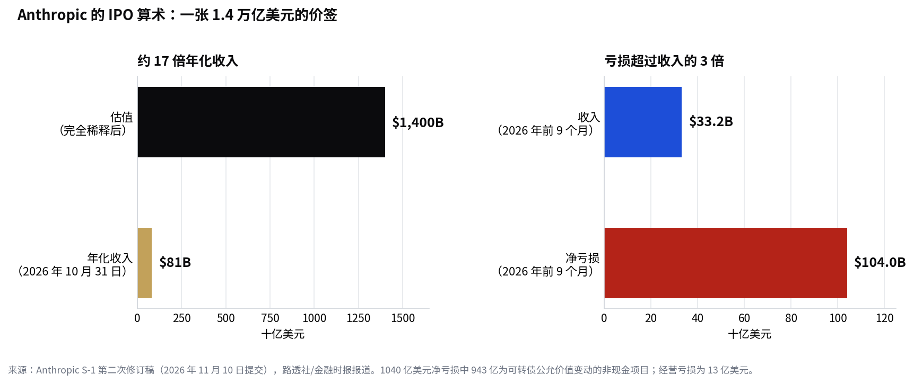

> [English version](/life/anthropic-ipo-priced-70-78/)

*Anthropic 联合创始人兼 CEO Dario Amodei，2023 年。照片：英国首相府，来自 Wikimedia Commons（CC BY 2.0）。*

**更新：** 本文是 11 月 10 日帖子 [Anthropic 发布更便宜更快的 Fable 5.2——万亿美元 IPO 路演启动](/life/anthropic-claude-fable-5-2-ipo-roadshow-zh/) 的后续，那篇讲了模型发布和路演启动。新进展是已提交的定价：以下数字来自 Anthropic 于 11 月 10 日提交的 S-1 第二次修订稿。

## 发生了什么

11 月 10 日，Anthropic 提交了 S-1 的第二次修订稿，封面第一次有了数字。公司预计以**每股 70 至 78 美元**发售 **8.25 亿股 A 类股**，在纳斯达克全球精选市场上市，代码 ANT。其中约 8.0135 亿股来自 Anthropic 自身，约 2365 万股来自售股股东。按区间上限计算，本次发行募资最高约 **644 亿美元**——其中约 625 亿美元归 Anthropic。按区间下限计算，约 578 亿美元。

按上限计算，估值约为完全稀释后 **1.4 万亿美元**，按非稀释口径（发行后 131 亿股流通股）约为 1 万亿美元。金融时报给出的完全稀释估值区间为 1.26–1.41 万亿美元。据路透社和 CNBC 报道，交易预计 **11 月 18 日定价、11 月 19 日开始交易**。这只是预期，不是文件中的承诺——定价区间本身就是估计数，招股书仍待完成。

比估值标题更值得注意的是文件里的两个细节：

**第一，供应商也在买入。** Anthropic 计划以 IPO 价格向自己的供应商定向配售约 **260 亿美元**无投票权 N 类股，买方包括 AMD、博通、谷歌、美光、微软、英伟达和台积电。加上 IPO，总额最高达 904 亿美元。卖给 Anthropic 算力的公司也在给它出资——这本身不是丑闻，但值得警惕：AI 供应链最大的客户与最大的供应商，如今在两个方向上都产生了财务纠缠。

**第二，正式提交的条件比先泄露的版本要小。** 在定价文件提交前几小时，流传给银行家的版本显示约 8.67 亿股、每股 70–80 美元，募资最高约 693 亿美元。据路透社报道，Anthropic 随后发邮件给银行家，称这些数字不准确。正式版本减少了约 4200 万股、上限定价低了 2 美元——按上限计算少了约 50 亿美元。请把 693 亿美元这个数字当作已撤回，而非已确认。

## 算术

文件也更新了价签背后的业务：

- **年化收入约 810 亿美元**（截至 10 月 31 日），一个月内增加 100 亿美元（9 月底约为 710 亿美元）。年化收入是将近期月销售额年化得出的数字，并不意味着 810 亿美元已在完整一年内到账。
- **第三季度收入 169.6 亿美元**，环比增长 47%——强劲，但慢于上一季度 144% 的增幅。第三季度收入增加 54 亿美元，少于第二季度的 68 亿美元：这是第一个新增收入少于上一季度的季度。
- **前 9 个月收入 332.4 亿美元**，同比增长约 1200%。
- **前 9 个月净亏损 1040.4 亿美元。** 这个数字会出现在每条吓人的标题里，但其中 943 亿美元是可转债及类似工具的公允价值变动，文件将其主要归因于公司自身估值的上升——越成功，账面亏损越大。经营亏损，即业务本身，是 **13 亿美元**，低于一年前的 52 亿美元。仅第三季度，经营业绩就从第二季度 9.74 亿美元的盈利转为 5.67 亿美元的亏损。
- **算力承诺近 9000 亿美元**，高于 10 月文件中的约 8000 亿美元。

*Anthropic 的 IPO 算术。来源：Anthropic S-1 第二次修订稿（2026 年 11 月 10 日提交），路透社/金融时报报道。*

## 怎么读这个定价

按完全稀释后约 1.4 万亿美元计算，投资者支付的约为年化收入的 **17 倍**——而这家公司前 9 个月的净亏损超过前 9 个月收入的 3 倍，尽管其中大部分亏损是非现金项目。看多的理由是轨迹：收入三年增长约 400 倍，经营亏损从 52 亿美元收窄至 13 亿美元，2025 年初每 1 美元收入要花 2.51 美元在算力和基础设施上，到 2026 年第二季度已降至 0.48 美元。看空的理由是减速：每季度新增收入已掉头向下，第三季度经营业绩重新转为亏损，而 9000 亿美元的算力承诺赌的是需求会持续复合增长。

还有一个值得注意的估值锚。靠给公司估值谋生的 Aswath Damodaran 在拿到第三季度数据后更新了他的数字：1.45 万亿美元——略高于提交区间的上限。市场的真正考验在 11 月 18 日和 19 日：如果发行价落在区间上限并且站得住，1.4 万亿美元就是一个价格，而不是一个推销口号。如果定价低于区间，故事就变成 Anthropic 的供应商愿意付的钱与公开市场投资者愿意付的钱之间的差距。

做个对照：Anthropic 在 2026 年 2 月融资时的估值为 3800 亿美元。九个月后，公开市场被要求支付约 3.5 倍的价格——买的是一家同时是 AI 行业最可信的 OpenAI 挑战者、也是最昂贵的问号的公司。

*本文数字均来自 Anthropic 已提交的 S-1 第二次修订稿（2026 年 11 月 10 日），据路透社、金融时报和 CNBC 报道，为截至 2026 年 11 月 13 日（美西时间）的快照。发行在定价之前均未最终确定。*
