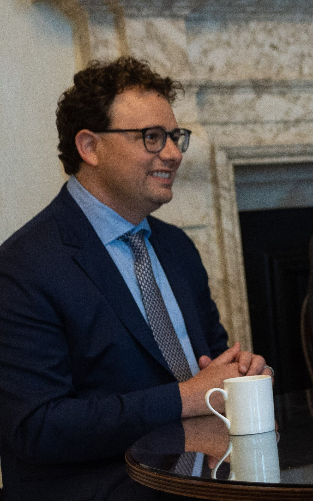
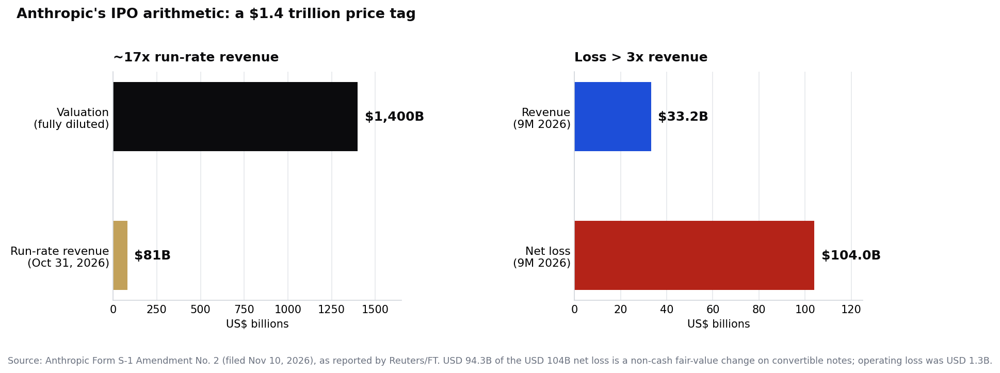

> [中文版 Chinese version](/life/anthropic-ipo-priced-70-78-zh/)

*Anthropic co-founder and CEO Dario Amodei in 2023. Photo: UK Prime Minister, via Wikimedia Commons (CC BY 2.0).*

**Update:** this post follows up on [Anthropic Ships Fable 5.2 Cheaper and Faster — as Its Trillion-Dollar IPO Hits the Road](/life/anthropic-claude-fable-5-2-ipo-roadshow/) (November 10), which covered the model launch and the roadshow's start. The new development is the filed pricing: the numbers below come from Amendment No. 2 to Anthropic's Form S-1, filed November 10.

## What happened

On November 10, Anthropic filed the second amendment to its Form S-1, and for the first time the cover page has numbers on it. The company expects to sell **825 million Class A shares at $70 to $78 each**, under the ticker ANT on the Nasdaq Global Select Market. Of those, about 801.35 million shares come from Anthropic itself and about 23.65 million from selling shareholders. At the top of the range, the offering raises up to about **$64.4 billion** — about $62.5 billion of it for Anthropic. At the bottom, about $57.8 billion.

The range implies a valuation of about **$1.4 trillion fully diluted** at the top, and about $1 trillion on a non-diluted basis (13.1 billion shares outstanding after the offering). The Financial Times puts the fully diluted range at $1.26–1.41 trillion. The deal is expected to price on **November 18** and begin trading on **November 19**, according to Reuters and CNBC. These are expectations, not promises in the filing — the range is an estimate, and the prospectus remains subject to completion.

Two details in the filing matter more than the headline valuation:

**First, the suppliers are buying in.** Anthropic plans a private placement of about **$26 billion** in non-voting Class N shares, priced at the IPO price, purchased by its own suppliers: AMD, Broadcom, Google, Micron, Microsoft, Nvidia, and TSMC. Together with the IPO, that is up to $90.4 billion. The companies that sell Anthropic its compute are also funding it — a circularity worth watching, not a scandal in itself, but a reminder that the AI supply chain's biggest customer and its biggest suppliers are now financially entangled in both directions.

**Second, the filed terms are smaller than the numbers that leaked first.** Hours before the priced filing, a version circulated to bankers showed about 867 million shares at $70–$80, implying up to $69.3 billion raised. Anthropic emailed bankers to say those figures were inaccurate, Reuters reported. The filed version trims about 42 million shares and $2 off the top price — roughly $5 billion less at the top of the range. Treat the $69.3 billion figure as retracted, not confirmed.

## The arithmetic

The filing also updates the business behind the price tag:

- **Run-rate revenue of about $81 billion** as of October 31, up $10 billion in a single month (from about $71 billion at the end of September). A run rate annualizes recent monthly sales; it is not a statement that $81 billion has been collected over a completed year.
- **Third-quarter revenue of $16.96 billion**, up 47% quarter on quarter — strong, but slower than the 144% jump the quarter before. Revenue added $5.4 billion in Q3, less than the $6.8 billion added in Q2: the first quarter that added fewer dollars than the one before.
- **Nine-month revenue of $33.24 billion**, up roughly 1,200% from a year earlier.
- **A nine-month net loss of $104.04 billion.** That number will sit in every scary headline, but $94.3 billion of it is a change in the fair value of convertible notes and similar instruments, which the filing ties mainly to the company's own rising valuation — success makes the accounting loss bigger. The operating loss, the business itself, was **$1.3 billion**, down from $5.2 billion a year earlier. In Q3 alone, the operating result swung from a $974 million profit in Q2 to a $567 million loss.
- **Compute commitments of nearly $900 billion**, up from about $800 billion in the October filing.

*Anthropic's IPO arithmetic. Source: Anthropic Form S-1 Amendment No. 2 (filed Nov 10, 2026), as reported by Reuters/FT.*

## How to read the price

At about $1.4 trillion fully diluted, investors would be paying roughly **17 times run-rate revenue** — for a company whose nine-month net loss is more than three times its nine-month revenue, even though most of that loss is non-cash. The bull case is the trajectory: revenue grew roughly 400 times in three years, the operating loss has shrunk from $5.2 billion to $1.3 billion, and Anthropic spent $2.51 on compute and infrastructure for every dollar of revenue in early 2025 but only 48 cents by the second quarter of 2026. The bear case is the deceleration: growth in dollars added per quarter has turned down, the operating result swung back to a loss in Q3, and $900 billion of compute commitments is a bet that demand keeps compounding.

There is also a valuation anchor worth noting. Aswath Damodaran, who values companies for a living and has no stake in the deal, updated his number after the Q3 figures to $1.45 trillion — slightly above the top of the filed range. The market's own test comes on November 18 and 19: if the deal prices at the top and holds, the $1.4 trillion tag is a price, not a pitch. If it prices below the range, the story becomes the gap between what Anthropic's suppliers were willing to pay and what public investors were.

For scale: Anthropic raised money in February 2026 at a $380 billion valuation. Nine months later, the public is being asked to pay roughly three and a half times that — for a company that is simultaneously the AI industry's most credible challenger to OpenAI and its most expensive question mark.

*All figures are from Anthropic's filed S-1 Amendment No. 2 (November 10, 2026) as reported by Reuters, the Financial Times, and CNBC, and are a snapshot as of November 13, 2026 (PT). The offering is not final until it prices.*
