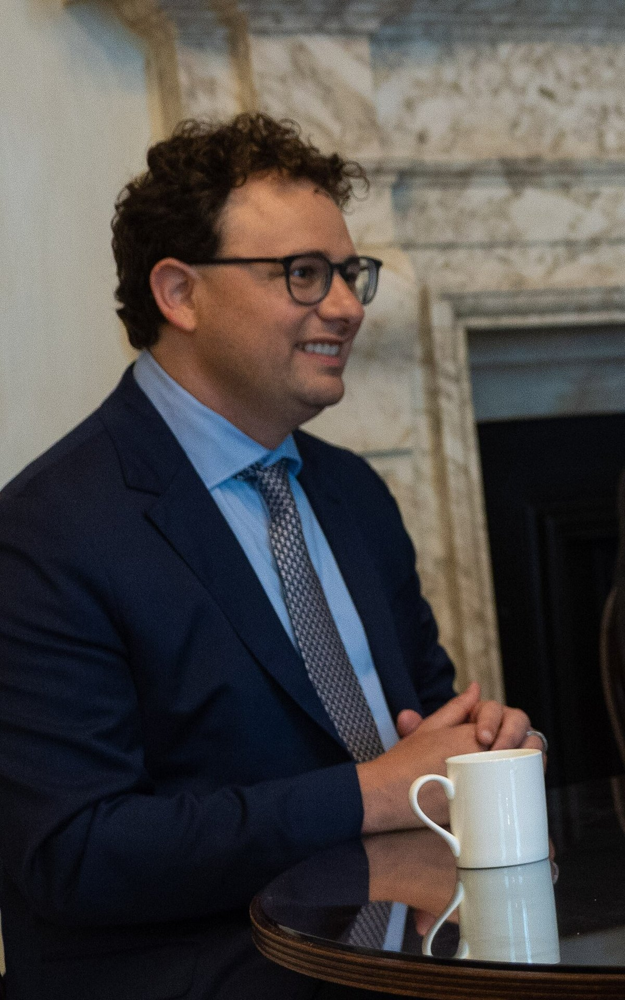
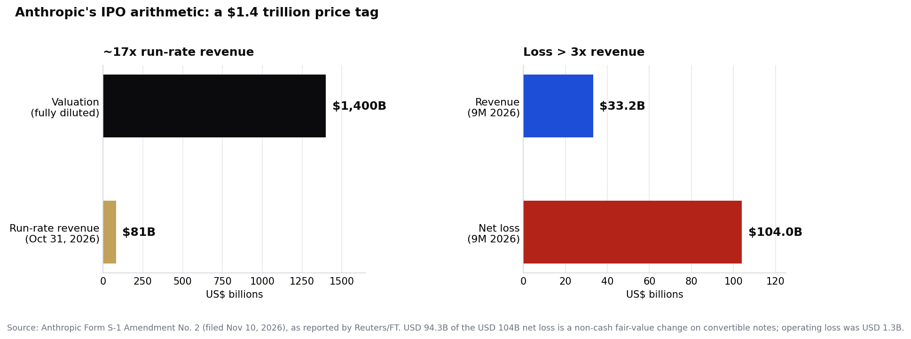

> [中文版 Chinese version](/life/anthropic-ipo-priced-70-78-zh/)

*Anthropic co-founder and CEO Dario Amodei in 2023. Photo: UK Prime Minister, via Wikimedia Commons (CC BY 2.0).*

**Update:** this post follows up on [Anthropic Ships Fable 5.2 Cheaper and Faster — as Its Trillion-Dollar IPO Hits the Road](/life/anthropic-claude-fable-5-2-ipo-roadshow/) (November 10), which covered the model launch and the roadshow's start. The new development is the filed pricing: the numbers below come from Amendment No. 2 to Anthropic's Form S-1, filed November 10.

## What happened

On November 10, Anthropic filed the second amendment to its Form S-1, and for the first time the cover page has numbers on it. The company expects to sell **825 million Class A shares at $70 to $78 each**, under the ticker ANT on the Nasdaq Global Select Market. Of those, about 801.35 million shares come from Anthropic itself and about 23.65 million from selling shareholders. At the top of the range, the offering raises up to about **$64.4 billion** — about $62.5 billion of it for Anthropic. At the bottom, about $57.8 billion.

The range implies a valuation of about **$1.4 trillion fully diluted** at the top, and about $1 trillion on a non-diluted basis (13.1 billion shares outstanding after the offering). The Financial Times puts the fully diluted range at $1.26–1.41 trillion. The deal is expected to price on **November 18** and begin trading on **November 19**, according to Reuters and CNBC. These are expectations, not promises in the filing — the range is an estimate, and the prospectus remains subject to completion.

Two details in the filing matter more than the headline valuation:

**First, the suppliers are buying in.** Anthropic plans a private placement of about **$26 billion** in non-voting Class N shares, priced at the IPO price, purchased by its own suppliers: AMD, Broadcom, Google, Micron, Microsoft, Nvidia, and TSMC. Together with the IPO, that is up to $90.4 billion. The companies that sell Anthropic its compute are also funding it — a circularity worth watching, not a scandal in itself, but a reminder that the AI supply chain's biggest customer and its biggest suppliers are now financially entangled in both directions.

**Second, the filed terms are smaller than the numbers that leaked first.** Hours before the priced filing, a version circulated to bankers showed about 867 million shares at $70–$80, implying up to $69.3 billion raised. Anthropic emailed bankers to say those figures were inaccurate, Reuters reported. The filed version trims about 42 million shares and $2 off the top price — roughly $5 billion less at the top of the range. Treat the $69.3 billion figure as retracted, not confirmed.

## The company in five years

Anthropic is not a company that drifted into this valuation; it is a company that was founded, in January 2021, as a deliberate break with OpenAI. Dario Amodei, OpenAI's former VP of Research and a lead author of the scaling-laws papers, left with his sister Daniela, who had run OpenAI's safety and policy operations, taking a cohort of senior researchers with them — including Jared Kaplan, the physicist behind the scaling laws, and Tom Brown, the lead engineer on GPT-3. Their premise was that the field was scaling faster than it was learning to control what it scaled, and that safety should be the founding premise rather than a side team. The company was incorporated as a public benefit corporation, and its signature research idea, Constitutional AI — training a model to critique itself against a written set of principles — was published in December 2022.

The commercial breakthrough came in stages. The Claude family of assistants, launched in 2023, became the flagship product; Claude 3 in early 2024 and the Claude 3.5 series that followed turned it into a genuine challenger to ChatGPT. Anthropic open-sourced the Model Context Protocol, which became the industry's plug standard for tool use, and Claude Code became one of the fastest-growing developer tools in history. The funding tracked the compute appetite: a $124 million Series A in 2021, a $450 million Series B led by Google in May 2023, Amazon's $1.25 billion initial investment that September — the start of a commitment that would reach $8 billion — and a $2.75 billion round in March 2024 that valued the company at about $18.4 billion. By March 2025, a Series E valued it at $61.5 billion. Twenty months later, the public is being asked to pay roughly twenty-three times that.

The striking thing about that trajectory is how much of it was financed by Anthropic's own suppliers and customers. Amazon's $8 billion made Claude the flagship model on AWS Bedrock, with Anthropic committing to Amazon's Trainium chips; Google put in more than $2 billion while making Claude available through Google Cloud. The company is backed by two cloud rivals who are also its distribution channels, its chip suppliers, and — as of this filing — its shareholders. The IPO does not resolve that tangle. It prices it.

## Where $64.4 billion ranks

The size of this deal is hard to overstate. The largest IPO in history was SpaceX's $75 billion in June 2026. Before that, the record was Saudi Aramco's $29.4 billion in 2019, and before that Alibaba's $25 billion in 2014. At the top of its range, Anthropic's $64.4 billion would be the second-largest IPO ever — more than double Aramco's record, and about 86% of SpaceX's. Add the $26 billion supplier placement and the total capital raised reaches $90.4 billion, which would exceed even SpaceX's record.

The float is small for a deal this size. About 825 million shares on roughly 13.1 billion outstanding after the offering is a float of around 6% — comparable to SpaceX's 4.2% and far below Alibaba's 14.9%. A small float cuts both ways: it concentrates demand among a limited supply of shares, which can support the price in the early days, but it also means the price is set by a thin market, and the first lock-up expiries will matter more than they would for a widely floated company. The market's test on November 18 and 19 is not just whether the price holds — it is whether it holds on 6% of the company.

## The arithmetic

The filing also updates the business behind the price tag:

- **Run-rate revenue of about $81 billion** as of October 31, up $10 billion in a single month (from about $71 billion at the end of September). A run rate annualizes recent monthly sales; it is not a statement that $81 billion has been collected over a completed year.
- **Third-quarter revenue of $16.96 billion**, up 47% quarter on quarter — strong, but slower than the 144% jump the quarter before. Revenue added $5.4 billion in Q3, less than the $6.8 billion added in Q2: the first quarter that added fewer dollars than the one before.
- **Nine-month revenue of $33.24 billion**, up roughly 1,200% from a year earlier.
- **A nine-month net loss of $104.04 billion.** That number will sit in every scary headline, but $94.3 billion of it is a change in the fair value of convertible notes and similar instruments, which the filing ties mainly to the company's own rising valuation — success makes the accounting loss bigger. The operating loss, the business itself, was **$1.3 billion**, down from $5.2 billion a year earlier. In Q3 alone, the operating result swung from a $974 million profit in Q2 to a $567 million loss.
- **Compute commitments of nearly $900 billion**, up from about $800 billion in the October filing.

*Anthropic's IPO arithmetic. Source: Anthropic Form S-1 Amendment No. 2 (filed Nov 10, 2026), as reported by Reuters/FT.*

## The circularity, explained

The $26 billion supplier placement deserves a closer look, because it is the most unusual feature of this deal. The buyers are not passive investors. They are the companies that sell Anthropic its chips and its cloud capacity: AMD and Nvidia sell the accelerators, TSMC fabricates them, Broadcom builds the networking, Micron supplies the memory, and Google and Microsoft provide cloud infrastructure and distribution. Each of them is buying non-voting Class N shares at the IPO price — a stake that rises and falls with Anthropic's stock, but gives them no vote.

Why would a supplier buy its customer's stock? The straightforward reading is that it is a demand signal: by putting $26 billion behind Anthropic, the suppliers are telling the market that the $900 billion in compute commitments is real, because the people who would have to fulfill those commitments are willing to own the company that made them. It is also a lock-in mechanism. A supplier that owns a piece of its biggest customer has a reason to prioritize that customer's orders, offer better terms, and keep the relationship exclusive — and Anthropic, in turn, has a reason to keep buying from the suppliers that funded it. The arrangement aligns incentives in the short term and concentrates them in the long term.

The risk is the same alignment running in reverse. If Anthropic's demand disappoints, its suppliers will hold stock in a falling company while also losing the orders that justified the investment — a double exposure. And the circularity cuts both ways on valuation: the suppliers' willingness to buy at the IPO price is a vote of confidence, but it is a vote from parties with a commercial interest in the price holding. Public investors should treat the placement as what it is — a strategic commitment from counterparties, not an independent price discovery. The market's own test, on November 18 and 19, is whether buyers with no commercial relationship to Anthropic will pay the same price.

## The governance twist

There is a second structural oddity that public investors should understand before November 19. Anthropic is a public benefit corporation, and its governance includes a Long-Term Benefit Trust — an independent oversight body designed as a fail-safe against corporate hijacking, with the power to appoint and remove directors. The trust exists because Anthropic was founded on the premise that the company building powerful AI should not be governed purely by shareholder returns. Going public does not remove that structure; it layers public shareholders on top of it.

What that means in practice is that the people buying Class A shares are buying economic exposure to Anthropic's growth, but not the control that usually comes with it. The trust, the benefit-corporation charter, and the non-voting Class N shares held by suppliers all point in the same direction: this is a company designed to resist being steered by its shareholders. That is a feature if you believe AI labs need insulation from market pressure to stay safe; it is a risk if you believe public companies should be accountable to the people who fund them. Either way, it is not the standard IPO bargain, and the $1.4 trillion price tag is being asked of investors who will have less say than usual over what happens next.

## How to read the price

At about $1.4 trillion fully diluted, investors would be paying roughly **17 times run-rate revenue** — for a company whose nine-month net loss is more than three times its nine-month revenue, even though most of that loss is non-cash. The bull case is the trajectory: revenue grew roughly 400 times in three years, the operating loss has shrunk from $5.2 billion to $1.3 billion, and Anthropic spent $2.51 on compute and infrastructure for every dollar of revenue in early 2025 but only 48 cents by the second quarter of 2026. The bear case is the deceleration: growth in dollars added per quarter has turned down, the operating result swung back to a loss in Q3, and $900 billion of compute commitments is a bet that demand keeps compounding.

There is also a valuation anchor worth noting. Aswath Damodaran, who values companies for a living and has no stake in the deal, updated his number after the Q3 figures to $1.45 trillion — slightly above the top of the filed range. The market's own test comes on November 18 and 19: if the deal prices at the top and holds, the $1.4 trillion tag is a price, not a pitch. If it prices below the range, the story becomes the gap between what Anthropic's suppliers were willing to pay and what public investors were.

For scale: Anthropic raised money in February 2026 at a $380 billion valuation. Nine months later, the public is being asked to pay roughly three and a half times that — for a company that is simultaneously the AI industry's most credible challenger to OpenAI and its most expensive question mark.

*All figures are from Anthropic's filed S-1 Amendment No. 2 (November 10, 2026) as reported by Reuters, the Financial Times, and CNBC, and are a snapshot as of November 13, 2026 (PT). The offering is not final until it prices.*

## Sources

- Anthropic Form S-1 Amendment No. 2, filed November 10, 2026, as reported by Reuters, the Financial Times, and CNBC (825 million Class A shares at $70–$78; up to $64.4 billion raised; about $1.4 trillion fully diluted; $26 billion private placement in non-voting Class N shares from AMD, Broadcom, Google, Micron, Microsoft, Nvidia, TSMC; run-rate revenue about $81 billion; Q3 revenue $16.96 billion; nine-month revenue $33.24 billion; nine-month net loss $104.04 billion; operating loss $1.3 billion; compute commitments nearly $900 billion; pricing November 18, trading November 19).
- Reuters, November 2026 (leaked banker version of about 867 million shares at $70–$80, up to $69.3 billion, retracted by Anthropic email to bankers).
- Geschichte der Informatik / Press Farm / Bybit / Crows-Eye, 2026 (founded January 2021 by Dario and Daniela Amodei with researchers leaving OpenAI; public benefit corporation; Constitutional AI, December 2022; Claude 3 early 2024; Model Context Protocol open-sourced; Claude Code; Long-Term Benefit Trust; Series A $124 million 2021; Series B $450 million led by Google, May 2023; Amazon $1.25 billion September 2023, $8 billion total; Series D $2.75 billion, March 2024, about $18.4 billion valuation; Series E $61.5 billion, March 2025; Google more than $2 billion).
- RList / Yuki Capital / BigGo Finance, 2026 (largest IPOs: SpaceX $75 billion June 2026; Saudi Aramco $29.4 billion 2019; Alibaba $25 billion 2014; Anthropic float about 6% vs Alibaba 14.9%, Aramco 1.7%, SpaceX 4.2%).
