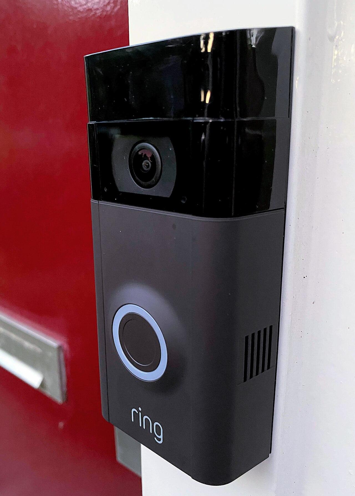
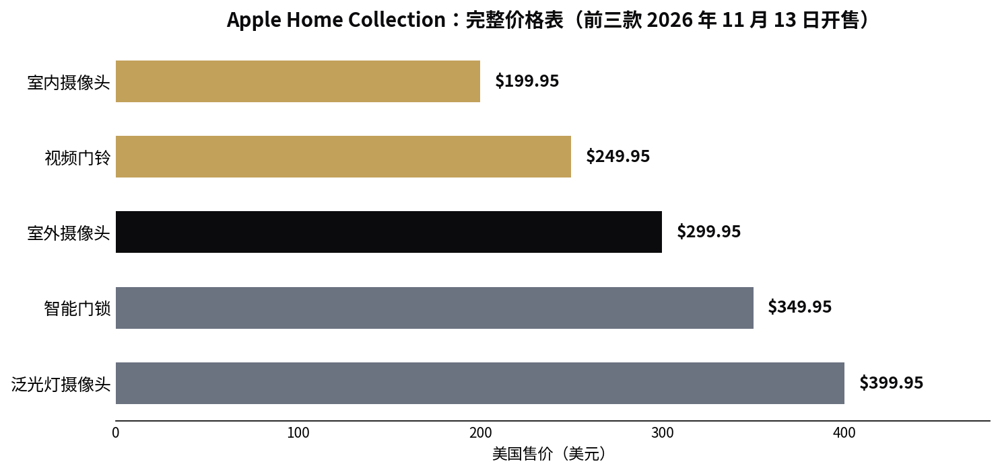

> [English version](/life/apple-home-cameras-roku-exit/)

*视频门铃（图为亚马逊 Ring Video Doorbell 2）——苹果于 11 月 13 日进入的产品品类。照片：Amin，来自 Wikimedia Commons（CC BY-SA 4.0）。*

## 发生了什么

上周，两家公司朝着相反的方向穿过了同一条货架。

11 月 13 日周五，苹果为 **Apple Home Collection** 首批三款配件开订：**LG 视频门铃 249.95 美元**、**LG 室内摄像头 199.95 美元**、**LG 室外摄像头 299.95 美元**，预计 12 月中旬送货。门铃采用双摄像头设计——2.5K 正面视角加一个全高清底部视角，专门看包裹；摄像头则用 Apple Intelligence 识别人脸、宠物与快递。该系列由苹果与 LG、施耐德电气联合开发，卖点是在 Home App 内完成设置，**无需第三方账号或 App**。

两天前的 11 月 11 日，**Roku 确认将全面停售智能家居硬件**——摄像头、视频门铃与智能插座——以聚焦流媒体业务。Roku 于 2022 年 10 月进入该品类；现有设备售完为止，不再生产新品，售后支持继续。消息传出时，距福克斯完成 **220 亿美元收购** Roku（11 月 6 日）仅过去几天。

*Apple Home Collection 价格，截至 2026 年 11 月 13 日所列，价格可能变动。仅前三款可订购；门锁与泛光灯摄像头已定价、稍后供货。来源：9to5Mac；iTechPost。*

## 数字

苹果的完整价格表如今从 **39.95 美元**（传感器）到 **399.95 美元**（LG 泛光灯摄像头），**LG 智能门锁 349.95 美元**。恒温器、室内传感器与智能门锁随后跟进——部分 12 月到货，其余 2027 年初——2027 年前是否还有更多产品开售尚不清楚。

Roku 的退出在市场的另一端留下一个空洞。它的摄像头走的是廉价路线——室内摄像头上市时约 30 美元——到上周只剩两款设备还能买到，其他零售商已经在清仓。整条产品线只活了不到四年。

## 判断：两种不同的生意，廉价那端已有定论

这并不是一家取代另一家。买 30 美元 Roku 摄像头的人，不会转身去买 250 美元的苹果门铃。这周真正显示的是：智能家居摄像头市场已经分化，只有高端那一半看起来还值得做。

苹果赌的是摩擦本身就是产品：不用另注册账号、不用另装 App、人脸识别做进 Home App，硬件由 LG 制造、挂苹果品牌。风险与苹果整个家居推进面临的是同一个——与同一天上市的 HomeView 评测说的一样，Siri AI 仍在 beta、英文限定、功能有限。一款依赖 Apple Intelligence 的门铃，表现只会和 Apple Intelligence 本身一样好，而目前这句话是要打折扣的。

Roku 的退出则把反面的道理说得同样清楚：把便宜硬件卖给之后不再向你付费的人，是门糟糕的生意——尤其当你的东家想要的是流媒体订阅与广告收入时。福克斯买 Roku，可不是为了它的门铃。

真正的较量不是苹果对 Roku，而是苹果对 Ring 与 Nest 的高端之争——在那个价位，买家本来就愿意为门铃花钱，并且指望它与家里的其他设备协同工作。苹果手里有生态这张牌；它有没有软件来兑现这张牌，12 月的送货会给出答案。

*本文价格为截至 2026 年 11 月 13 日所列，可能变动。本文反映截至 2026 年 11 月 16 日上午（太平洋时间）的状态。来源：9to5Mac；Engadget；CEPRO；TheStreet；iTechPost。*
