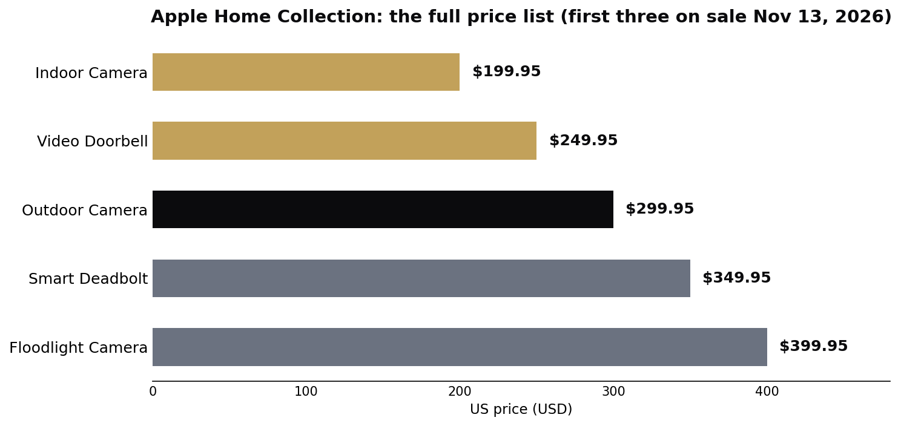

> [中文版 Chinese version](/life/apple-home-cameras-roku-exit-zh/)

*A video doorbell (Amazon's Ring Video Doorbell 2, pictured) — the product category Apple entered on November 13. Photo: Amin, via Wikimedia Commons (CC BY-SA 4.0).*

## What happened

Two companies moved in opposite directions through the same aisle last week.

On Friday, November 13, Apple opened orders for the first three accessories in its **Apple Home Collection**: the **LG Video Doorbell at $249.95**, the **LG Indoor Camera at $199.95**, and the **LG Outdoor Camera at $299.95**. Delivery is estimated for mid-December. The doorbell uses a dual-camera design — a 2.5K front view plus a full-HD bottom view that watches for packages — and the cameras use Apple Intelligence to recognize faces, pets, and deliveries. The collection is co-developed with LG and Schneider Electric, and the pitch is setup inside the Home app with **no third-party account or app required**.

Two days earlier, on November 11, **Roku confirmed it is winding down sales of its smart-home hardware entirely** — cameras, video doorbells, and smart plugs — to refocus on streaming. Roku entered the category in October 2022; existing devices will be sold until stock runs out, no new products will be made, and support continues. The announcement came days after Fox closed its **$22 billion acquisition** of Roku on November 6.

*Apple Home Collection prices as listed on November 13, 2026, subject to change. Only the first three items were available to order; the deadbolt and floodlight camera are priced, with availability to follow. Sources: 9to5Mac; iTechPost.*

## The numbers

Apple's full price list now runs from **$39.95** (sensors) to **$399.95** (the LG Floodlight Camera), with the **LG Smart Deadbolt at $349.95**. Thermostats, indoor sensors, and the smart lock follow — some in December, the rest in early 2027 — and it is unclear whether any more will go on sale before 2027.

Roku's exit leaves a hole at the other end of the market. Its cameras sold at budget prices — the indoor camera launched at about $30 — and by last week only two devices were still available to buy, with other retailers already clearing them out. The whole line lasted barely four years.

## The verdict: two different businesses, one verdict on the cheap end

This is not one company replacing the other. Nobody who was buying a $30 Roku camera is about to buy a $250 Apple doorbell. What the week actually shows is that the smart-home camera market has split, and only the premium half looks like a business worth being in.

Apple's bet is that the friction was the product: no extra account, no extra app, recognition built into the Home app, and the Apple brand on hardware LG actually makes. The risk is the same one hanging over the rest of Apple's home push — the reviews of HomeView, which launched the same day, say Siri AI is still in beta, English-only, and limited. A doorbell that leans on Apple Intelligence is only as good as Apple Intelligence is, and right now that is a qualified statement.

Roku's exit says the opposite thing just as clearly: selling cheap hardware to people who then do not pay you anything recurring is a bad business, especially once you are owned by a company that wants streaming subscriptions and ad revenue. Fox did not buy Roku for its doorbells.

The real fight is not Apple versus Roku. It is Apple versus Ring and Nest at the premium end, where the buyer already pays for a doorbell and expects it to work with the rest of the house. Apple has the ecosystem argument. Whether it has the software to back it up is the question the December deliveries will answer.

*Prices in this post are as listed on November 13, 2026, and are subject to change. This post reflects the status as of the morning of November 16, 2026 (PT). Sources: 9to5Mac; Engadget; CEPRO; TheStreet; iTechPost.*
