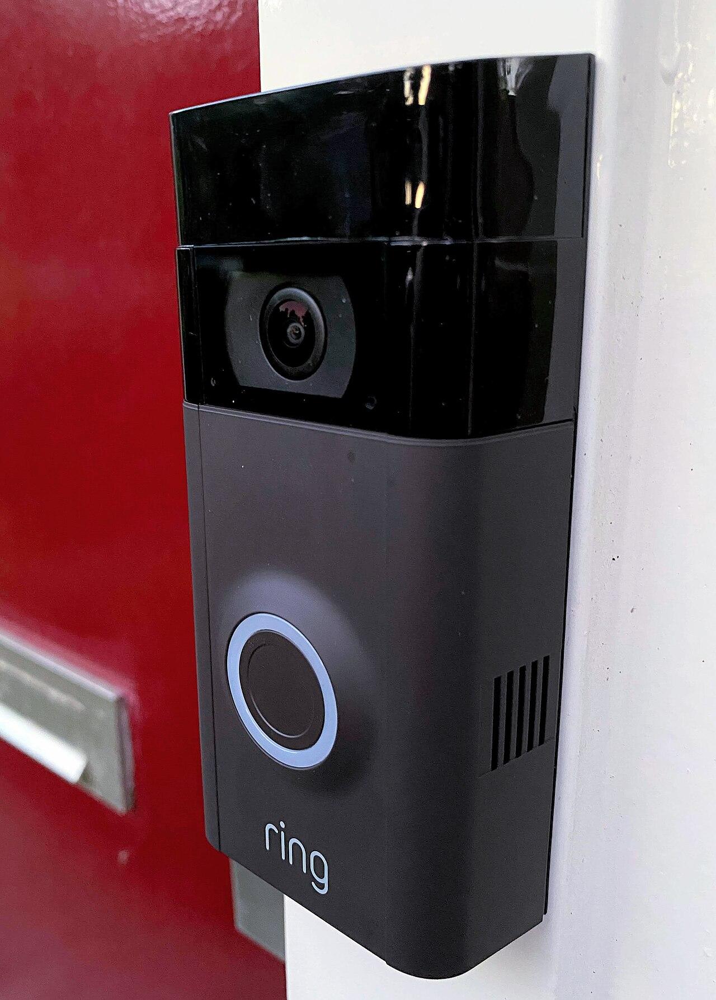

> [中文版 Chinese version](/life/apple-home-cameras-roku-exit-zh/)

*A video doorbell (Amazon's Ring Video Doorbell 2, pictured) — the product category Apple entered on November 13. Photo: Amin, via Wikimedia Commons (CC BY-SA 4.0).*

## What happened

Two companies moved in opposite directions through the same aisle last week.

On Friday, November 13, Apple opened orders for the first three accessories in its **Apple Home Collection**: the **LG Video Doorbell at $249.95**, the **LG Indoor Camera at $199.95**, and the **LG Outdoor Camera at $299.95**. Delivery is estimated for mid-December. The doorbell uses a dual-camera design — a 2.5K front view plus a full-HD bottom view that watches for packages — and the cameras use Apple Intelligence to recognize faces, pets, and deliveries. The collection is co-developed with LG and Schneider Electric, and the pitch is setup inside the Home app with **no third-party account or app required**.

Two days earlier, on November 11, **Roku confirmed it is winding down sales of its smart-home hardware entirely** — cameras, video doorbells, and smart plugs — to refocus on streaming. Roku entered the category in October 2022; existing devices will be sold until stock runs out, no new products will be made, and support continues. The announcement came days after Fox closed its **$22 billion acquisition** of Roku on November 6.

*Apple Home Collection prices as listed on November 13, 2026, subject to change. Only the first three items were available to order; the deadbolt and floodlight camera are priced, with availability to follow. Sources: 9to5Mac; iTechPost.*

## What you're actually buying

The hardware is only half the product; the other half is the subscription and the privacy model, and both are where Apple is drawing its sharpest contrast with the rest of the market.

The three cameras run on **HomeKit Secure Video**, which stores event history through an iCloud+ plan rather than a separate camera subscription. Apple's iCloud+ plans run $0.99 a month for 50 GB (one camera), $2.99 for 200 GB (five cameras), and $9.99 for 2 TB (unlimited cameras). Video is end-to-end encrypted, which means — according to Apple's announcement — neither Apple nor LG can access the footage. That is a genuine difference from Ring and Nest, where the footage lives on the vendor's servers under the vendor's terms, and it is the feature Apple will lean on hardest with buyers who have been uneasy about putting an always-on camera in their home.

The details of the devices fill out the pitch. The doorbell pairs its two cameras with a built-in spotlight and chime. The indoor camera automatically tilts down when you arrive home, pointing itself at the wall as a physical privacy gesture rather than a software promise. Buying all three first-wave devices together runs **$749.85 before tax** and installation, with deliveries estimated between December 14 and 18 — about a week before Christmas, which is plainly the point. The full collection, once it arrives, runs from $39.95 sensors to a $399.95 floodlight camera, with a $349.95 smart deadbolt and $199.95 thermostats from LG and Schneider Electric. Apple has nearly ten accessories planned across the lineup, and one estimate puts a complete setup — display, cameras, lock, thermostat, and cloud recording — above $1,300 before installation.

The cameras did not launch alone. The same day, Apple put its **HomeView** smart display on sale — a $299, 7-inch display with an A18 chip and a camera that recognizes up to six people in the household, with camera and microphone data handled inside what Apple calls Secure Exclaves — alongside a refreshed Apple TV 4K, also $299. The three products together are the home system Apple announced at its "Welcome Home" event on October 13: a display to look at, a TV box to watch on, and cameras to watch the house. The cameras are the piece that turns the display from a gadget into a system.

## Apple has been here before

It is worth remembering that Apple has been circling the smart home for more than a decade. HomeKit launched in 2014 as a framework for other companies' devices, and the original HomePod arrived in 2018 as a speaker that happened to control the house. What changed this year is the posture: instead of certifying other companies' hardware and hoping the experience holds together, Apple is now curating the hardware itself — LG and Schneider Electric make it, Apple designs the experience and sells it in its own stores, and the Home app is the only app involved. The company is betting that the reason the smart home never quite took off for mainstream buyers was not the devices but the friction between them: a different account for every brand, a different app for every room, and a different subscription for every camera.

That bet has an obvious vulnerability, and it showed up on launch day. The reviews of HomeView, which launched the same day, say Siri AI is still in beta, English-only, and limited. A doorbell that leans on Apple Intelligence is only as good as Apple Intelligence is, and right now that is a qualified statement. Apple is selling a premium, integrated experience whose most advertised feature — on-device recognition of faces, pets, and packages — depends on the part of Apple's software stack that is furthest behind its rivals.

## The numbers

Apple's full price list now runs from **$39.95** (sensors) to **$399.95** (the LG Floodlight Camera), with the **LG Smart Deadbolt at $349.95**. Thermostats, indoor sensors, and the smart lock follow — some in December, the rest in early 2027 — and it is unclear whether any more will go on sale before 2027.

Roku's exit leaves a hole at the other end of the market. Its cameras sold at budget prices — the indoor camera launched at about $30 — and by last week only two devices were still available to buy, with other retailers already clearing them out. The whole line lasted barely four years.

The numbers behind Roku's exit are uglier than the announcement. In its last earnings report before joining Fox, Roku said hardware sales were less than $200 million of $1.5 billion in quarterly revenue — and the hardware business posted a gross loss of $48.6 million, more than double the $22.9 million loss a year earlier, which the company attributed largely to higher memory costs. In other words, Roku was losing more money on every camera it sold, in a division that was barely a tenth of its revenue. The retreat had been underway for months before Fox closed its purchase: products had been quietly disappearing from Roku's site and from retailers, and Roku had stopped mentioning the smart-home business in the company description in its quarterly investor communications. The Desk, which first reported the exit, later corrected its own headline to note that the wind-down predated the Fox acquisition — the timing was coincidental, not causal.

Roku's existing customers are in a worse position than the announcement suggests. The company says it will keep supporting the products people already own, but it has not said for how long, whether the paid cloud recording plans continue, or how long warranty and replacement help will last. The camera subscription costs $3.99 per camera per month, or $9.99 a month for all cameras — and there is no migration path: Roku's own support documentation states its smart-home devices cannot be connected to Ring, Nest, SimpliSafe, or any competing service. Owners are also already in court with the company: a class action filed in California federal court in March 2026 alleges Roku quietly removed the Motion Snapshots feature — still images of detected motion sent without a paid subscription — from its cameras in July 2025. As of November 11, Roku has confirmed the exit and nothing else.

## The real fight: Ring and Nest

That is why the real fight is not Apple versus Roku. It is Apple versus Ring and Nest at the premium end, where the buyer already pays for a doorbell and expects it to work with the rest of the house — and where the sticker price is the smallest part of what the buyer actually spends.

The comparison, on 2026 prices, looks like this. Ring's best-regarded doorbell, the Battery Doorbell Pro, costs $229, and its budget model costs $99; Google's wired Nest Doorbell (second generation) costs $179. Apple's doorbell costs $249.95 — the most expensive of the four, but not by a wild margin. The gap opens up in the subscription. Ring Protect costs $3.99 a month per device for recordings; Nest Aware costs $8 a month. Over three years, a $99 Ring doorbell plus its subscription runs about $243, a $229 Ring Pro about $373, and a $179 Nest about $467. Apple's pitch is that its recording lives inside an iCloud+ plan the buyer may already pay for — $0.99 to $9.99 a month, covering one to unlimited cameras — with end-to-end encryption included rather than sold as a tier.

That comparison cuts both ways. Apple's doorbell is wired-only, so it needs existing doorbell wiring where Ring and Nest both sell battery models a renter can install in half an hour. Apple's cameras only work inside the Apple ecosystem, where Ring works with Alexa and Nest with Google Home. And Apple is asking buyers to trust a first-generation product from a company whose home software is, by its own reviewers' account, still in beta. Ring and Nest are asking buyers to trust companies that have been selling doorbells for a decade and whose subscription pricing, whatever its faults, is a known quantity.

## The verdict: two different businesses, one verdict on the cheap end

This is not one company replacing the other. Nobody who was buying a $30 Roku camera is about to buy a $250 Apple doorbell. What the week actually shows is that the smart-home camera market has split, and only the premium half looks like a business worth being in.

Apple's bet is that the friction was the product: no extra account, no extra app, recognition built into the Home app, and the Apple brand on hardware LG actually makes. The risk is the same one hanging over the rest of Apple's home push — the reviews of HomeView, which launched the same day, say Siri AI is still in beta, English-only, and limited. A doorbell that leans on Apple Intelligence is only as good as Apple Intelligence is, and right now that is a qualified statement.

Roku's exit says the opposite thing just as clearly: selling cheap hardware to people who then do not pay you anything recurring is a bad business, especially once you are owned by a company that wants streaming subscriptions and ad revenue. Fox did not buy Roku for its doorbells. What Fox paid $22 billion for was a connected TV operating system in more than 100 million active households, commanding nearly 40 percent of U.S. streaming platform usage, according to Horowitz Research — folded into a new Fox Digital Platforms division alongside Tubi, Fox One, and Red Seat Ventures. The doorbells were never the asset; they were a distraction from it, and one that was losing close to $50 million a quarter.

The real fight is not Apple versus Roku. It is Apple versus Ring and Nest at the premium end, where the buyer already pays for a doorbell and expects it to work with the rest of the house. Apple has the ecosystem argument. Whether it has the software to back it up is the question the December deliveries will answer.

*Prices in this post are as listed on November 13, 2026, and are subject to change. This post reflects the status as of the morning of November 16, 2026 (PT). Sources: 9to5Mac; Engadget; CEPRO; TheStreet; iTechPost; Gadget Review; Popular Science; The Desk; How-To Geek; Tech Times; Top Home Security.*

