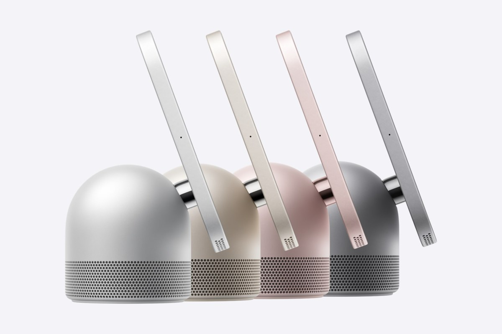
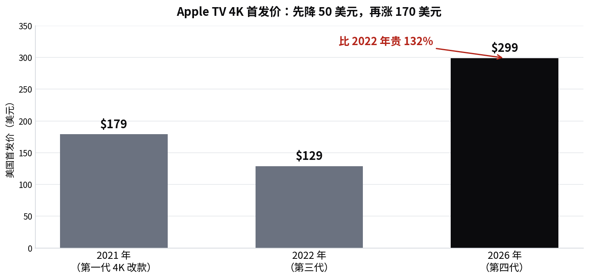

> [English version](/life/apple-homeview-apple-tv-4k-launch/)

*四种配色的 Apple HomeView：银色、星光色、玫瑰粉与深空灰。照片：Apple Newsroom。*

*以下价格为苹果美国官方价，截至发售日 2026 年 11 月 13 日，subject to change。*

## 发了什么

11 月 13 日周五，苹果开售两款客厅设备，美国售价均为 **299 美元**。两者均于 10 月 13 日发布，10 月中旬起接受预订。

**HomeView** 是苹果首款智能家居显示屏：7 英寸 Liquid Retina 屏幕，底座款带穹顶扬声器，另有壁挂款，均为 299 美元，搭载 A18 芯片，以 Siri AI 为核心。它能通过人脸识别区分最多 6 名用户，为每人适配 Messages、FaceTime、日历、提醒事项与"查找"，并配备 1200 万像素 Center Stage 摄像头。在美国、澳大利亚、加拿大、印度、新西兰、新加坡、南非和英国发售，但**不在欧盟销售**，因为 Siri AI 尚未在欧盟的 iOS 上提供。

**Apple TV 4K（第四代）** 是熟悉的电视盒子，芯片与价格都大幅升级：A19 芯片（苹果称 CPU 最快提升 50%、图形性能翻倍）、8GB 内存、Wi-Fi 7、免提 Siri、带 Find My 功能的新 Siri Remote，以及与 HomePod 音箱搭配的四扬声器环绕声。只有一个配置——128GB 存储——售价 299 美元。

苹果还于 11 月 13 日开启了 Apple Home Collection 首批配件的预订：与 LG 合作的两款安防摄像头和一款视频门铃。

## 首批评价：硬件好，Siri 拖后腿

HomeView 的早期评价相当一致：硬件令人印象深刻，软件才是问题。Engadget 给出 **8.4 分（满分 10）**，称赞其设计与音质，同时指出它高度依赖附近的 iPhone 或 iPad，看视频不太行。The MacRumors Show 在使用一周后认为，它的音质介于 HomePod mini 与全尺寸 HomePod 之间——但 7 英寸屏幕实物看起来更小，边框很厚，像"一块大号 Apple Watch"；壁挂款与底座款同价却没有扬声器底座，性价比令人怀疑。

两个限制被反复提到。第一，**HomeView 没有 App Store**——它运行苹果自己的家居应用，第三方音视频应用要通过连接的 iPhone 或 iPad 使用，类似 CarPlay。第二，**Siri AI 仍是 beta 版，发售时仅支持英文**，评测者反映速度与可靠性仍有老问题。在 Joanna Stern 的评测中，Siri AI 即使认出了她的人脸，也拒绝打开车库门或解锁前门；苹果告诉她，12 月的更新会把开锁功能交给 Siri AI。

HomeView 出厂搭载的是六个月前的系统（26.5 版），设置过程中会提示更新到 27.2 版。苹果于 11 月 12 日发布的安全更新修复了 9 个漏洞。

## 价格问题

下面这张图就是关于 Apple TV 4K 的全部论点：

*三代 Apple TV 4K 的美国首发价。来源：苹果；MacRumors。*

上一代起售价 **129 美元**，新款 **299 美元——涨了 170 美元，涨幅 132%**。Engadget 对这款盒子的评价是"依然出色，但比以前贵得多"。A19、Wi-Fi 7 和免提 Siri 都是实打实的升级，但对普通看流媒体的用户来说提升有限，而四扬声器 HomePod 环绕声只有在你已有这些音箱时才有意义。

至少需求是真实的：据 9to5Mac 发售日的核查，两款产品在苹果官网下单，送货都已排到 **12 月第一周**，而大多数 Apple Store 当天可取。亚马逊上 HomeView 多数配色可即时发货。

## 迟到了十二年：一个亚马逊发明的市场

HomeView 是苹果首款智能显示屏，但这个品类已经十二岁了。亚马逊分阶段发明了它：2014 年的 Echo——一个内置 Alexa 的黑色圆柱——把语音控制从手机功能变成了一件家具。Google 在 2016 年跟进，推出 Google Home。屏幕在 2017 年到来，Echo Show 与 Google 的 Home Hub（后来改名 Nest Hub）加上触屏与视频，创造了"智能显示屏"这个子品类。苹果一直在旁观：2018 年推出 HomePod，一款没有屏幕的音箱，把赌注全押在音质上，始终没有做显示屏。十年里，客厅的屏幕属于亚马逊和 Google。

结果是市场极度集中。据发售报道引用的 Parks Associates 数据，亚马逊 Echo 与 Google Nest 合计约占智能音箱与智能显示屏市场的 91%，苹果约占 6%。生态差距更大：Alexa 兼容约 14 万款设备，Google 约 8.5 万款，而 2014 年推出的苹果 HomeKit 只有约 1,000 款。在美国 DIY 智能家居市场，Parks Associates 给出的数据是 Alexa 约 31%、Google Home 约 21%、苹果 HomeKit 约 9%。HomeView 不是走进一间空屋子，而是走进一间两个对手花了十年布线的屋子。

2026 年变化的是助手本身。亚马逊把 Alexa 重建为生成式 AI 的 Alexa+，Prime 会员包含在内，非会员每月 19.99 美元；Google 用 Gemini for Home 取代 Assistant，并在 2026 年 6 月发布了全新的 Home Speaker。苹果的 Siri 大改则多次跳票——这也是它的家居显示屏传闻已久、姗姗来迟的原因。所以 HomeView 不只是苹果的第一块显示屏，它是苹果对一场今年重新开跑的竞赛的回答：三家助手几乎同时围绕生成式 AI 重建。硬件是容易的部分。问题是，最后到达、还是 beta 版的 Siri AI，能不能追上已经在用户家里跑了几个月的另外两个助手。

## 299 美元，放在上下文里看

Apple TV 4K 的价格值得比一张图更长的篇幅，因为这次涨价不只是幅度大——它逆转了十年的方向。第一代 Apple TV 4K 于 2017 年 9 月发售，32GB 售价 179 美元；2021 年 4 月的第二代维持了同样的 179 美元；2022 年 10 月的第三代把起售价砍到 129 美元——那一刻 Apple TV 不再是高端盒子，而成了 plausible 的默认流媒体设备。随后苹果在 2026 年 6 月把同一款 2022 年型号涨价到 64GB 199 美元、128GB 249 美元，硬件没有任何变化：纯涨价。第四代 299 美元、只有一个 128GB 配置，完成了这次逆转。初代 Apple TV 在 2007 年也是 299 美元。十九年后价格回到了原点——但 2007 年那台是没有对手的硬盘媒体中心，而 2026 年这台要和售价只有它十分之一的流媒体棒竞争。

真正重要的比较不是和 2007 年，而是和今天的货架。HomeView 最接近的对手亚马逊 Echo Show 8 约 180–200 美元，Google Nest Hub 约 100 美元。HomeView 的 299 美元比 Echo Show 贵约 50%，几乎是 Nest Hub 的三倍——这还没算订阅的问题。Alexa+ 包含在 Prime 里；Gemini 的深层功能在每月 10 或 20 美元的 Google Home Premium 后面；Siri AI 不额外收费，这是一个真正的优势——但前提是它得好用。9to5Mac 对新款 Apple TV 4K 的评价值得全文引用，因为后半句才是重点：它是市面上最好的流媒体设备，而它的价格限制了它的吸引力。苹果造出了一个品类里最好的产品，而这个品类的价格正是它自己花了四年时间变得亲民、然后又变贵的。

还有一个改变价值计算的细节。Siri AI 也会来到 2021 年的第二代和 2022 年的第三代 Apple TV 4K——只有免提麦克风是新硬件独占的。拥有任意一款旧盒子的用户，大部分软件体验可以免费获得。A19、Wi-Fi 7 和 HomePod 环绕声仍是新盒子独有的，但那是家庭影院发烧友在意的升级，而不是在电视上看流媒体的人在意的。换句话说，299 美元买的不是 Siri AI 的未来——那个未来正在免费送给旧盒子。买的是速度和声音。

## Siri AI 要证明什么——以及苹果押上了什么

HomeView 的卖点是"开口说话、事情办成"，整台设备成败取决于这句话在一个普通的星期二是否成立。首批评测的证据以一种特定的方式喜忧参半：失败都不是什么 exotic 的场景。Joanna Stern 的 Siri AI 在认出她的人脸之后，拒绝打开车库门、拒绝解锁前门——这是最基础的智能家居操作，而这台设备的主打功能正是最多六名用户的人脸识别。苹果告诉她，12 月的更新会把开锁功能交给 Siri AI，也就是说发售当天的设备做不到它自己的营销所暗示的事。beta 标签、仅英文、部分功能的每日用量限制，都指向同一个结论：这是一款售价 299 美元、带扬声器的公开测试版。

赌注比一台设备更大。10 月 13 日的"Welcome Home"发布会还推出了第二代 HomePod mini 和 Apple Home Collection——与 LG、施耐德电气合作开发的摄像头、门锁、恒温器与传感器——11 月 13 日开启预订的是两款 LG 安防摄像头和一款视频门铃。在 HomeKit 作为协议、由其他公司搭建体验的十二年之后，苹果现在要自己造中枢、音箱和配件。这是一次战略转向：苹果不再满足于提供标准、让别人拥有体验。但这个转向只有在 Siri AI 成为把这套产品线串起来的东西时才划算。没有一个助手把它们变成"一个家"，HomePod mini 2、HomeView 和一个 LG 门铃就是三笔分开的购买。

欧盟的缺席最能说明这件事有多没完成。HomeView 不在欧盟销售，因为 Siri AI 尚未在当地的 iOS 上提供——监管与上线进度的缺口，让这台设备在发售第一天就缺席了苹果最大的市场之一。苹果没有说什么时候会改变。对美国买家来说，实际影响更窄但真实：11 月买到的设备，是为 12 月及以后的软件付的首付款，而最重要的功能——一个可靠到可以托付前门的语音助手——仍然是一个承诺，不是一个产品。

## 从 HomePod 到 HomeView：苹果客厅路线的十年

要理解 HomeView 为什么是 299 美元，先要理解苹果在客厅里走过的十年弯路。2018 年初代 HomePod 发售时定价 349 美元，卖点是音质——苹果请来专业音频团队调校，相信"最好的音箱"本身就是卖点。市场不买账：349 美元的音箱比 Echo 贵了三倍，而 Siri 在当时连设个多步骤的定时器都费劲。2019 年苹果把价格降到 299 美元，2021 年干脆停产初代 HomePod，只留下 99 美元的 HomePod mini。教训很清楚：客厅里，助手的能力比音箱的音质更重要。

HomePod mini 的成功与失败同样说明问题。它卖得不错，因为它便宜、好看、能当 Thread 边界路由器把 Matter 设备连进 HomeKit，而且 Siri 在它上面只需要做几件简单的事：放音乐、设闹钟、开关灯。但它也把苹果的短板暴露无遗：没有屏幕，意味着它不能显示日历、不能视频通话、不能当厨房的菜谱架——而这些恰恰是 Echo Show 和 Nest Hub 每天被使用的场景。苹果等了八年才补上这块屏幕，等待的代价是整整一代用户已经在亚马逊或 Google 的生态里安了家，灯、锁、摄像头、恒温器全都连在别人的中枢上。

HomeView 的设计处处透着对这段历史的回应。7 英寸屏幕不大——评测者说实物比想象中小、边框厚、像"大号 Apple Watch"——但它的定位很明确：厨房台面与玄关，而不是客厅电视的替代品。底座款带穹顶扬声器，壁挂款同价却没有扬声器，这个定价细节本身就说明苹果还在摸索：它不知道用户更想要一块屏幕，还是一个音箱，于是两个版本卖同一个价，让市场来回答。人脸识别最多六名用户、为每人适配 Messages 与日历，是苹果对"共享设备"这个难题的答案——Echo Show 是全家共用一块屏，HomeView 想让同一块屏在不同人面前变成不同的设备。这个想法是对的，但它成立的前提是识别要快、要准、要让人信任，而这正是 Siri AI 目前最需要证明的部分。

## 隐私与摄像头：一台放在家里的带摄像头的屏幕

HomeView 还有一层别的智能显示屏没有的包袱：它是一台苹果设备，而苹果把隐私当作品牌来卖。一台带 1200 万像素 Center Stage 摄像头、能认出你是谁的屏幕，放在卧室或厨房里，提出的问题比一台电视盒子多得多。苹果的回答是熟悉的那一套：人脸识别数据处理的方式、摄像头指示灯、以及 Siri 比竞争对手更多地在设备端处理。但"熟悉"不等于"已验证"：HomeView 出厂搭载的是六个月前的系统（26.5 版），设置过程中就要更新到 27.2 版，而苹果在 11 月 12 日刚刚发布了一个修复 9 个漏洞的安全更新。一台主打"认出你"的设备，在发售当天就带着已知漏洞清单上市，这不是灾难，但也不是一个让人安心的开场。

对买家来说，隐私问题的实际形态很具体：谁的脸被存下来了？孩子路过镜头时发生了什么？摄像头在你没有叫它的时候在看什么？苹果在 HomeKit Secure Video 上积累的信誉——视频加密后存 iCloud、处理在设备端——是它真正的资产，也是 HomeView 与 Echo Show 最大的区别之一。亚马逊的摄像头有过把视频交给警方、员工查看录像的争议历史；苹果没有。但信誉是借来的，不是买来的：HomeView 必须在未来几个月里证明，一台放在家里的摄像头可以既聪明又安分。如果它做到了，299 美元里有一部分买的是安心；如果它做不到，299 美元买的就是一台放在厨房里的监控器——而没有人会为这个付费。

## 等等党与首发党的选择题

发售第一天就出现的送货排期，其实已经替很多人做了决定。苹果官网两款产品的送货都排到了 12 月第一周，而大多数 Apple Store 当天可取、亚马逊多数配色可即时发货。这意味着首发买家分成了两拨：一拨在店里当场拿走，另一拨在官网下单、等三周。而 12 月的更新——那个承诺把开锁功能交给 Siri AI 的更新——恰好卡在这个等待期的尾巴上。等官网的货送到时，设备开箱后要做的第一件事可能就是升级系统，然后发现它终于能开前门了。

这种时间上的重合，让"现在买还是等等"成了一个真实的选择题，而不是一句套话。现在买的好处是：硬件本身已经得到了评测者的认可，设计与音质没有争议；如果你深度使用苹果生态，HomeView 在厨房台面上的位置今天就空着。等等的好处是：12 月的更新会回答最关键的问题——Siri AI 到底能不能开锁、能不能稳定地执行多步骤指令——而答案会直接决定这台设备是"客厅中枢"还是"昂贵的厨房计时器"。更重要的是，等等不会损失什么：这不是限量发售，亚马逊的货架上一直有货，苹果官网的排期也只是三周。

对 Apple TV 4K 来说，等待的逻辑更强。旧款 2021 与 2022 年型号也会获得 Siri AI，而新款的独占功能只有免提麦克风、A19 与 Wi-Fi 7。没有任何一场发布会或更新会改变这个对比：新盒子的优势是固定的、硬件层面的，而旧盒子的劣势正在被软件更新一点点抹掉。唯一可能改变计算的是价格——如果 2022 款在渠道里降价，或者苹果在假日季调价，299 美元的算术会立刻变得更难看。流媒体盒子历史上最常见的故事就是降价，而这款盒子刚刚经历了它所在品类历史上最大的一次涨价。

还有一个很少有人算的账：如果两件都买，总价是 598 美元。这个数字值得停一下：598 美元可以买一台不错的电视，或者三台 Echo Show 8，或者六台 Nest Hub。苹果的客厅方案不是按"一台设备"来定价的，而是按"一个生态的入场券"来定价的——HomeView 放在厨房、Apple TV 4K 放在客厅、HomePod mini 放在卧室，三台设备加起来接近 700 美元，换来的是一个由 Siri AI 串起来的家。这个算术只对一种人成立：已经深度使用苹果生态、并且相信 Siri AI 会在未来几个月里变好的人。对其他人来说，598 美元的正确答案可能是先买一台 HomeView，或者什么都不买——等 Siri AI 证明了自己，再决定要不要把客厅也交给它。苹果的客厅野心是真实的，但野心不是产品，12 月的更新才是第一场真正的考试。

## 判断：显示屏值得买，盒子要再想想

299 美元这个巧合就是故事本身。苹果把首款智能显示屏和电视盒子定成同一个价，这个定价抬举了 HomeView，却暴露了 Apple TV 4K。一台带扬声器、摄像头和人脸识别的苹果首款显示屏卖 299 美元，可以理解；一台两年前 129 美元的电视盒子现在卖 299 美元，就很难接受了——哪怕里面是 A19。

HomeView 真正的考验不是硬件（评测者都喜欢），而是 Siri AI 是否终于好到能撑起一个房间。目前的证据说还差一点：beta 状态、仅英文、没有 App Store、部分功能有每日用量限制，开锁功能还要等到 12 月。对一款卖点就是"开口说话、事情办成"的设备来说，这是一串奇怪的附带条件。

购买建议很直接。**HomeView** 值得买，如果你深度使用苹果生态、想要一块放在厨房台面的音乐/计时/FaceTime/家居控制屏——而且要买带扬声器的底座款。**Apple TV 4K** 只有在你明确想要 A19、Siri AI 和 HomePod 环绕声时才值得；否则上一代如果还能买到，仍是更值的选择。无论买哪一款，都别从苹果官网下单等送货——发售第一天，12 月的送货窗口就已经摆在那里了。

*本文反映截至 2026 年 11 月 13–14 日（太平洋时间）的发售日状态。评分与送货时间会变化；价格为快照，subject to change。*
