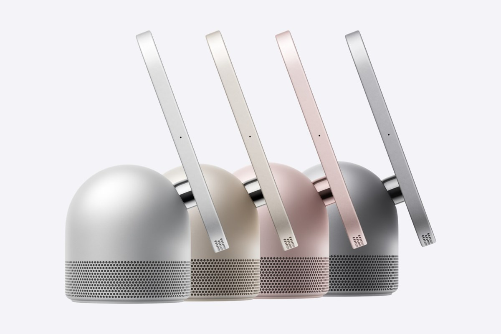
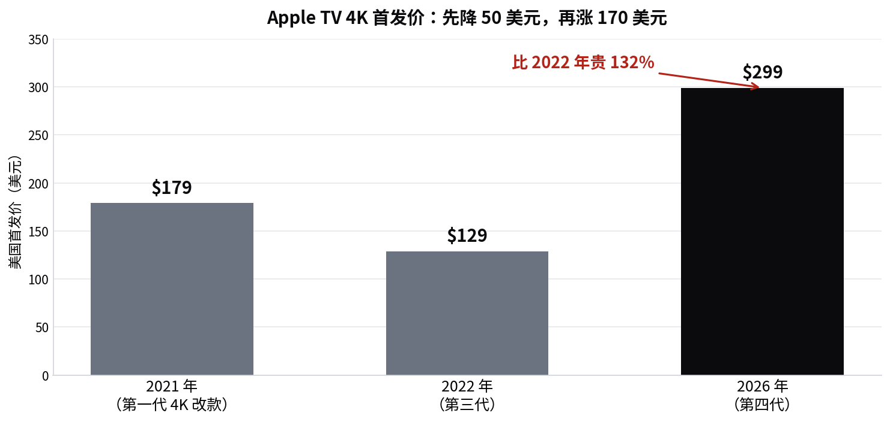

> [English version](/life/apple-homeview-apple-tv-4k-launch/)

*四种配色的 Apple HomeView：银色、星光色、玫瑰粉与深空灰。照片：Apple Newsroom。*

*以下价格为苹果美国官方价，截至发售日 2026 年 11 月 13 日，subject to change。*

## 发了什么

11 月 13 日周五，苹果开售两款客厅设备，美国售价均为 **299 美元**。两者均于 10 月 13 日发布，10 月中旬起接受预订。

**HomeView** 是苹果首款智能家居显示屏：7 英寸 Liquid Retina 屏幕，底座款带穹顶扬声器，另有壁挂款，均为 299 美元，搭载 A18 芯片，以 Siri AI 为核心。它能通过人脸识别区分最多 6 名用户，为每人适配 Messages、FaceTime、日历、提醒事项与"查找"，并配备 1200 万像素 Center Stage 摄像头。在美国、澳大利亚、加拿大、印度、新西兰、新加坡、南非和英国发售，但**不在欧盟销售**，因为 Siri AI 尚未在欧盟的 iOS 上提供。

**Apple TV 4K（第四代）** 是熟悉的电视盒子，芯片与价格都大幅升级：A19 芯片（苹果称 CPU 最快提升 50%、图形性能翻倍）、8GB 内存、Wi-Fi 7、免提 Siri、带 Find My 功能的新 Siri Remote，以及与 HomePod 音箱搭配的四扬声器环绕声。只有一个配置——128GB 存储——售价 299 美元。

苹果还于 11 月 13 日开启了 Apple Home Collection 首批配件的预订：与 LG 合作的两款安防摄像头和一款视频门铃。

## 首批评价：硬件好，Siri 拖后腿

HomeView 的早期评价相当一致：硬件令人印象深刻，软件才是问题。Engadget 给出 **8.4 分（满分 10）**，称赞其设计与音质，同时指出它高度依赖附近的 iPhone 或 iPad，看视频不太行。The MacRumors Show 在使用一周后认为，它的音质介于 HomePod mini 与全尺寸 HomePod 之间——但 7 英寸屏幕实物看起来更小，边框很厚，像"一块大号 Apple Watch"；壁挂款与底座款同价却没有扬声器底座，性价比令人怀疑。

两个限制被反复提到。第一，**HomeView 没有 App Store**——它运行苹果自己的家居应用，第三方音视频应用要通过连接的 iPhone 或 iPad 使用，类似 CarPlay。第二，**Siri AI 仍是 beta 版，发售时仅支持英文**，评测者反映速度与可靠性仍有老问题。在 Joanna Stern 的评测中，Siri AI 即使认出了她的人脸，也拒绝打开车库门或解锁前门；苹果告诉她，12 月的更新会把开锁功能交给 Siri AI。

HomeView 出厂搭载的是六个月前的系统（26.5 版），设置过程中会提示更新到 27.2 版。苹果于 11 月 12 日发布的安全更新修复了 9 个漏洞。

## 价格问题

下面这张图就是关于 Apple TV 4K 的全部论点：

*三代 Apple TV 4K 的美国首发价。来源：苹果；MacRumors。*

上一代起售价 **129 美元**，新款 **299 美元——涨了 170 美元，涨幅 132%**。Engadget 对这款盒子的评价是"依然出色，但比以前贵得多"。A19、Wi-Fi 7 和免提 Siri 都是实打实的升级，但对普通看流媒体的用户来说提升有限，而四扬声器 HomePod 环绕声只有在你已有这些音箱时才有意义。

至少需求是真实的：据 9to5Mac 发售日的核查，两款产品在苹果官网下单，送货都已排到 **12 月第一周**，而大多数 Apple Store 当天可取。亚马逊上 HomeView 多数配色可即时发货。

## 判断：显示屏值得买，盒子要再想想

299 美元这个巧合就是故事本身。苹果把首款智能显示屏和电视盒子定成同一个价，这个定价抬举了 HomeView，却暴露了 Apple TV 4K。一台带扬声器、摄像头和人脸识别的苹果首款显示屏卖 299 美元，可以理解；一台两年前 129 美元的电视盒子现在卖 299 美元，就很难接受了——哪怕里面是 A19。

HomeView 真正的考验不是硬件（评测者都喜欢），而是 Siri AI 是否终于好到能撑起一个房间。目前的证据说还差一点：beta 状态、仅英文、没有 App Store、部分功能有每日用量限制，开锁功能还要等到 12 月。对一款卖点就是"开口说话、事情办成"的设备来说，这是一串奇怪的附带条件。

购买建议很直接。**HomeView** 值得买，如果你深度使用苹果生态、想要一块放在厨房台面的音乐/计时/FaceTime/家居控制屏——而且要买带扬声器的底座款。**Apple TV 4K** 只有在你明确想要 A19、Siri AI 和 HomePod 环绕声时才值得；否则上一代如果还能买到，仍是更值的选择。无论买哪一款，都别从苹果官网下单等送货——发售第一天，12 月的送货窗口就已经摆在那里了。

*本文反映截至 2026 年 11 月 13–14 日（太平洋时间）的发售日状态。评分与送货时间会变化；价格为快照，subject to change。*
