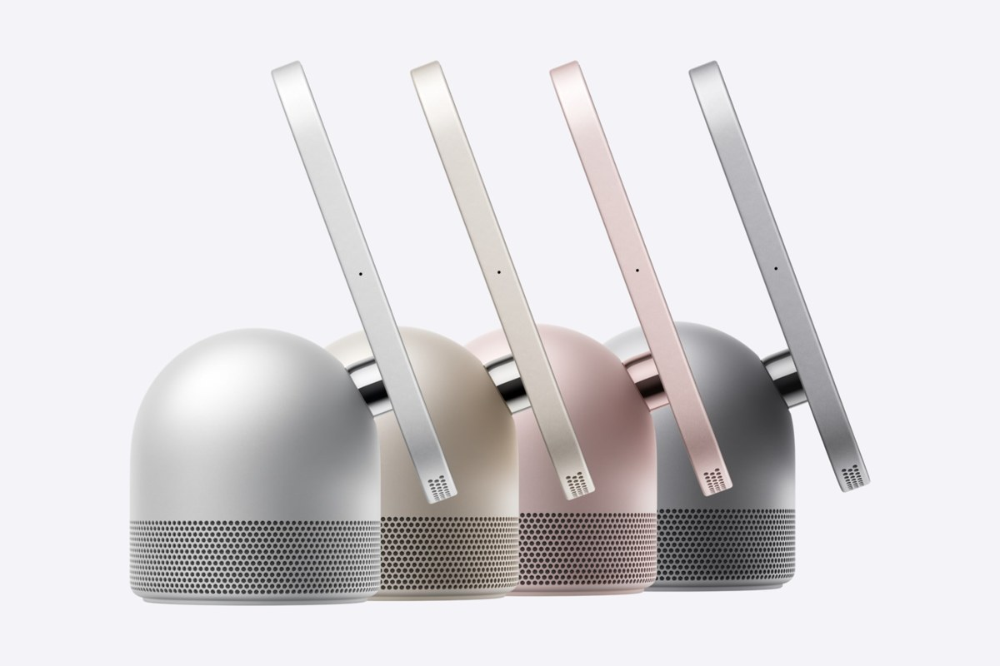
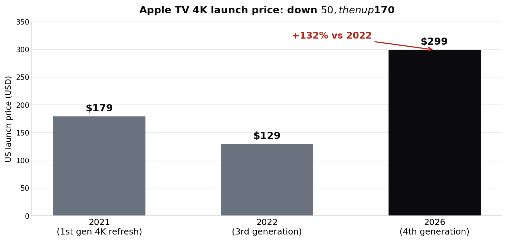

> [中文版 Chinese version](/life/apple-homeview-apple-tv-4k-launch-zh/)

*Apple HomeView in silver, starlight, rose pink, and space gray. Photo: Apple Newsroom.*

*Prices below are Apple's official US prices as of launch day, November 13, 2026, and are subject to change.*

## What launched

On Friday, November 13, Apple put two living-room devices on sale, both priced at **$299** in the US. Both were announced on October 13 and had been on pre-order since mid-October.

**HomeView** is Apple's first smart home display: a 7-inch Liquid Retina screen on a domed speaker base (tabletop) or a wall mount, both $299, running on the A18 chip with Siri AI at the center. It recognizes up to six users by face and adapts to each person's Messages, FaceTime, Calendar, Reminders, and Find My, and it carries a 12MP Center Stage camera. It is on sale in the US, Australia, Canada, India, New Zealand, Singapore, South Africa, and the UK — but **not in the European Union**, because Siri AI is not yet available on iOS there.

**Apple TV 4K (4th generation)** is the familiar streaming box with a much bigger chip and price: the A19 (Apple claims up to 50% faster CPU and up to twice the graphics of the previous model), 8GB of RAM, Wi-Fi 7, hands-free Siri, a new Siri Remote with Find My, and four-speaker surround sound with HomePod speakers. There is only one configuration — 128GB of storage — for $299.

Apple also opened pre-orders on November 13 for the first accessories in its Apple Home Collection: two security cameras and a video doorbell made with LG.

## The first reviews: good hardware, shaky Siri

HomeView's early verdict is consistent across reviewers: the hardware impresses, the software is the question. Engadget gave it **8.4 out of 10**, praising its design and sound, while noting that it depends heavily on a nearby iPhone or iPad and is not great for watching videos. On The MacRumors Show, after a week with the device, the hosts put its sound between the HomePod mini and the full-sized HomePod — but found the 7-inch screen feels smaller in person, with thick bezels that make it look like "a large Apple Watch," and questioned the wall-mounted version, which costs the same $299 but lacks the speaker base.

Two limitations keep coming up. First, **there is no App Store on HomeView** — it runs Apple's own home apps, and third-party audio and video apps work through a connected iPhone or iPad, much like CarPlay. Second, **Siri AI is still in beta, English only at launch**, and reviewers report familiar speed and reliability problems. In Joanna Stern's review, Siri AI refused to open her garage door or unlock her front door even after recognizing her face; Apple told her a December update would extend unlocking to Siri AI.

HomeView also ships with six-month-old software (version 26.5) and prompts an update to version 27.2 during setup. Apple released a security update on November 12 fixing nine vulnerabilities.

## The price problem

The chart below is the whole argument about the Apple TV 4K:

*Apple TV 4K US launch prices by generation. Sources: Apple; MacRumors.*

The previous model started at **$129**. The new one is **$299 — a $170 jump, or 132%**. Engadget's verdict on the box was "still great, but much more expensive than before." The A19, Wi-Fi 7, and hands-free Siri are real upgrades, but for a casual streamer the gains are modest, and the four-speaker HomePod surround feature only pays off if you already own the speakers.

Demand, at least, is real: on launch day, Apple's online store showed delivery backordered to the **first week of December** for both products, according to 9to5Mac's launch-day check, while most Apple Stores had same-day pickup. Amazon had HomeView available for immediate delivery in most colors.

## The verdict: buy the display, think twice about the box

The $299 coincidence is the story. Apple priced its first smart display and its streaming box identically, and that flatters HomeView while exposing the Apple TV 4K. A first-of-its-kind Apple display with a speaker, a camera, and face recognition for $299 is an understandable price; a streaming box that cost $129 two years ago, now at $299, is a much harder sell — even with the A19 inside.

HomeView's real test is not the hardware, which reviewers like, but whether Siri AI is finally good enough to anchor a room. Right now the evidence says not quite: beta status, English only, no App Store, daily usage limits on some features, and a door-unlock feature that arrives in December. That is a strange set of caveats for a device whose entire pitch is "talk to it and things happen."

The buying advice writes itself. **HomeView** is worth it if you live deep in the Apple ecosystem and want a kitchen-counter display for music, timers, FaceTime, and home control — and if you buy the tabletop version, which is the one with the speaker. **Apple TV 4K** is worth it only if you specifically want the A19, Siri AI, and HomePod surround; otherwise the previous model, if you can still find it, remains the value pick. And whichever you buy, order from a store or Amazon rather than Apple's online store — the December delivery window is already here on day one.

*This post reflects launch-day status as of November 13–14, 2026 (PT). Review scores and delivery estimates will move; prices are a snapshot, subject to change.*
