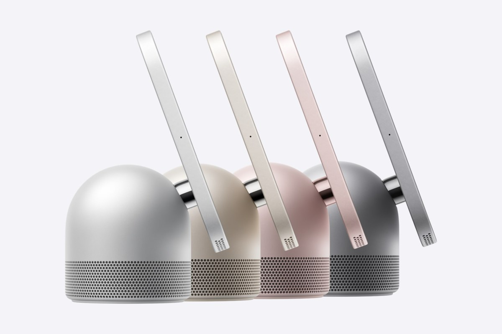
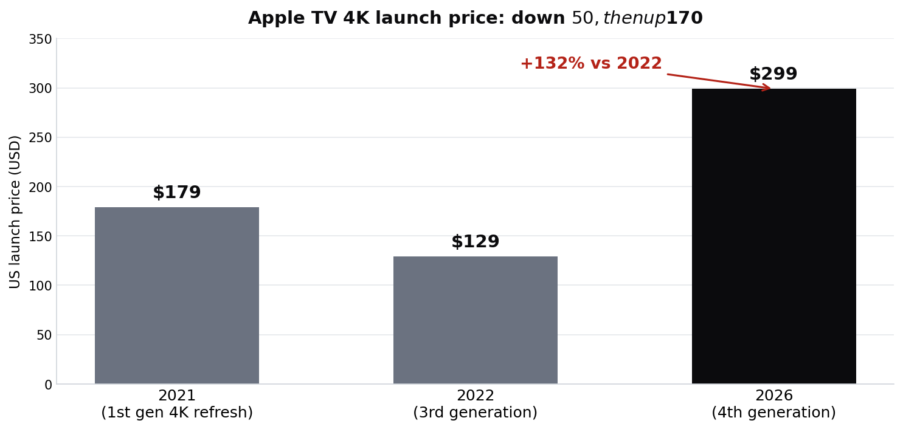

> [中文版 Chinese version](/life/apple-homeview-apple-tv-4k-launch-zh/)

*Apple HomeView in silver, starlight, rose pink, and space gray. Photo: Apple Newsroom.*

*Prices below are Apple's official US prices as of launch day, November 13, 2026, and are subject to change.*

## What launched

On Friday, November 13, Apple put two living-room devices on sale, both priced at **$299** in the US. Both were announced on October 13 and had been on pre-order since mid-October.

**HomeView** is Apple's first smart home display: a 7-inch Liquid Retina screen on a domed speaker base (tabletop) or a wall mount, both $299, running on the A18 chip with Siri AI at the center. It recognizes up to six users by face and adapts to each person's Messages, FaceTime, Calendar, Reminders, and Find My, and it carries a 12MP Center Stage camera. It is on sale in the US, Australia, Canada, India, New Zealand, Singapore, South Africa, and the UK — but **not in the European Union**, because Siri AI is not yet available on iOS there.

**Apple TV 4K (4th generation)** is the familiar streaming box with a much bigger chip and price: the A19 (Apple claims up to 50% faster CPU and up to twice the graphics of the previous model), 8GB of RAM, Wi-Fi 7, hands-free Siri, a new Siri Remote with Find My, and four-speaker surround sound with HomePod speakers. There is only one configuration — 128GB of storage — for $299.

Apple also opened pre-orders on November 13 for the first accessories in its Apple Home Collection: two security cameras and a video doorbell made with LG.

## The first reviews: good hardware, shaky Siri

HomeView's early verdict is consistent across reviewers: the hardware impresses, the software is the question. Engadget gave it **8.4 out of 10**, praising its design and sound, while noting that it depends heavily on a nearby iPhone or iPad and is not great for watching videos. On The MacRumors Show, after a week with the device, the hosts put its sound between the HomePod mini and the full-sized HomePod — but found the 7-inch screen feels smaller in person, with thick bezels that make it look like "a large Apple Watch," and questioned the wall-mounted version, which costs the same $299 but lacks the speaker base.

Two limitations keep coming up. First, **there is no App Store on HomeView** — it runs Apple's own home apps, and third-party audio and video apps work through a connected iPhone or iPad, much like CarPlay. Second, **Siri AI is still in beta, English only at launch**, and reviewers report familiar speed and reliability problems. In Joanna Stern's review, Siri AI refused to open her garage door or unlock her front door even after recognizing her face; Apple told her a December update would extend unlocking to Siri AI.

HomeView also ships with six-month-old software (version 26.5) and prompts an update to version 27.2 during setup. Apple released a security update on November 12 fixing nine vulnerabilities.

## The price problem

The chart below is the whole argument about the Apple TV 4K:

*Apple TV 4K US launch prices by generation. Sources: Apple; MacRumors.*

The previous model started at **$129**. The new one is **$299 — a $170 jump, or 132%**. Engadget's verdict on the box was "still great, but much more expensive than before." The A19, Wi-Fi 7, and hands-free Siri are real upgrades, but for a casual streamer the gains are modest, and the four-speaker HomePod surround feature only pays off if you already own the speakers.

Demand, at least, is real: on launch day, Apple's online store showed delivery backordered to the **first week of December** for both products, according to 9to5Mac's launch-day check, while most Apple Stores had same-day pickup. Amazon had HomeView available for immediate delivery in most colors.

## Twelve years late to a market Amazon invented

HomeView is Apple's first smart display, but the category is twelve years old. Amazon invented it in stages: the Echo, a tall black cylinder with Alexa inside, arrived in 2014 and turned voice control from a phone feature into a piece of furniture. Google followed in 2016 with Google Home. The screen arrived in 2017, when the Echo Show and Google's Home Hub — later renamed the Nest Hub — added touchscreens and video, creating the smart display as a subcategory. Apple watched all of this from the sidelines: it launched the HomePod in 2018, a screen-less speaker that bet everything on sound quality, and never built the display. For a decade, the living-room screen belonged to Amazon and Google.

The market that resulted is brutally concentrated. Amazon's Echo and Google's Nest together hold about 91 percent of the smart speaker and smart display market, according to Parks Associates figures cited in launch coverage, with Apple at about 6 percent. The ecosystem gap is wider still: Amazon's Alexa works with roughly 140,000 devices and Google with about 85,000, against around 1,000 for Apple's HomeKit, which launched in 2014. In the US DIY smart home market, Parks Associates puts Alexa at about 31 percent, Google Home at 21 percent, and Apple HomeKit at about 9 percent. HomeView is not entering an empty room. It is entering a room where two rivals have spent a decade wiring everything in it.

What changed in 2026 is that the assistants themselves changed. Amazon rebuilt Alexa around generative AI as Alexa+, included with Prime or $19.99 a month without it, and Google replaced Assistant with Gemini for Home, shipping an all-new Home Speaker in June 2026. Apple's Siri overhaul slipped more than once — which is also why its home display, long rumoured, arrived late. HomeView is therefore not just Apple's first display; it is Apple's answer to a race that restarted this year, with all three assistants rebuilt around generative AI at roughly the same time. The hardware is the easy part. The question is whether Siri AI, arriving last and in beta, can catch up to two assistants that have already had their rebuilds in customers' homes for months.

## The $299 question, in context

The Apple TV 4K's price deserves a longer look than one chart, because the jump is not just large — it reverses a decade of direction. The first Apple TV 4K launched in September 2017 at $179 for 32GB. The second generation, in April 2021, held the same $179. The third generation, in October 2022, cut the starting price to $129 — the moment Apple TV stopped being a premium box and became a plausible default streamer. Apple then raised that same 2022 model's price in June 2026, to $199 for 64GB and $249 for 128GB, with no hardware change at all: a price increase only. The fourth generation, at $299 for a single 128GB configuration, completes the reversal. The original Apple TV, in 2007, also cost $299. Nineteen years later, the price has come full circle — but the 2007 box was a hard-drive media hub with no competition, and the 2026 box competes with streaming sticks that cost a tenth as much.

The comparison that matters is not with 2007 but with the shelf today. Amazon's Echo Show 8, the closest rival to HomeView, costs about $180–200; Google's Nest Hub costs about $100. HomeView at $299 is roughly 50 percent more than the Echo Show and nearly three times the Nest Hub — and that is before the subscription question. Alexa+ is bundled with Prime; Gemini's deeper features sit behind Google Home Premium at $10 or $20 a month; Siri AI costs nothing extra, which is a genuine advantage, but only if it works. The 9to5Mac review's verdict on the new Apple TV 4K — "the best streamer on the market" — is worth quoting in full, because the next clause is the point: the box is the best streamer, and its price limits its appeal. Apple has built the best version of a product category that its own pricing spent four years making affordable, and then made expensive again.

There is one more detail that changes the value calculation. Siri AI is also coming to the second-generation Apple TV 4K from 2021 and the third-generation model from 2022 — only the hands-free microphones are exclusive to the new hardware. A reader who owns either older box gets most of the software story for free. The A19, Wi-Fi 7, and HomePod surround remain the new box's alone, but they are the kind of upgrades that matter to a home-theatre enthusiast, not to someone who watches streaming services on a television. The $299 price, in other words, is not buying the Siri AI future. That future is being given away to the old boxes. It is buying speed and sound.

## What Siri AI has to prove — and what Apple is betting on it

HomeView's pitch is "talk to it and things happen," and the entire device stands or falls on whether that sentence is true on an ordinary Tuesday. The evidence from the first reviews is mixed in a specific way: the failures are not exotic. Joanna Stern's Siri AI refused to open a garage door or unlock a front door after recognising her face — the most basic smart-home actions, on a device whose headline feature is face recognition for up to six users. Apple told her a December update would extend unlocking to Siri AI, which means the launch-day device cannot do the thing its own marketing implies it can. The beta label, the English-only launch, and the daily usage limits on some features all point the same way: this is a public beta with a $299 price tag and a speaker attached.

The stakes are larger than one device. The October 13 event, "Welcome Home," also introduced a second-generation HomePod mini and the Apple Home Collection — cameras, locks, thermostats, and sensors developed with LG and Schneider Electric — with pre-orders opening November 13 for two LG security cameras and a video doorbell. After twelve years of HomeKit as a protocol that other companies built on, Apple is now building the hub, the speakers, and the accessories itself. That is a strategic turn: Apple is no longer content to supply the standard and let others own the experience. But the turn only pays off if Siri AI becomes the thing that ties the collection together. A HomePod mini 2, a HomeView, and an LG doorbell are three separate purchases until one assistant makes them feel like one home.

The EU absence is the clearest sign of how unfinished this is. HomeView is not sold in the European Union because Siri AI is not yet available on iOS there — a regulatory and rollout gap that also kept the device out of one of Apple's largest markets on day one. Apple has not said when that changes. For a buyer in the US, the practical consequence is narrower but real: the device you buy in November is a down payment on software that arrives in December and beyond, and the most important feature — a voice assistant reliable enough to trust with your front door — is still a promise, not a product.

## The verdict: buy the display, think twice about the box

The $299 coincidence is the story. Apple priced its first smart display and its streaming box identically, and that flatters HomeView while exposing the Apple TV 4K. A first-of-its-kind Apple display with a speaker, a camera, and face recognition for $299 is an understandable price; a streaming box that cost $129 two years ago, now at $299, is a much harder sell — even with the A19 inside.

HomeView's real test is not the hardware, which reviewers like, but whether Siri AI is finally good enough to anchor a room. Right now the evidence says not quite: beta status, English only, no App Store, daily usage limits on some features, and a door-unlock feature that arrives in December. That is a strange set of caveats for a device whose entire pitch is "talk to it and things happen."

The buying advice writes itself. **HomeView** is worth it if you live deep in the Apple ecosystem and want a kitchen-counter display for music, timers, FaceTime, and home control — and if you buy the tabletop version, which is the one with the speaker. **Apple TV 4K** is worth it only if you specifically want the A19, Siri AI, and HomePod surround; otherwise the previous model, if you can still find it, remains the value pick. And whichever you buy, order from a store or Amazon rather than Apple's online store — the December delivery window is already here on day one.

*This post reflects launch-day status as of November 13–14, 2026 (PT). Review scores and delivery estimates will move; prices are a snapshot, subject to change.*
