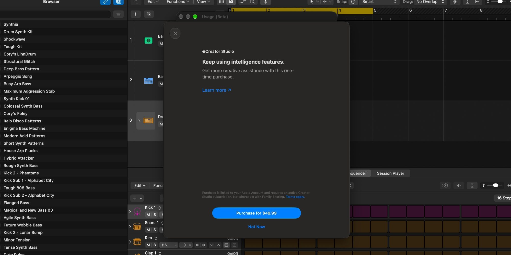
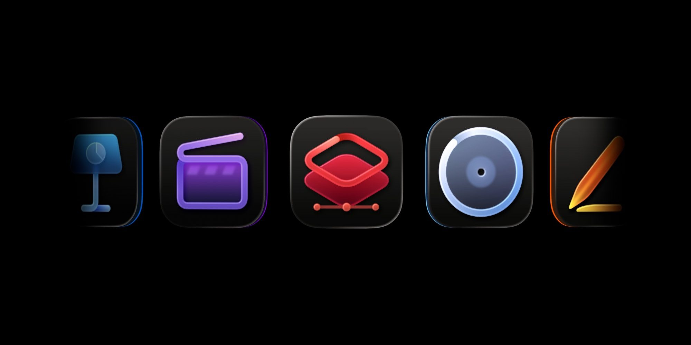
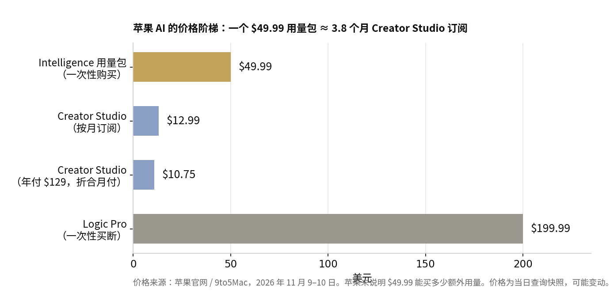

> [English version](/life/apple-intelligence-usage-packs-4999/)

*Logic Pro 里新出现的"Buy More Usage"弹窗，一次性购买 $49.99。截图来源：9to5Mac。*

## 发生了什么

11 月 9 日，9to5Mac 在 Mac 版 Logic Pro 里发现了一个新东西：点开 Logic Pro > Intelligence Features > Show Usage，出现了一个"Buy More Usage"（购买更多用量）按钮。它只卖一样东西：$49.99 一次性购买的"intelligence usage pack"（智能用量包）。The Verge、AppleInsider 和 Engadget 当天都确认了这一消息。

在此之前，苹果设备上的所有 Apple Intelligence 功能都是免费的。苹果早就说过这不会永远持续。这一次，它第一次为"多用一点 AI"标了价。

## 苹果是怎么走到这一步的：免费 AI、借来的模型、和一个一再跳票的 Siri

$49.99 这个包不是凭空冒出来的。它是一条两年弧线的终点：在这条弧线上，苹果承诺了很多，兑现的比承诺的少，又悄悄开始租用自己造不出来的智能。

Apple Intelligence 于 2024 年 6 月在 WWDC 上发布，同年 10 月 28 日随系统更新登陆美国的 iPhone、iPad 和 Mac。第一批功能很朴素：文本摘要、通知归类、一个叫 Genmoji 的生成式表情工具。没有新 Siri。同场 WWDC 上预告的 Siri 大改版——屏幕感知、个人上下文、多步骤应用内操作——原本预计 2025 年初到来，结果一拖再拖，先是几个月，然后是整整一年，推迟到 2026 年春天。在将近两年的时间里，当对手纷纷推出对话式智能体时，苹果的语音助手在功能上基本原地不动。

苹果的应对办法是借。ChatGPT 集成于 2024 年 12 月上线：Siri 可以把复杂问题交给 ChatGPT，写作工具和视觉智能也能调用它。这笔交易是非独家的——苹果拒绝了 OpenAI 提出的两年独家要求——而且 ChatGPT 默认是关闭的，需要多步手动开启。OpenAI 后来表示，这次集成"严重低于"它的预期：它曾预计苹果渠道会成为每年十亿美元级别的订阅收入管道，到 2025 年夏天，它已经下调了新增周活用户的预测。二十亿台活跃苹果设备带来的分发，实际价值比预想的低得多——当一个功能藏在三层菜单之后、默认还是关闭状态时，分发本身就不值钱。

然后是更大的转向。2026 年 1 月 12 日，苹果宣布与谷歌达成协议，在苹果自己的私有云计算（Private Cloud Compute）基础设施上运行一个定制的 1.2 万亿参数 Gemini 模型——据报道这笔交易每年价值约 10 亿美元。这个架构值得留意：因为模型跑在苹果自己的服务器上而不是谷歌云，谷歌看不到用户的查询，这让苹果在事实上承认"最好的大模型来自它在搜索领域最大的对手"的同时，保住了自己的隐私叙事。据报道，苹果在 2025 年年中也曾考虑过用 Anthropic 的 Claude 承担同样的角色，之后才敲定了 Gemini 的交易。

这段历史就是用量包的背景。Apple Intelligence 之所以免费，是因为最初两年它大多跑在设备端或苹果自己的服务器上，规模不大，而昂贵的部分是别人的问题——OpenAI 的免费层级。现在昂贵的部分成了苹果自己的账单：每年约 10 亿美元的 Gemini 协议，再加上 Creator Studio 里那些苹果自己承认跑在 Gemini 和 OpenAI 上的服务器端功能。模型还小、还主要跑在本地的时候，免费是可持续的；当模型变成每次请求都要在数据中心里跑的 1.2 万亿参数大模型时，免费就不可持续了。用量包就是苹果把这笔成本转嫁出来，一次 $49.99 地收——而且先从那些用完额度就没法继续工作的专业用户身上收起。

这里还有第二条更安静的线索。苹果一向喜欢卖硬件、让软件成为买硬件的理由。Apple Intelligence 是这个逻辑最纯粹的版本：一个免费的功能层，让新 iPhone 值得买，本身不带订阅。一旦苹果开始按量计费，这个功能层就不再是硬件卖点，而变成一门有自己损益表的服务。这是一个战略转向，不只是一个价格。它让苹果进入了与 OpenAI 和谷歌相同的生意——按单位卖智能——同时还想继续讲"智能随设备免费附赠"的硬件故事。这两个故事不可能长期同时成立。

## $49.99 能买到什么——和买不到什么

这个包是个充值包，不是订阅。只有当你用完了 Creator Studio 订阅自带的每月 AI 额度之后，它才会开始计费。Creator Studio 订阅是每月 $12.99 或每年 $129，今年 1 月 28 日推出。苹果支持页面列出了每月的最低额度（假设你只用其中一项功能）：生成 50 张图片、250 个形状、50 份 8–10 页的演示文稿，或 700 页幻灯片的演讲者备注。至于 Logic Pro 助手本身，苹果连数字都不给——只说额度"取决于对话的复杂程度"。

而真正该让购买者警惕的是这一条：**苹果没有说明 $49.99 能买多少额外用量。** 包装上没有计量单位。先付钱，用多少以后再说。

其余细则同样一边倒。没用完的用量可以逐月结转，但购买后 12 个月过期。用量包绑定购买时登录 iCloud 的那个 Apple ID——不支持家人共享，尽管 Creator Studio 订阅本身最多可以和另外五个人共享。所有销售均为最终销售，不退款。而且用量包目前只在八个国家出售：美国、英国、加拿大、巴西、法国、德国、印度和墨西哥。

## 先轮到谁

目前只有 Logic Pro 在卖这个包。它随 Logic Pro 13 一起推出，后者于 11 月 5 日周四上架 Mac App Store。9to5Mac 预计，随着苹果本月内陆续推出其余已公布的 Creator Studio 更新，用量包也会进入 Final Cut Pro、Pixelmator Pro、Motion 以及 iWork 套件。

注意这次*还没*波及的人：普通 iPhone 用户。Siri、Image Playground 和照片编辑工具都不在其中。但苹果自己的用量限制页面已经预告，Siri AI 和 Image Playground 等服务器端功能将在 2027 年的软件更新中引入用量限制。Logic Pro 这个包，就是那场全面铺开的试点。

*Creator Studio 包含 Final Cut Pro、Logic Pro、Pixelmator Pro、Motion 等应用。图片来源：9to5Mac。*

还有一个值得点明的讽刺。苹果支持页面写明，Logic Pro 助手、图片生成、形状生成和演讲者备注功能由 **Google Gemini** 驱动，Keynote 的生成演示文稿功能由 **OpenAI** 驱动。苹果在转售它两大 AI 对手的按量计费算力——还要在订阅费之上，向自己的用户再收一笔溢价。

## 价格放在 context 里看

*一个 $49.99 的用量包，差不多等于四个月每月 $12.99 的 Creator Studio 订阅费。价格来源：苹果官网 / 9to5Mac，2026 年 11 月 9–10 日查询快照，可能变动。*

一个包的价格接近四个月 Creator Studio 订阅费，约等于 $129 年付套餐的 40%。它也恰好等于 Pixelmator Pro 一次性买断的价格。对于每月都会撞上限的 Logic Pro 用户，这笔账会越算越难看：订阅费不再是天花板，而变成了地板。

## 为什么苹果不直接涨订阅费

一个自然的问题是：既然 AI 成本上去了，为什么苹果不直接把 Creator Studio 从每月 $12.99 涨到比如 $19.99，而要搞一个用量包？答案藏在订阅经济学的结构里。订阅费是向所有人收的，涨价会同时赶走轻度用户——那些一个月只生成几张图、从来没撞过上限的人，他们为涨价买单却得不到任何好处，流失的恰恰是这批人。而用量包只向重度用户收费，轻度用户完全不受影响。从苹果的角度看，这是最精准的提价方式：它把成本转嫁给了恰好是那些最离不开这个功能的人，而没有惊动沉默的大多数。

这也是为什么这个包看起来"一边倒"。不退款、一年过期、不可共享，每一条都是为了防止用户把一次购买的价值摊薄：退款会让用户先买后试、试完退掉；长期有效会让用户囤积便宜的用量；可共享会让一家人只买一个包。苹果不是在卖一个产品，而是在设计一个只能单向流动的阀门——钱流进来，用量流出去，中间不留任何可以套利的缝隙。理解了这一点，就能理解为什么包里没有计量单位：一个写明了的单位会让用户算账，而算账的用户会比较、会犹豫、会等打折。不写单位，用户就只能凭感觉付费，而感觉在创作中途、赶工期的那一刻是最容易被拿捏的。

对创作者来说，现实的应对不是争论这个设计公不公平，而是把 AI 任务分流。批量生成图片、批量写演讲者备注这类可以排队等的工作，完全可以留到下个月额度刷新之后再做；真正紧急的、卡在创作流程中间的请求，才值得动用量包。更彻底的做法是把一部分工作搬出苹果的围墙：免费层级的聊天应用、开源本地模型、或者按次付费的 API，都可以承担那些不依赖 Logic Pro 工程上下文的任务。原则只有一个：别让一个来路不明的 $49.99 包，成为你工作流里默认的"继续"按钮。每一次点击之前，先问自己这次请求是不是非在 Logic Pro 里完成不可——很多时候答案是否定的。

## "$20 俱乐部"：别人家的 AI 是怎么收费的

把苹果的包放在整个行业旁边看，它显得更奇怪了——因为整个行业已经收敛到了一个苹果至今回避的数字：每月大约 $20，额度写得明明白白，表盘看得见。

ChatGPT Plus 每月 $20。Google AI Pro——也就是以前叫 Gemini Advanced 的那个套餐，2025 年 5 月改名——每月 $19.99，还附带 5TB 存储空间。Claude Pro 每月 $20。这三个都是订阅，不是单次充值，而且都大致告诉你这笔钱买到了什么：比免费版更高的用量上限、更强的模型，谷歌那里还给了一个倍数——AI Pro 的 Gemini 用量大约是免费版的四倍。各家的细节都不算透明——OpenAI 现在按五小时窗口和每周上限来计量高级推理用量，谷歌则按算力而不是简单的消息条数来计量——但交易的结构是清楚的：按月付费、用量更多、上限可见。

苹果的包把这套逻辑的每一环都反了过来。它不是按月、而是一次性；不是额度明确、而是数量未知；不是可共享、而是绑定单个账号；不是可退款、而是最终销售。而且它叠加在订阅之上，而不是替代订阅：你每月付 $12.99 买应用和基础额度，额度用完再付 $49.99。没有对手这样卖 AI，原因很简单——没有对手需要这样卖。OpenAI 和谷歌直接卖智能，所以可以把订阅价格定在能覆盖普通用户推理成本的水平上，重度用户再去买更高档位。苹果卖的是别人的智能、装在自己的订阅里，基础价覆盖不了重度用户，又不能向轻度用户多收。这个包就是为这种错配打的补丁：一个从来就不是为计量而设计的套餐上，外挂了一个计量器。

下面还有一层更便宜的档位，是苹果没有提供的。OpenAI 有每月 $8 的 ChatGPT Go，谷歌有每月 $4.99 的 AI Plus。行业的方向是一座梯子——便宜的入门档、$20 的中档、$100 以上的重度档——让每个用户落在与自己用量匹配的那一级。苹果只有一级，$12.99，底下还有一个 $49.99 的活板门。需要多一点 AI 的 Logic Pro 用户没有 $20 的选项；唯一的升级路径是一次性支付接近月费四倍的钱，买一个数量未知包。这不是梯子，这是一座带收费站的悬崖。

这番比较也重新框定了"免费 AI 时代"。免费层从来就不是一门生意，而是一笔获客成本——在 OpenAI 和 Anthropic 那里由风险投资支付，在谷歌那里由广告和搜索支付。苹果的版本由硬件利润支付：每卖出一台 iPhone，就补贴了每个 iPhone 用户的推理成本。模型还小的时候，这笔补贴行得通；当模型变成在数据中心里跑的 1.2 万亿参数 Gemini、每次请求的成本不再微不足道、请求数量也不再受手机芯片能力约束时，补贴就撑不住了。现在每个厂商都在收敛到同一个答案——按量计费——剩下的争论只是计量器标得有多诚实。在这场争论里，苹果目前是输的。

## 为什么先拿 Logic Pro 开刀——以及计量器为什么最终会落到每个人头上

Logic Pro 不是随机选的试点。选它有三个理由，每一个都预示着下一步的走向。

第一，这里的用户在有用的意义上是被锁住的：音乐人做到一半，额度用完了，没法像换个聊天应用那样换个助手，因为助手就长在工程、会话和混音里面。切换成本就是会话本身。Siri 用户撞上限可以打开 ChatGPT；Logic Pro 用户在编曲中途撞上限，没有等价的退路。苹果在测试计量器的地方，是付费意愿最高、替代品最弱的地方。

第二，这里的用量是尖峰式、职业化的。50 张生成图片或 700 页演讲者备注，对业余爱好者来说是一个月的量，对赶工期的职业音乐人来说可能只是一个下午。上限设得足够低，真正的专业用户一定会撞到它——而这正是试点需要的：如果没有人撞上限，苹果就学不到任何关于价格承受力的东西。上限低不是疏忽，而是实验设计。

第三，Logic Pro 的助手还在测试版，只支持美国英语，需要 macOS 27 和支持 Apple Intelligence 的设备。受众窄、技术化、对粗糙之处比较宽容——是那种会在论坛上抱怨、而不是转投 Windows 的用户。苹果用最不可能因为这场实验而惩罚它的用户，来获取定价数据。

这不是在指责用户，这是在描述测试设计，而测试设计本身就是新闻：苹果正在用成本最低的方式学习，它最忠实的用户愿意忍受多少摩擦。这个答案将决定 Siri 的定价。当 2027 年 Siri AI 和 Image Playground 引入用量限制时，受众将不再是几十万 Logic Pro 用户，而是数亿 iPhone 用户，其中大多数人从没为 AI 付过费，而且一键之遥就有一个免费的对手——ChatGPT、Gemini、Claude。如果 Logic Pro 试点显示专业用户愿意为数量不明的用量付 $49.99，苹果会得出结论：消费者也会付类似的钱。如果试点显示他们不愿意——包卖不出去，专业用户宁可省着用——苹果就必须在 2027 年之前设计出一个看得懂的计量器，否则只能眼睁睁看着用户绕开它。

另一件值得盯的事是家人共享的不对称，因为它预演了消费级的那场仗。Creator Studio 最多可以和另外五个人共享；用量包不行。这不是技术限制，而是刻意的选择——用量包绑定购买时的 Apple ID，苹果本可以把它绑定到家庭组。理由一想就明白：可共享的包会被买一次、分给六个人用，计量器只能收到六分之一的收入；不可共享的包要向家庭里的每个重度用户收全价。等计量器落到 Siri 头上，同样的问题会以家庭规模出现：一个人的包能不能覆盖全家人的 iPhone，还是每台手机都要单独买？苹果在 Logic Pro 里的答案已经表明它选了哪一边，家庭用户不会喜欢这个答案。

值得多看一眼的是那八个国家名单。美国、英国、加拿大、巴西、法国、德国、印度、墨西哥——这不是苹果产品通常首发的名单，也不是 Creator Studio 用户最多的八个市场，而更像是一份"能卖"和"敢卖"的交集：支付体系成熟、AI 服务合规路径相对清晰、且 Gemini 与 OpenAI 的服务在当地可以合法提供的地方。名单里没有中国，没有日本，没有韩国，也没有整个东南亚。对这些地区的创作者来说，用量包连"买不买"的问题都不存在——他们被直接排除在试点之外。而试点一旦扩大，名单的下一批名字会先说明苹果的合规谈判走到了哪一步，其次才说明市场有多大。换句话说，这八个国家既是销售范围，也是一张路线图。

## 判断

苹果正在做每个 AI 厂商最终都会做的事——按量计费。不同之处在于包装：一个在订阅里卖的一次性充值包，用量不公开、不能共享、不能退款、一年过期。这个产品很奇怪，而奇怪本身就是重点。苹果在测试：它最忠实的创作用户在忍受多少摩擦之后，才会轮到其他所有人。

对普通用户来说，现在能做的事很少，但有两件值得做。第一，留意自己每个月到底用了多少 Apple Intelligence 功能——不是凭感觉，而是去设置里看一眼用量页面。等 2027 年计量器真的落到 Siri 头上时，今天的用量习惯就是明天的账单预告，提前知道自己是轻度用户还是重度用户，比到时候再算账要从容得多。第二，别急着为"免费 AI 结束"而焦虑：免费层不会一夜消失，苹果的试点节奏一向是先在专业应用里试水、再向消费级扩散，中间至少隔着一年以上的观察期。真正需要警惕的不是收费本身，而是收费方式——一个不写明单位的包，今天出现在 Logic Pro 里，明天就可能以同样的面目出现在你每天都要用的 Siri 里。

真正值得盯的日期不是今天，而是 2027 年——Siri 和 Image Playground 引入用量限制的时候。届时数亿 iPhone 用户都会看到同一个"Buy More Usage"按钮。他们是会点下去，还是干脆少用 AI，将决定苹果的 AI 业务是一条真正的收入线，还是向自家生态系统收的一笔税。就目前而言，诚实的建议很简单：在苹果说清楚包里有什么之前，别买。

而如果苹果真的说了——如果未来的某份支持页面悄悄补上一个数字，"一个包等于 X 张图片"或"Y 次助手对话"——请把那个数字当作真正的新闻。价格从来不是新闻，计量单位才是。一个看不懂的计量器不是价格，而是一张空白支票，苹果正在请它最忠实的用户先签上字。
