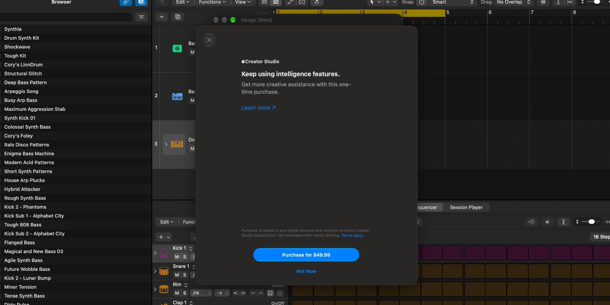
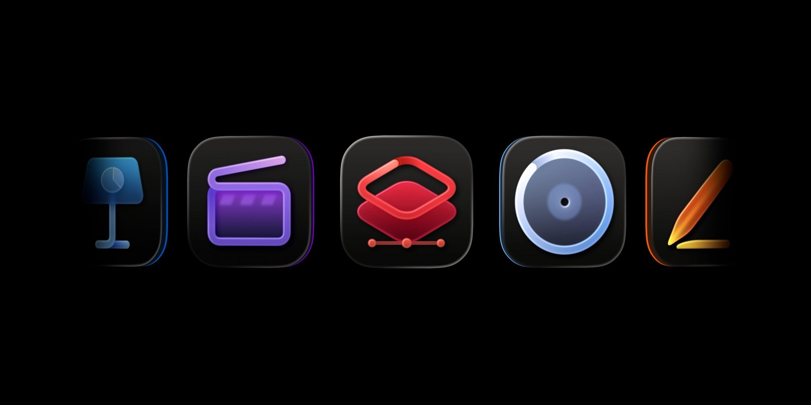
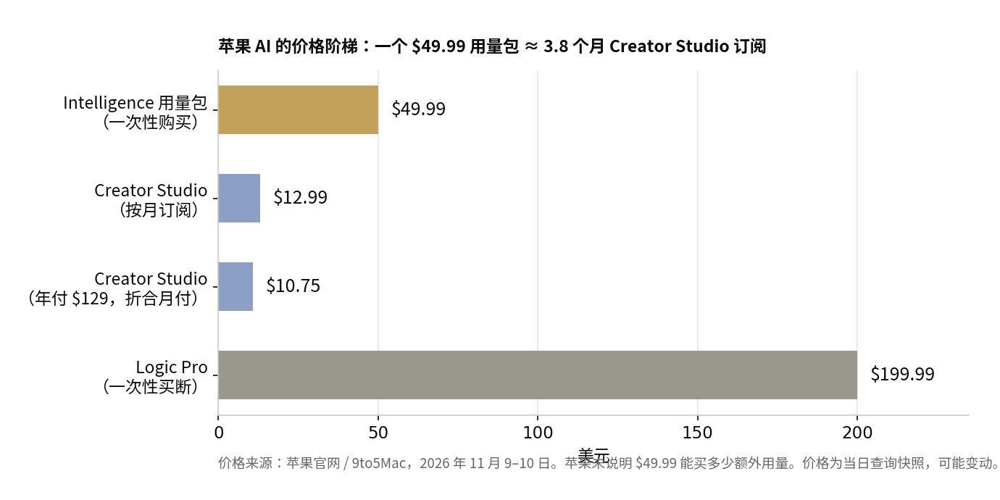

> [English version](/life/apple-intelligence-usage-packs-4999/)

*Logic Pro 里新出现的"Buy More Usage"弹窗，一次性购买 $49.99。截图来源：9to5Mac。*

## 发生了什么

11 月 9 日，9to5Mac 在 Mac 版 Logic Pro 里发现了一个新东西：点开 Logic Pro > Intelligence Features > Show Usage，出现了一个"Buy More Usage"（购买更多用量）按钮。它只卖一样东西：$49.99 一次性购买的"intelligence usage pack"（智能用量包）。The Verge、AppleInsider 和 Engadget 当天都确认了这一消息。

在此之前，苹果设备上的所有 Apple Intelligence 功能都是免费的。苹果早就说过这不会永远持续。这一次，它第一次为"多用一点 AI"标了价。

## $49.99 能买到什么——和买不到什么

这个包是个充值包，不是订阅。只有当你用完了 Creator Studio 订阅自带的每月 AI 额度之后，它才会开始计费。Creator Studio 订阅是每月 $12.99 或每年 $129，今年 1 月 28 日推出。苹果支持页面列出了每月的最低额度（假设你只用其中一项功能）：生成 50 张图片、250 个形状、50 份 8–10 页的演示文稿，或 700 页幻灯片的演讲者备注。至于 Logic Pro 助手本身，苹果连数字都不给——只说额度"取决于对话的复杂程度"。

而真正该让购买者警惕的是这一条：**苹果没有说明 $49.99 能买多少额外用量。** 包装上没有计量单位。先付钱，用多少以后再说。

其余细则同样一边倒。没用完的用量可以逐月结转，但购买后 12 个月过期。用量包绑定购买时登录 iCloud 的那个 Apple ID——不支持家人共享，尽管 Creator Studio 订阅本身最多可以和另外五个人共享。所有销售均为最终销售，不退款。而且用量包目前只在八个国家出售：美国、英国、加拿大、巴西、法国、德国、印度和墨西哥。

## 先轮到谁

目前只有 Logic Pro 在卖这个包。它随 Logic Pro 13 一起推出，后者于 11 月 5 日周四上架 Mac App Store。9to5Mac 预计，随着苹果本月内陆续推出其余已公布的 Creator Studio 更新，用量包也会进入 Final Cut Pro、Pixelmator Pro、Motion 以及 iWork 套件。

注意这次*还没*波及的人：普通 iPhone 用户。Siri、Image Playground 和照片编辑工具都不在其中。但苹果自己的用量限制页面已经预告，Siri AI 和 Image Playground 等服务器端功能将在 2027 年的软件更新中引入用量限制。Logic Pro 这个包，就是那场全面铺开的试点。

*Creator Studio 包含 Final Cut Pro、Logic Pro、Pixelmator Pro、Motion 等应用。图片来源：9to5Mac。*

还有一个值得点明的讽刺。苹果支持页面写明，Logic Pro 助手、图片生成、形状生成和演讲者备注功能由 **Google Gemini** 驱动，Keynote 的生成演示文稿功能由 **OpenAI** 驱动。苹果在转售它两大 AI 对手的按量计费算力——还要在订阅费之上，向自己的用户再收一笔溢价。

## 价格放在 context 里看

*一个 $49.99 的用量包，差不多等于四个月每月 $12.99 的 Creator Studio 订阅费。价格来源：苹果官网 / 9to5Mac，2026 年 11 月 9–10 日查询快照，可能变动。*

一个包的价格接近四个月 Creator Studio 订阅费，约等于 $129 年付套餐的 40%。它也恰好等于 Pixelmator Pro 一次性买断的价格。对于每月都会撞上限的 Logic Pro 用户，这笔账会越算越难看：订阅费不再是天花板，而变成了地板。

## 判断

苹果正在做每个 AI 厂商最终都会做的事——按量计费。不同之处在于包装：一个在订阅里卖的一次性充值包，用量不公开、不能共享、不能退款、一年过期。这个产品很奇怪，而奇怪本身就是重点。苹果在测试：它最忠实的创作用户在忍受多少摩擦之后，才会轮到其他所有人。

真正值得盯的日期不是今天，而是 2027 年——Siri 和 Image Playground 引入用量限制的时候。届时数亿 iPhone 用户都会看到同一个"Buy More Usage"按钮。他们是会点下去，还是干脆少用 AI，将决定苹果的 AI 业务是一条真正的收入线，还是向自家生态系统收的一笔税。就目前而言，诚实的建议很简单：在苹果说清楚包里有什么之前，别买。
