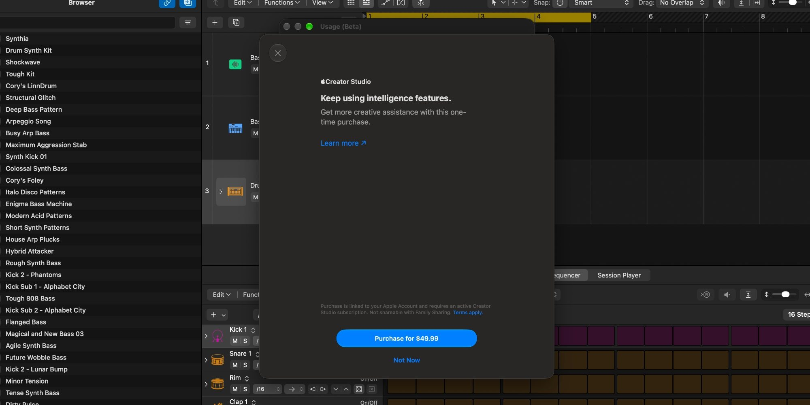
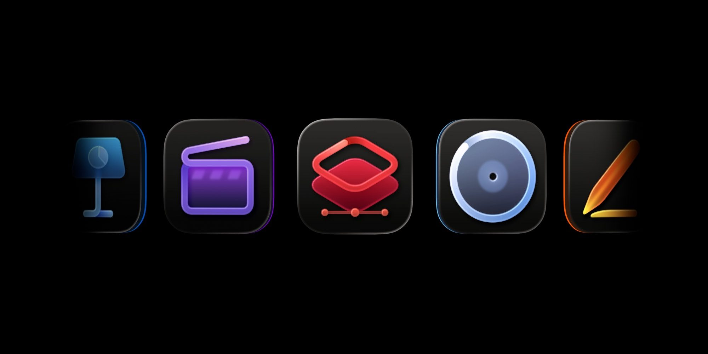
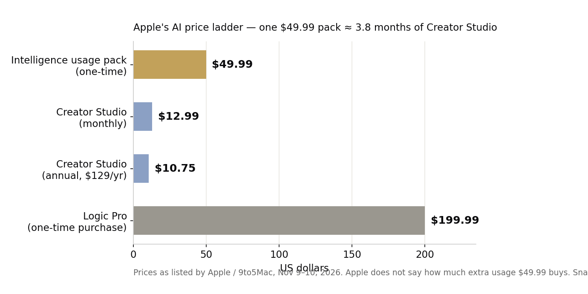

> [中文版 Chinese version](/life/apple-intelligence-usage-packs-4999-zh/)

*Logic Pro's new "Buy More Usage" dialog, offering a $49.99 one-time purchase. Screenshot: 9to5Mac.*

## What happened

On November 9, 9to5Mac spotted something new inside Logic Pro for Mac: under Logic Pro > Intelligence Features > Show Usage, there is now a "Buy More Usage" button. The only thing it sells is a $49.99 one-time "intelligence usage pack." The Verge, AppleInsider, and Engadget confirmed it the same day.

Until now, every Apple Intelligence feature has been free on Apple devices. Apple has said that would not last forever. This is the first time it has put a price on using more of it.

## How Apple got here: free AI, borrowed models, and a Siri that kept slipping

The $49.99 pack did not appear out of nowhere. It is the end of a two-year arc in which Apple promised a great deal, shipped less than promised, and quietly started renting the intelligence it could not build fast enough itself.

Apple Intelligence was announced at WWDC in June 2024 and launched on October 28, 2024, on iPhones, iPads, and Macs in the United States. The first features were modest: text summaries, notification grouping, a generative emoji tool called Genmoji. There was no new Siri. The dramatic Siri overhaul previewed at the same WWDC — on-screen awareness, personal context, multi-step actions inside apps — was originally expected in early 2025 and slipped, first by months and then by a full year, to spring 2026. For the better part of two years, Apple's voice assistant was functionally unchanged while its rivals shipped conversational agents.

Apple's answer to the gap was to borrow. ChatGPT integration launched in December 2024: Siri could hand complex questions to ChatGPT, and Writing Tools and Visual Intelligence could call on it too. The deal was non-exclusive — Apple refused OpenAI's reported request for two years of exclusivity — and ChatGPT was off by default, requiring a multi-step opt-in. OpenAI later said the integration was "dramatically underperforming" its expectations: it had projected the Apple channel as a billion-dollar-a-year subscription pipeline, and by summer 2025 it had cut its forecasts for additional weekly users. Distribution through two billion active Apple devices turned out to be worth less than expected when the feature was buried three taps deep and switched off by default.

Then came the bigger pivot. In January 2026, Apple announced a deal with Google to run a custom 1.2-trillion-parameter Gemini model on Apple's own Private Cloud Compute infrastructure — a deal reported to be worth an estimated $1 billion a year. The architecture matters: because the model runs on Apple's servers rather than Google Cloud, Google never sees the queries, which lets Apple keep its privacy story intact while conceding, in effect, that the best large model for its assistant would come from its biggest rival in search. Apple had reportedly also weighed Anthropic's Claude for the same role in mid-2025, before the Gemini deal landed.

That history is the context for the usage pack. Apple Intelligence was free because, for its first two years, most of it ran on-device or on Apple's own servers at modest scale, and the expensive parts were someone else's problem — OpenAI's, on a free tier. Now the expensive parts are Apple's own bill: a billion-dollar-a-year Gemini arrangement, plus the server-based features in Creator Studio that Apple itself says run on Gemini and OpenAI. Free was sustainable while the AI was small and mostly local. It stopped being sustainable the moment the AI became a large model running in a data centre on every request. The pack is Apple passing that cost on, one $49.99 top-up at a time — and doing it first where the users are professionals who cannot simply stop working when the meter runs out.

## What $49.99 does — and doesn't — buy

The pack is a top-up, not a subscription. It only kicks in after you burn through the monthly AI allowance that comes with a Creator Studio subscription ($12.99 a month or $129 a year, launched January 28, 2026). Apple's support page sets the monthly minimums, assuming you use only one feature: 50 generated images, 250 shapes, 50 presentations of 8–10 slides, or presenter notes for 700 slides. For the Logic Pro assistant itself, Apple gives no number at all — the limit "depends on the complexity of conversations."

And here is the part that should bother anyone thinking of buying one: **Apple does not say how much extra usage $49.99 buys.** There is no unit on the tin. You pay first, and find out how far it goes later.

The rest of the fine print is similarly one-sided. Unused usage rolls over month to month but expires 12 months after purchase. The pack is tied to the Apple Account signed into iCloud when you bought it — no Family Sharing, even though the Creator Studio subscription itself can be shared with up to five other people. All sales are final. And packs are sold in only eight countries: the US, UK, Canada, Brazil, France, Germany, India, and Mexico.

## Who gets hit first

For now, only Logic Pro sells the pack. It arrived with Logic Pro 13, which reached the Mac App Store on Thursday, November 5. 9to5Mac expects packs to reach Final Cut Pro, Pixelmator Pro, Motion, and the iWork apps when the rest of Apple's already-announced Creator Studio updates ship later this month.

Note who this does *not* touch yet: ordinary iPhone users. Siri, Image Playground, and the Photos editing tools are not part of this. But Apple's own usage-limits page already warns that server-based features like Siri AI and Image Playground will get limits in its 2027 software releases. The Logic Pro pack is the pilot program for that.

*Creator Studio bundles Final Cut Pro, Logic Pro, Pixelmator Pro, Motion, and more. Image: 9to5Mac.*

There is also an irony worth naming. Apple's support page says the Logic Pro assistant, image generation, shape generation, and presenter notes run on **Google Gemini**, and Generate Presentation in Keynote runs on **OpenAI**. Apple is reselling metered compute from its two biggest AI rivals — and charging its own customers a premium for the privilege, on top of a subscription.

## The price, in context

*A $49.99 pack costs nearly as much as four months of the $12.99 Creator Studio subscription it tops up. Prices as listed by Apple / 9to5Mac, November 9–10, 2026 — snapshot, subject to change.*

A single pack costs almost four months of Creator Studio, and nearly 40% of the $129 annual plan. It is also exactly what Apple charges for Pixelmator Pro as a one-time purchase. For a Logic Pro user who hits the cap every month, the math gets ugly fast: the subscription stops being the ceiling and becomes the floor.

## The $20 club: what everyone else charges for AI

Apple's pack looks stranger once you put it next to the rest of the industry, because the rest of the industry has converged on a number Apple has so far avoided: about $20 a month, for a named allowance, with the meter visible.

ChatGPT Plus costs $20 a month. Google AI Pro — the plan formerly called Gemini Advanced, renamed in May 2025 — costs $19.99 a month and bundles 5 TB of storage. Claude Pro costs $20 a month. All three are subscriptions, not one-off top-ups, and all three tell you, at least in outline, what the money buys: higher usage limits than the free tier, access to stronger models, and in Google's case a multiple — AI Pro offers roughly four times the free tier's Gemini usage. The details are fuzzy everywhere — OpenAI now meters advanced reasoning in five-hour windows and weekly caps, and Google meters on compute rather than a simple message count — but the shape of the deal is legible: pay monthly, get more, see the ceiling.

## Why Logic Pro first — and why the meter will reach everyone

Logic Pro is not a random pilot. It is the ideal place to test a meter, for three reasons, and each of them tells you something about where this goes next.

First, the users are captive in the useful sense: a musician mid-session cannot switch to a rival assistant when the allowance runs out, because the assistant lives inside the project, the session, and the mix. The switching cost is the session itself. A Siri user who hits a limit can open ChatGPT instead; a Logic Pro user who hits a limit in the middle of arranging a track has no equivalent move. Apple is testing the meter where the willingness to pay is highest and the alternatives are weakest.

Second, the usage is spiky and professional. Fifty generated images or 700 slides of presenter notes is a plausible month for a hobbyist and a single afternoon for a working professional on deadline. The cap is set low enough that real professionals will hit it, which is exactly what a pilot needs: if nobody hit the cap, Apple would learn nothing about price tolerance. The low cap is not an accident; it is the experiment.

Third, Logic Pro's assistant is in beta, US-English-only, and requires macOS 27 and an Apple-Intelligence-capable device. The audience is narrow, technical, and forgiving of rough edges — the kind of users who will complain on forums rather than churn to Windows. Apple gets its pricing data from the users least likely to punish it for the experiment.

## The verdict

Apple is doing what every AI vendor eventually does — metering. The difference is the packaging: a one-time top-up sold inside a subscription, for an undisclosed amount of usage, non-shareable, non-refundable, expiring in a year. That is a strange product, and the strangeness is the point. Apple is testing how much friction its most loyal creative users will accept before the meter reaches everyone else.

The real date to watch is not today but 2027, when usage limits arrive for Siri and Image Playground. Hundreds of millions of iPhone users will then meet the same "Buy More Usage" button. Whether they tap it — or just use the AI less — will decide whether Apple's AI business is a real revenue line or a tax on its own ecosystem. For now, the honest advice is simple: don't buy a pack until Apple says what it contains.

And if Apple does say — if a future support page quietly adds a number, "one pack equals X images" or "Y assistant conversations" — read that number as the real announcement. The price was never the news. The unit was. A meter you cannot read is not a price; it is a blank cheque, and Apple is asking its most loyal users to sign it first.
