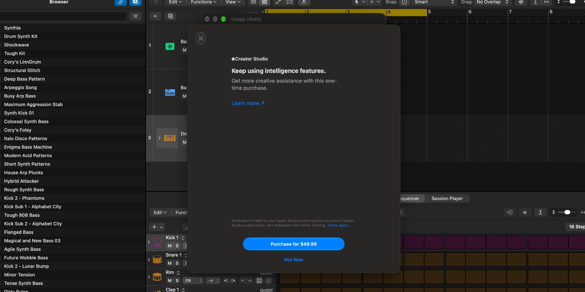
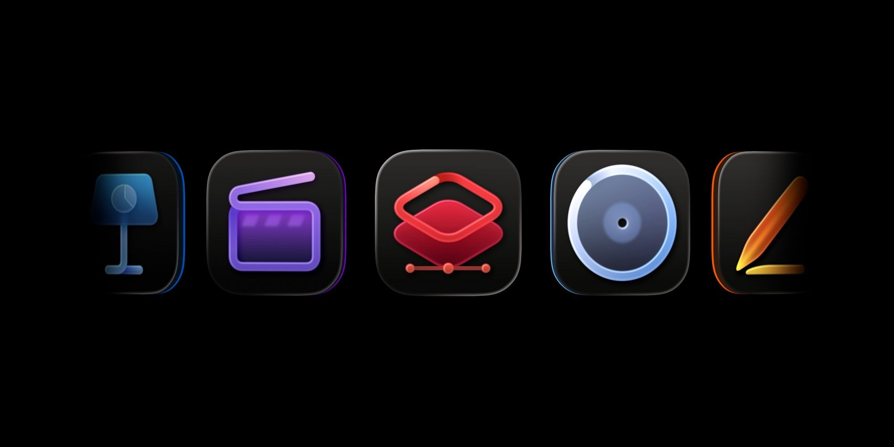
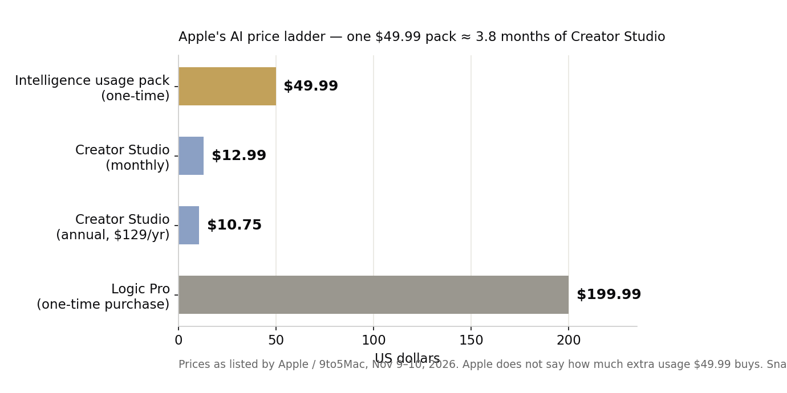

> [中文版 Chinese version](/life/apple-intelligence-usage-packs-4999-zh/)

*Logic Pro's new "Buy More Usage" dialog, offering a $49.99 one-time purchase. Screenshot: 9to5Mac.*

## What happened

On November 9, 9to5Mac spotted something new inside Logic Pro for Mac: under Logic Pro > Intelligence Features > Show Usage, there is now a "Buy More Usage" button. The only thing it sells is a $49.99 one-time "intelligence usage pack." The Verge, AppleInsider, and Engadget confirmed it the same day.

Until now, every Apple Intelligence feature has been free on Apple devices. Apple has said that would not last forever. This is the first time it has put a price on using more of it.

## What $49.99 does — and doesn't — buy

The pack is a top-up, not a subscription. It only kicks in after you burn through the monthly AI allowance that comes with a Creator Studio subscription ($12.99 a month or $129 a year, launched January 28, 2026). Apple's support page sets the monthly minimums, assuming you use only one feature: 50 generated images, 250 shapes, 50 presentations of 8–10 slides, or presenter notes for 700 slides. For the Logic Pro assistant itself, Apple gives no number at all — the limit "depends on the complexity of conversations."

And here is the part that should bother anyone thinking of buying one: **Apple does not say how much extra usage $49.99 buys.** There is no unit on the tin. You pay first, and find out how far it goes later.

The rest of the fine print is similarly one-sided. Unused usage rolls over month to month but expires 12 months after purchase. The pack is tied to the Apple Account signed into iCloud when you bought it — no Family Sharing, even though the Creator Studio subscription itself can be shared with up to five other people. All sales are final. And packs are sold in only eight countries: the US, UK, Canada, Brazil, France, Germany, India, and Mexico.

## Who gets hit first

For now, only Logic Pro sells the pack. It arrived with Logic Pro 13, which reached the Mac App Store on Thursday, November 5. 9to5Mac expects packs to reach Final Cut Pro, Pixelmator Pro, Motion, and the iWork apps when the rest of Apple's already-announced Creator Studio updates ship later this month.

Note who this does *not* touch yet: ordinary iPhone users. Siri, Image Playground, and the Photos editing tools are not part of this. But Apple's own usage-limits page already warns that server-based features like Siri AI and Image Playground will get limits in its 2027 software releases. The Logic Pro pack is the pilot program for that.

*Creator Studio bundles Final Cut Pro, Logic Pro, Pixelmator Pro, Motion, and more. Image: 9to5Mac.*

There is also an irony worth naming. Apple's support page says the Logic Pro assistant, image generation, shape generation, and presenter notes run on **Google Gemini**, and Generate Presentation in Keynote runs on **OpenAI**. Apple is reselling metered compute from its two biggest AI rivals — and charging its own customers a premium for the privilege, on top of a subscription.

## The price, in context

*A $49.99 pack costs nearly as much as four months of the $12.99 Creator Studio subscription it tops up. Prices as listed by Apple / 9to5Mac, November 9–10, 2026 — snapshot, subject to change.*

A single pack costs almost four months of Creator Studio, and nearly 40% of the $129 annual plan. It is also exactly what Apple charges for Pixelmator Pro as a one-time purchase. For a Logic Pro user who hits the cap every month, the math gets ugly fast: the subscription stops being the ceiling and becomes the floor.

## The verdict

Apple is doing what every AI vendor eventually does — metering. The difference is the packaging: a one-time top-up sold inside a subscription, for an undisclosed amount of usage, non-shareable, non-refundable, expiring in a year. That is a strange product, and the strangeness is the point. Apple is testing how much friction its most loyal creative users will accept before the meter reaches everyone else.

The real date to watch is not today but 2027, when usage limits arrive for Siri and Image Playground. Hundreds of millions of iPhone users will then meet the same "Buy More Usage" button. Whether they tap it — or just use the AI less — will decide whether Apple's AI business is a real revenue line or a tax on its own ecosystem. For now, the honest advice is simple: don't buy a pack until Apple says what it contains.
