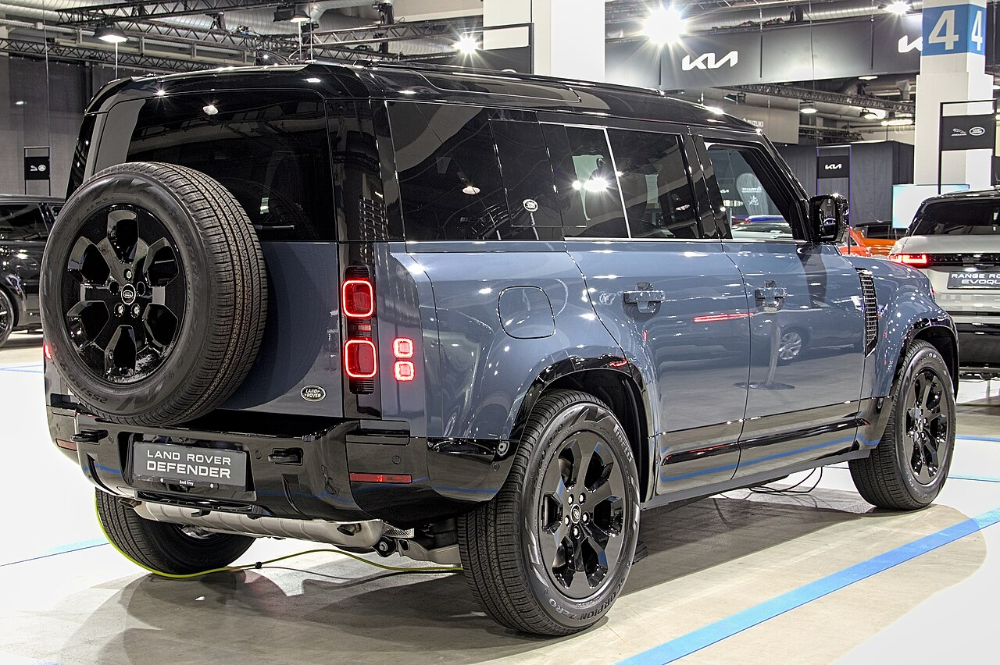
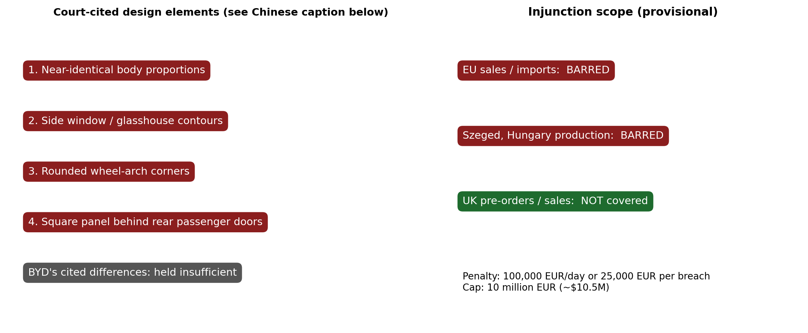
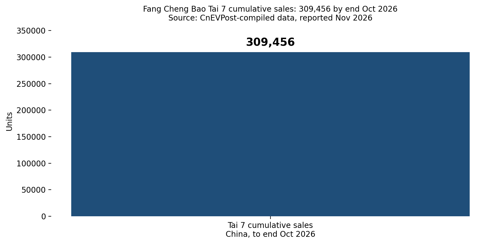

> [English version 英文版](/life/byd-ti7-eu-ban-defender-design/)

*现款路虎卫士 110（L663），即本案所涉已注册欧盟外观设计的车型。图片：Alexander Migl，经 Wikimedia Commons，CC BY-SA 4.0。*

## 一段话说清裁决

2026年11月20日星期五，海牙地方法院在简易程序中作出临时裁决，认定比亚迪 Ti7 越野 SUV「侵犯捷豹路虎的欧盟外观设计」。消息由路透社（11月20日至22日）、《华尔街日报》（11月23日）与 Notebookcheck（11月23日）报道。法院禁止比亚迪在整个欧盟范围内进口、制造、销售和交付 Ti7，其中明确包括比亚迪位于匈牙利塞格德的工厂——该厂原计划明年初开始量产。禁令在正式送达一周后生效，罚则为每天10万欧元，或每次违规2.5万欧元，上限1000万欧元（约1050万美元）。这是一项临时措施：捷豹路虎必须在六个月内提起完整的实体诉讼，否则禁令可能失效。比亚迪表示强烈不同意，称 Ti7 是其自主独立设计，并将上诉。《华尔街日报》报道，比亚迪股价在11月23日星期一尾盘下跌1.0%，至61.70港元（约7.87美元）。

这就是新闻本身。但真正有意思的，是这是一条什么性质的新闻。它不是关税决定，不是反补贴税，也不是布鲁塞尔的一次政治表决。它是一家车企对另一家车企提起的私人知识产权主张，由法院——虽然是临时裁定，却带着立即的商业后果——针对一款尚未在欧盟上市的车的造型作出的裁决。

## 法院到底比了什么

外观设计案件成败全在细节，而法院这次给出了细节。法院认定，捷豹路虎已注册设计中的特征性元素在 Ti7 上得到了体现，包括：几乎相同的车身比例、侧窗与玻璃座舱（glasshouse）的轮廓、圆角处理的轮拱，以及后排乘客车门后方那块标志性的方形面板。比亚迪指出了两车之间的多处差异，法院认为这些差异不足以避免侵权。

请在这份清单上停一下，因为它解释了整套法律机制。四个元素单拎出来，没有一个算稀奇。方正的比例，本来就是硬派越野车该有的样子；玻璃座舱总得放在某个位置；轮拱是圆角的，因为轮子是圆的；后门后面有一块面板，也只是一块面板。法院的意思——也是注册外观设计法的普遍逻辑——不是说任何单个元素归捷豹路虎所有，而是说这些元素以这种特定方式组合在一起，产生的整体印象与受保护设计过于接近。比亚迪指出的差异确实存在，但在法院的临时评估中，它们没有把整体印象拉开足够远。

捷豹路虎的这项设计于2018年在欧盟注册。现款卫士110即 L663 世代，于2019年9月发布。这个先后顺序很重要：保护是在公众熟悉的那款车上市之前就申请的。这正是注册外观设计应该的运作方式——你提交外观，获得一项经续展最长可达25年的权利，并可以对后来出现的、给「知情使用者」留下相同整体印象的产品行使它，哪怕后来者声称自己从未抄袭。注册外观设计侵权，并不像外行想的那样需要证明抄袭行为。「独立创作」本身，并不是注册外观设计主张的抗辩理由。这恰恰是比亚迪公开回应的微妙之处：它说 Ti7 是「自主独立设计」，讲的是来源；法院的测试讲的是相似程度。两句话可以同时真诚，却在法律上指向相反方向。上诉要弥合这道缝隙，必须拿设计本身说话，而不能只讲这款车是怎么画出来的。

*示意图：作者自制，依据路透社、《华尔街日报》与 Notebookcheck 2026年11月20日至23日报道所列的设计元素与禁令条款。图中英文标注依次为：1. 几乎相同的车身比例；2. 侧窗／玻璃座舱轮廓；3. 圆角轮拱；4. 后排车门后方的方形面板；比亚迪所举差异被认定不足。禁令范围：欧盟销售／进口——禁止；匈牙利塞格德生产——禁止；英国预订／销售——不在范围内。罚则：每天10万欧元或每次违规2.5万欧元，上限1000万欧元（约1050万美元）。*

## 在中国是爆款，在欧洲还没上市

Ti7 不是一张被提前拦下的图纸。在中国，它以方程豹钛7之名销售，隶属比亚迪旗下主打越野风格的方程豹子品牌，2025年9月上市。据 CnEVPost 汇总的数据（在本案报道中被引用），截至2026年10月底，钛7累计销量达到309,456辆。无论用哪个标准看，这都是一个扎实的商业成功——在全球竞争最激烈的汽车市场里，十三个月左右卖出三十多万辆方正造型的电动化 SUV。

而在欧盟，Ti7 尚未上市。从这个角度看禁令，它的真实目标就清楚了：这主要不是针对已经停在欧洲客户车道上的车的裁决，因为那种车基本上不存在。它针对的是一次还没发生的上市、一条还没建完的供应链，和一座还没开始量产的工厂。法院很少有机会在一款产品的区域生命周期里介入得这么早。一项2018年的外观设计申请，在2026年被执行，叫停了一个2027年的欧洲故事的第一章——是临时叫停，要看上诉和完整实体诉讼的结果，但此刻确实停了。

匈牙利这一笔，是裁决的战略中心。比亚迪塞格德工厂被普遍理解为行业应对欧盟对中国产电动车加征关税的一种解法：在欧盟境内生产，关税逻辑就变了。无论这座工厂对比亚迪其他车型意味着什么，禁令都把 Ti7 从这个计划里拿掉了。一款被禁止在欧盟制造的车，无法靠把生产搬到境内来绕开外观设计禁令。壁垒跟着设计走，不跟着航线走。这一句话，浓缩起来，就是本案与过去两年欧洲政策争论的全部区别。

*图表：作者自制，数据为 CnEVPost 汇总的累计销量（截至2026年10月底309,456辆），见2026年11月相关报道。*

## 英国例外，以及它揭示的东西

禁令不覆盖英国。法院对比亚迪的英国关联公司没有管辖权，因此英国的预订不受影响。在英国，Ti7 以七座版本销售，起价47,995英镑（约60,500美元；为2026年11月报道中的价格，属当日查询快照，后续可能变动），英国交付计划在2027年1月。

这个一分为二的结果不是脚注，而是脱欧后法律地理的一次现场演示。一项欧盟注册外观设计，在欧盟法院执行，保护范围止于欧盟。英国在这个体系之外，需要自己的权利和自己的程序。捷豹路虎完全可能在英国另行采取行动——已报道的裁决没有说它会或不会——但就本裁决而言，同一款车、同一种造型，在海峡这一侧被临时禁止，在另一侧可以下单。对比亚迪来说，这造就了一个明显但部分的退路：让这款车先走英国路线，在一个重要的右舵大市场里先攒存在感、口碑和评测，同时继续打欧盟这场官司。它同时也造就了一个尴尬的展厅问题：一款旗舰方盒子 SUV，英国买家可以订、2027年1月提车，大陆买家却根本不能合法购买——这个故事，欧洲每个记者都会替比亚迪讲一遍，不管比亚迪想不想这样被讲。

## 外观设计权不是专利，也不是商标

网上关于此案的大量争论会因为用错法律类别而跑偏，所以值得把三者干净地分开。

专利保护的是东西如何工作——一项发明、一个机构、一种技术方案。本案中没有人主张 Ti7 的电机、电池或悬架侵犯了卫士的专利，2018年注册的也不是卫士的工程。商标保护的是标示来源的符号——名称、徽标、标志——让消费者不至于搞错是谁造的。没有人说比亚迪把 Ti7 挂上了路虎的标，也没有人会以为自己买的是一辆英国车。注册外观设计保护的是东西看起来什么样：线条、轮廓、形状、装饰——产品整体或部分的外观。本案涉及的权利，只有这一种。

由此得出的测试，叫「整体印象」测试。问题不是某个零件清单是否完全相同，也不是工程师能不能量出差异——差异永远量得出来。问题是：在考虑设计师自由度的前提下，后来的设计给知情使用者留下的整体印象，是否与受保护设计相同。在一个拥挤且受功能约束的领域里——方盒子越野车正是如此——小差异可能更重要，因为设计师本来就没多少腾挪空间。但反过来也成立：在明明有许多造型可选的情况下，选出一个组合、并落得如此之近，正是会招来海牙法院这次临时认定的做法。法院列出的四个元素应该放在这个框架里读：比例，加上玻璃座舱，加上轮拱处理，再加上那块方形后面板，不是四个巧合。在外观设计法里，这是一个关于整体的论证。

这也是为什么此案会在比亚迪和捷豹路虎之外被争论很久。方盒子越野车正在全球复兴。方正的 SUV、直立的玻璃座舱、外露的工具化细节，是当下中国、韩国、美国和欧洲品牌共同的时尚，背后是买家希望自己的电动化家用车看起来能穿越一片大陆。如果一项2018年的注册外观设计，能以整体印象为由临时把一个主要对手的旗舰挡在整个大洲之外，那么今晚每一个正在做方盒子 SUV 的设计工作室，都得向自家律师多问一个问题——更不舒服地说，这个问题本该在油泥模型冻结之前就问。此案的先例风险，并不是说所有方盒子 SUV 现在都违法了——显然不是，而且这项临时裁决连 Ti7 的命运都还没有最终决定。风险在于：被允许的边界刚刚以昂贵且公开的方式变得可见，而在实体诉讼和可能的上诉把线画得更清楚之前，法庭之外没有人确切知道这条线画在哪里。

## 比亚迪的选项，实话实说

比亚迪已表示将上诉。大体上有四条路，没有一条是免费的。

上诉加实体诉讼，是它已经宣布的路。裁决是临时的、在简易程序中作出的，捷豹路虎必须在六个月内提起完整诉讼，否则禁令可能失效。比亚迪可以主张整体印象不同、被指的元素由功能决定或在该领域司空见惯、知情使用者看到的会是另一辆车。赢了，原计划恢复，只是迟到；实体诉讼输了，禁令变成长期禁令，改设计将无可避免。无论哪种结果，诉讼都会吃掉塞格德工厂原本要服务的上市窗口。

重新设计是工程上的答案，而且比听起来难得多。换一个格栅很便宜；改比例、改玻璃座舱、改一块标志性后面板，改的是这款车的身份——恰恰是那个在中国卖出309,456辆的东西。只给欧洲做一个改版，还会拆分模具、认证和营销，并冒着造出一辆看起来像妥协的车的险，因为在法律上它就是妥协。

授权许可是商业上的答案，不应排除，也不应指望它很快发生。权利人很少把设计授权出去，而一个品牌价值恰恰绑在这个轮廓上的直接竞争者，几乎没有理由帮忙。更可行的结局是和解：改掉车头或车尾的某些处理，再加一笔付款，而双方对外都会把这说成别的事情。

英国先行、加上其他非欧盟市场，是已经半开着的那条路。它能让车型活着、生产经验继续积累、评测继续出来，同时暂时让出欧洲大陆。这是一个真实选项。但对比亚迪这个量级的公司来说，它同时也是一种承认：欧洲——那座匈牙利工厂本要打开的市场——恰恰是这款车暂时去不了的地方。

## 方程豹、钛7 与「方盒子」这门生意

要理解比亚迪为什么在意这款车，得先看它在比亚迪体系里的位置。方程豹是比亚迪面向越野与个性化市场打造的子品牌，定位高于走量的王朝与海洋系列，强调硬派造型、越野意象和更高的单车价格带。钛7是这个品牌走量的关键车型：它不像豹5那样强调极限越野，也不靠纯性能取胜，而是把方正的车身、宽大的座舱和电动化动力打包成一辆看起来能去野外、实际上主要服务家庭日常的 SUV。2025年9月上市之后十三个月左右卖出309,456辆，说明这套配方在中国市场是成立的——买家买的很大一部分，正是这个造型本身。

这恰恰是本案最棘手的地方。对钛7来说，外观不是包装，而是产品核心卖点之一。如果一辆车的主要吸引力来自空间、配置和价格，改一改外观设计的代价相对有限；但如果消费者第一眼心动的就是那个方盒子轮廓、直立的玻璃座舱和硬朗的侧面比例，那么法院点名的每一个元素，都同时是销售部门最舍不得动的元素。换句话说，侵权认定命中的部位与商业价值集中的部位高度重叠。这也解释了比亚迪为什么第一反应是上诉而不是立刻宣布改款：改款改掉的可能不只是几处线条，而是这款车在中国市场已经被验证过的成功公式的一部分。

还要注意一个时间差。钛7在中国已经卖了一年多，模具、供应链和营销素材全部围绕现造型运转。欧洲版本如果被迫单独改设计，成本不只是重新开几副模具：碰撞与行人保护的重新验证、灯光与外部凸出物的合规复核、宣传物料与经销商培训材料的重做，都会跟着走。对一款还没在欧洲卖出第一辆车的产品来说，这些都是在收入为零的阶段先行发生的成本。禁令的杀伤力，一半在「不许卖」，另一半在「所有为卖而做的准备都要重新算账」。

## 消费者与经销商：订单在，车未必

本案对普通消费者的直接影响目前有限，原因很简单：欧盟境内还没有 Ti7 车主。但对已经在为这款车做准备的渠道来说，影响是立刻的。欧洲多国的进口商与经销商原本在为一款2027年上市的七座方盒子 SUV 做铺货、培训和营销排期，禁令一出，这些排期全部进入不确定状态。英国的情况则相反：预订继续、交付仍按2027年1月计划，这会制造一种罕见的同车不同命——英国消费者能在社交媒体上晒提车照片的同时，欧盟消费者连展车都看不到。对汽车这种高度依赖口碑与可见度的商品来说，这种可见度的不对称本身就会改变竞争格局：路虎卫士在欧盟少了一个造型最接近的对手，而在英国，它要正面迎战。

对已经关注这款车的欧盟消费者，还有一个更实际的问题：平行进口行不行？禁令禁止的是在欧盟范围内进口、销售和交付这款车，从英国买一辆再开回欧盟自用，涉及的正是被禁止的进口行为，且车辆注册与合规也会遇到障碍。这不是一条现实的后门。本文不对具体法律问题提供意见，只提醒一点：禁令的措辞覆盖进口环节，意味着它堵的不只是经销商的正门。

## 「整体印象」为什么是关键战场

再把法律测试说透一点，因为上诉大概率就打在这里。欧盟注册外观设计的侵权判断，核心是看被诉设计是否给知情使用者留下与注册设计相同的整体印象，同时要考虑设计师在创作这类产品时的自由度。这个测试有三个对本案至关重要的推论。

第一，它不要求逐项相同。法院列出四个元素，不是因为这四项缺一不可，而是因为这四项合在一起足以支撑整体印象的判断。比亚迪即使在其他十处细节上与卫士不同，只要整体印象没有拉开，抗辩就难以成立。这就是为什么「我们有区别」清单在法庭上经常输给「放在一起看像不像」这一个问题。

第二，功能约束会放大或缩小差异的权重。越野车的接近角、离去角、发动机舱高度和座舱布局都受工程与安全法规约束，设计师在某些部位确实没多少自由。在自由度低的地方，两车相似更容易被解释为功能使然；在自由度高的地方——比如车门后方那块方形面板的处理、玻璃座舱收尾的方式——相似就更难用功能解释。法院特意点名那块方形面板，正是因为它看起来最不像功能必需品，而最像一个有意为之的标志性处理。

第三，临时裁决不等于最终结论。简易程序看的是紧迫性与表面证据，法院在有限时间内作出的是临时平衡：让禁令先行，同时要求权利人在六个月内把完整官司打下去。比亚迪在上诉和实体诉讼中会有更充分的机会提交专家意见、市场证据和设计演变材料。任何把本裁决读成「终审定罪」的说法都是错的；但同样，把它读成「只是程序动作、没有商业后果」也是错的——塞格德工厂的排产表不会等终审判决出来才改。

## 一种不同性质的欧洲壁垒

欧洲关于中国电动车的争论，到目前为止几乎完全用贸易的语言进行：补贴、关税、价格承诺、本地含量。贸易壁垒有一些共同属性：由政府设定、可以谈判、按原产地和类别而不是按单个产品适用，而且一个决心足够的制造商常常能绕过去——本地建厂、调整定价、改变产品组合。

外观设计禁令一条都不具备。它不是追求产业政策的政府设定的；它是一家法院授予一个私人权利人的。它无法在一轮贸易谈判里被谈掉。它不针对「中国电动车」这个类别，只针对一个造型。而且正如塞格德这一笔所示，本地建厂治不了它，因为权利会跟着设计走进工厂。这并不是说裁决在实体上是对是错——那是上诉和完整诉讼的事。这只是说，它是一种不同性质的壁垒，从关税辩论没有盯着的那扇门里走了进来。

市场的第一反应很温和：周五裁决之后周一股价跌1.0%，是耸肩，不是恐慌，这也合理地反映出：一款尚未在欧盟销售的车型，在比亚迪这个体量的公司里只占一小部分。但战略层面的分量可能比股价层面的大。现在，每一个计划在欧洲推旗舰车型的中国品牌都知道，欧洲的准入清单不只有型式认证、关税和充电标准，还有一项对登记册的「外观设计清障检索」——那些登记册可以追溯很多年，握在完全有动力去执行它们的竞争者手里。卫士的轮廓2018年就提交了，早于现款卫士进驻展厅，也远早于钛7被画出来。上周五在海牙，2018年向前伸手，拦下了一辆2027年的车。无论上诉结果如何，这都是行业从这一周里带走的教训——而且它会先被计入下一款方盒子 SUV 的成本，远早于被计入任何股价。

## 接下来六个月看什么

把后续观察点列清楚，比猜测结果更有用。第一，看捷豹路虎是否在六个月期限内正式提起实体诉讼，以及它在英国是否另行出手——英国是目前唯一明确敞开的主要欧洲市场，如果它在英国也启动程序，说明这家公司要的是全面封堵而不只是一次欧盟范围内的警告；如果它按兵不动，则可能意味着它更在意欧盟本土市场，或者在等待欧盟实体诉讼的风向。第二，看比亚迪上诉的时间表与理由构成：它主攻整体印象不同、主攻被指元素属于功能与行业惯例，还是主攻程序与管辖，不同打法暴露的是它对自家设计底气的真实评估。第三，看塞格德工厂的公开排产表态：如果比亚迪开始公开谈论该厂先投产其他车型，说明它内部已经按 Ti7 长期缺席来做规划；如果它继续把 Ti7 挂在该厂的计划里，则说明它对上诉或和解的预期更乐观。第四，看其他方盒子造型的在售与待售车型是否悄悄调整设计语言——行业最诚实反应从来不在声明里，而在下一批谍照和改款图里。这四条，任何一条在未来六个月内出现变化，都值得再写一篇更新。

*价格（英国 Ti7 起价47,995英镑）与比亚迪股价（61.70港元）均为2026年11月23日报道中的快照，后续可能变动。销量数据为 CnEVPost 汇总数据，见本案相关报道。本文为纯外部视角，仅依据随稿来源文件中列出的公开报道撰写。*
