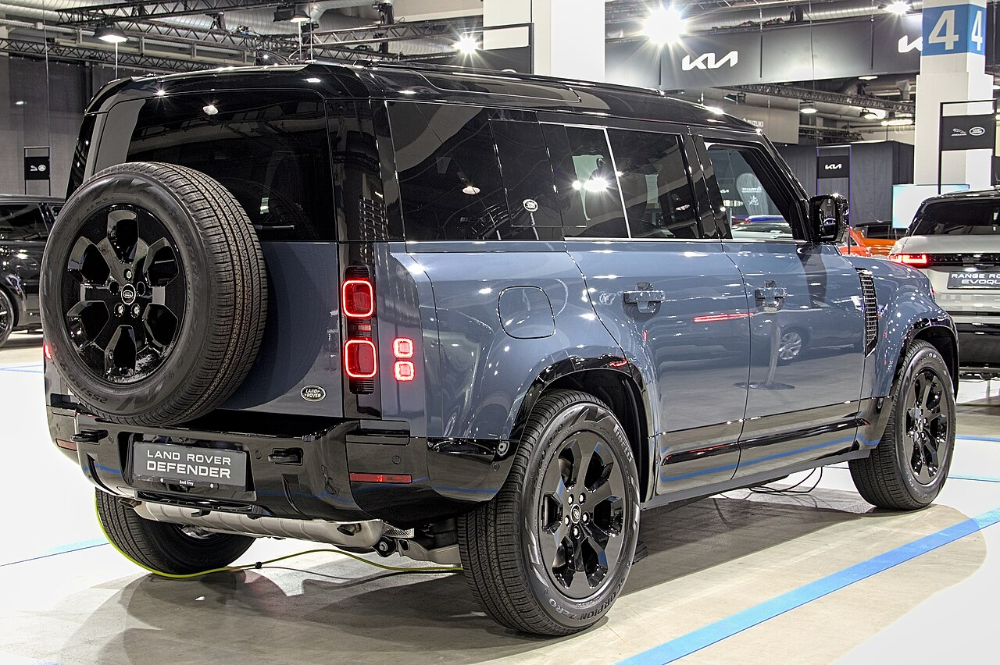
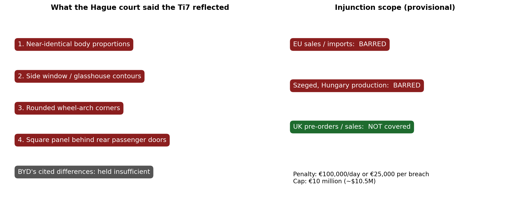
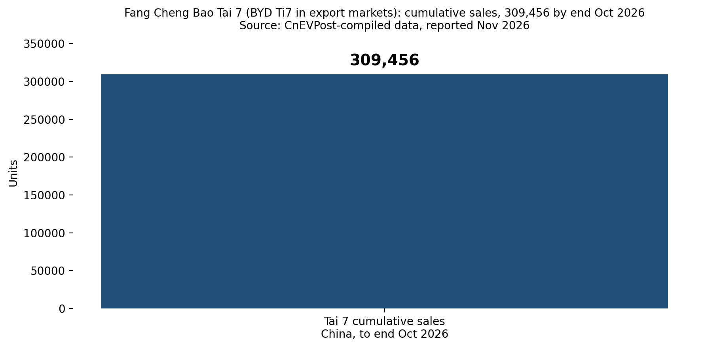

> [中文版 Chinese version](/life/byd-ti7-eu-ban-defender-design-zh/)

*The current Land Rover Defender 110 (L663), the vehicle whose registered EU design is at issue. Photo: Alexander Migl, via Wikimedia Commons, CC BY-SA 4.0.*

## The ruling, in one paragraph

On Friday, November 20, 2026, in summary proceedings, the District Court of The Hague provisionally ruled that BYD's Ti7 SUV "infringes the EU design of Jaguar Land Rover," according to reporting by Reuters (November 20–22), the Wall Street Journal (November 23) and Notebookcheck (November 23). The court barred BYD from importing, manufacturing, selling and delivering the Ti7 across the European Union — including production at BYD's plant in Szeged, Hungary, which is due to start mass production early next year. The injunction takes effect one week after formal service, carries penalties of €100,000 per day or €25,000 per breach, capped at €10 million (about $10.5 million), and is provisional: Jaguar Land Rover must file a full case on the merits within six months or the injunction may lapse. BYD said it strongly disagrees, that the Ti7 is its own independent design, and that it will appeal. BYD shares fell 1.0% to HK$61.70 (about US$7.87) in late trade on Monday, November 23, the Wall Street Journal reported.

That is the news. The interesting part is what kind of news it is. This is not a tariff decision, not an anti-subsidy duty, and not a political vote in Brussels. It is a private intellectual-property claim, brought by one carmaker against another, decided — provisionally, but with immediate commercial consequences — on the shape of a vehicle that has not yet gone on sale in the EU at all.

## What the court actually compared

Design cases live or die on specifics, and the court gave specifics. It found that characteristic elements of Jaguar Land Rover's registered design were reflected in the Ti7, including near-identical body proportions, the contours of the side windows and glasshouse, rounded wheel-arch corners, and the signature square panel behind the rear passenger doors. BYD pointed to differences between the two vehicles. The court held that those differences were insufficient to avoid infringement.

Pause on that list, because it explains the whole legal mechanism. None of the four elements is, on its own, exotic. Boxy proportions are what a serious off-roader looks like. A glasshouse has to go somewhere. Wheel arches are round because wheels are round. A panel behind a rear door is a panel. The court's point — and the point of registered design law generally — is not that any single element belongs to Jaguar Land Rover. It is that the combination, arranged in this particular way, produces an overall impression that is too close to the protected design. The differences BYD cited existed, but in the court's provisional assessment they did not change that overall impression enough.

Jaguar Land Rover's design was registered in the EU in 2018. The current Defender 110, the L663 generation, was launched in September 2019. That sequence matters. The protection was filed before the car the public knows went on sale, which is how registered designs are supposed to work: you file the appearance, you receive a right that can last, with renewals, for up to 25 years, and you can enforce it against later products that create the same overall impression on an informed user — even if the later maker says, truthfully or not, that it never copied you. Registered design infringement does not require proof of copying in the way a lay reader might expect. Independent creation is not, by itself, a defence to a registered design claim. That is precisely why BYD's public response — the Ti7 is "its own independent design" — is a statement about origin, while the court's test is a statement about resemblance. Those two statements can both be sincere and still point in opposite legal directions. An appeal will have to close that gap with argument about the design itself, not only about how it was created.

*Diagram: author's own, based on the design elements and injunction terms reported by Reuters, the Wall Street Journal and Notebookcheck, November 20–23, 2026.*

## A car that is a hit at home, and not yet on sale in Europe

The Ti7 is not a paper concept caught early. In China it is sold as the Fang Cheng Bao Tai 7, under BYD's Fang Cheng Bao off-road-oriented sub-brand, and it was launched in September 2025. Cumulative sales reached 309,456 units by the end of October 2026, according to data compiled by CnEVPost and cited in coverage of the ruling. That is a substantial commercial success by any measure — more than three hundred thousand boxy, electrified SUVs sold in roughly thirteen months in the world's most competitive car market.

In the EU, by contrast, the Ti7 is not yet on sale. Read the injunction in that light and its real target becomes clearer. This is not primarily a ruling about cars already in European customers' driveways, because there essentially are none. It is a ruling about a launch that has not happened, a supply chain that has not finished being built, and a plant that has not started mass production. Courts rarely get to intervene this early in a product's regional life. A design filing from 2018, enforced in 2026, has stopped a 2027 European story before its first chapter — provisionally, and subject to appeal and a full merits case, but stopped for now all the same.

The Hungary detail is the strategic centre of the ruling. BYD's Szeged plant is widely understood as part of the industry's answer to the EU's additional duties on China-built electric vehicles: build inside the Union, and the tariff logic changes. Whatever the plant does for BYD's other models, the injunction removes the Ti7 from that plan. A car banned from being manufactured in the EU cannot be tariff-engineered around a design ban by moving its production onshore. The barrier follows the design, not the shipping route. That sentence is, in miniature, the difference between this case and everything European policymakers have argued about for the past two years.

*Chart: author's own, from CnEVPost-compiled cumulative sales data (309,456 units by end October 2026) as reported in November 2026 coverage.*

## The United Kingdom exception — and what it reveals

The injunction does not cover the United Kingdom. The court lacked jurisdiction over BYD's UK affiliate, so British pre-orders are unaffected. In the UK the Ti7 is offered as a seven-seater from £47,995 (about $60,500; price as reported in November 2026 coverage, snapshot and subject to change), with UK deliveries planned for January 2027.

That split outcome is not a footnote. It is a live demonstration of post-Brexit legal geography. An EU registered design, enforced in an EU court, protects within the EU. The United Kingdom, outside that system, requires its own rights and its own proceedings. Jaguar Land Rover may well pursue separate action there — nothing in the reported ruling says it will or will not — but as of this ruling, the same vehicle, with the same shape, is provisionally barred on one side of the Channel and orderable on the other. For BYD, that creates an obvious, if partial, fallback: a UK-first strategy for this model, building presence, reviews and word of mouth in a major right-hand-drive market while the EU fight continues. It also creates an awkward showroom problem. A flagship boxy SUV that British buyers can order for January 2027 and continental buyers cannot legally be sold at all is a story every journalist in Europe will tell for BYD, whether BYD wants it told that way or not.

## Design rights are not patents, and not trademarks

Much of the online argument about this case will go wrong by using the wrong legal category, so it is worth separating the three cleanly.

A patent protects how something works — an invention, a mechanism, a technical solution. Nobody in this case is claiming the Ti7's motors, batteries or suspension infringe a Defender patent, and the Defender's engineering is not what was registered in 2018. A trademark protects signs that identify origin — a name, a badge, a logo — so consumers are not confused about who made a product. Nobody is suggesting BYD badged the Ti7 as a Land Rover, or that a buyer would think they had purchased a British car. A registered design protects how something looks: lines, contours, shape, ornamentation — the appearance of the whole or part of a product. That, and only that, is the right at issue here.

The test that follows from that category is the "overall impression" test. The question is not whether a checklist of parts is identical, and not whether an engineer can measure differences — there are always measurable differences. The question is whether the later design produces the same overall impression on an informed user as the protected design, taking into account the designer's degree of freedom. In a crowded, functionally constrained field — and boxy off-roaders are exactly that — small differences can matter more, because the designer had less room to move. But the converse also holds: where many shapes were available, choosing a combination that lands this close invites exactly the finding the Hague court provisionally made. The four elements the court listed should be read through that lens. Proportions plus glasshouse plus wheel-arch treatment plus that square rear panel is not four coincidences. In design law, it is an argument about a whole.

This is also why the case will be argued about far beyond BYD and Jaguar Land Rover. The boxy off-roader is having a global revival. Squared-off SUVs, upright glasshouses and exposed, utilitarian detailing are the fashion of the moment across Chinese, Korean, American and European brands alike, driven by buyers who want their electrified family car to look like it could cross a continent. If a registered design from 2018 can provisionally bar a major rival's flagship from an entire continent on overall impression, every design studio working on a boxy SUV tonight has a new question to ask its lawyers — and, more uncomfortably, a question it should already have asked before the clay model was frozen. The precedent risk is not that all boxy SUVs are now illegal; they plainly are not, and this provisional ruling decides nothing finally even about the Ti7. The risk is that the boundary of the permissible just became visible, expensively, in public, and nobody outside the courtroom knows exactly where it runs until the merits case and any appeal draw it more clearly.

## BYD's options, honestly assessed

BYD has said it will appeal, and there are four broad paths, none of them free.

Appeal and merits litigation is the path it has announced. The ruling is provisional, made in summary proceedings, and Jaguar Land Rover must file its full case within six months or the injunction may lapse. BYD can argue the overall impression differs, that the cited elements are dictated by function or common in the field, and that the informed user would see a different vehicle. Winning would restore the original plan, late. Losing on the merits would make the ban durable and the redesign unavoidable. Either way, litigation consumes the launch window the Szeged plant was built to serve.

Redesign is the engineering answer, and it is harder than it sounds. Changing a grille is cheap. Changing proportions, a glasshouse and a signature rear panel is changing the vehicle's identity — the very thing that sold 309,456 units in China. A European-only redesign also splits tooling, homologation and marketing, and risks producing a car that looks like a compromise because, legally, it is one.

Licensing is the commercial answer nobody should rule out and nobody should expect soon. Rights holders license designs rarely, and a direct competitor whose brand equity is bound up with this exact silhouette has weak reasons to help. A settlement with a redesigned front or rear treatment and a payment is more plausible than a pure licence, and would still be described publicly by both sides as something else.

UK-first, plus other non-EU markets, is the path already half-open. It keeps the model alive, the production learning going and the reviews coming, while conceding the continent for now. It is a real option. It is also, for a company of BYD's ambition, an admission that Europe — the market the Hungary plant was meant to unlock — is the one place this particular car cannot yet go.

## A different kind of Europe barrier

Europe's debate about Chinese electric vehicles has, until now, been conducted almost entirely in the language of trade: subsidies, duties, price undertakings, local-content arguments. Trade barriers share certain properties. They are set by governments, they can be negotiated, they apply by origin and category rather than by individual product, and a determined manufacturer can often engineer around them — build locally, adjust pricing, change the mix.

A design injunction has none of those properties. It was not set by a government pursuing industrial policy; it was granted by a court to a private rights holder. It cannot be negotiated away in a trade round. It does not apply to Chinese EVs as a class; it applies to one shape. And, as the Szeged element shows, building locally does not cure it, because the right travels with the design into the factory. None of that makes the ruling right or wrong on its merits — that is for the appeal and the full case. It makes it a different kind of barrier, arriving through a door the tariff debate was not watching.

The market's first verdict was mild: a 1.0% fall in BYD shares on the Monday after a Friday ruling is a shrug, not a panic, and fairly reflects that one model, not yet sold in the EU, is a small part of a company selling at BYD's scale. The strategic verdict may be larger than the share-price verdict. Every Chinese brand planning a European flagship now knows that the clearance process for Europe is not only homologation, tariffs and charging standards. It is also a design-clearance search through registers that go back years, held by competitors who have every incentive to enforce them. The Defender's silhouette was filed in 2018, before the current Defender existed in showrooms and long before the Tai 7 was drawn. In The Hague last Friday, 2018 reached forward and stopped a car from 2027. Whatever the appeal decides, that is the lesson the industry will take from this week — and it will be priced into the next boxy SUV long before it is priced into any share.

*Prices (UK Ti7 from £47,995) and the BYD share price (HK$61.70) are snapshots as reported on November 23, 2026, and are subject to change. Sales figure: CnEVPost-compiled data as reported in coverage of the ruling. This post is written from an external perspective, based solely on the public reporting listed in the accompanying sources file.*
