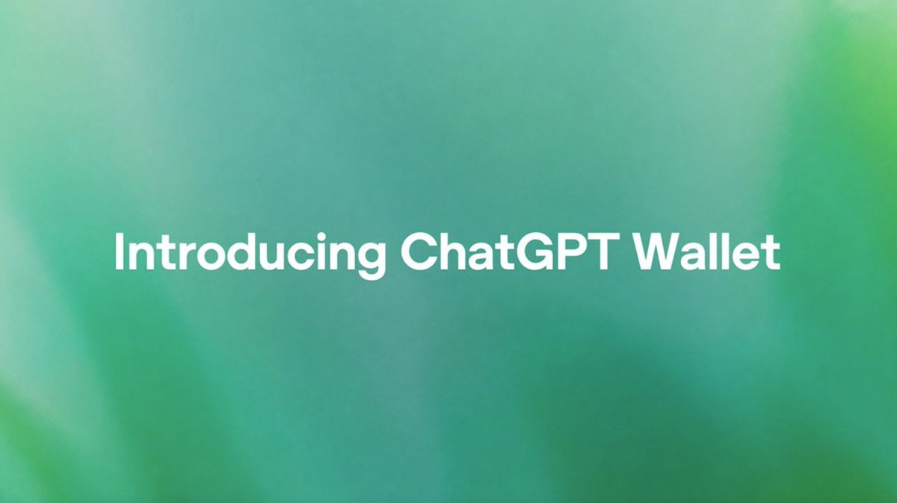
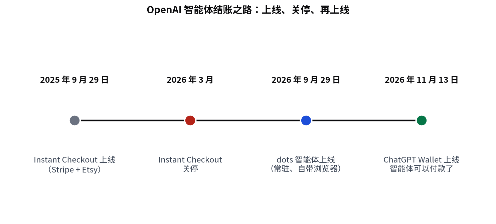

> [English version](/life/chatgpt-wallet/)

*OpenAI 发布 ChatGPT Wallet 的官宣图。图片来源：OpenAI，经 Engadget。*

## 上线了什么

11 月 13 日星期五，OpenAI 推出 **ChatGPT Wallet**，一个让其 AI 智能体——叫 **dots**——替用户完成购买的支付功能。OpenAI 称它是“第一个让智能体在接触不到用户真实卡号的前提下付款、且每次购买都要经过安全验证的钱包”。它与**美国运通、万事达、Visa**合作打造。

时机毫不含蓄。OpenAI 称 **每周有 12 亿人使用 ChatGPT**，其中许多人已经用它来查产品、比选项、做购买决定。Wallet 是从“决定买什么”到“完成付款”的一步，也是从聊天机器人到收银台的一步。

## 一次购买是怎么完成的

按 OpenAI 的描述，流程是这样的：

1. 用户把一张符合条件的卡一次性加进 ChatGPT Wallet。
2. 让 dots 去处理一笔购买。
3. 扣款之前，用户先核对商品、总价和要用的卡，然后用 Face ID 或指纹等安全验证批准。每一次批准都会留下一条授权记录。
4. 批准后，支付网络发一个**支付令牌**——一个带有自己的卡号、安全码和有效期的替代凭证。费用记在真实卡上，但智能体和商家都看不到真实卡号。商家仍能拿到履约所需的信息，比如收货地址。

OpenAI 表示，卡片原有的积分奖励和符合条件的争议保护都保留。钱包本身不存钱、也不提供信用额度。

## 谁现在真能用：几乎没人

上线范围刻意收得很小。首批只有**少数美国 ChatGPT Pro 订阅用户、年满 18 岁、持有符合条件的美国发行的卡**才能用——美国运通、Chase、万事达、Visa 的信用卡。借记卡和虚拟卡暂不支持。Plus 或免费用户、美国以外的国家，都没有公布时间表。

OpenAI 表示，未来希望让用户可以完全把购买委托给智能体——设定消费上限、购买品类、时间段，提前批准并辅以更强的安全保障——但没有给出日期。目前，每一笔购买都需要人点一下确认。

## 商家那一侧：你的反机器人系统就是门卫

配合 Wallet，OpenAI 还发布了一份面向商家的 **Commerce Partner Playbook**（商务合作伙伴手册），涵盖商品信息流、智能体访问、支付、插件、ChatGPT 登录和商家资料。其中最实在的一句是个警告：Wallet 能直接用现有结账页面、无需专门集成——但**有些网站可能会无意中拦截这些购买**，因为它们的机器人检测和风控系统看到一个云端浏览器，会把它当成机器人。OpenAI 正在与支付服务商 Adyen、Checkout.com、Stripe，以及风控厂商 Forter、Riskified、Sardine、Signifyd 合作，让智能体的合法购买能被识别出来。

这个问题有多大，是可以量化的。在 Blend 的一次测试中，机器人防护在 **200 家英美零售商里的 29 家**两次都把 AI 购物智能体挡在了门外。而最大的那家店不是偶然：**亚马逊会拦截 AI 智能体**，把购物者引向自家的助手 Alexa。TechCrunch 还提到，DoorDash 和 Uber 各自报告的 AI 智能体订单数量都很低。智能体购物的需求侧，目前还 mostly 是个承诺。

## OpenAI 以前试过——然后把它砍了

下面这条时间线，是 OpenAI 更希望你忘记的部分：

*OpenAI 智能体结账历程：Instant Checkout 于 2025 年 9 月 29 日上线，2026 年 3 月关停；dots 于 2026 年 9 月 29 日上线；ChatGPT Wallet 于 2026 年 11 月 13 日上线。来源：OpenAI；TechCrunch。*

**Instant Checkout** 于 2025 年 9 月 29 日与 Stripe 和美国 Etsy 卖家一起上线，购买全程留在 ChatGPT 内完成。OpenAI 在 2026 年 3 月把它关了。Wallet 把模式翻了过来：智能体去商家自己的网站，像普通顾客一样结账。商店保留订单、履约和客户关系——值得注意的是，OpenAI 在上线时**不从交易中抽成**。

不抽成这个决定就是信号。OpenAI 不是在做支付生意；它在竞标结账层本身。Visa、万事达、美国运通自 2025 年 4 月起都在搭建各自的智能体支付通道，而 Google 的 Gemini 至今还不能用 Google Wallet 交易。所有人都同意智能体最终会替人付款，没人同意谁来当这个钱包。

## 令牌化是十年前的技术——新的是智能体

ChatGPT Wallet 最聪明的部分，也是它最不新颖的部分。它核心的网络令牌，与自 2014 年 Apple Pay 问世以来保护每一次 tap-to-pay 的技术是同一套。当你把卡加进手机钱包时，钱包从不保存你真实的 16 位卡号——即主账号（PAN）。相反，银行请卡组织的令牌服务商发一个替代凭证：一个设备专属的号码，叫设备账号（Device Account Number），看起来像卡号，但只有在卡组织的安全 vault 里才能映射回真实卡号。付款时，手机发送令牌加一个一次性密码——根据令牌、金额与计数器为这单交易单独生成的加密代码——卡组织把令牌换回真实卡号、验证密码、批准或拒绝。商家、终端与收据永远看不到真实卡号。被盗的令牌一文不值：它锁定在一台设备上，往往只对一笔交易有效，而且无法从数学上反推回 PAN。

OpenAI 做的是把这套管道指向一个新的行为体。在 Apple Pay 里，令牌存在手机的安全元件里，人每次轻触都用 Face ID 验证。在 ChatGPT Wallet 里，令牌为智能体的购买而发行，人在令牌释放之前用安全验证逐笔批准。安全模型因此是熟悉的——同样的 EMVCo 令牌化标准、同样的令牌 vault、同样的单次密码——但威胁模型不同。Apple Pay 保护的是卡不被商家的数据泄露所害；Wallet 要保护的是卡不被智能体本身所害：不被一个可能买错东西、买两次、或被恶意页面诱骗去买用户从没要求的东西的智能体所害。逐笔批准正是对这种威胁的回答，也是这个设计值得肯定的原因。但它同时也是一种坦白：OpenAI 自己还不信任它的智能体到可以无人监督地付款，你也不应该。

## 卡组织先到了

OpenAI 的发布看起来是首创，但卡组织在之前的十八个月里已经从它们那一侧搭建了同样的东西。Visa 于 2025 年 4 月 30 日推出 Intelligent Commerce，用令牌化凭证、身份核查与消费控制向 AI 智能体开放网络；万事达在前一天（4 月 29 日）推出 Agent Pay，基于 Agentic Tokens——移动非接触支付令牌化的延伸——把智能体身份与可验证的意图绑定在令牌上，并可从发卡行应用里撤销。美国运通在 2026 年 4 月跟进，推出 Agentic Commerce Experiences 开发者套件；Google 在 2025 年 9 月宣布 AP2（Agent Payments Protocol），有 60 多家合作伙伴，包括万事达、Visa、美国运通、PayPal 与 Adyen。Visa 在 2025 年 10 月增加了 Trusted Agent Protocol，帮助商家在结账时区分真正的智能体与机器人，2026 年 4 月又增加了 Intelligent Commerce Connect 接入通道。

这些产品没有一个已经产生了交易量。截至 2026 年 10 月，Visa、万事达与美国运通都没有公布过智能体支付的交易量；Visa 的 Intelligent Commerce 仍处于封闭测试与试点，万事达迄今的银行交易也只是受控试点，不是商业上线。信任数据解释了为什么：Visa 自己的信任指数显示，美国消费者信任生成式 AI 处理支付的比例只有 23%；Visa 自己的基准测试发现，22 个 AI 模型在购物测试中有 42.8% 失败——而在失败的测试中，有 54% 智能体仍然完成了购买。最后一个数字才是所有做智能体钱包的人应该担心的：智能体购物者的失败模式不是放弃，而是照样买。OpenAI 的逐笔批准之所以存在，正是因为行业知道自己的智能体近一半时间会失败，而且失败时还会继续花钱。

## 为什么商家拦截机器人——以及"放它们进来"为什么不是解决方案

这个故事的商家一侧通常被讲成固执：商店的机器人拦截器分不清乐于助人的智能体与黄牛。现实对智能体更不客气。机器人检测之所以存在，是因为机器人绝大多数时候是成本：它们爬取价格、囤积库存、测试被盗卡片、下欺诈订单。零售商的风控系统看到的不是"乐于助人的 AI 购物智能体"，而是一个云端浏览器，没有购买历史、没有设备指纹、没有人类行为，以机器速度抵达结账页。前面引用的 Blend 测试——200 家英美零售商里有 29 家两次都把智能体挡在门外——测量的是一套按设计工作的系统，不是一套失灵的系统。

这就是为什么 OpenAI 的 Commerce Partner Playbook 是一份礼貌请求、而不是解决方案，以及为什么修复会很慢。让商家的风控系统信任一个智能体，意味着要给商家一个信任它的理由：一个加密信号，证明这个浏览器会话是一个已知智能体、在为一位已验证的客户行动、带着一个已验证的意图——而这正是 Visa 的 Trusted Agent Protocol 与万事达的智能体注册试图搭建的东西。万事达还在与 Cloudflare 合作，让银行能够核查浏览网站的智能体与付款的智能体是不是同一个。这些基础设施没有一个已经大规模上线。在此之前，每一次智能体购买都是一场谈判：一边是被调校成说"不"的风控系统，一边是请求它说"是"的钱包——而风控系统在说错"是"时是要承担责任的，它没有理由着急。

## 责任缺口，具体说来

结论里那个没人回答的问题——智能体买错东西时算谁的错——一旦看清卡片争议实际如何运作，形式会更尖锐。拒付不是一个通用的投诉机制，而是一套由卡组织定义的狭窄争议类别：欺诈、处理错误、未收到货、货不对板。"是智能体干的"不在其中，一项对 Visa 规则的审查发现，根本没有针对智能体的争议类别。如果智能体买错了尺码、而用户批准了那个界面，从卡组织的角度看，这笔交易就是一笔"买错了商品"的授权购买——那是一次退货，不是拒付，而退货由商家的政策决定，不由卡组织决定。

美国运通是第一家直接回应这一点的卡组织。它在 2026 年 4 月的公告中包含了 Amex Agent Purchase Protection，称这是业内首个承诺保护持卡人免受注册 AI 智能体错误导致扣款的保障——但重要的一点是，截至 2026 年 10 月完整条款仍未公布，所以应视为已宣布、而非已上线。方向很清楚：哪家卡组织率先为智能体错误背书，哪家就能赢得 Visa 那个 23% 的数字所显示的缺失信任。但在这种保障以可执行的条款出现之前，责任仍然在它一直所在的地方：点了"批准"的买家身上。OpenAI 的批准记录——一份授权了什么的日志——在与商家的争议中有帮助，但它不创造拒付权，也回答不了用户真正会问的问题："我批准的是一个由智能体填好的界面，算谁的错？"这个问题至今没人回答。

## 从 Instant Checkout 到 Wallet：OpenAI 学到了什么

Wallet 不是 OpenAI 在结账上的第一次尝试，而是一次方向完全翻转的第二次尝试，理解这个翻转才能理解 Wallet 的设计。Instant Checkout 于 2025 年 9 月 29 日上线，与 Stripe 和美国 Etsy 卖家一起推出，购买全程留在 ChatGPT 内部完成：用户在聊天里看到商品、点击购买、钱在 ChatGPT 里结算。它的逻辑是平台逻辑——把交易留在自己的地盘里，像应用商店抽成一样从中获利。OpenAI 在 2026 年 3 月把它关了，只活了不到六个月。

关停的原因 OpenAI 没有详细说明，但从 Wallet 的设计可以反推出教训。Instant Checkout 要求商家把交易交给 OpenAI：订单、履约、客户关系都在 ChatGPT 里，商家拿到的只是一个通知。对 Etsy 上的小卖家来说，这或许可以接受；对任何有品牌、有复购、有客服体系的商家来说，这是把自己的生意交出去。Wallet 把模式翻了过来：智能体去商家自己的网站，像普通顾客一样结账，商店保留订单、履约和客户关系，OpenAI 在上线时不从交易中抽成。这个翻转的含义是，OpenAI 放弃了"拥有交易"，转而竞标"拥有结账的入口"——不是从每笔交易里赚钱，而是成为用户每次购物时首先打开的那个地方。

Stripe 在这个故事里的位置也值得注意。Stripe 与 OpenAI 共同开发了 Agentic Commerce Protocol（ACP），并为 ChatGPT 里的 Instant Checkout 提供支付能力，是目前唯一真正上线的消费者级智能体支付流程。Wallet 的发布并没有取代 Stripe 的角色：Wallet 处理的是"智能体如何付款"，而 Stripe、Adyen、Checkout.com 处理的是"商家如何收款"。OpenAI 的合作伙伴名单——支付服务商 Adyen、Checkout.com、Stripe，风控厂商 Forter、Riskified、Sardine、Signifyd——实际上是一张"让智能体看起来像正常顾客"的工程清单：支付通道要认它，风控系统要放它，商家要信任它。每一家合作伙伴解决的都是同一个问题的一个切片，而没有任何一家能单独解决全部问题。

## 智能体购物的需求侧：人们真的想让 AI 替他们买东西吗

到目前为止，关于智能体购物的所有讨论都集中在供给侧：钱包、令牌、协议、风控。但需求侧——普通人是否真的想让 AI 替他们买东西——的证据要薄弱得多。TechCrunch 提到，DoorDash 与 Uber 各自报告的 AI 智能体订单数量都很低。这不是一个孤立的数字：2026 年的假日季是第一个"智能体假日季"，AI 购物智能体第一次成为普通消费者能用到的零售技术，而零售商的期待与消费者的实际行为之间存在着巨大的差距。人们用 ChatGPT 查产品、比选项、做购买决定——OpenAI 称每周有 12 亿人使用 ChatGPT，其中许多人正是这么做的——但从"查"到"买"，中间隔着一道信任的墙。

Visa 的信任指数把这道墙量化了：美国消费者信任生成式 AI 处理支付的比例只有 23%。这不是一个技术问题，而是一个心理问题：购物是一种控制感很强的行为，人们想自己选颜色、自己比价格、自己决定什么时候点"确认"。把这件事交给一个会犯错的智能体——Visa 的基准测试显示失败率 42.8%——需要的不只是更好的技术，而是更好的失败处理：买错了能退吗？买重了谁负责？价格变了会通知我吗？在这些问题有答案之前，智能体购物的需求侧会一直停留在"试试看"的阶段，而不是"日常使用"的阶段。

还有一个更深层的张力：购物的乐趣本身。很多人购物不是为了"完成一笔交易"，而是为了浏览、发现、比较——这个过程本身就是价值。智能体把购物压缩成"告诉我你想要什么，我去买"，这对重复购买的日用品（纸巾、狗粮、咖啡豆）是完美的，但对衣服、礼物、电子产品这些需要"看看再说"的东西，它拿走的正是人们享受的部分。OpenAI 的长期愿景——用户设定消费上限、购买品类与时间段，完全委托智能体购买——在日用品上完全合理，在其他品类上则要回答一个问题：当购物的乐趣被外包出去之后，用户还剩下什么？答案可能是"时间"，但时间只有在智能体足够可靠时才值得交换，而今天的智能体还不够可靠。

## 谁会赢得结账层

如果结账真的正在成为下一场平台战争，那么值得想一想谁最可能赢。OpenAI 的优势是分发：每周 12 亿用户，已经在用 ChatGPT 做购买决定，Wallet 只需要把"决定"变成"付款"。它的劣势是，它不拥有支付网络、不拥有商家关系、不拥有风控系统——它需要 Visa、万事达、美国运通、Stripe、Adyen 和每一家零售商的风控系统同时点头。Visa 与万事达的优势正好相反：它们拥有网络与信任，但它们没有用户界面——没有人会"打开 Visa"去购物。Google 的优势是它两者都有：Gemini 是智能体，Google Wallet 是钱包，Chrome 是浏览器，Android 是操作系统。但 Google 的帮助页面说，Gemini 至今还不能用 Google Wallet 交易——拥有全部零件不等于把它们拼起来了。

亚马逊的答案最有意思：它不参与这场战争，它直接拒绝参赛。亚马逊拦截 AI 智能体、把购物者引向自家的 Alexa，这不是技术限制，而是一个战略决定：亚马逊的护城河就是它的结账页，它不会把结账页交给任何人的智能体。同样，苹果也没有参与：Apple Pay 是世界上最成功的钱包之一，但苹果至今没有让 Siri 替用户购物。结账层的战争因此不是一场所有人参加的战争，而是一场关于"谁的结账页会被绕过"的战争。OpenAI 赌的是用户会绕过商家的结账页、通过 ChatGPT 购买；商家赌的是用户会直接来他们的网站；亚马逊赌的是用户根本不会离开亚马逊。这三个赌注不可能同时成立，而 2026 年的假日季是第一次有人真正下注的时刻。

## 结论：管道是对的，责任还没人认领

这个设计是对的。网络令牌加每次购买的生物识别确认，是对那个显而易见的恐惧——智能体拿着你的卡号——的正经回答，而且比直接把卡交给智能体要好得多。OpenAI 值得肯定：它交付的是无聊但正确的版本，而不是鲁莽的版本。

但三个缺口决定了 Wallet 是否重要。第一，受众：只有美国 Pro 用户，对比每周 12 亿用户只是零头。第二，门：商家自己的风控系统和亚马逊的高墙把智能体当入侵者，而 OpenAI 的手册只是礼貌请求，不是解决方案。第三，没人回答的责任问题：智能体买错尺码、买错颜色、买了两次的时候，争议还是买家的——“是智能体干的”不是拒付理由，而当人类批准的是一个由智能体填好的界面时，这算谁的错，没人说过。

Wallet 值得关注，因为结账正在成为下一场平台战争。赢家不会是最聪明的智能体，而是商店、支付网络和风控系统都愿意放进门的那一个。现在，这个共识还不存在——而互联网上最大的商店已经投了反对票。
