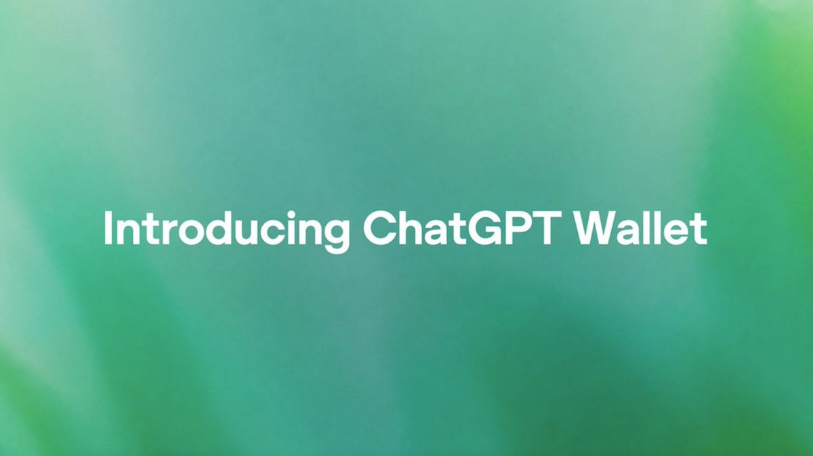

> [中文版 Chinese version](/life/chatgpt-wallet-zh/)

*OpenAI's announcement art for ChatGPT Wallet. Image: OpenAI, via Engadget.*

## What launched

On Friday, November 13, OpenAI launched **ChatGPT Wallet**, a payment feature that lets its AI agents — called **dots** — complete purchases on a user's behalf. OpenAI calls it "the first wallet that lets agents pay without access to users' actual card details and that requires a security check for every purchase." It was built in partnership with **American Express, Mastercard, and Visa**.

The timing is not subtle. OpenAI says **1.2 billion people use ChatGPT each week**, and many of them already use it to research products, compare options, and decide what to buy. Wallet is the step from deciding to paying — and from a chatbot to a checkout.

## How a purchase works

The flow, as OpenAI describes it:

1. The user adds an eligible card to ChatGPT Wallet once.
2. They ask their dot to handle a purchase.
3. Before anything is charged, the user reviews the items, the total, and the card — then approves with a security check such as Face ID or a fingerprint. Each approval creates a record of what was authorized.
4. After approval, the payment network issues a **payment token** — a substitute with its own card number, security code, and expiration date. The charge lands on the real card, but neither the agent nor the merchant ever sees the real card details. The merchant still receives what it needs to fulfill the order, like the shipping address.

Card rewards and dispute protections for eligible disputes are preserved, OpenAI says. The wallet itself holds no funds and extends no credit.

## Who can actually use it: almost nobody, yet

The rollout is deliberately tiny. At launch, Wallet is available only to a **limited number of ChatGPT Pro subscribers in the US, aged 18 and older, with eligible US-issued cards** — American Express, Chase, Mastercard, and Visa credit cards. Debit cards and virtual cards are not supported. There is no announced date for Plus or free users, or for any country outside the US.

OpenAI says it plans to let users eventually delegate purchases entirely — spending limits, purchase categories, time periods, pre-approved with enhanced safeguards — but no date has been given. For now, every purchase needs a human tap.

## The merchant side: your bot blocker is the bouncer

Alongside Wallet, OpenAI published a **Commerce Partner Playbook** for businesses, covering product feeds, agent access, payments, plugins, Sign in with ChatGPT, and business profiles. Its most honest line is a warning: Wallet works with existing checkout pages and needs no special integration — but **some sites may unintentionally block purchases**, because their bot-detection and fraud systems see a cloud browser and treat it as a bot. OpenAI is working with payment providers Adyen, Checkout.com, and Stripe, and fraud vendors Forter, Riskified, Sardine, and Signifyd, to get agent purchases recognized as legitimate.

The scale of that problem is measurable. In a test by Blend, bot protection turned away an AI shopping agent at **29 of 200 UK and US retailers on both attempts**. And the biggest store of all is not an accident: **Amazon blocks AI agents**, steering shoppers to its own assistant, Alexa. TechCrunch also notes that DoorDash and Uber have each reported low numbers of orders placed by AI agents so far. The demand side of agentic shopping is still mostly a promise.

## OpenAI has tried this before — and killed it

The timeline below is the part OpenAI would rather you forget:

*OpenAI's agent-checkout history: Instant Checkout launched September 29, 2025, shut down March 2026; dots launched September 29, 2026; ChatGPT Wallet launched November 13, 2026. Sources: OpenAI; TechCrunch.*

**Instant Checkout**, launched September 29, 2025 with Stripe and US Etsy sellers, kept the purchase inside ChatGPT. OpenAI shut it down in March 2026. Wallet flips the model: the agent goes to the merchant's own website and checks out like a customer. The store keeps the order, the fulfillment, and the customer relationship — and OpenAI, notably, **takes no percentage cut of transactions at launch**.

That no-cut decision is the tell. OpenAI is not launching a payments business; it is bidding for the checkout layer itself. Visa, Mastercard, and American Express have all been building their own agent-payment rails since April 2025, and Google's Gemini still cannot transact with Google Wallet. Everyone agrees the agent will eventually pay. Nobody agrees who gets to be the wallet.

## The verdict: good plumbing, unanswered liability

The design is the right one. A network token plus a per-purchase biometric approval is a serious answer to the obvious fear — an agent with your card number — and it is a better answer than handing the agent the card itself. OpenAI deserves credit for shipping the boring, correct version instead of the reckless one.

But three gaps decide whether Wallet matters. First, the audience: US Pro subscribers only, a rounding error against 1.2 billion weekly users. Second, the door: merchants' own fraud systems and Amazon's wall treat the agent as an intruder, and OpenAI's playbook is a polite request, not a fix. Third, the liability question nobody has answered: when the agent buys the wrong size, the wrong color, or twice, the dispute is still the buyer's — "the agent did it" is not a chargeback reason, and no one has said whose mistake it is when the human approved a screen the agent filled in.

Wallet is worth watching because the checkout is becoming the next platform war. The winner will not be whoever builds the smartest agent. It will be whoever the stores, the networks, and the fraud systems all agree to let through the door. Right now, that agreement does not exist — and the largest store on the internet has already voted no.
