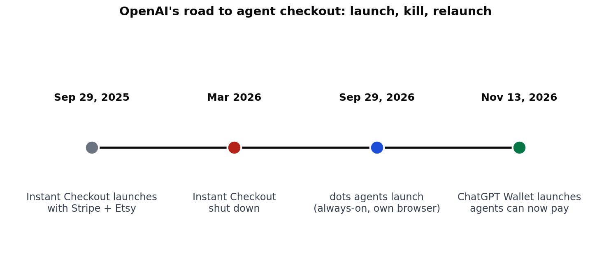

> [中文版 Chinese version](/life/chatgpt-wallet-zh/)

*OpenAI's announcement art for ChatGPT Wallet. Image: OpenAI, via Engadget.*

## What launched

On Friday, November 13, OpenAI launched **ChatGPT Wallet**, a payment feature that lets its AI agents — called **dots** — complete purchases on a user's behalf. OpenAI calls it "the first wallet that lets agents pay without access to users' actual card details and that requires a security check for every purchase." It was built in partnership with **American Express, Mastercard, and Visa**.

The timing is not subtle. OpenAI says **1.2 billion people use ChatGPT each week**, and many of them already use it to research products, compare options, and decide what to buy. Wallet is the step from deciding to paying — and from a chatbot to a checkout.

## How a purchase works

The flow, as OpenAI describes it:

1. The user adds an eligible card to ChatGPT Wallet once.
2. They ask their dot to handle a purchase.
3. Before anything is charged, the user reviews the items, the total, and the card — then approves with a security check such as Face ID or a fingerprint. Each approval creates a record of what was authorized.
4. After approval, the payment network issues a **payment token** — a substitute with its own card number, security code, and expiration date. The charge lands on the real card, but neither the agent nor the merchant ever sees the real card details. The merchant still receives what it needs to fulfill the order, like the shipping address.

Card rewards and dispute protections for eligible disputes are preserved, OpenAI says. The wallet itself holds no funds and extends no credit.

## Who can actually use it: almost nobody, yet

The rollout is deliberately tiny. At launch, Wallet is available only to a **limited number of ChatGPT Pro subscribers in the US, aged 18 and older, with eligible US-issued cards** — American Express, Chase, Mastercard, and Visa credit cards. Debit cards and virtual cards are not supported. There is no announced date for Plus or free users, or for any country outside the US.

OpenAI says it plans to let users eventually delegate purchases entirely — spending limits, purchase categories, time periods, pre-approved with enhanced safeguards — but no date has been given. For now, every purchase needs a human tap.

## The merchant side: your bot blocker is the bouncer

Alongside Wallet, OpenAI published a **Commerce Partner Playbook** for businesses, covering product feeds, agent access, payments, plugins, Sign in with ChatGPT, and business profiles. Its most honest line is a warning: Wallet works with existing checkout pages and needs no special integration — but **some sites may unintentionally block purchases**, because their bot-detection and fraud systems see a cloud browser and treat it as a bot. OpenAI is working with payment providers Adyen, Checkout.com, and Stripe, and fraud vendors Forter, Riskified, Sardine, and Signifyd, to get agent purchases recognized as legitimate.

The scale of that problem is measurable. In a test by Blend, bot protection turned away an AI shopping agent at **29 of 200 UK and US retailers on both attempts**. And the biggest store of all is not an accident: **Amazon blocks AI agents**, steering shoppers to its own assistant, Alexa. TechCrunch also notes that DoorDash and Uber have each reported low numbers of orders placed by AI agents so far. The demand side of agentic shopping is still mostly a promise.

## OpenAI has tried this before — and killed it

The timeline below is the part OpenAI would rather you forget:

*OpenAI's agent-checkout history: Instant Checkout launched September 29, 2025, shut down March 2026; dots launched September 29, 2026; ChatGPT Wallet launched November 13, 2026. Sources: OpenAI; TechCrunch.*

**Instant Checkout**, launched September 29, 2025 with Stripe and US Etsy sellers, kept the purchase inside ChatGPT. OpenAI shut it down in March 2026. Wallet flips the model: the agent goes to the merchant's own website and checks out like a customer. The store keeps the order, the fulfillment, and the customer relationship — and OpenAI, notably, **takes no percentage cut of transactions at launch**.

That no-cut decision is the tell. OpenAI is not launching a payments business; it is bidding for the checkout layer itself. Visa, Mastercard, and American Express have all been building their own agent-payment rails since April 2025, and Google's Gemini still cannot transact with Google Wallet. Everyone agrees the agent will eventually pay. Nobody agrees who gets to be the wallet.

## Tokenization is a decade old — the agent is what's new

The cleverest part of ChatGPT Wallet is also its least novel part. The network token at its centre is the same technology that has protected every tap-to-pay purchase since Apple Pay launched in 2014. When you add a card to a mobile wallet, the wallet never stores your real 16-digit card number — the Primary Account Number, or PAN. Instead, your bank asks the card network's Token Service Provider to issue a substitute: a device-specific number, called a Device Account Number, that looks like a card number but maps back to the real one only inside the network's secure vault. At the point of payment, the phone sends the token plus a one-time cryptogram — a cryptographic code generated for that single transaction from the token, the amount, and a counter — and the network swaps the token for the real card number, verifies the cryptogram, and approves or declines. The merchant, the terminal, and the receipt never see the real number. A stolen token is worthless: it is locked to one device, often to one transaction, and cannot be mathematically reversed into the PAN.

What OpenAI has done is take that plumbing and point it at a new actor. In Apple Pay, the token lives in the phone's Secure Element and the human authenticates each tap with Face ID. In ChatGPT Wallet, the token is issued for the agent's purchase, and the human authenticates each purchase with a security check before the token is released. The security model is therefore familiar — the same EMVCo tokenization standard, the same token vault, the same one-time cryptogram — but the threat model is different. Apple Pay protects a card from a merchant's breach. Wallet has to protect a card from the agent itself: from an agent that might buy the wrong thing, buy twice, or be tricked by a malicious page into buying something the user never asked for. The per-purchase approval is the answer to that threat, and it is the reason the design deserves the credit the verdict gives it. But it is also a confession: OpenAI does not yet trust its own agent enough to let it pay unsupervised, and neither should you.

## The networks got there first

OpenAI's launch looks like a first, but the card networks spent the eighteen months before it building the same thing from their side. Visa launched Intelligent Commerce on April 30, 2025, opening its network to AI agents with tokenized credentials, identity checks, and spend controls; Mastercard launched Agent Pay a day earlier, on April 29, built on Agentic Tokens — an extension of the tokenization behind mobile contactless payments — with agent identity and verifiable intent bound to the token, revocable from the issuer's app. American Express followed in April 2026 with its Agentic Commerce Experiences developer kit, and Google announced AP2, the Agent Payments Protocol, in September 2025 with more than 60 partners, including Mastercard, Visa, American Express, PayPal, and Adyen. Visa added a Trusted Agent Protocol in October 2025, designed to help a merchant tell a real agent from a bot at checkout, and an Intelligent Commerce Connect on-ramp in April 2026.

None of those products has yet produced volume. As of October 2026, none of Visa, Mastercard, or American Express had published agentic payment volumes; Visa's Intelligent Commerce was still in closed beta and pilot, and Mastercard's bank transactions so far were controlled pilots, not commercial rollouts. The trust numbers explain why: Visa's own Trust Index put US consumer trust in generative AI handling payments at 23 percent, and Visa's own benchmark found that 22 AI models failed 42.8 percent of shopping test runs — and that in 54 percent of the failed runs, the agent still made a purchase. That last number is the one that should worry anyone building an agent wallet: the failure mode of an agentic shopper is not that it gives up, but that it buys anyway. OpenAI's per-purchase approval exists precisely because the industry knows its agents fail nearly half the time and keep spending when they do.

## Why merchants block bots — and why "just let them in" is not a fix

The merchant side of this story is usually told as stubbornness: stores with bot blockers that cannot tell a helpful agent from a scalper. The reality is less flattering to the agents. Bot detection exists because bots are, overwhelmingly, a cost: they scrape prices, hoard inventory, test stolen cards, and place fraudulent orders. A retailer's fraud system does not see a "helpful AI shopping agent." It sees a cloud browser, with no purchase history, no device fingerprint, and no human behaviour, arriving at checkout at machine speed. The Blend test cited above — 29 of 200 UK and US retailers turning an agent away on both attempts — measures a system working as designed, not a system malfunctioning.

That is why OpenAI's Commerce Partner Playbook is a polite request rather than a fix, and why the fix will be slow. Telling a merchant's fraud system to trust an agent means giving the merchant a reason to trust it: a cryptographic signal that this browser session is a known agent, acting for a verified customer, with a verified intent — which is exactly what Visa's Trusted Agent Protocol and Mastercard's agent registration are trying to build. Mastercard is also working with Cloudflare so banks can check whether the agent browsing a site is the same one that pays. None of that infrastructure is live at scale yet. Until it is, every agent purchase is a negotiation between a fraud system tuned to say no and a wallet asking it to say yes — and the fraud system, which is liable when it says yes wrongly, has no incentive to hurry.

## The liability gap, in detail

The unanswered question in the verdict — whose mistake is it when the agent buys the wrong thing — has a sharper form once you look at how card disputes actually work. A chargeback is not a general complaint mechanism. It is a set of narrow dispute categories defined by the card networks: fraud, processing errors, goods not received, goods not as described. "The agent did it" is not among them, and one review of Visa's rules found no dispute category specific to agents at all. If the agent buys the wrong size and the user approved the screen, the transaction is, from the network's point of view, an authorised purchase of the wrong item — which is a return, not a chargeback, and returns are governed by the merchant's policy, not by the card network.

American Express is the first network to address this directly. Its April 2026 announcement included Amex Agent Purchase Protection, described as an industry-first commitment to protect card members from charges resulting from registered AI agent error — with the important caveat that full terms were still unpublished as of October 2026, so it should be treated as announced rather than live. The direction of travel is clear: the network that puts its guarantee behind agent error wins the trust that Visa's 23 percent figure says is missing. But until that protection exists in enforceable terms, the liability sits where it has always sat: with the buyer who tapped approve. OpenAI's approval record — a log of what was authorised — helps in a dispute with a merchant, but it does not create a chargeback right, and it does not answer the question the user will actually ask: "I approved a screen the agent filled in. Who pays for its mistake?" Nobody has answered that yet.

## The verdict: good plumbing, unanswered liability

The design is the right one. A network token plus a per-purchase biometric approval is a serious answer to the obvious fear — an agent with your card number — and it is a better answer than handing the agent the card itself. OpenAI deserves credit for shipping the boring, correct version instead of the reckless one.

But three gaps decide whether Wallet matters. First, the audience: US Pro subscribers only, a rounding error against 1.2 billion weekly users. Second, the door: merchants' own fraud systems and Amazon's wall treat the agent as an intruder, and OpenAI's playbook is a polite request, not a fix. Third, the liability question nobody has answered: when the agent buys the wrong size, the wrong color, or twice, the dispute is still the buyer's — "the agent did it" is not a chargeback reason, and no one has said whose mistake it is when the human approved a screen the agent filled in.

Wallet is worth watching because the checkout is becoming the next platform war. The winner will not be whoever builds the smartest agent. It will be whoever the stores, the networks, and the fraud systems all agree to let through the door. Right now, that agreement does not exist — and the largest store on the internet has already voted no.

<!-- rebuild trigger 2026-11-15 -->
