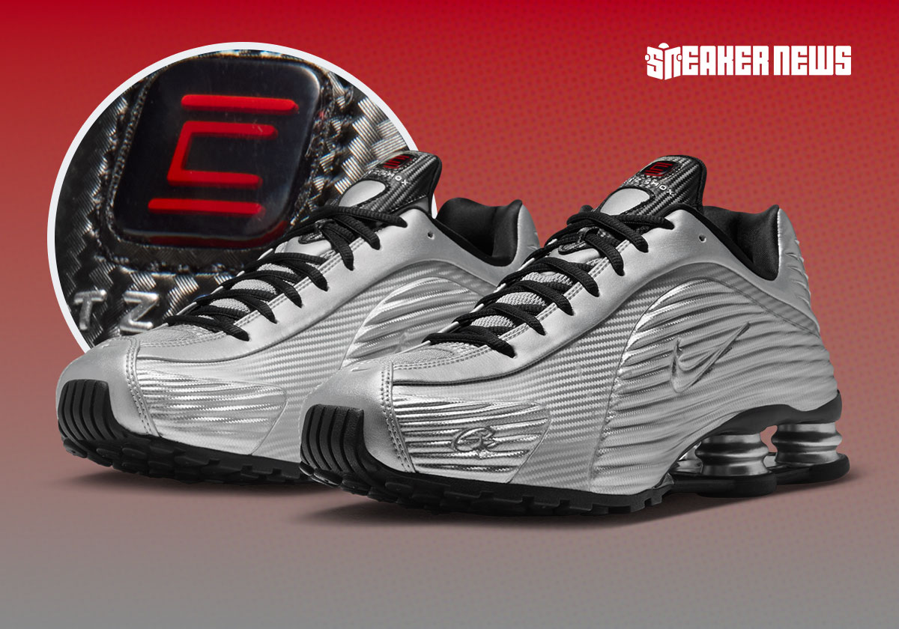
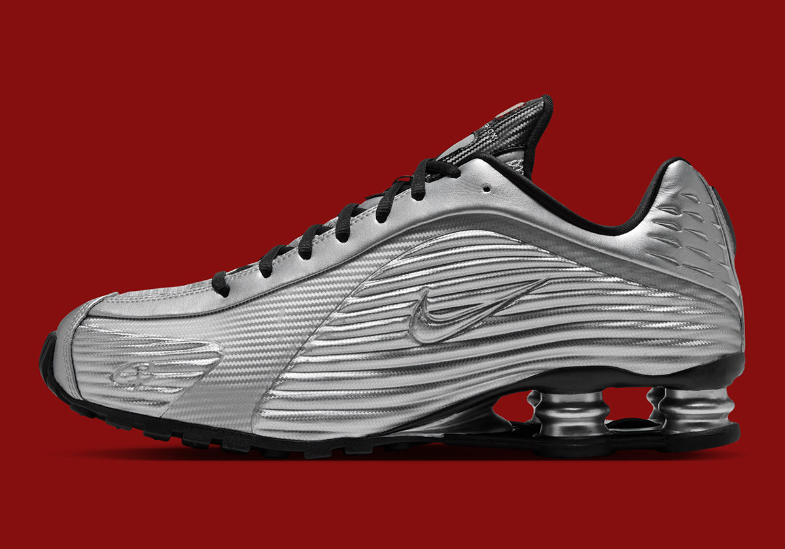
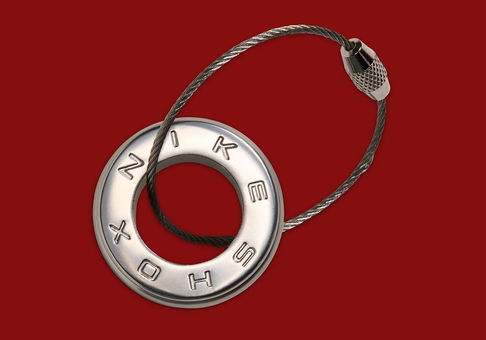
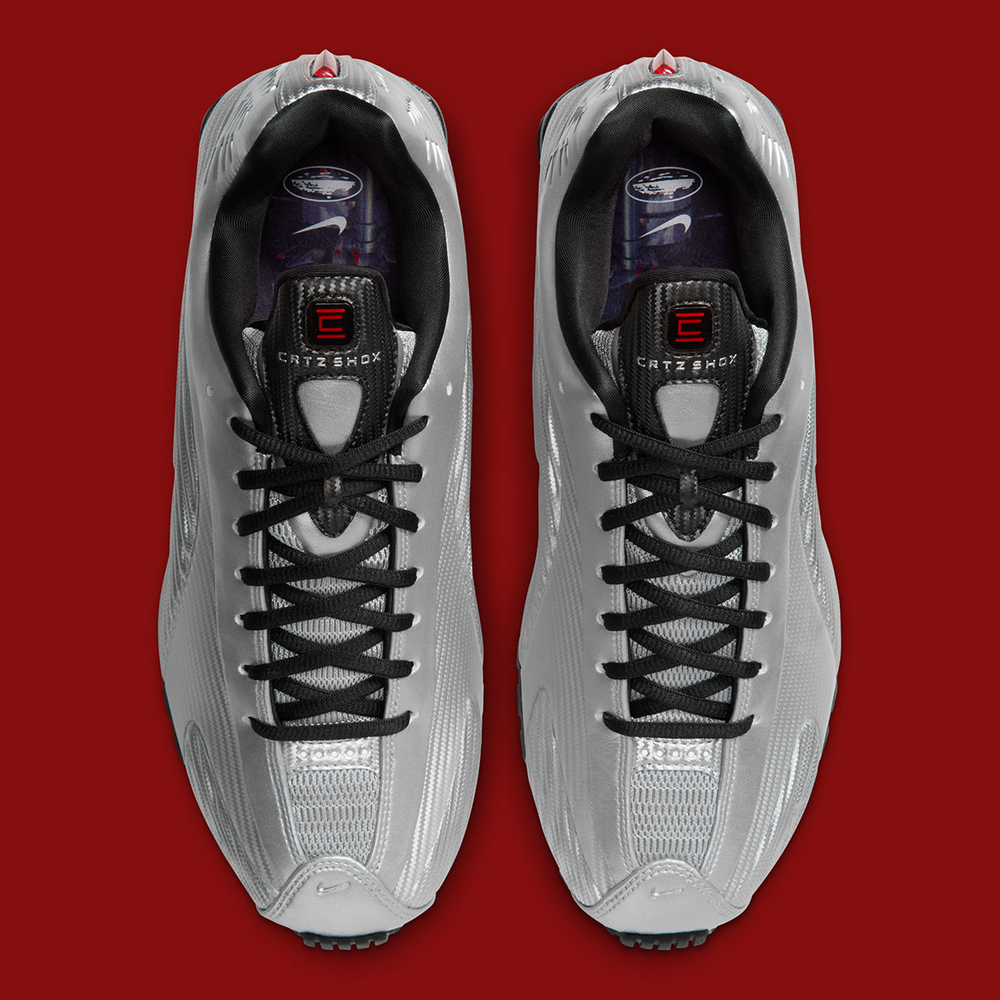
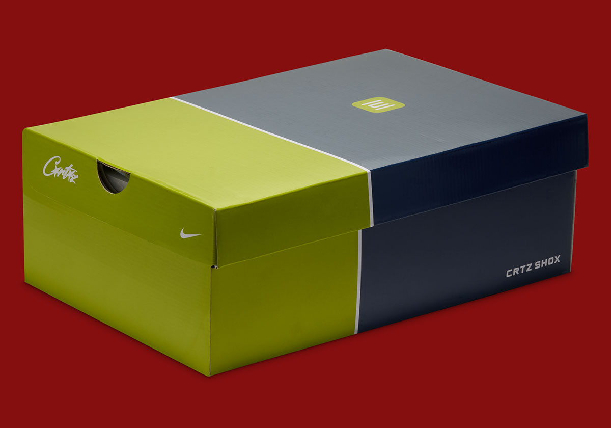
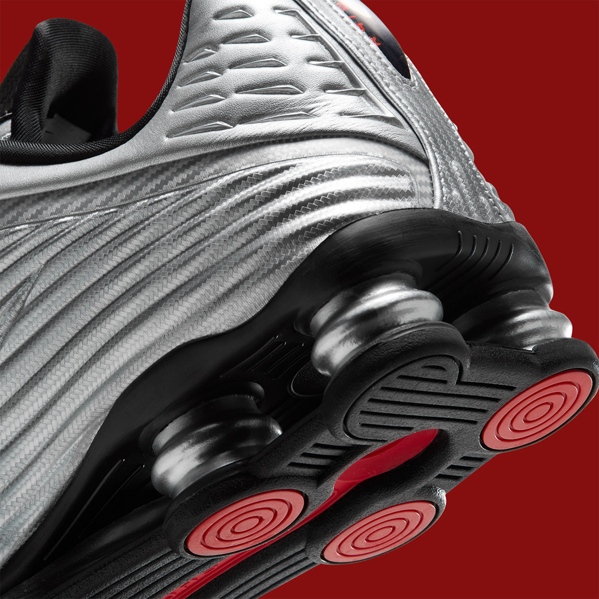
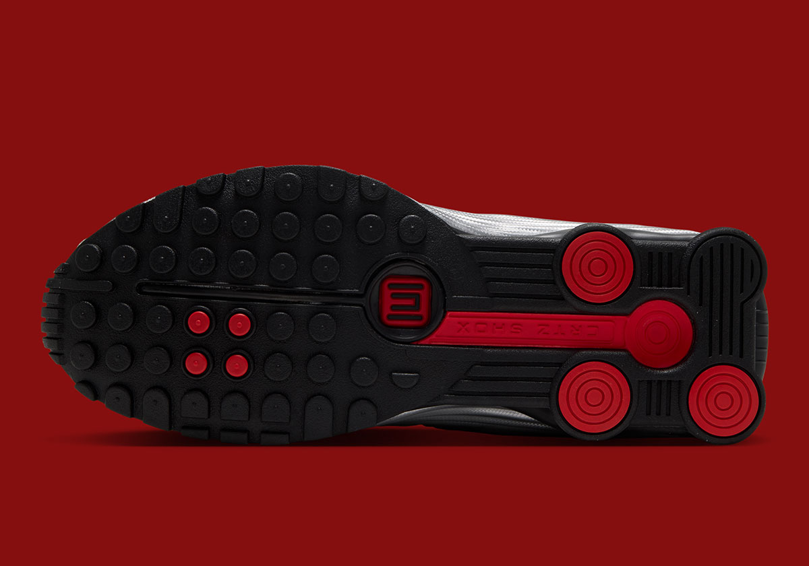
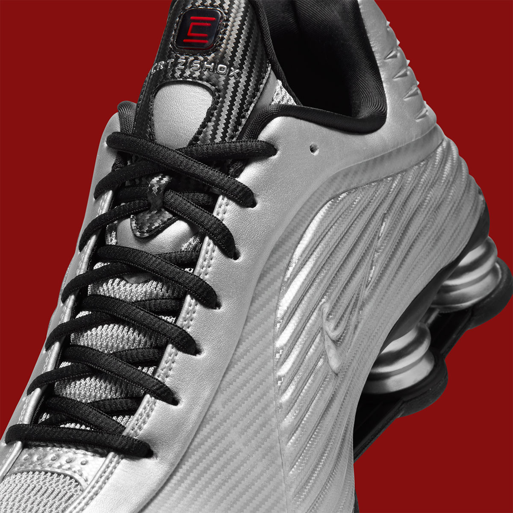

> [English version 英文版](/life/corteiz-nike-shox-r419-silver-surfer/)

五年前，Nike 把 Corteiz 告上了法庭。这家伦敦街头品牌的律师函里写着：品牌名听起来太像 Nike 1972 年的跑鞋 Cortez。案子最后以 1,850 英镑和解。而今天，2026 年 11 月 15 日，Corteiz 创始人 Clint Ogbenna——也就是 Clint419——发售了一双 Nike 鞋，鞋上印着他自己的编号：Corteiz x Nike Shox R419 “Metallic Silver”，又名 “Silver Surfer”。今天先通过 Corteiz 自家网店 r419.com 发售，11 月 20 日星期五再通过 Nike SNKRS 更广发售。从被告到合作方，再到一个以你名字命名的鞋型——这条弧线就是这双鞋的故事，也是它能领跑今天的原因。

先说一句实在话：这不是 R419 的上脚评测。这双鞋今天才发售，Nike 和 Corteiz 之外没有人穿着这个配色跑过有意义的里程。下面是一篇长篇首次深度解析——事实、让鞋跟上的名字有分量的五年 Corteiz–Nike 历史、设计与鞋底下那套 26 年历史的技术、这双鞋在一个三配色套装和一场 Nike 自己先发起的 Shox 复兴里的位置，以及这笔钱到底买到了什么——能核实的说法和不能核实的说法会分开讲。

*Corteiz x Nike Shox R419 “Silver Surfer” 的 Nike 官方图：从鞋头到鞋跟全是金属银，黑色鞋带，鞋跟下是四根 Shox 柱子。右上角是红色 C-Star 标志特写。图片：Nike，经 Sneaker News。*

## 事实一览

| | |
|---|---|
| **型号** | Corteiz x Nike Shox R419 “Metallic Silver”（“Silver Surfer”） |
| **货号** | IQ9951-001 |
| **配色** | Metallic Silver / Metallic Silver – University Red – Black（金属银／金属银－大学红－黑） |
| **发售日** | 2026 年 11 月 15 日星期日，通过 Corteiz 网店 r419.com；2026 年 11 月 20 日星期五，通过 Nike SNKRS（据报道为美东时间上午 10 点） |
| **发售价** | Corteiz 渠道标价 180 美元（Sole Retriever），SNKRS 标价 190 美元（Sneaker News、Nice Kicks）——截至 2026 年 11 月 15 日，两个渠道的标价并不一致；价格快照，可能变动。英国 SNKRS 标价 174.99 英镑。 |
| **发售渠道** | 今天 r419.com；11 月 20 日 Nike SNKRS 与指定零售商 |
| **这双鞋是什么** | Corteiz 与 Nike 的第三个鞋款合作，也是第一双把 Clint419 的名字写进鞋里的鞋——以 Nike Shox R4 为蓝本重新设计，三配色套装之一 |

## 为什么这双鞋是今天的头条

热度很容易举证，因为这双鞋刚一露面，球鞋媒体就全站到了它身后。Sneaker News 在 11 月 9 日发了带完整 13 张官方图的专门解析，11 月 10 日 Clint419 宣布 11 月 15 日发售后又更新了文章。Sole Retriever 报道了两次——10 月 19 日的整套解析和 11 月 6 日的银色款专篇——它的页面上这双鞋的实时标价是 607 美元，对应 180 美元的发售价；这只是转售市场的一个快照，不是预测，但已经直白地说明了需求有多大。Nice Kicks、Hypebeast、HotNewHipHop 和一串发售追踪站都发了专门报道，GOAT 还为背后的 Corteiz 故事写了整篇特稿。

一双建立在 26 年历史缓震系统上的鞋能拿到这么多关注，值得问一句为什么。答案是，R419 一次讲了三个故事：Nike 卖过最怪异的鞋底回来了、过去十年最会做独立街头品牌的厂牌加冕了、还有一个花了五年才讲完的笑话。Nike 曾经为了一个名字起诉这个人。现在鞋子用他的名字命名。

## 故事：从 1,850 英镑到 R419

Corteiz——全名 Corteiz RTW——2017 年由英籍尼日利亚创意人 Clint Ogbenna 在西伦敦创立，网名 clint419。最初的产品是印着阿尔卡特拉斯岛（Alcatraz）标志的丝网印花连帽衫，通过一个需要密码才能进的网站售卖。没有广告战役，没有媒体通稿，好几年不接受采访。品牌是靠硬办法长大的：稀缺、口碑、把密码当成会员卡的社群。Central Cee、Dave 等音乐人都在舞台上穿过那个阿尔卡特拉斯标志，到 2020 年代初，Corteiz 已经是英国最有影响力的品牌之一——而且从来没按大品牌的规矩行事。

Nike 注意到了，一开始并不友善。2021 年，Nike 的律师起诉了这个品牌，理由是 “Corteiz” 会让搜 Cortez（Nike 1972 年田径鞋）的消费者混淆。和解金额是 1,850 英镑——一个零头数字，后来成了这段合作关系的起源神话。不到 18 个月，Nike 改主意签下了 Ogbenna，而不是继续打官司；2023 年 3 月，双方发布了第一个正式合作：Corteiz x Nike Air Max 95，城市限定配色——伦敦的 “Gutta Green”、纽约和巴黎的 “Pink Beam” 与 “Aegean Storm”——在 Air Max Day 发售，190 美元。2024 年跟进了一双 Air Trainer Huarache，2025 年又出了第四双 Air Max 95 “Honey Black”。

但 Shox 是新的 territory。Air Max 95 和 Huarache 本来就是 Nike 自己在大力推的鞋，Corteiz 给了它们一个新受众。R419 是第一双鞋身本身就带着 Clint 名字的鞋——R4 加上 419，也就是他从 Corteiz 出现之前就一直在用的网名。这也是 Corteiz x Nike 第一个不只是一双鞋、而是一整套衣橱的项目：一支两分多钟的宣传片，由 George Muncey 和 Elliott Elder（以 Uncanny 为名合作）执导，本质上是一支关于“怎么拍这支广告”的广告；再加一整套技术面料服装、运动套装和 oversize 单品。

首波曝光还是 Corteiz 一贯的方式：Clint 自己的 Instagram，一组与一辆梅赛德斯-奔驰 SLR McLaren 合影的照片。那辆车不是随便摆的道具，它就是这双鞋的全部设计语言。

## 设计：一辆车，穿在脚上

R419 以 2000 年的 Nike Shox R4 为起点，围绕汽车重新设计。鞋面由横贯鞋头与侧面的雕塑感棱线定义，层层叠叠像车身钣金，配上碳纤维质感的细节——看起来是编织纹理，而不是印花。Nike 自己的文案把设计归功于 Ogbenna，描述是：一块 TPU 覆盖层沿着原版鞋的压纹轮廓以黑色勾勒，再加一个围绕鞋头重新搭建的框架，用来放他的 C-Star 标志——那个出现在鞋舌与鞋头的红色 “C”。

品牌标识被塞进了每一个能放的表面。鞋舌上 “CRTZ SHOX” 字样配红色 “C”，用的就是 Shox 标志性的字体，鞋舌本身包着碳纤维质感的材料。“R419” 印在半透明的鞋跟柱子里——整双鞋上唯一能看到缓震系统的地方——名字就坐在技术里面。大底沿着中部印着红色的 “CRTZ SHOX”，大底后跟的黑色窗口里是红色 C 标志。

*侧面轮廓：鞋面上的雕塑感棱线、压进银色里的同色 Swoosh、鞋头重做的框架上带着 C-Star 标志，鞋跟下是四根 Shox 柱子。图片：Nike，经 Sneaker News。*

真正把概念讲透的是两个细节。鞋垫上印着发动机主题的图案——一根汽车螺旋弹簧减震器，镀铬筒身、红色弹簧，从轮拱内侧向上拍的视角——这正是 Nike 当年给 Shox 起名的那个零件，26 年后又被印回了鞋里。而每双鞋都附带一枚联名螺栓垫圈作为收尾配件：一枚机加工金属环，刻着字，穿在一根钢缆上。它是一件五金件，不是一个吊牌，也是鞋盒里最有 Corteiz 味道的东西——一个一直把产品当违禁品卖的品牌，把一双球鞋当成机器零件来对待。

*收尾的一笔：一枚机加工金属螺栓垫圈，刻字、穿在钢缆上——一件五金件，不是一个吊牌。图片：Nike，经 Sneaker News。*

“Silver Surfer” 是三个配色里最“传统 Shox”的一双，这是有意的选择。它最贴近原版 Shox R4 自己的配色——2000 年设计团队做的银红配色，灵感来自阿波罗飞船、20 世纪特快列车（20th Century Limited）和 James Dean 的保时捷 550 Spyder。另外两个配色离源头更远：“Black Widow”，黑色鞋面配大学红点缀；“Mystique”，Game Royal（比赛皇家蓝）配大学红与黑。Black Widow 和 Mystique 会不会也上 Nike，目前还不清楚——Sneaker News 报道说至少有一双很可能只在 Corteiz 渠道发售——而错峰发售的结构已经看得见：Game Royal 那双，也就是 Mystique，10 月 31 日和 11 月 1 日在东京原宿的 The Hall 发售，11 月 4 日通过 r419.com 线上发售，服装同批上架。银色款是 Nike 拿到 SNKRS 的那一双，相对而言是套装里最容易买到的那一章。

*俯视：整双鞋，鞋舌上的 “CRTZ SHOX”、碳纤维质感材料，以及从鞋口露出来的发动机图案鞋垫。图片：Nike，经 Sneaker News。*

包装把这个想法收了尾。鞋盒从中间一分为二——一边荧光绿，一边深藏青——绿的那半印着 Corteiz 手写体标志和一个 Nike Swoosh，藏青那面印着 “CRTZ SHOX”。这是一个两个品牌的盒子，没有假装把两个品牌融成一个——而这正是这次合作的诚实版本。

*鞋盒：荧光绿与深藏青从中间对半分，一边是 Corteiz 手写体，另一边印着 “CRTZ SHOX”——两个品牌，没有融成一个。图片：Nike，经 Sneaker News。*

## 技术：花十六年造一根弹簧

鞋跟下的柱子是这双鞋里最老的想法，也是最怪的。设计了 Air Force 1 的 Nike 设计师 Bruce Kilgore 从 1984 年开始研究机械缓震系统，在新罕布什尔州埃克塞特的一双 Nike Internationalist 上做原型——那东西看起来更像山地车的避震前叉，而不是一双鞋。花了十六年才上架。设计团队先在鞋底里试过钢弹簧，最后选了中空泡沫柱，弹性和支撑的平衡更好；Air Max 95 的设计师 Sergio Lozano 在确定中空结构的过程中起了关键作用。第一批 Shox 鞋在 2000 年上架——跑步的 R4、篮球的 BB4、交叉训练的 XT4——名字标明运动项目和柱子数量：鞋跟下四根中空聚氨酯柱子，受冲击时压缩，再回弹把能量还回去。

发售时刻是球鞋史上最有名的场面之一。2000 年悉尼奥运会上，美国队的 Vince Carter——穿着 Shox BB4，那是他在 Nike 的第一双签名鞋——飞跃了法国队 7 英尺 2 英寸（约 218 厘米）的中锋 Frédéric Weis。那记“死亡之扣”给这个鞋型带来的关注，超过任何广告投入；此后 Carter 的每一双签名鞋都建立在 Shox 系统上。而 R4 则在远离跑道的地方找到了第二生命：它成了英国地下文化、grime 音乐圈和足球看台的固定装束，在那里柱子读起来像盔甲，而不是技术。

先做一处小小的考据说明，因为年份对收藏者很重要：大多数独立鞋史把第一批 Shox 定在 2000 年，但 Nike 自己近期的文案把 R4 称为 2001 年的 icon。年份没有完全定论，这里也不做定论——2000 年是被广泛报道的发售年份，2001 年是 Nike 自己目前的说法。

*鞋跟：四根 Shox 柱子一览无遗，银色鞋面上的棱线，以及大底上的红色圆形抓地块。图片：Nike，经 Sneaker News。*

实话实说这套技术在 2026 年意味着什么。Shox 是真正的创新——鞋里第一个能量回馈系统，也是今天跑鞋里弹簧板与超级泡棉的祖先——但 R4 是 26 年前的脚感，现代复刻首先是一双生活方式鞋。柱子偏硬，鞋按今天的标准偏重，脚感和现在的 Nike 跑鞋完全不是一回事。诚实的说法是：你买柱子，是因为它们长什么样、代表什么，而不是因为它们跑起来比现在的训练鞋强。实用层面还有一点：选购指南提到 R4 的中足略窄，脚宽的人最好试穿，或者考虑大半码，别凭感觉猜。

*大底：黑色橡胶配红色圆形抓地块，后跟窗口里的红色 C 标志，以及中部红色的 “CRTZ SHOX”。图片：Nike，经 Sneaker News。*

## 套装，以及它搭上的那场复兴

R419 不是凭空来的。Nike 自己几个月来一直在重建 Shox 产品线：两双市售版 R4 定在 11 月 1 日发售，其中一双是全黑漆皮——品牌只有在已经确认需求之后才会发这种配色——而 2025 年底推出的女子鞋型 Shox Z（没有原版原型）一年内就拿到了联名。这不是一个靠联名救活的休眠型号，而是一场 Nike 自己先发起的复兴走到高点时的交接，名字把算术直接喊了出来：R4 加 419。

这个背景是判断银色款在套装里位置的正确方式。Mystique 已经有过它的时刻——东京，然后 11 月 4 日的 r419.com——Black Widow 的渠道还没确认。Silver Surfer 是有 SNKRS 日期、有一整套官方图、已经被转售市场定过价的那一双：Sole Retriever 的页面显示实时标价 607 美元，对应 180 美元发售价，那是 11 月 15 日的快照，Corteiz 那波一清就会变。别把这个数字当成承诺，把它当成市场对一双按 Corteiz 标准来说“异常好买”的鞋开出的第一口价——能上 SNKRS 和只能在伦敦凭密码抢，是两回事。

## 本周的其他动静

今天很挤。R419 之外，Playa Society x Nike A’Two——A’ja Wilson 签名鞋上的第一个联名——以 “Dark Russet” 和 “Ocean Bliss” 两个配色发售，155 美元；Nike Air Max Plus “Batman” 同日发售，190 美元。11 月 17 日星期二才是更大的一天：Rick Owens x adidas Springblade 系列——两双跑鞋 590 美元、一双 oversize 长靴 850 美元，这是把 adidas 2010 年代的刀片缓震跑鞋带回来的第一大步；双方在 11 月 9 日宣布重聚，距离上次合作已近十年——同日还有 Nike LeBron 24 “Stars”、Nike KD 6 “Texas”（135 美元）和 NOCTA x Nike Air Modmax “Pink Spell”（180 美元）。

但 Silver Surfer 的诚实对照不是其中任何一双，而是它自己的套装。Mystique 是更稀有的那一章，首波窗口已经过去；Black Widow 是更深色、更好穿的那一双，渠道还没确认。银色款是最大声、最容易买到、设计上最接近 2000 年原版的那一双。如果你想要 R419 这个物件——柱子、镀铬、垫圈——就是这一双。如果你想要的是炫耀，Mystique 已经在东京把这活干完了。

## 购买建议

按发售日的重要顺序，讲几条实用的。

**两次发售。** 今天 11 月 15 日，这双鞋先通过 Corteiz 的 r419.com 发售——这是 Clint419 在 11 月 10 日宣布的渠道，也是会先卖光的那一波。11 月 20 日星期五，它再通过 Nike SNKRS 更广发售，190 美元（据报道为美东时间上午 10 点），另有指定零售商。今天没抢到，11 月 20 日是一次真正的第二次机会，不是安慰奖——而且从计划的角度说，它是两波里更容易准备的一波，因为 SNKRS 抽签是抽奖，Corteiz 发售是冲刺。

**尺码。** 据选购指南，R4 的中足略窄——脚型正常就按平时 Nike 尺码，脚宽就考虑大半码。能试穿就试穿，柱子不像泡棉，紧了不会自己让步。

**转售，实话实说。** 607 美元的实时标价对 180 美元的发售价，是那种会让人想买两双的数字。别这么干。这个数字是两次发售清掉之前的快照，而 Corteiz 上 SNKRS 的鞋有个习惯：第二波一落地，价格就会回落。想买鞋，先试两次发售。两次都错过，等市场找到它的位置，别在第一天付开盘价。

**适合谁。** 如果你追 Corteiz，这双必入——这是第一双把 Clint 的名字写进鞋里的 Nike 鞋，从 1,850 英镑和解到 R419 的故事是这次合作里最好的一条弧线。如果你喜欢 Shox R4，这是复兴至今最忠实原版的一次，镀铬加红就是原版配色的直系后代。如果你想要一双安静的日常鞋，对自己诚实一点：这是一双金属银、带外露机械柱子、盒里附螺栓垫圈的鞋。它配运动套装和某种态度，别的场合不多。

**唯一需要注意的。** SNKRS 的 190 美元比 Corteiz 渠道的 180 美元贵 10 美元，贵的这部分买的是更广的渠道，不是另一双鞋。鞋本身两边是一样的。今天那波抢不到，11 月 20 日只隔五天——这双鞋值得等五天，不值得付溢价。

*鞋舌特写：Shox 字体写成的 “CRTZ SHOX” 字样配红色 “C”，碳纤维质感材料，以及鞋面上的雕塑感棱线。图片：Nike，经 Sneaker News。*

## 结论

R419 “Silver Surfer” 是 Corteiz x Nike 故事里最奇怪的一章，也正是它能领跑今天的原因。作为概念，它是双方多年来给一双鞋安过的最锐利的想法——不是换个 logo，而是一个汽车零件、一场官司、一个网名，装进了一双 26 年历史的跑鞋。作为物件，它是 Corteiz 至今最完整的一次发售：雕塑感鞋面、鞋垫里的发动机图案、印在鞋跟柱子里的名字、盒里的螺栓垫圈。作为一次购买，它是两次发售——今天 r419.com，星期五 SNKRS——所以老规矩适用：先试发售，别付首日转售价，买它是因为这个故事让你笑了。

五年前，Nike 为了一个名字起诉这个品牌，和解金额 1,850 英镑。今天鞋子用那个人的名字命名。柱子一直都是重点——鞋跟下四根弹簧，人人看得见，做着它们本来就该做的事。鞋跟上的名字，只是终于赶上了它们。

*价格与发售信息为截至 2026 年 11 月 15 日的快照，依据 Sneaker News、Sole Retriever、Nice Kicks 与 Because Sneakers 的报道；均可能变动。607 美元的转售数字为 Sole Retriever 截至 11 月 15 日的实时标价，不是预测。本文是对 “Silver Surfer” 配色的首次深度解析，不是上脚评测——这双鞋今天才发售，目前不存在针对这个配色的独立上脚测试。原版 R4 的 2000 年与 2001 年之争如正文所述，尚未定论。无 affiliate 链接。*

**来源：** Sneaker News——《Corteiz Nike Shox R419 Metallic Silver》（2026 年 11 月 9 日，11 月 10 日更新）；Sole Retriever——《Corteiz Debuts a New Nike Shox R419 Collab》（2026 年 10 月 19 日）与《Check Out the Chrome Details on the Silver Corteiz x Nike Shox R419》（2026 年 11 月 6 日）；Nice Kicks——《Corteiz x Nike Shox R419 “Silver Surfer”》（IQ9951-001，190 美元，11 月 20 日）；Hypebeast——Corteiz x Nike Shox R419 “Mystique” 报道（2026 年 11 月 2 日）；HotNewHipHop——《Corteiz And Nike Turn The Shox R4 Into The R419》（2026 年 10 月 19 日）；GOAT——《Alcatraz to Everywhere: The Story of Corteiz》；Because Sneakers——《Corteiz Printed a Car’s Shock Absorber Inside the Shox R419》（2026 年 11 月 6 日）；The Sole Supplier——《Why the Nike Shox Was Always Ahead Of Its Time》；Wikipedia——《Nike Shox》；Sole Retriever——R419、Rick Owens x adidas Springblade 系列、Nike A’Two Playa Society 套装与 Nike Air Max Plus “Batman” 的发售日页面。
