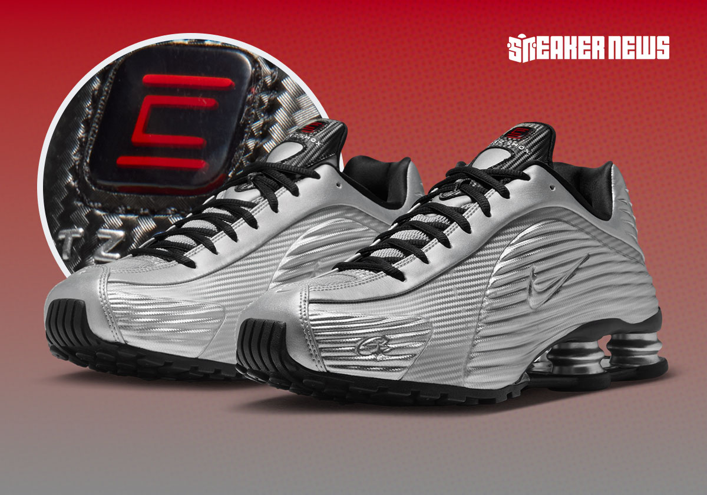
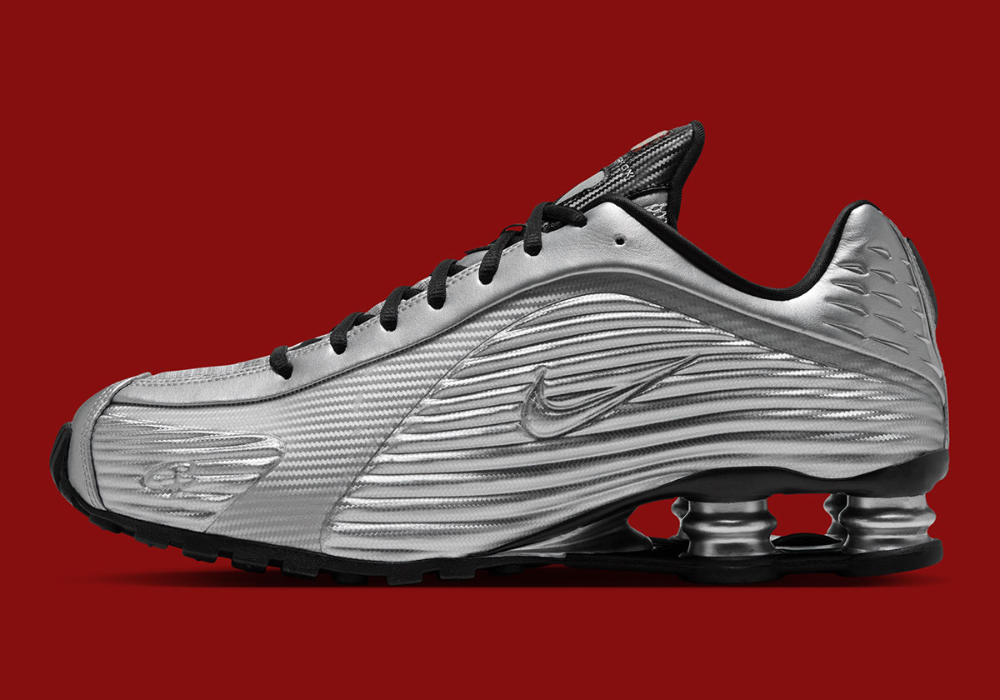
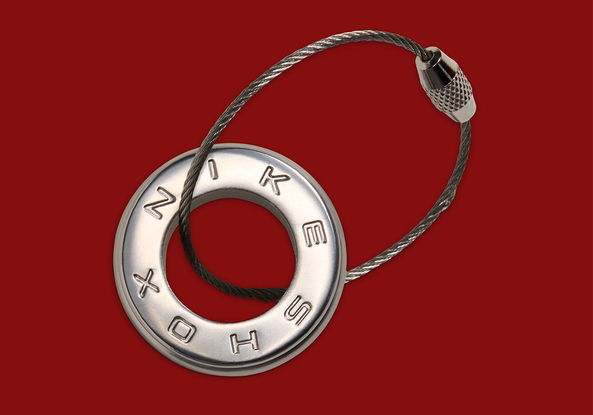
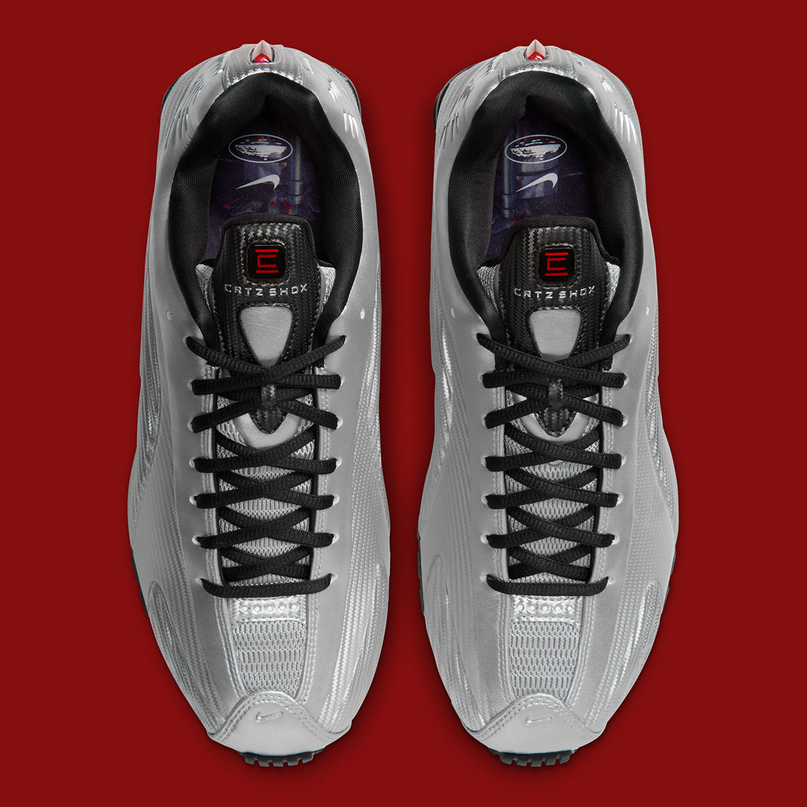
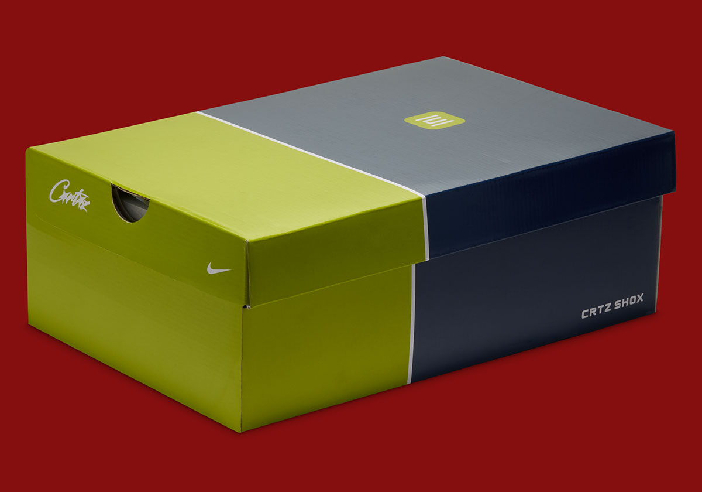
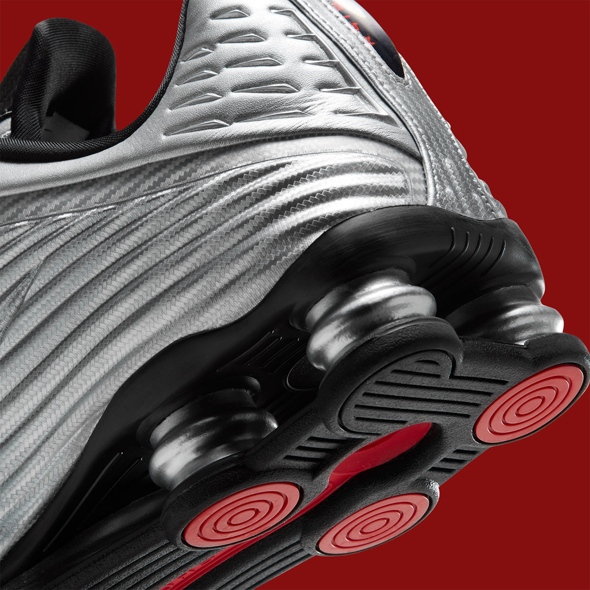
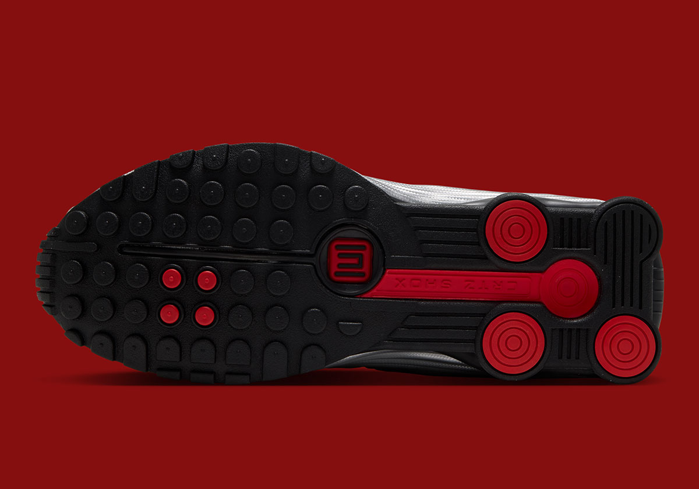
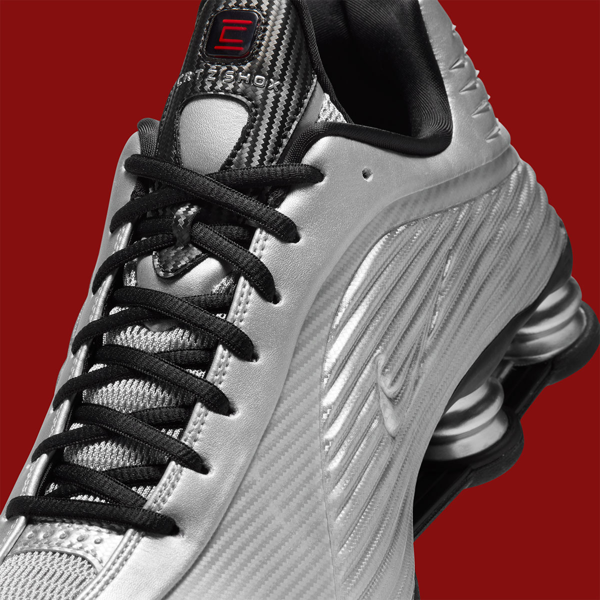

> [中文版 Chinese version](/life/corteiz-nike-shox-r419-silver-surfer-zh/)

Five years ago, Nike took Corteiz to court. The London streetwear label’s name, Nike’s lawyers argued, sounded too much like the Cortez, its 1972 running shoe. The case settled for £1,850. Today, November 15, 2026, Corteiz founder Clint Ogbenna — Clint419 — drops a Nike shoe with his own number on it: the Corteiz x Nike Shox R419 “Metallic Silver,” also known as the “Silver Surfer.” It goes live today through Corteiz’s own webstore, r419.com, with a wider release via Nike SNKRS on Friday, November 20. That arc — from defendant to collaborator to a silhouette renamed after you — is the story of this shoe, and it is why the drop leads the day.

One honest note up front: this is not a wear test of the R419. The pair drops today, and nobody outside Nike and Corteiz has put meaningful miles on this exact shoe. What follows is a long first look — the facts, the five-year Corteiz–Nike history that makes the name on the heel matter, the design and the 26-year-old technology underneath it, where this shoe sits inside a three-colorway pack and a Shox revival Nike started on its own, and what the money is actually buying — with the claims that can be checked separated from the ones that cannot.

*The Corteiz x Nike Shox R419 “Silver Surfer” in Nike’s official imagery: metallic silver from toe to heel, black laces, and the four Shox columns under the heel. The inset shows the red C-Star logo. Image: Nike, via Sneaker News.*

## The facts

| | |
|---|---|
| **Model** | Corteiz x Nike Shox R419 “Metallic Silver” (“Silver Surfer”) |
| **Style code** | IQ9951-001 |
| **Colorway** | Metallic Silver / Metallic Silver – University Red – Black |
| **Release date** | Sunday, November 15, 2026, via Corteiz webstore r419.com; Friday, November 20, 2026, via Nike SNKRS (10:00 a.m. ET, as reported) |
| **Retail price** | Listed at $180 through Corteiz (Sole Retriever) and $190 on SNKRS (Sneaker News, Nice Kicks) — the two channels carry different listed prices as of November 15, 2026; price snapshot, subject to change. UK SNKRS lists £174.99. |
| **Where** | r419.com today; Nike SNKRS and select retailers November 20 |
| **What it is** | The third Corteiz x Nike footwear project and the first to carry Clint419’s name on the shoe — a reworked Nike Shox R4, one of three R419 colorways |

## Why this release is the story of the day

The heat is easy to prove, because the sneaker press lined up behind this pair the moment the first look surfaced. Sneaker News published a dedicated breakdown with the full 13-image official photo set on November 9 and updated it on November 10 when Clint419 announced the November 15 date. Sole Retriever covered it twice — a full pack breakdown on October 19 and a dedicated Silver piece on November 6 — and its listing for the shoe showed a live price of $607 against a $180 retail, a snapshot of the resale market rather than a prediction, but a blunt measure of demand. Nice Kicks, Hypebeast, HotNewHipHop and a string of release trackers all carried dedicated coverage, and GOAT ran a full editorial on the Corteiz story behind it.

That is a lot of attention for a shoe built on a 26-year-old cushioning system — and it is worth asking why. The answer is that the R419 is three stories at once: a comeback for the strangest-looking sole Nike ever sold, a coronation for the most effective independent streetwear label of the last decade, and a punchline that took five years to land. Nike sued this man over a name. Now the shoe is named after him.

## The story: from £1,850 to R419

Corteiz — Corteiz RTW — was founded in West London in 2017 by British-Nigerian creative Clint Ogbenna, working under the alias clint419. The first products were screen-printed hoodies stamped with an Alcatraz Island logo, sold through a password-protected website. No campaigns, no press runs, no interviews for years. The label grew the hard way: scarcity, word of mouth, and a community that treated the password like a membership card. Musicians including Central Cee and Dave wore the Alcatraz logo on stage, and by the early 2020s Corteiz was one of Britain’s most influential labels without ever behaving like one.

Nike noticed, and not kindly at first. In 2021, Nike’s lawyers sued the label, arguing that “Corteiz” confused shoppers searching for the Cortez, Nike’s 1972 track shoe. The settlement was £1,850 — a rounding error that became the founding myth of the partnership. Within 18 months, Nike had signed Ogbenna instead of fighting him, and in March 2023 the two released their first official collaboration: the Corteiz x Nike Air Max 95, in city-exclusive colorways — “Gutta Green” for London, “Pink Beam” and “Aegean Storm” for New York and Paris — launched on Air Max Day at $190. An Air Trainer Huarache followed in 2024, and a fourth Air Max 95, “Honey Black,” arrived in 2025.

The Shox is new ground, though. The Air Max 95 and the Huarache were shoes Nike was already pushing hard on its own; Corteiz gave them a new audience. The R419 is the first time the shoe itself carries Clint’s name — R4 plus 419, the handle he has used since before Corteiz existed. It is also the first Corteiz x Nike project built as a complete wardrobe rather than a single shoe: a campaign film, just over two minutes long and directed by George Muncey and Elliott Elder (working as Uncanny), that is essentially an ad about making the ad, plus a full apparel collection of technical clothing, tracksuits and oversized pieces.

The first look came the way Corteiz first looks always come: from Clint’s own Instagram, in a photo shoot with a Mercedes-Benz SLR McLaren. The car is not a random prop. It is the whole design language of the shoe.

## The design: a car, worn on your feet

The R419 starts from the Nike Shox R4, the 2000 running shoe, and reworks it around the automobile. The upper is defined by sculpted ridges that stretch across the toe and the side panels, layered like bodywork, with carbon-fiber detailing that reads as a weave rather than a print. Nike’s own copy credits the design to Ogbenna and describes a TPU overlay tracing the debossed contours of the original in black, plus a new frame built around the toe box to carry his C-Star logo — the red “C” that appears on the tongue and the toe.

The branding is worked into every surface that will hold it. The tongue pairs “CRTZ SHOX” lettering with the red “C” set in the signature Shox typeface, and the tongue itself is wrapped in a carbon-fiber-look material. “R419” is printed inside the translucent heel column — the one place on the shoe where the cushioning is visible — so the name sits literally inside the technology. The outsole carries “CRTZ SHOX” in red along the shank, and the heel of the outsole carries the red C logo in a black window.

*Lateral profile: the sculpted ridges across the upper, the tonal Swoosh pressed into the silver, the reworked toe box carrying the C-Star logo, and the four Shox columns under the heel. Image: Nike, via Sneaker News.*

Then there are the two details that sell the concept. The insoles carry engine-inspired graphics — a car’s coil-over shock absorber, chrome body and red spring, shot from up inside the wheel well — which is the part Nike named Shox after, printed back into the shoe 26 years later. And every pair comes with a co-branded bolt washer as a finishing accessory: a machined metal ring, engraved with the lettering, threaded on a steel cable. It is a piece of hardware, not a hangtag, and it is the most Corteiz object in the box — a label that has always treated its products like contraband treating a sneaker like a machine part.

*The finishing touch: a machined metal bolt washer, engraved and threaded on a steel cable — a piece of hardware, not a hangtag. Image: Nike, via Sneaker News.*

The “Silver Surfer” is the most traditionally “Shox” of the three colorways, and that is a deliberate choice. It stays closest to the original Shox R4’s own colorway — the silver-and-red that the design team built in 2000, drawing on the Apollo spacecraft, the 20th Century Limited train and James Dean’s Porsche 550 Spyder. The other two colorways push further from the source: the “Black Widow,” a black upper with University Red accents, and the “Mystique,” in Game Royal, University Red and black. Whether the Black Widow and Mystique will also drop via Nike is still unclear — Sneaker News reports that at least one is likely to be a Corteiz exclusive — and the staggered structure is already visible: the Game Royal pair, the Mystique, released October 31 and November 1 at The Hall Harajuku in Tokyo and went online on November 4 through r419.com, with the apparel. The Silver pair is the one Nike is putting on SNKRS, which makes it the accessible chapter of the pack — relatively speaking.

*Top-down: the full pair, with the “CRTZ SHOX” tongue, the carbon-fiber-look material, and the engine graphics on the insoles showing through the collars. Image: Nike, via Sneaker News.*

The packaging finishes the idea. The box is split down the middle — lime green on one side, dark navy on the other — with the Corteiz script logo and a Nike Swoosh on the green half and “CRTZ SHOX” printed on the navy side. It is a two-brand box that does not try to blend the two brands into one, which is the honest version of what this collaboration is.

*The box: lime green and dark navy split down the middle, Corteiz script on one side, “CRTZ SHOX” on the other — two brands, not blended into one. Image: Nike, via Sneaker News.*

## The tech: sixteen years to build a spring

The columns under the heel are the oldest idea in this shoe and the strangest. Nike designer Bruce Kilgore — the man who drew the Air Force 1 — began researching a mechanical cushioning system in 1984, building a prototype on a Nike Internationalist in Exeter, New Hampshire, that looked more like a mountain-bike suspension fork than a shoe. It took sixteen years to reach a shelf. The design team tested steel springs in the sole before settling on hollow foam pillars, which gave a better balance of bounce and support; Air Max 95 designer Sergio Lozano played a key role in arriving at the hollowed-out design. The first Shox shoes reached retail in 2000 — the R4 for running, the BB4 for basketball, the XT4 for cross-training — with the name marking the sport and the number of columns: four hollow polyurethane columns under the heel, compressing on impact and rebounding to return energy.

The launch moment is one of the most famous in sneaker history. At the Sydney 2000 Olympics, Team USA’s Vince Carter — in the Shox BB4, his first signature shoe with Nike — dunked over France’s 7'2" center Frédéric Weis. The “dunk of death” did more for the silhouette than any advertising spend could have, and every Carter signature after it was built on the Shox system. The R4, meanwhile, found a second life far from the track: it became a fixture of the British underground, the grime scene and football terraces, where the columns read as armor rather than technology.

One small piece of housekeeping, because the dates matter to collectors: most independent histories date the first Shox shoes to 2000, but Nike’s own recent copy calls the R4 a 2001 icon. The year is not fully settled, and nothing here settles it — treat 2000 as the widely reported launch year and 2001 as Nike’s own current wording.

*The heel: the four Shox columns in full view, the ridged silver upper, and the red circular traction pods on the outsole. Image: Nike, via Sneaker News.*

Be honest about what the technology means in 2026. Shox was a genuine innovation — the first energy-return system in a shoe, and the ancestor of the spring plates and super-foams in today’s runners — but the R4 is a 26-year-old ride, and the modern retro is a lifestyle shoe first. The columns are firm, the shoe is heavy by current standards, and the ride is nothing like a modern Nike runner. The honest framing is that you are buying the columns because of what they look like and what they mean, not because they outperform a current trainer. And on the practical side: buying guides note the R4 runs a touch narrow through the midfoot, so anyone with wide feet should try a pair on or consider going up half a size rather than guessing.

*The outsole: black rubber with red circular pods, the red C logo in a heel window, and “CRTZ SHOX” along the shank. Image: Nike, via Sneaker News.*

## The pack, and the revival it rides

The R419 does not arrive in a vacuum. Nike has been rebuilding the Shox line on its own for months: two inline R4 colorways were dated for November 1, one of them a triple-black patent pair — the kind of colorway a brand ships once it already has its answer about demand — and the Shox Z, a women’s silhouette with no original behind it, arrived in late 2025 and picked up collaborations within a year. This is not a dormant model revived by a collaborator. It is a handoff at the top of a cycle Nike started by itself, and the name does the arithmetic out loud: R4 plus 419.

That context is the right way to judge the Silver pair’s place in the pack. The Mystique already had its moment — Tokyo, then r419.com on November 4 — and the Black Widow’s channel is still unconfirmed. The Silver Surfer is the one with the SNKRS date, the one with the official photo set, and the one the resale market has already priced: Sole Retriever’s listing showed a live price of $607 against a $180 retail, a snapshot from November 15 that will move the moment the Corteiz drop clears. Do not read that number as a promise. Read it as the market’s opening bid on a shoe that is, by Corteiz standards, unusually available — a SNKRS release is a different proposition from a password-protected London drop.

## The field: what else is happening this week

Today is crowded. Alongside the R419, the Playa Society x Nike A’Two — A’ja Wilson’s first collaboration on her signature shoe — drops in two colorways, “Dark Russet” and “Ocean Bliss,” at $155, and the Nike Air Max Plus “Batman” lands at $190. Tuesday, November 17, is the bigger day: the Rick Owens x adidas Springblade collection — two runners at $590 and an oversized boot at $850, the first major step in bringing back adidas’ blade-cushioned runner from the 2010s, after a reunion announced on November 9 following nearly a decade apart — plus the Nike LeBron 24 “Stars,” the Nike KD 6 “Texas” at $135, and the NOCTA x Nike Air Modmax “Pink Spell” at $180.

The honest comparison for the Silver Surfer is not any of those. It is the rest of its own pack. The Mystique is the rarer chapter and already gone from its first window; the Black Widow is the darker, more wearable one with no confirmed channel. The Silver is the loudest and the most available, and the one whose design is closest to the 2000 original. If you want the R419 as an object — the columns, the chrome, the washer — this is the pair. If you want it as a flex, the Mystique already did that work in Tokyo.

## Buying advice

A few practical notes, in the order that matters on a drop day.

**The two drops.** Today, November 15, the pair goes live through Corteiz’s r419.com — the channel Clint419 announced on November 10, and the one that will sell out first. Friday, November 20, it goes wider via Nike SNKRS at $190 (10:00 a.m. ET, as reported) and select retailers. If you miss today, November 20 is a real second chance, not a consolation prize — and it is the cheaper of the two windows to plan around, because a SNKRS draw is a lottery and a Corteiz drop is a sprint.

**Sizing.** The R4 runs a touch narrow through the midfoot, according to buying guides — go with your normal Nike size if your feet are average, and consider half a size up if they are wide. Try it on if you can; the columns do not forgive a tight fit the way foam does.

**Resale, honestly.** A $607 live listing against a $180 retail is the kind of number that makes people buy two pairs. Do not. The number is a snapshot from before either drop has cleared, and Corteiz SNKRS releases have a habit of settling once the second window lands. If you want the shoe, try both drops first. If you miss both, wait for the market to find its level rather than paying the opening price on day one.

**Who it is for.** If you follow Corteiz, this is a mandatory one — it is the first Nike shoe with Clint’s name on it, and the story from the £1,850 settlement to the R419 is the best arc in the collaboration’s history. If you love the Shox R4, this is the most faithful version of the revival so far, and the chrome-and-red is the original colorway’s direct descendant. If you want a quiet daily shoe, be honest with yourself: this is a metallic silver shoe with visible mechanical columns and a bolt washer in the box. It goes with a tracksuit and a certain attitude, and not much else.

**The one caveat.** The $190 SNKRS price is $10 more than the $180 Corteiz listing, and the premium is paying for the wider channel, not a different shoe. The shoe underneath is the same R419 either way. If today’s drop is out of reach, November 20 is five days away — and the shoe is worth the wait more than it is worth the markup.

*Close-up on the tongue: “CRTZ SHOX” lettering with the red “C” in the Shox typeface, carbon-fiber-look material, and the sculpted ridges of the upper. Image: Nike, via Sneaker News.*

## Verdict

The R419 “Silver Surfer” is the strangest entry in the Corteiz x Nike story, and that is exactly why it leads the day. As a concept, it is the sharpest idea either partner has attached to a shoe in years — not a logo swap, but a car part, a lawsuit, and a handle, built into a 26-year-old running shoe. As an object, it is the most complete Corteiz release so far: the sculpted upper, the engine graphics in the insoles, the name printed inside the heel column, the bolt washer in the box. And as a purchase, it is a two-window drop — today on r419.com, Friday on SNKRS — which means the usual rules apply: try the drops first, do not pay opening-day resale, and buy it because the story makes you smile.

Five years ago, Nike sued this label over a name and settled for £1,850. Today the shoe is named after the man. The columns were always the point — four springs under the heel, visible to everyone, doing exactly what they were built to do. The name on the heel just finally caught up with them.

*Price and availability are a snapshot as of November 15, 2026, based on Sneaker News, Sole Retriever, Nice Kicks and Because Sneakers reporting; both are subject to change. The $607 resale figure is Sole Retriever’s live listing price as of November 15, not a prediction. This is a first look at the “Silver Surfer” colorway, not a wear test — the pair drops today, and no independent wear testing of this colorway exists yet. The 2000 versus 2001 dating of the original R4 is unsettled, as noted in the text. No affiliate links.*

**Sources:** Sneaker News — “Corteiz Nike Shox R419 Metallic Silver” (November 9, 2026; updated November 10); Sole Retriever — “Corteiz Debuts a New Nike Shox R419 Collab” (October 19, 2026) and “Check Out the Chrome Details on the Silver Corteiz x Nike Shox R419” (November 6, 2026); Nice Kicks — “Corteiz x Nike Shox R419 ‘Silver Surfer’” (IQ9951-001, $190, November 20); Hypebeast — Corteiz x Nike Shox R419 “Mystique” coverage (November 2, 2026); HotNewHipHop — “Corteiz And Nike Turn The Shox R4 Into The R419” (October 19, 2026); GOAT — “Alcatraz to Everywhere: The Story of Corteiz”; Because Sneakers — “Corteiz Printed a Car’s Shock Absorber Inside the Shox R419” (November 6, 2026); The Sole Supplier — “Why the Nike Shox Was Always Ahead Of Its Time”; Wikipedia — “Nike Shox”; Sole Retriever — release-date listings for the R419, the Rick Owens x adidas Springblade collection, the Nike A’Two Playa Society pack and the Nike Air Max Plus “Batman.”
