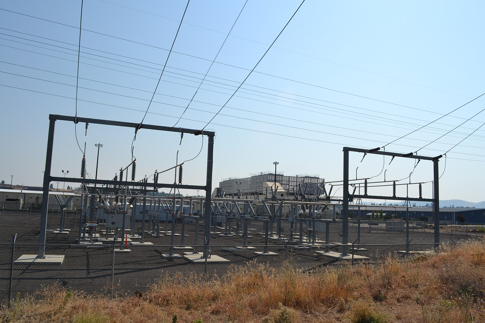
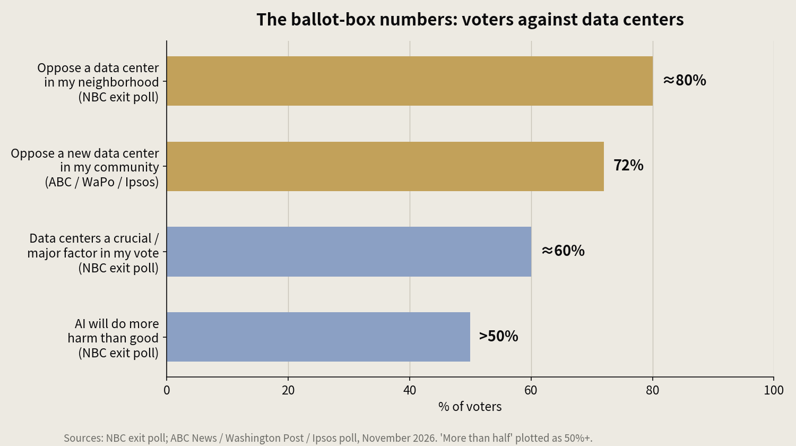
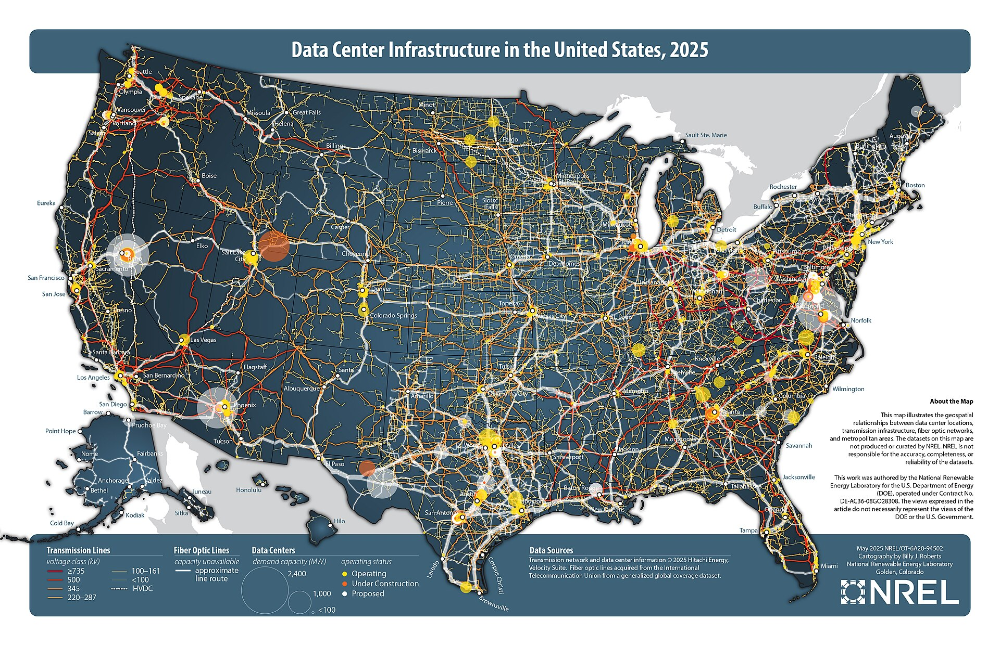

> [中文版 Chinese version](/life/data-center-backlash-midterms-zh/)

*Google's data center in The Dalles, Oregon, with its electrical substation in the foreground — power sits at the center of the local grievances. Photo: Wikimedia Commons.*

## What happened on Tuesday

The November 3 midterm elections handed Democrats full control of Congress, with Republicans keeping the White House. That alone would be a big week for tech policy. What made it bigger is what the vote said about the physical footprint of AI: the data center has become a ballot-box issue, and voters are voting against it.

An NBC exit poll found nearly 80 percent of voters oppose a data center being built in their neighborhood, more than half believe AI will do more harm than good, and nearly 60 percent said data centers were a crucial or major factor in how they voted. An ABC News, Washington Post and Ipsos poll put opposition to a new data center in one's own community at 72 percent.

The local results matched the polling. One count put it at 41 data-center measures on ballots across 10 states, with voters rebuffing the buildout in all but one of them. Goldman Sachs warned that moratoria could eventually touch 45 percent of planned US data-center capacity.

*Opposition to data centers near home, November 2026. Chart: this site, from NBC and ABC News / Washington Post / Ipsos polling.*

## The map: Ohio and Texas are the front line

*Data center infrastructure in the United States, 2025 — operating, under-construction and proposed sites, with transmission lines and fiber routes. Map: National Renewable Energy Laboratory (NREL), via Wikimedia Commons.*

Ohio is where the backlash got concrete. In Piqua, voters recalled the mayor and two commissioners who had backed a $1 billion Meta campus, and passed a ban on large data centers. In the county where Meta had planned a 700,000-square-foot facility, voters passed a ban too. This is the same state where OpenAI has eyed a $500 billion data-center project backed by more than $100 billion in Nvidia financing. Morgan Stanley analysts now warn that Democratic governor-elect Amy Acton, who supports a conditional moratorium requiring developers to cover 100 percent of utility costs, poses a major risk to the state's buildout.

Texas is the other front. Governor-elect Gina Hinojosa campaigned in favor of a statewide moratorium, and Texas holds about 27 percent of planned US data-center capacity, according to Wells Fargo. Goldman Sachs expects construction delays in Georgia and Texas as a result of the Democratic gains, and candidates who campaigned against rapid buildout also won in Maine, Michigan, Nevada, Georgia and South Carolina.

The local grievances are specific, not abstract: higher electricity bills, strained water supplies, and exhaust. In South Memphis, residents live next to gas turbines powering xAI's supercomputer, and the head of Color of Change called the election a referendum on "who this economy is built for."

## Washington responds

Senator Bernie Sanders posted on X after the results: "National data center moratorium now," adding that Americans do not want "Big Tech oligarchs wrecking the environment." He and Representative Alexandria Ocasio-Cortez have proposed a nationwide moratorium on new data centers until Congress sets guardrails on electricity costs, environmental damage and community consent. Senator Martin Heinrich's GRID Savings Act would stop grid upgrade costs from being passed on to nearby communities.

The industry's first answer came fast. On November 6, OpenAI said it will no longer use non-disclosure agreements with public officials on data-center projects, allowing only narrow protections for security information and trade secrets. Amazon made a similar move in October. The message is unmistakable: secrecy around these projects has become a political liability.

## The judgment

For two years the constraint on the AI buildout was supply: chips, power, memory. This week the constraint moved to politics. A moratorium bill still faces a likely presidential veto, and Democrats are themselves divided over a blanket freeze — but the local bans, the governor races and the exit polls are not vetoable. They are already law in some places, and they are coming to more.

The market already priced the first-order effect: on Thursday, November 5, the Nasdaq fell 5.52 percent and about $2 trillion in value vanished, as this site covered. Tech stocks bounced on Friday, recovering only a fraction of it. The bounce does not settle the question; it just shows the market has not decided whether this is a delay or a derailment.

Watch three things. First, whether any state moratorium advances from campaign promise to signed law. Second, whether OpenAI's transparency move becomes the industry standard or stays a one-off. Third, whether the next round of chipmaker earnings and data-center capex guidance holds or bends. If the buildout keeps its money and its schedule, this week was a correction. If either bends, the election was the moment the AI boom got a politics problem it cannot engineer its way out of.

*Figures in this post are from NBC, ABC News/Washington Post/Ipsos, Goldman Sachs, Morgan Stanley and Wells Fargo reporting on the November 3–6, 2026 election results.*
