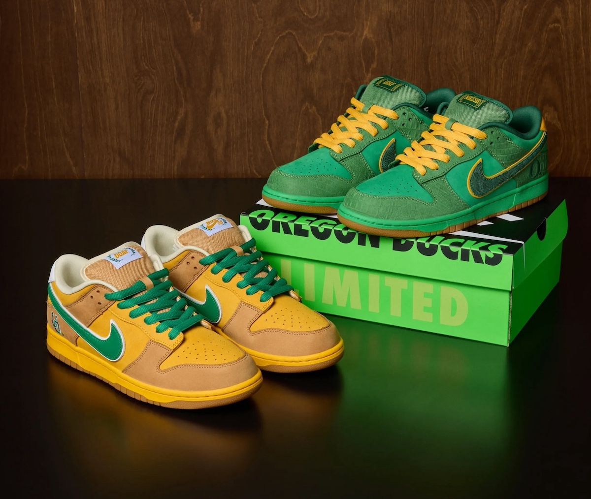
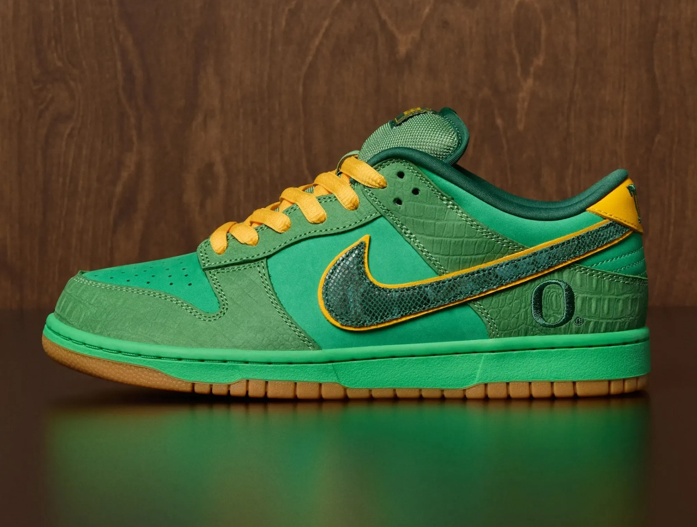
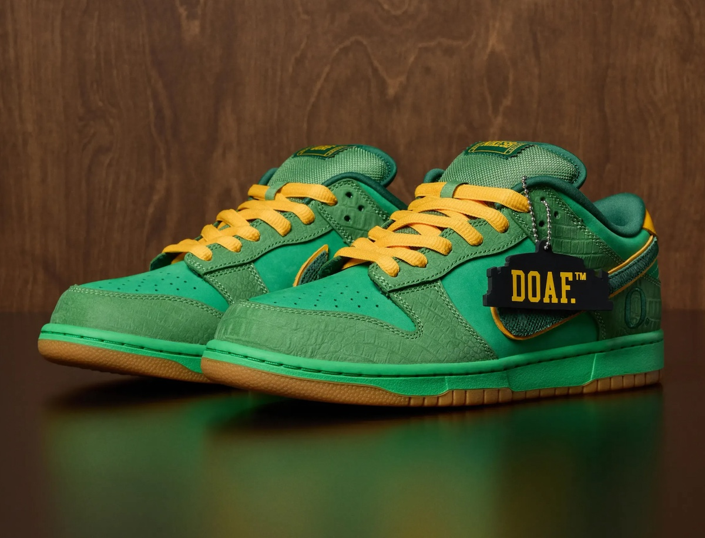
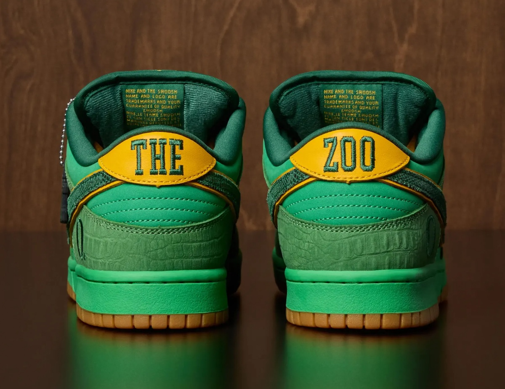
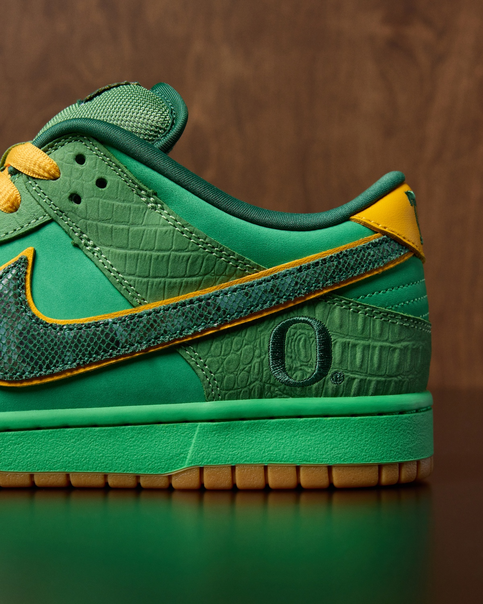
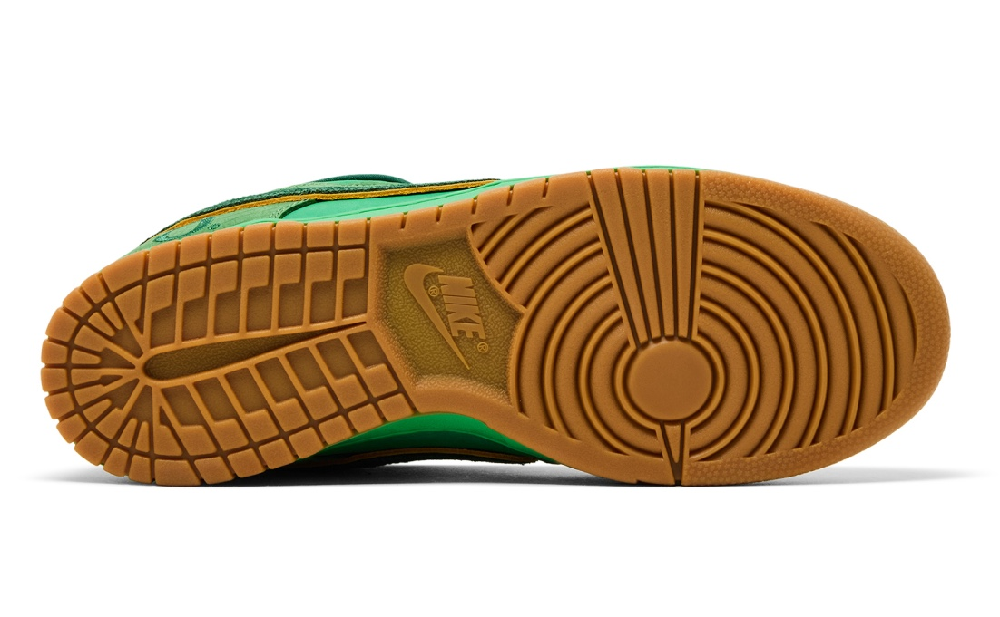
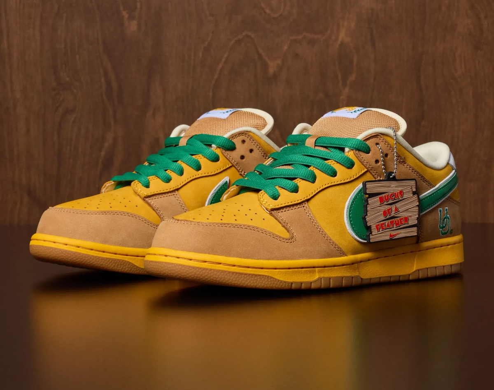
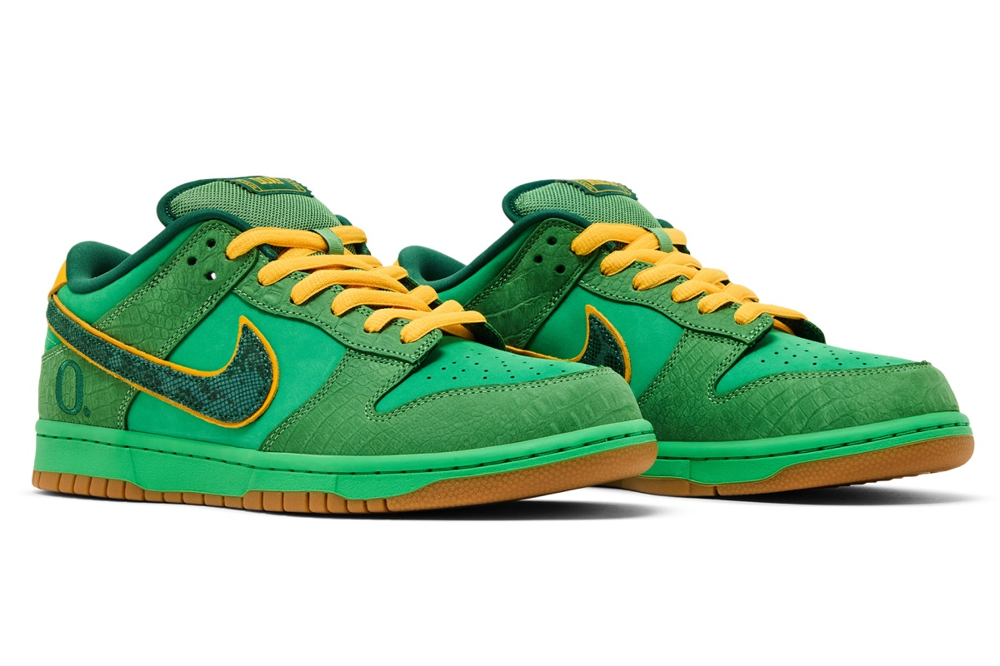

> [English version 英文版](/life/doaf-nike-sb-dunk-the-zoo/)

大多数大学主题球鞋的做法都很简单：校色往熟悉的鞋型上一套，后跟加个 logo，完事。Ducks of a Feather x Nike SB Dunk Low “The Zoo”（货号 JJ7565-300）不是这个路数。它是一座球场——具体说，是俄勒冈州尤金的 Autzen 球场，在某个星期六的夜晚、第三节和第四节之间，当大学橄榄球最奇特也最动人的传统之一接管整座建筑的那一刻——被重建成了一双滑板鞋。它 11 月 20 日已在 Flight Club 东京首发，今天（2026 年 11 月 21 日，星期六）登陆 Flight Club 洛杉矶、迈阿密和纽约门店，11 月 26 日感恩节登陆 GOAT App。售价 235 美元。

先说一句实话：这是初看，不是上脚评测、更不是滑板实测。美国门店今天才发售，写稿时还没有任何针对这双鞋的独立穿着或滑板测试。下面这篇基于 Division Street 官方发布、已确认的产品图和发售周边的报道：逐个细节解读设计、讲清套装里的第二双、拆解错峰发售的节奏，以及让 Ducks of a Feather 与日历上任何其他联名都不同的运动员收益模式。

*套装双鞋与绿色 “Oregon Ducks — Limited” 鞋盒合影：上为 “The Zoo”，前为 “Shout!”。图片：Nike / Division Street，经 Sneaker Bar Detroit。*

## 基本事实

| | |
|---|---|
| **型号** | Ducks of a Feather x Nike SB Dunk Low “The Zoo” |
| **货号** | JJ7565-300 |
| **配色** | Tomatillo / Gum Medium Brown – Gym Green – Gorge Green（绿调 + 生胶色） |
| **发售日期** | 2026 年 11 月 20 日（Flight Club 东京）；11 月 21 日（Flight Club 洛杉矶、迈阿密、纽约）；11 月 26 日（GOAT App）；另有部分地区滑板店 |
| **售价** | 235 美元——2026 年 11 月 21 日查询的 snapshot，subject to change |
| **姊妹款** | “Shout!”（JJ7564-200），Flax / Gum Medium Brown – University Gold – Pine Green，235 美元——12 月 4 日 Flight Club 东京、12 月 5 日美国 Flight Club 门店、12 月 10 日 GOAT App |
| **出品方** | Division Street 的 Ducks of a Feather，联合 Nike SB、GOAT 与 Flight Club；收益惠及参与项目的俄勒冈大学学生运动员 |
| **它是什么** | 一个围绕俄勒冈典故的双鞋 SB Dunk Low 套装：“The Zoo” 讲 Autzen 球场与它的 “Shout!” 传统；“Shout!” 讲 1977 年在尤金拍摄的《动物屋》 |

## 为什么它是今天的主角

这双鞋的热度是一个硬事件，不是一轮传闻。Division Street 11 月 19 日更新了官方发布；House of Heat 发了套装的入手指南；Sneaker Bar Detroit 用完整的官方图库做了发售日期全解；Sports Illustrated 的俄勒冈报道则把这次发售写进了 11 月 20 日的比赛故事——排名第 13 的鸭队当晚客场打密歇根州立，球队的出行鞋话题和这双 SB Dunk 的发售是同一条新闻线。这就是关键信号：这不是一个借橄榄球受众的球鞋故事，也不是一个借球鞋热度的橄榄球故事，而是两者在赛季正酣、发售当天同时成立。

发售节奏内部的时点也重要。今天是 “The Zoo” 在感恩节 GOAT App 发售之前唯一的美国门店日。Flight Club 在这件事里只有四家门店——东京先行，然后洛杉矶、迈阿密、纽约——再加上部分地区滑板店，这就是全部实体足迹。其余全靠一个节假日的 App 发售。所以这里的稀缺不是营销形容词，而是分销方式本身的字面形状。

还有一个结构性理由，让这个套装值得长篇而不是一条日历简讯。Ducks of a Feather 是 Division Street 的俄勒冈品牌，它的发售设计成让收益惠及参与项目的俄勒冈大学学生运动员。在 NIL（姓名、形象与肖像权）时代，声称与运动员有关的产品很多；DOAF 的模式本身就是项目：这个品牌存在的意义，就是把俄勒冈无与伦比的 Nike 传统转化成运动员的价值，鞋是这个机制的载体。一双 235 美元的 SB Dunk，当你知道钱被设计成流向哪里，就更容易评判，也更难被当成又一双限量 Dunk 一笔带过。

## “The Zoo”：一座球场，被翻译成一双鞋

先从名字说起。“Autzen Zoo”（Autzen 动物园）是 Autzen 球场氛围的绰号——以它的体量而言，它是大学橄榄球最吵的环境之一。这双鞋围绕的具体传统，发生在每一个俄勒冈主场比赛：第三节和第四节之间，《Shout》响起，整座球场——球迷和球员一起——齐声合唱、起舞。这是有一双重根源的仪式，因为这首歌也是 1978 年电影《动物屋》里最著名的场景，而那部电影 1977 年秋天就拍于尤金。套装把这两条根拆成了两双鞋：“The Zoo” 是球场，“Shout!” 是电影。这一双，是球场。

翻译是用材料完成的，不只是颜色。鞋面在柔软的牛巴革底上叠了鳄鱼纹压花覆盖片，用 Tomatillo、Gym Green、Gorge Green 层层堆绿，让这双鞋先以质感、再以配色被读到。Swoosh 是蛇皮皮革，深色、带鳞片，边缘镶黄。这是一双用动物纹讲一个绰号叫“动物园”的地方的鞋，而玩笑被认真地执行了：压花够深，Swoosh 上的鳞片够细，两种质感坐在光滑的牛巴革底上，让整双鞋可穿、而不是戏服。

*侧面：鳄鱼纹压花覆盖片、黄边蛇皮 Swoosh、后跟刺绣 “O” 标与生胶外底。图片：Nike / Division Street，经 Sneaker Bar Detroit。*

品牌标识放在 SB 收藏者会去看的位置。一个刺绣的俄勒冈 “O” 低调地落在外侧后跟，缝在鳄鱼纹压花的鞋面上。鞋带和后跟提片是黄色——全鞋唯一的亮色点缀，而且用对了地方：正是这个颜色让层层绿不至于发闷。中底是绿色，外底是生胶色。而吊牌做成了一张球场门票的形状，印着 DOAF——这是全鞋最好的隐藏细节的第一个暗示。

*双鞋与门票造型的 DOAF 吊牌——呼应鞋舌标签上那张印着 Autzen 球场揭幕日期的门票图形。图片：Nike / Division Street，经 Sneaker Bar Detroit。*

## 承载故事的三个细节

真正讲故事的是三个细节，都值得凑近看。

第一个是鞋舌标签。它被画成一张印着数字 9231967 的门票——1967 年 9 月 23 日，Autzen 球场正式揭幕的日子。这正是区分“设计的鞋”和“装饰的鞋”的那种具体：不是拿 “est. 1967” 当氛围，而是把真实日期编码成门票号码，放在穿鞋人每次系鞋带都会看到的那块标签上。

第二个是鞋垫。鞋内印着一幅 Autzen 球场的素描，旁边是 “Once a Duck, Always a Duck”（一日为鸭，终身为鸭）和 Ducks of a Feather 的品牌标识。穿着时没人看得见它——这正是用意所在：它是给鞋主本人的细节，延续了最好的 SB Dunk 的传统，它们的故事一直有一半藏在内衬、鞋垫和标签里。

第三个在最后面。后跟提片把名字拆在双鞋上：左脚写 “THE”，右脚写 “ZOO”，绿字、黄皮。站在穿着者身后，球场的绰号会在他的两只后跟之间自己拼完整。简单，十英尺外可读，而且会是每位鞋主第一个拍的照片。

*后跟：“THE” 与 “ZOO” 拆在双鞋的黄色后跟提片上，下方是鳄鱼纹压花后跟片。图片：Nike / Division Street，经 Sneaker Bar Detroit。*

*后跟特写：黄边蛇皮 Swoosh、刺绣 “O” 标，以及鳄鱼纹压花的深度。图片：Nike / Division Street，经 Sneaker Bar Detroit。*

鞋底之下，它就是一双干本职工作的 SB Dunk：生胶外底配经典 Dunk 纹路——前掌同心圆、后跟块状纹——加上加厚鞋舌和这个系列二十年来一直用的缓震鞋垫配置。Division Street 和 Nike 没有为这双鞋发布什么特别的科技故事，也没有必要编一个：SB Dunk Low 的配方就是配方，这次发售的功夫全在鞋面、图形和分销上。

*生胶外底：经典 Dunk 纹路原样保留——这双鞋的故事全在鞋面上。图片：Nike / Division Street，经 Sneaker Bar Detroit。*

## 另一半：“Shout!”

套装的第二双两周后到，讲的是同一个星期六的另一半。“Shout!”（JJ7564-200）致敬《动物屋》——1977 年秋在尤金和 Lane County 一带拍摄，俄勒冈大学校园是取景地之一——以及那首后来被 Autzen 收编为第四节仪式的派对圣歌。它的设计在色调和气质上都是 Zoo 的反面：Flax 与黄色的柔软牛巴革鞋面、绿色全粒面皮革 Swoosh 带白边、绿色鞋带、生胶外底。

它的细节与概念一一对应。鞋舌标签取材于月桂花环；后跟提片上印着 “Shout!”；鞋垫图形和吊牌取材于电影一处主要取景地那栋破旧建筑的外观——在产品图里，吊牌是一块写着 “Ducks of a Feather” 的风化木牌。如果说 “The Zoo” 是夜晚的球场，“Shout!” 就是 1977 年的校园：更暖、更糙、也更好笑。

*姊妹款：“Shout!” 亚麻黄牛巴革、绿色皮革 Swoosh、木牌吊牌——故事的 1977 年电影拍摄那一半，12 月到。图片：Nike / Division Street，经 Sneaker Bar Detroit。*

发售节奏完全复制：12 月 4 日 Flight Club 东京，12 月 5 日洛杉矶、迈阿密、纽约门店，12 月 10 日 GOAT App，另有部分地区滑板店——235 美元，与 “The Zoo” 相同。两双鞋、两个月末、一条把它们连起来的仪式：电影带火的那首歌，正是球场在唱的那首歌，这个套装的设计就是让你拥有这个故事、就得拥有它的两半。

## DOAF 模式：这个项目为什么能持续成立

Ducks of a Feather 的发售已经成了俄勒冈日历上的常设事件——这个项目横跨过 Nike 的多个品类，这次进入 SB，而 SB Dunk 是一个很有说服力的画布选择。Dunk 是滑板圈最具收藏价值的 Nike 鞋型，也是球鞋文化最可靠的叙事平台；俄勒冈则是 Nike 本身实际诞生的学校——它源自俄勒冈的田径项目。把这两者通过一个收益惠及参与学生运动员的品牌连起来，是大学产品能做到的最闭环的形态：学校的历史提供故事，运动员提供现在时，产品反哺运动员。

这个闭环也是价格问题最诚实的答案。235 美元远高于一双普通 SB Dunk Low——溢价买的是材料（鳄鱼压花、蛇皮皮革、额外的图形和吊牌）、Flight Club/GOAT 的限量分销，以及运动员收益模式。这套组合值不值是个人判断，但它是一套看得见的组合：与很多联名溢价不同，你能逐项指出每一美元的去向理由。

## 发售怎么走——以及怎么试

按顺序说实操。“The Zoo” 今天（11 月 21 日）已在 Flight Club 洛杉矶、迈阿密、纽约门店发售，此前一天在东京首发；部分地区滑板店也有。错过门店，GOAT App 的发售落在感恩节 11 月 26 日——节假日 App 发售意味着竞争对手是所有有手机、有空的早晨的人。“Shout!” 在 12 月 4 日、5 日、10 日走同样的路线。

由这个发售形状可以直接得出三条建议。第一，今天是最好的机会：门店的货卖完就没了，而 App 发售是竞争最激烈的形态。第二，现在就把“成套”这件事决定好——“Shout!” 两周后到，两双鞋被设计成两半；因为跳过它的发售日、再去二级市场买第二双，是同一个决定更贵的版本。第三，在 GOAT 发售发生之前不要为 “The Zoo” 付转售价：错峰发售意味着 11 月 21 日的价格由这双鞋一生中最小的供应量决定，而一个更大的窗口已经定在 11 月 26 日。

尺码与脚感是 SB Dunk Low 的老故事——加厚鞋舌、偏 snug 的中段，大多数穿着者按正码选——这里给出的是这个系列长期的普遍经验，不是针对这双鞋的实测事实，因为项目之外还没有人穿过或滑过它们。任何在美国发售前就声称给出上脚结论的评测，都应当作虚构看待。

*白底双鞋图：柔软牛巴革上的层层绿、黄色鞋带、蛇皮 Swoosh、生胶底。图片：Nike / Division Street，经 Sneaker Bar Detroit。*

## 结论

DOAF x Nike SB Dunk Low “The Zoo” 是主题球鞋里最好的一类：每一个选择都能追溯回它所讲的那件事。动物纹是那个绰号。鞋舌上的门票是球场的生日。鞋内的素描是球场本身。名字拆在后跟上，让它以人群读它的方式被读出来——合在一起读。而它晚两周的姊妹款，补上仪式的另一半：那部给了球场这首歌的电影。

它也是大学产品走到今天的一个标记。十年前，一双俄勒冈 SB Dunk 大概率会是球员专属或亲友限定——被欣赏、穿不到、也买不到。2026 年，它是一次公开的发售：四城错峰、App 发售、以及一个写明的目的——收益惠及提供这些典故的项目里的运动员。鞋本身很好；模式是更大的故事——而今天，在三家 Flight Club 门店和少数滑板店里，是它开始的地方。

*价格为 2026 年 11 月 21 日查询的 snapshot，subject to change。来源：Division Street / Ducks of a Feather 官方发布（2026 年 11 月 9 日发布、11 月 19 日更新——设计细节、日期、运动员收益模式）；House of Heat（入手指南——发售节奏、235 美元售价、收益说明）；Sneaker Bar Detroit（2026 年 11 月发售全解——货号 JJ7565-300 / JJ7564-200、配色、完整官方图库）；Sports Illustrated 俄勒冈报道（2026 年 11 月 20 日——发售进入鸭队比赛周新闻线）。这是初看，不是上脚评测：“The Zoo” 2026 年 11 月 21 日登陆美国门店，写稿时无独立穿着或滑板测试。*
