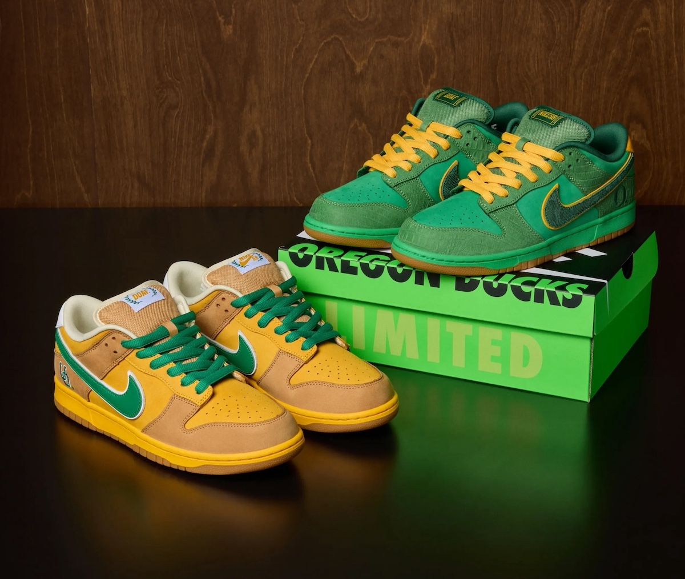
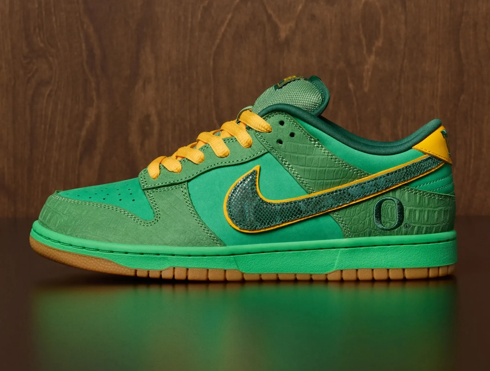
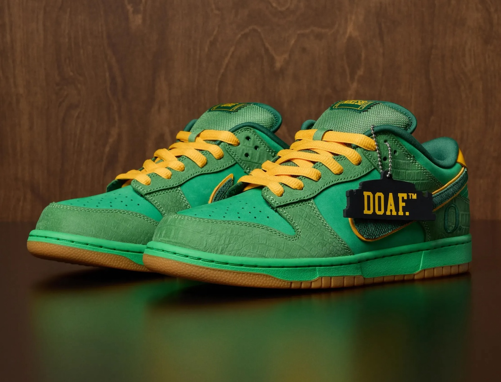
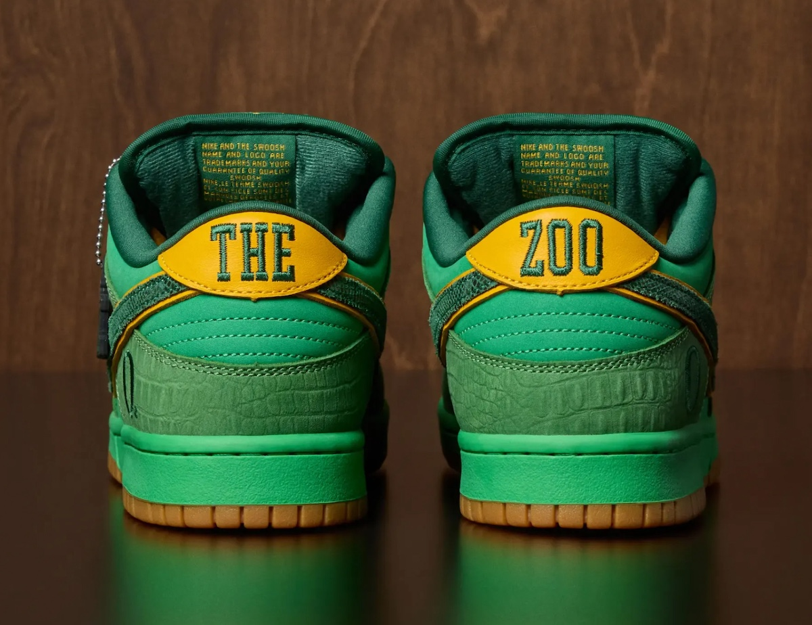
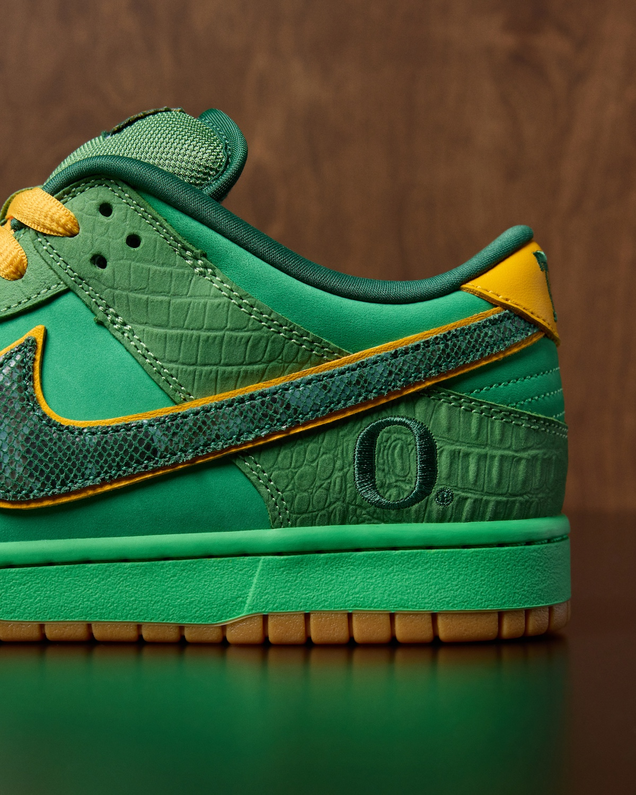
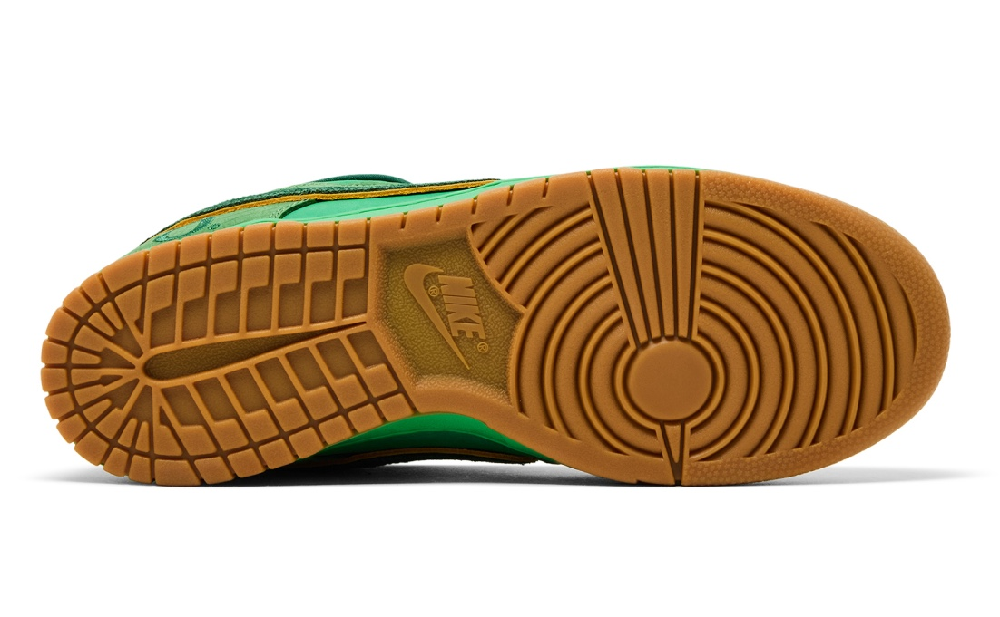
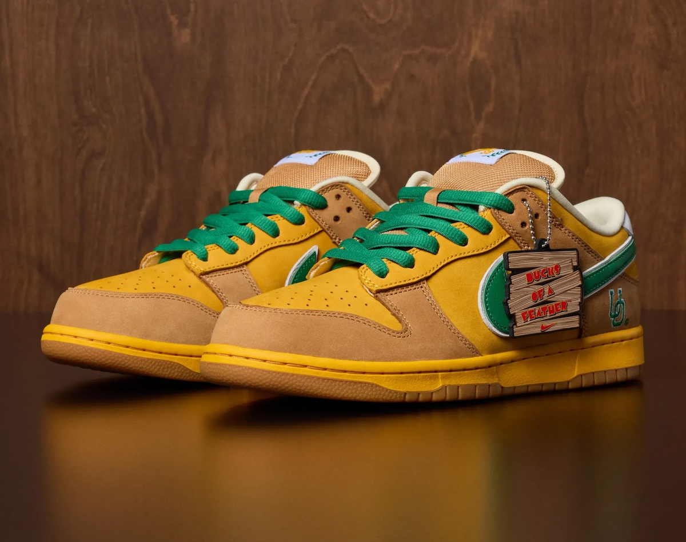
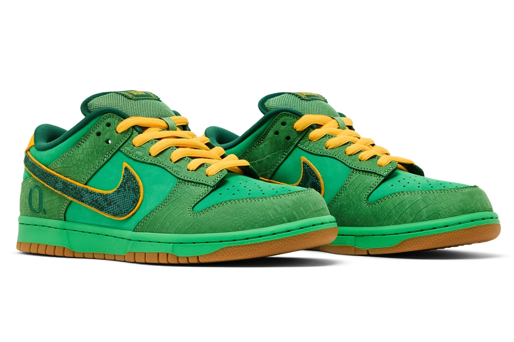

> [中文版 Chinese version](/life/doaf-nike-sb-dunk-the-zoo-zh/)

Most college sneakers are a colorway: school colors on a familiar shoe, a logo on the heel, done. The Ducks of a Feather x Nike SB Dunk Low "The Zoo" (JJ7565-300) is not that. It is a stadium — specifically Autzen Stadium in Eugene, Oregon, on a Saturday night, between the third and fourth quarters, when one of college football's strangest and best traditions takes over the building — rebuilt as a skate shoe. It debuted at Flight Club Tokyo on November 20, it reaches Flight Club's Los Angeles, Miami and New York stores today, Saturday, November 21, 2026, and it arrives on the GOAT app on Thanksgiving, November 26. Retail is $235.

One honest note up front: this is a first look, not a wear test or a skate test. The U.S. in-store release is today, and no independent skating or wear testing of this pair existed at the time of writing. What follows is built on Division Street's official release, the confirmed product photography, and the coverage around the drop: the design decoded detail by detail, the second pair in the pack, the staggered rollout, and the athlete-payments model that makes Ducks of a Feather different from every other collaboration on the calendar.

*Both pairs of the pack with the green "Oregon Ducks — Limited" box: "The Zoo" (top) and "Shout!" (front). Image: Nike / Division Street, via Sneaker Bar Detroit.*

## The facts

| | |
|---|---|
| **Model** | Ducks of a Feather x Nike SB Dunk Low "The Zoo" |
| **Style code** | JJ7565-300 |
| **Colorway** | Tomatillo / Gum Medium Brown – Gym Green – Gorge Green |
| **Release dates** | November 20, 2026 (Flight Club Tokyo); November 21, 2026 (Flight Club Los Angeles, Miami, New York); November 26, 2026 (GOAT app); also select regional skate shops |
| **Retail price** | $235 — price snapshot as of November 21, 2026, subject to change |
| **Sibling pair** | "Shout!" (JJ7564-200), Flax / Gum Medium Brown – University Gold – Pine Green, $235 — Flight Club Tokyo December 4, U.S. Flight Club stores December 5, GOAT app December 10 |
| **Who** | Division Street's Ducks of a Feather, with Nike SB, GOAT and Flight Club; proceeds benefit participating University of Oregon student-athletes |
| **What it is** | A two-pair SB Dunk Low collection about Oregon lore: "The Zoo" is Autzen Stadium and its "Shout!" tradition; "Shout!" is the 1977 *Animal House* shoot in Eugene |

## Why this is the story of the day

The heat here is a hard event, not a rumor cycle. Division Street updated its official release on November 19. House of Heat published its how-to-buy guide for the pack, Sneaker Bar Detroit ran the full release-date breakdown with the complete official gallery, and Sports Illustrated's Oregon coverage folded the drop into its November 20 game story — the No. 13 Ducks were at Michigan State that night, and the team's travel-shoe story and the SB Dunk release were part of the same news cycle. That is the tell: this is not a sneaker story borrowing a football audience, or a football story borrowing sneaker heat. It is both at once, in the middle of the season, on a release day.

The timing inside the rollout matters too. Today is the only U.S. in-store day for "The Zoo" before the GOAT app drop on Thanksgiving. Flight Club has four doors in this story — Tokyo first, then Los Angeles, Miami and New York — plus select regional skate shops, and that is the entire physical footprint. Everything else is an app drop on a holiday. Scarcity here is not a marketing adjective; it is the literal shape of the distribution.

And there is a structural reason this pack deserves a long look rather than a calendar entry. Ducks of a Feather is Division Street's Oregon brand, and its releases are built so that proceeds benefit participating Oregon student-athletes. In the NIL era, plenty of product claims an athlete connection. DOAF's model is the program itself: the brand exists to turn Oregon's unmatched Nike heritage into athlete value, and the shoes are the mechanism. A $235 SB Dunk is easier to judge when you know where the money is designed to go — and harder to dismiss as just another limited Dunk.

## "The Zoo": a stadium, translated

Start with the name. "Autzen Zoo" is the nickname for Autzen Stadium's atmosphere — one of the loudest environments in college football relative to its size. The specific tradition the shoe is built around happens at every Oregon home game: between the third and fourth quarters, "Shout" plays, and the entire stadium — fans and players alike — dances and sings along in unison. It is a ritual with a double root, because the song is also the most famous scene in *Animal House*, the 1978 film shot in Eugene in the fall of 1977. The pack splits those two roots into two shoes: "The Zoo" is the stadium; "Shout!" is the film. This pair is the stadium.

The translation is done in materials, not just colors. The upper layers croc-embossed overlays over soft nubuck, in stacked shades of green — Tomatillo, Gym Green, Gorge Green — so the shoe reads as a texture study before it reads as a colorway. The Swoosh is snakeskin leather, dark and scaled, edged in yellow. It is an animal-print shoe about a place nicknamed a zoo, and the joke is executed seriously: the embossing is deep, the scales on the Swoosh are fine, and the two textures sit on a smooth nubuck base that keeps the whole thing wearable rather than costumed.

*Lateral side: croc-embossed overlays, the snakeskin Swoosh edged in yellow, the embroidered "O" at the heel, and the gum outsole. Image: Nike / Division Street, via Sneaker Bar Detroit.*

The branding is placed where SB collectors look for it. An embroidered Oregon "O" sits low on the lateral heel, stitched into the croc-embossed panel. The laces and the heel tab are yellow — the one loud accent, and the right one, because it is the color that keeps the greens from going murky. The midsole is green; the outsole is gum. And the hangtag is shaped like a stadium ticket, stamped DOAF — the first hint of the shoe's best hidden detail.

*The pair with the ticket-shaped DOAF hangtag — a nod to the tongue label's ticket graphic, stamped with the date Autzen Stadium opened. Image: Nike / Division Street, via Sneaker Bar Detroit.*

## The details that carry the story

Three details do the real storytelling, and all three reward a close look.

The first is the tongue label. It is drawn as a ticket bearing the number 9231967 — September 23, 1967, the date Autzen Stadium officially opened. That is the kind of specificity that separates a designed shoe from a decorated one: not "est. 1967" as a vibe, but the actual date, encoded as a ticket number, on the one label every wearer sees every time they lace up.

The second is the sockliner. Inside the shoe, a sketch of Autzen Stadium appears alongside the words "Once a Duck, Always a Duck" and Ducks of a Feather branding. Nobody sees it while the shoe is worn. That is the point — it is a detail for the owner, in the tradition of the best SB Dunks, whose stories have always been half-hidden in linings, insoles and labels.

The third is at the very back. The heel tabs split the name across the pair: the left shoe reads "THE," the right reads "ZOO," in green lettering on yellow leather. Stand behind someone wearing them and the stadium's nickname assembles itself across their heels. It is simple, it is legible from ten feet away, and it is the photograph every owner will take first.

*The heels: "THE" and "ZOO" split across the pair's yellow heel tabs, over the croc-embossed heel panel. Image: Nike / Division Street, via Sneaker Bar Detroit.*

*Heel close-up: the snakeskin Swoosh with its yellow edge, the embroidered "O," and the depth of the croc embossing. Image: Nike / Division Street, via Sneaker Bar Detroit.*

Underneath, the shoe is an SB Dunk doing its regular job: a gum rubber outsole on the classic Dunk traction pattern — concentric circles at the forefoot, block tread at the heel — with the padded tongue and the line's standard cushioned insole setup that SB Dunk Lows have carried for two decades. Division Street and Nike have not published a special tech story for this pair, and there is no reason to invent one: the SB Dunk Low's formula is the formula, and this release's work is all in the upper, the graphics and the distribution.

*The gum rubber outsole: the classic Dunk traction pattern, unchanged — the storytelling on this pair lives in the upper. Image: Nike / Division Street, via Sneaker Bar Detroit.*

## The other half: "Shout!"

The pack's second pair arrives two weeks later and tells the other half of the same Saturday. "Shout!" (JJ7564-200) references *Animal House* — filmed in Eugene and around Lane County in the fall of 1977, with the University of Oregon campus as part of the backdrop — and the toga-party anthem that Autzen later adopted as its fourth-quarter ritual. The design is the Zoo's opposite in palette and temperament: a Flax and yellow soft nubuck upper, a full-grain leather Swoosh in green with a white edge, green laces, and a gum rubber outsole.

Its details mirror the concept. The tongue label is inspired by laurel wreaths; "Shout!" marks the back heel tab; and the sockliner graphic and hangtag take their cues from the run-down exterior of one of the film's primary shooting locations — in the product photography, the hangtag is a weathered wooden sign reading "Ducks of a Feather." Where "The Zoo" is the stadium at night, "Shout!" is the campus in 1977: warmer, scruffier, and funnier.

*The sibling pair: "Shout!" in Flax and yellow nubuck with a green leather Swoosh and the wooden-sign hangtag — the 1977 film-shoot half of the story, arriving in December. Image: Nike / Division Street, via Sneaker Bar Detroit.*

The release cadence repeats exactly: Flight Club Tokyo on December 4, the Los Angeles, Miami and New York stores on December 5, the GOAT app on December 10, plus select regional skate shops — $235, same as "The Zoo." Two pairs, two months-ends, one ritual connecting them: the song the film made famous is the song the stadium sings, and the pack is built so that owning the story means owning both halves of it.

## The DOAF model: why this program keeps working

Ducks of a Feather drops have become a recurring event on the Oregon calendar — the program has worked across Nike categories, from basketball-adjacent releases to this move into SB — and the SB Dunk is a telling choice of canvas. The Dunk is skateboarding's most collected Nike silhouette and sneaker culture's most reliable storytelling platform; Oregon is the school where Nike itself was effectively founded, out of the Oregon track program. Putting the two together, through a brand whose proceeds benefit participating student-athletes, is about as closed a loop as college product gets: the school's history supplies the stories, the athletes supply the present tense, and the product funds the athletes.

That loop is also the honest answer to the price question. At $235, these are priced well above a standard SB Dunk Low — a premium that buys the materials (croc embossing, snakeskin leather, the extra graphics and hangtags), the limited Flight Club/GOAT distribution, and the athlete-benefit model. Whether that stack is worth it is a judgment call, but it is a visible stack: you can point at every dollar's reason in a way you often cannot with a collaboration premium.

## How the rollout actually works — and how to try

The practical picture, in order. "The Zoo" is in U.S. stores today, November 21, at Flight Club Los Angeles, Miami and New York, following yesterday's Tokyo debut; it is also at select regional skate shops. If you miss the stores, the GOAT app drop lands on Thanksgiving, November 26 — a holiday app release, which means the competition is everyone with a phone and a free morning. "Shout!" runs the same course on December 4, 5 and 10.

Three pieces of advice follow from the shape of the release. First, today is the best chance: in-store pairs are gone when they are gone, and the app drop is the most contested format there is. Second, decide about the pair as a pack now — "Shout!" arrives two weeks later, and the two shoes are designed as halves; buying the second at resale because you skipped its release day is the expensive version of the same decision. Third, do not pay resale for "The Zoo" before the GOAT drop has happened: a staggered rollout means November 21 prices are set by the smallest supply the shoe will ever have, with a second, larger window already scheduled for November 26.

Sizing and fit are the standard SB Dunk Low story — a padded tongue, a snug midfoot, and a fit most wearers take true to size — offered here as the line's long-standing track record, not as a tested fact about this pair, because nobody outside the program has skated or worn these yet. Treat any review claiming on-foot verdicts before the U.S. release as fiction.

*The pair on white: layered greens over soft nubuck, yellow laces, snakeskin Swoosh, gum sole. Image: Nike / Division Street, via Sneaker Bar Detroit.*

## The verdict

The DOAF x Nike SB Dunk Low "The Zoo" is the best kind of themed sneaker: one where every choice can be traced back to the thing it is about. The animal textures are the nickname. The ticket on the tongue is the stadium's birthday. The sketch inside is the stadium itself. The name is split across the heels so it reads the way a crowd reads it — together. And its sibling pair, two weeks behind it, covers the other half of the ritual, the film that gave the stadium its song.

It is also a useful marker of where college product has arrived. Ten years ago an Oregon SB Dunk would have been a player exclusive or a friends-and-family story — admired, unwearable, unsellable. In 2026 it is a public release with a four-city rollout, an app drop, and a stated purpose: proceeds benefiting the athletes whose program supplies the lore. The shoe is good. The model is the bigger story — and today, in three Flight Club stores and a handful of skate shops, is where it starts.

*Price is a snapshot as of November 21, 2026, subject to change. Sources: Division Street / Ducks of a Feather official release (published November 9, updated November 19, 2026 — design details, dates, athlete-benefit model); House of Heat (how-to-buy guide — rollout dates, $235 retail, proceeds note); Sneaker Bar Detroit (release-date breakdown, November 2026 — style codes JJ7565-300 / JJ7564-200, colorways, full official gallery); Sports Illustrated Oregon coverage (November 20, 2026 — the drop in the Ducks' game-week news cycle). This is a first look, not a wear test: "The Zoo" reaches U.S. stores on November 21, 2026, and no independent wear or skate testing was available at the time of writing.*
